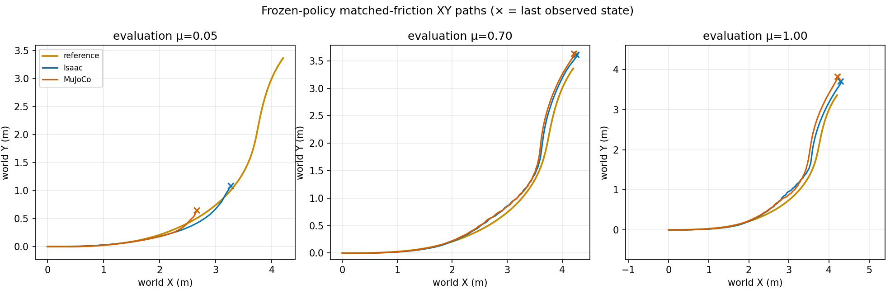
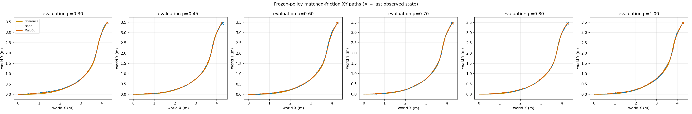
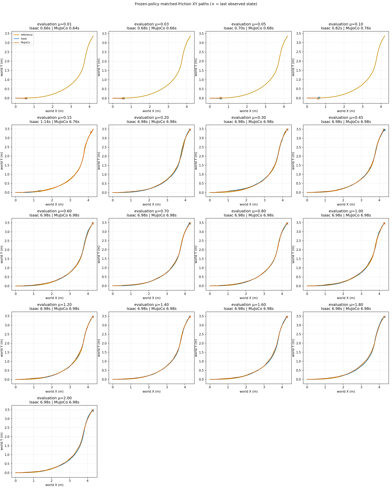
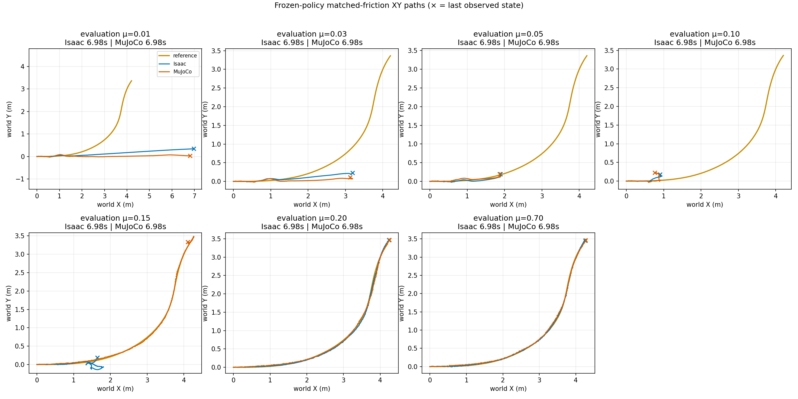
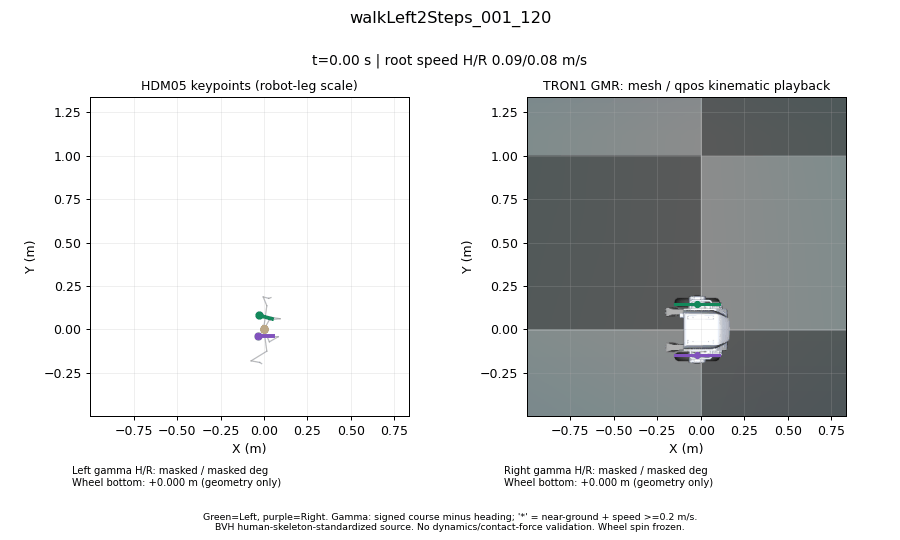
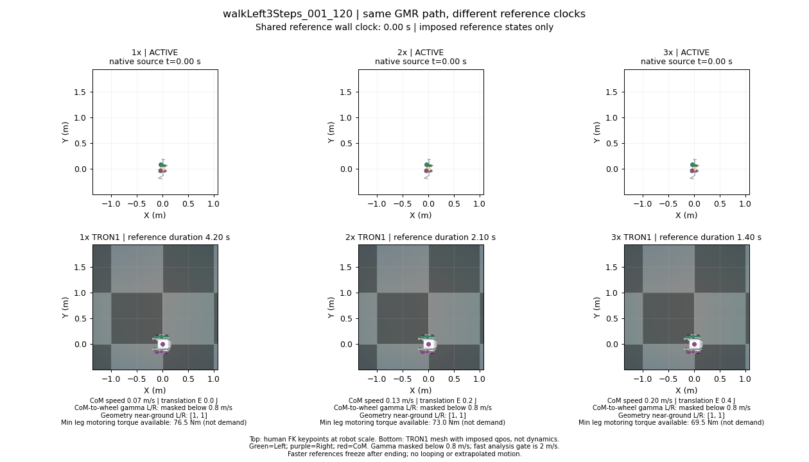

# TRON1 sliding-angle / XY failure analysis

This repository separates **reference geometry**, **BeyondMimic-style policy
training**, and **fixed-friction Isaac↔MuJoCo validation**. The question is:
for a high course-to-wheel/foot heading offset, at which validation contact
frictions does the learned TRON1 wheel-foot policy develop a large horizontal
position error? Views are top-down only. Height/flight is not a failure gate.

**Candidate selection update:** lateral and crossover steps are no longer active
drift candidates. Their old GMR/rate-sweep results remain geometric-offset controls.
We now seek sustained turning with translational momentum and explicitly report
speed loss, rather than selecting on angle alone. The
[new-source audit](results/2026-10-14-drift-candidate-search.md) checks traveling
dance turns, an alpine-skiing supplement and continuous car-drift implementations;
it does **not** claim a newly qualified human drift or start policy training.

**Current focus (2026-10-16):** compare PPO, SAC and NMPC on speed-retaining
turning, followed by fixed-friction Isaac↔MuJoCo validation. Human work remains
paused. `drift_drl_traj4` is the **primary large-angle turn**;
`doa_sa29_scale2` is a **separately reported S-avoidance supplement**, not a second
trial of the same turn. Both are hash-locked in
[`config/controller_references.json`](config/controller_references.json).
Current robot-scale reference speeds are roughly 1 m/s; these inputs alone do
not establish a high-speed capability result or dynamic similarity to a car.

The [completed historical refinement](results/2026-10-15-car-sim2sim-boundary.md) places
the sampled Isaac XY-verdict change between µ=0.16 and 0.18, versus µ=0.14 and
0.15 in MuJoCo, and includes top-down animation plus divergence-onset timing.

**Height-smooth task revision:** the new
[`car_drift_height_smooth_task.json`](config/car_drift_height_smooth_task.json)
removes absolute-height tracking and height-based stopping from **new PPO/SAC
training**, replacing them with vertical-acceleration smoothness. Archived
policies/results retain their original training objectives and are not relabeled.

Primary PPO and SAC training have now completed with **12,288,000 transitions
each**, followed by the same 17-point fixed-friction validation grid. PPO has
below-screen XY error in both engines at sampled µ=0.30–2.00; the first SAC
configuration exceeds the XY screen throughout its grid. These are one-seed
results, not evidence that SAC is intrinsically unsuitable. Normalization,
optimization reuse and compute differ despite equal environment interactions.
See the [PPO grid](results/2026-10-15-primary-ppo-height-smooth-grid.md),
[PPO nominal pair](results/2026-10-15-primary-ppo-nominal-pair.md) and
[SAC nominal pair](results/2026-10-16-primary-sac-nominal-pair.md).
The [completed SAC grid](results/2026-10-16-primary-sac-height-smooth-grid.md)
is retained even though nominal tracking is unsuccessful.

**NMPC development is not frozen.** The initial full-turn nominal controller
has core XY RMSE 0.324 m in Isaac and 0.280 m in MuJoCo at µ=0.70, with all
solver calls exceeding 20 ms. The next step is to improve nominal tracking
before freezing its settings and running the friction grid. Other coefficients
are not NMPC tuning data. Keep the reference speed, nonzero sideslip target and
height-free objective unchanged; neither leaving the ground nor heading offset
alone is a failure gate. The initial NMPC results are diagnostics, not a final
PPO/SAC/NMPC ranking. The
[untuned nominal NMPC pair](results/2026-10-16-primary-nmpc-nominal-pair.md)
includes the top-down comparison and bounded one-step model audit.

The current TRON1 model is usable as a nonlinear shooting predictor: 15 qpos
coordinates, 14 generalized velocities (28-dimensional tangent state), and
8 bounded leg/wheel actions. This is not a steer/throttle car model. A short
reproducible offline probe is available in
[`scripts/probe_mpc_feasibility.py`](scripts/probe_mpc_feasibility.py):

```bash
python scripts/probe_mpc_feasibility.py \
  --model /path/to/tron1_model.xml --motion /path/to/drift/motion.npz \
  --contract /path/to/policy_contract.json \
  --maxiter 80 --output-dir outputs/mpc_feasibility_probe
```

It checks complete-action transition derivatives and solves nominal and
shared-control three-friction scenario problems at two reference states.
The probe uses a 0.1 s horizon and a height-free **diagnostic surrogate cost**,
not the complete PPO reward, and does not execute the selected actions in a
closed-loop benchmark. Solver success is not evidence of whole-turn tracking,
20 ms real-time operation, or guaranteed robust MPC. Archived PPO and the old
TVLQR/CEM prototype retain their old objectives and are not matched baselines.
The [2026-10-15 feasibility record](results/2026-10-15-mpc-feasibility.json)
contains four converged short optimizations, input hashes and derivative
sensitivity checks. Their local solve times were about 1.0–14.9 s, not 20 ms.

The new implementation has three distinct, not-yet-ranked paths:

- PPO: [`train_beyondmimic_style.py`](scripts/train_beyondmimic_style.py), including
  an explicit `--smoke-only --iterations 1` mode that cannot pass as full training.
- SAC: [`train_sac_tracking_isaac.py`](scripts/train_sac_tracking_isaac.py), same
  51-D actor / 120-D privileged critic / 8-action environment and BM events.
  Actor/critic widths and ELU match PPO; SAC keeps explicit fixed identity
  normalization while PPO uses RSL online normalization. SAC preserves dt-scaled
  rewards, starts temperature at `0.2 * dt`, and records its update/replay budget.
- NMPC: [`run_nmpc_tracking.py`](scripts/run_nmpc_tracking.py), independent bounded
  CEM with the [new reward objective](scripts/nmpc_tracking_objective.py), not old
  TVLQR costs or learned-policy warm starts. Fixed prediction scenarios never
  read the validation plant coefficient. The
  [Isaac bridge](scripts/run_nmpc_tracking_isaac.py) replans from measured Isaac
  state using the same **MuJoCo predictor**; it is not action replay or an Isaac
  prediction model. Finite scenarios are not a robustness proof.

The earlier integration milestone comprised PPO one update iteration, SAC
32 control steps/29 updates with 16 correctly captured timeout successors,
and NMPC 0.20 s without reaching the turn core. Same-state Isaac/NumPy reward
parity passed 16 snapshots across 15 terms (max dt-scaled reward error
`3.70e-8`); this does not make the engines' contact physics equivalent.
Use [`materialize_controller_source.py`](scripts/materialize_controller_source.py)
for the audited full-horizon PPO/SAC actor loader. Smoke actors remain explicitly
untrained and are rejected by the formal validation driver. The untrained SAC
export also completed both recording pipelines; 350 reconstructed Isaac
observations had maximum absolute error `3.34e-6`. That actor loses posture:
complete recording is not successful tracking. The sanitized
[integration record](results/2026-10-15-controller-integration.json) separates
these interface checks from the later full-turn results and includes artifact hashes.

The optional native NMPC predictor is pinned to Linux MuJoCo 3.8.1 and uses
one persistent CPU worker with process-level fatal-error isolation; it never
automatically builds or restarts a failed worker. A MuJoCo warning rejects the
whole affected candidate batch/scenario, stricter than the Python predictor.
The [backend parity record](results/2026-10-15-native-backend-parity.json)
compares only 10 control steps (0.20 s, H=3, four candidates), not a turn:
37 non-timing trace fields are identical. Native controller-call median/P95
were 18.73/20.92 ms, with **2/10 calls exceeding 20 ms**. These uncontrolled
WSL measurements include worker IPC but exclude model/worker startup; they
do not verify real-time operation, inject solve delays into the plant, or
establish a 20 ms budget for the full H=15, 64-candidate configuration.
Use a Python environment with `mujoco==3.8.1` and a C++17 compiler. Build
explicitly in a new directory, then select the backend explicitly:

```bash
CUDA_VISIBLE_DEVICES='' python -c 'import sys; sys.path.insert(0,"scripts"); from nmpc_native_batch import build_native_library; print(build_native_library("outputs/NEW_native_build_directory"))'

CUDA_VISIBLE_DEVICES='' python scripts/run_nmpc_tracking.py \
  --model /path/to/tron1_model.xml \
  --motion /path/to/drift_drl_traj4/motion.npz \
  --contract /path/to/policy_contract.json \
  --reference-id drift_drl_traj4 --plant-mu .18 --prediction-mu-scenarios .7 \
  --horizon-steps 3 --control-blocks 3 --candidates 4 --iterations 1 --elite-count 2 \
  --max-policy-steps 10 --prediction-backend native \
  --native-library outputs/NEW_native_build_directory/libtron1_nmpc_batch.so \
  --output-dir outputs/NEW_parity_directory/native
```

Use the same inputs and options with `--prediction-backend python`, omit
`--native-library`, and choose a separate new output directory for the Python
comparison. Licensed robot assets, source motion and compiled binaries are
not included; provide the hash-locked reference and compatible local inputs.

## Experiment contract

1. Select car or human demonstrations with a sustained, nontrivial signed
   course-to-wheel/foot angle. `γ = wrap(atan2(v_y,v_x) − wheel/foot heading)`.
   Do not equate this geometric angle with measured tire contact-patch slip.
2. Car: retain the source XY/yaw trajectory, then measure the **retargeted**
   TRON1 wheel rolling-plane headings. The pinned open
   [`drift_drl/traj_4` source](upstream/drift_drl/code/ref_trajectory/traj_4.csv) has
   vehicle slip state but does **not** provide measured individual wheel steer
   angles. Thus its robot wheel headings are retarget output, not source sensor
   readings. Use this clip as the primary; pinned [DOA](upstream/DOA) `sa_traj29`
   is the selected high-angle S-avoidance supplement, still without a trained
   tracking policy. Do not pool their success statistics. The original primary reference
   is hash-locked in [`config/car_reference_lock.json`](config/car_reference_lock.json):
   at moving source frames its retargeted left-wheel offset has mean absolute
   11.27° and peak absolute 27.22°.
3. Human: use pinned [GMR](upstream/GMR) to retarget pelvis plus both ankles to
   TRON1 with `scripts/hdm05_gmr.py`. In the HDM05 BVH experiment, human headings
   use **ankle-to-toe-base joint pivots**, not heel markers. Retain human-to-wheel
   heading offsets as an auxiliary sidecar; compare each foot independently and
   mask low-speed / near-ground-proxy samples. The older
   `attach_human_wheel_offset.py` remains a separate heel/toe-marker utility and
   is not used to relabel joint pivots as measured markers. TRON1 WF has no
   independent wheel-yaw joint, so a human foot heading offset cannot be
   silently imposed as a realized joint command. Human source screening
   previously covered **HDM05 slow lateral steps, crossover steps and walking turns**.
   Lateral/crossover clips are now excluded as active drift candidates; running
   and skating remain excluded. Human work is currently **retarget-only**; there is no
   trained human tracking policy or human sim2sim result yet. Earlier skating
   IK/interaction-mesh previews are not substituted as GMR results. The previous
   FS-Jump3D submodule is retained for historical provenance, not selected here.
   The [re3data API audit](results/hdm05_registry_api/re3data_sources.json)
   distinguishes repository metadata from downloadable motion samples. The
   [download report](results/2026-10-14-hdm05-downloads.md) records 180 locally
   downloaded walking/turning BVH derivatives and 15 ASF/AMC mirror clips;
   the BVH source already uses human-to-human IK skeleton standardization and
   is not a TRON1 GMR result or an unprocessed foot-heading measurement.
4. Train a new tracking PPO with the official BeyondMimic event ranges, mapped
   to TRON1 (`scripts/train_beyondmimic_style.py`). At startup, sample robot
   static friction U[0.3,1.6], dynamic friction U[0.3,1.2], restitution
   U[0,0.5] in 64 buckets. Also use the upstream ±0.01 rad joint default
   offset on the six position-controlled leg joints, base CoM range (mapped
   from G1 torso to TRON1 `base_Link`), and
   1–3 s velocity pushes. These are **training** randomizations. TRON1's body,
   action, wheel handling, motion and drift rewards remain adaptations, not an
   exact G1 reproduction. The ground coefficient is fixed at 1.0 during training,
   matching the upstream nominal value. The frozen TRON1 checkpoint retains
   its `average` ground material combine rule; the official BeyondMimic ground
   uses `multiply`. Thus matching event ranges alone does not make the actual
   paired contact distribution identical. The earlier worst-substep
   ground-load reward is excluded: its audited mass/cache implementation only
   permits the historical fixed event set and is incompatible with new CoM
   randomization. The selected compatible reward profile is
   [`config/car_drift_beyondmimic_task.json`](config/car_drift_beyondmimic_task.json).
   The new matched-controller experiments instead use
   [`config/car_drift_height_smooth_task.json`](config/car_drift_height_smooth_task.json),
   retaining the same event ranges while replacing absolute-height tracking
   with bounded vertical-acceleration smoothness. Its original description says
   "untrained" because it records the revision's initial state, not current
   training completion; the hash-locked file is preserved.
5. Freeze the trained actor and evaluate single deterministic episodes per
   coefficient in Isaac/PhysX and MuJoCo. Turn off random events for validation.
   The initial grid used equal static/dynamic
   `µ = 0.30, 0.45, 0.60, 0.70, 0.80, 1.00` in both engines. The isolated
   validation-source extension supports a wider 17-point grid from `0.01`
   through `2.00`; values outside the training material ranges deliberately
   test extrapolation. Subsequently test `(µ_static,µ_dynamic)=(1.4,1.0)` and
   `(1.6,1.2)` once both evaluators support and read back distinct components.
   This is a **grid of fixed evaluation cases**, not a second policy training
   distribution. Equal numeric coefficients are not equal calibrated tire laws.
6. For every matched case, plot reference/Isaac/MuJoCo root XY with an equal
   XY aspect ratio. Report reference-tracking error in each engine and the
   Isaac↔MuJoCo XY difference separately. An early stop is right-censored;
   never extrapolate or splice after reset. Screen complete 1.44–4.00 s turn
   cores with reference-XY RMSE >0.15 m or peak >0.30 m. These are inherited
   *exploratory* limits, not physical drift thresholds. Report post-core drift
   separately. The numeric specification is in
   [`config/evaluation_friction.json`](config/evaluation_friction.json).

The pinned original source is [BeyondMimic's official EventCfg](upstream/whole_body_tracking/source/whole_body_tracking/whole_body_tracking/tasks/tracking/tracking_env_cfg.py).
Its robot-material randomization runs at startup; it is not an evaluation
event. See also the [official BeyondMimic paper](https://arxiv.org/abs/2508.08241)
and [GMR implementation](https://github.com/YanjieZe/GMR).

## Available result: historical fixed-friction-policy baseline

The old TRON1 actor was trained at `µ=0.15` with motor randomization, **without
BeyondMimic friction randomization**. Three previously recorded evaluation
pairs are published here only as a baseline for the new protocol. This does
not establish a threshold across the BeyondMimic training range.

| Fixed validation µ | Isaac core reference XY RMSE | MuJoCo core reference XY RMSE | Matched sim2sim core XY RMSE | Status |
| ---: | ---: | ---: | ---: | --- |
| 0.05 | unavailable | unavailable | unavailable | Both stop before core end; observed overlap peak engine gap 0.232 m |
| 0.70 | 0.0985 m | 0.1030 m | 0.0153 m | Full core; no large reference XY screen |
| 1.00 | 0.1502 m | 0.1510 m | 0.0455 m | Full core; both narrowly exceed 0.15 m reference XY screen |



The plot ends each engine path at its actual final observed state. Compact
[XY-only native traces](results/car_baseline/xy_trace.npz),
[machine-readable metrics](results/car_baseline/summary.json), and
[input SHA-256/readback provenance](results/car_baseline/xy_trace.provenance.json)
support independent re-analysis. No third-party raw mocap or vehicle CSV is
redistributed here.

## Initial result: BeyondMimic-randomized car policy

The new 512-environment, 1000-iteration policy used the pinned BeyondMimic
material, joint-offset, CoM and push events described above. The same frozen
actor was evaluated at six fixed equal static/dynamic coefficients in both
engines. All twelve rollouts completed the 1.44–4.00 s turn core; none crossed
the exploratory large-root-XY screen in the tested `µ=0.30–1.00` grid. The
largest Isaac reference-core XY RMSE was 0.0436 m, the largest MuJoCo value
was 0.0426 m, and the largest Isaac–MuJoCo core XY RMSE was 0.0272 m. This
does **not** locate a friction failure boundary or prove tire-patch sliding.



The [formal experiment report](results/2026-10-14-bm-friction-grid.md),
[training manifest](results/car_bm_dr_seed42/training_manifest.json),
[full metric summary](results/car_bm_dr_seed42/summary.json), and
[compact trajectories](results/car_bm_dr_seed42/xy_trace.npz) are public.
Recompute the metrics and figure from only those compact traces:

```bash
python scripts/analyze_friction_grid.py \
  --trace results/car_bm_dr_seed42/xy_trace.npz \
  --expected-summary results/car_bm_dr_seed42/summary.json \
  --output-dir outputs/replayed_bm_grid
```

The trained checkpoint is retained on the authorized remote machine; the
public repository provides the training and validation code plus compact
outputs, but not the licensed robot model or third-party raw data.

## Expanded validation result: µ=0.01–2.00

The same actor was evaluated at 17 fixed equal static/dynamic coefficients.
All sampled cases from `µ=0.20` through `2.00` completed the whole reference
in both engines and stayed below the exploratory core XY screens. The largest
paired core XY RMSE was 0.0489 m at `µ=0.20`.

At `µ=0.01–0.10`, both engines stopped before the turn core; `µ=0.15` stopped
early in Isaac and after the core in MuJoCo. Every stop was the inherited
vertical-anchor-error condition (>0.35 m), which censors later data and is
not an XY failure verdict. Nevertheless, already-recorded reference XY peaks
at `µ=0.05` and `0.10` reached 0.312–0.427 m before the core. The wider sweep
does not establish a complete-turn XY failure boundary.



The [expanded experiment report](results/2026-10-14-wide-friction-grid.md)
includes all metrics, stopping causes and the simulator-free replay command.

## Full-horizon XY result after observing pose predicates

The follow-up retains the original pose-condition flags as diagnostics and
records the complete 6.98 s reference without stopping on those flags. The
same actor has large core reference-XY errors in both engines at `µ≤0.10`.
At `µ=0.15`, Isaac's core reference XY RMSE is 1.8932 m and MuJoCo's is
0.0568 m, giving a 1.9376 m sim2sim gap. The `µ=0.20` and `0.70` controls
reproduce the earlier metrics exactly. These low-friction continuations
include failed posture; the XY result describes tracking failure, not active
controlled slip.



The [full-horizon report](results/2026-10-14-full-horizon-friction-grid.md)
contains all seven cases, predicate-onset diagnostics and reproduction commands.

## HDM05 initial result: low-speed GMR geometry control

Ten predeclared clips from actor `bd` have been retargeted with the pinned
upstream GMR two-stage algorithm (3,446 native-clock frames), then replayed
beside their human FK keypoints using the actual TRON1 mesh. These are
**kinematic results, not trained policies or human sim2sim rollouts**.



At the separately labeled slow-speed sensitivity threshold of 0.2 m/s, mean
absolute wheel-axis offsets in paired near-ground samples are approximately
82–84° for lateral steps and 60–65° for crossover steps, versus 6–16° for the
two circular-walking clips. These offsets are candidate learning features,
**not mismatch penalties or demonstrated controlled sliding**. The original
0.8 m/s criterion is retained: seven clips have no paired samples at that
speed, so the slow-speed result is not a same-speed comparison with the car.
Source distances/speeds are normalized to robot leg length, not claimed as
measured human SI units. The BVH source has pre-existing human-to-human IK
processing, and its foot headings have not been checked against originals.

The [experiment report and all ten animations](results/2026-10-14-hdm05-gmr.md)
include left/right angles, near-ground masks, exact metrics and reproduction.
Saved poses and FK-derived traces are published; raw BVH and robot meshes are
not redistributed.

## HDM05 time-scale experiment: higher momentum is not automatically a drift

All ten frozen GMR paths were tested at 1x/2x/3x physical reference clocks
(30 kinematic prechecks). Three-times lateral-three-step motion reaches
CoM speed P95 1.93 m/s and planar translation-energy P95 41.43 J, but leaves
only 5.58 Nm nominal motoring torque at its 13.95 rad/s peak leg speed. Its
longest >=2 m/s, >=20-degree, near-ground window is only 0.025 s.
The 3x circle references are faster, but peak leg speeds exceed the nominal
no-load speed. Availability is not demanded torque or proof of failure.



Time compression preserves path geometry: the lateral/crossover cores still
change travel direction by only about 4–15 degrees. None of the 30 references
passes the exploratory sustained-speed/angle/turn prechecks. They remain
reference stress tests, not demonstrated high-speed drifting. The
[rate-sweep report](results/2026-10-14-hdm05-rate-sweep.md) includes six shared-
clock animations, motor margins, CoM estimates and model-free metric replay.
No human policy, physical rollout or friction sweep was performed here.

## Reproduce what is currently public

```bash
git clone --recurse-submodules https://github.com/Shukashuki/tron1-sliding-analysis.git
cd tron1-sliding-analysis
python -m pip install -r requirements.txt
python -m pytest -q tests
python scripts/analyze_saved_xy.py \
  --trace results/car_baseline/xy_trace.npz \
  --output-dir outputs/replayed_topdown
```

The trace-replay command recreates `summary.json` and `topdown.png` without
Isaac or MuJoCo. With a local full source checkout **at the archived experiment
revision**, `--source-root /path/to/tron1-learning-from-human` imports the
original physics traces, verifies friction/readback and hashes, and regenerates
the compact trace too. The `upstream/tron1-learning-from-human` submodule is
pinned to its already-public commit. Its base Isaac evaluator can be transformed
into the byte-exact audited friction evaluator (input/output hashes are checked)
without publishing the large unpublished historical branch:

```bash
python scripts/materialize_friction_evaluator.py \
  --source-root upstream/tron1-learning-from-human
```

This adds one new, untracked evaluator file inside the local source submodule;
it does not change pinned source files. Archived checkpoints and licensed TRON1
assets are not included, so full **historical baseline** physics reruns still
require those inputs. The initial protocol can use the generated evaluator and
public source code once its separately licensed asset/motion inputs are
provided. The unpublished historical branch was not bulk-pushed because it
includes many other outputs beyond this experiment.

For a **byte-exact formal-run** source checkout, the remote snapshot's drift
reward module predates a later optional restitution-profile addition in the
public submodule. The formal task profile does not use that option, so it does
not change this run's reward or material event. Apply only the audited small
patch inside a fresh, dedicated clone to reproduce the manifest's module
SHA-256 (this intentionally makes that clone's submodule working tree dirty):

```bash
cd upstream/tron1-learning-from-human
git apply ../../patches/tron1_drift_formal.patch
cd ../..
```

The patch is tested against the pinned base and yields SHA-256
`5eb40c9b3c14f5bd5c59c9861c1414ae8ac1b219ff0dd70591f2c6fe0bb5344c`.

The [reference catalog](config/controller_references.json) selects
`drift_drl_traj4` as the primary large-angle turn and `doa_sa29_scale2` as a
**separate S-avoidance supplement**; never pool their success statistics.
The primary evaluation core is 1.44–4.00 s. The supplement uses its demonstrated
0–3.14 s interval, with descriptive high-offset windows 0.78–1.54 s and
1.88–3.04 s. Synthetic stopping/tail frames are outside both evaluation cores.
Source CSVs come from the pinned [drift_drl](upstream/drift_drl) and
[DOA](upstream/DOA) submodules (DOA commit `05ea8d643ea60b4649a59e2988cd1ae21719f9f4`).
These are CARLA simulations with reconstructed clocks, not physical-car mocap.

After initializing the source submodules, the
[offline wrapper](scripts/prepare_controller_reference.py) reuses the pinned
decoder/retarget/export functions without network requests, CARLA, rendering
or dynamics stepping. Supply the hash-matched **original export MJCF**, its
referenced meshes, and the **original unmerged URDF** explicitly; licensed
robot assets are not included and a configured runtime XML is not a substitute:

```bash
python scripts/prepare_controller_reference.py \
  --reference-id drift_drl_traj4 \
  --model /path/to/licensed/robot.xml \
  --urdf /path/to/licensed/upstream/robot.urdf \
  --output-dir outputs/reproduced_primary

python scripts/prepare_controller_reference.py \
  --reference-id doa_sa29_scale2 \
  --model /path/to/licensed/robot.xml \
  --urdf /path/to/licensed/upstream/robot.urdf \
  --output-dir outputs/reproduced_supplement
```

Each new directory gets `reproduction_report.json`; existing output is never
overwritten. In the [audited single-pass reproduction](results/2026-10-15-reference-reproduction.json),
SA29 matched both frozen NPZ byte hashes. Traj4 did **not**: generalized
coordinate/velocity differences were at most `3.56e-13` in native units, but
the cause was not established and numerical closeness does not satisfy its
byte lock. The wrapper exits **2** on mismatch; it never changes the catalog
or the [original primary lock](config/car_reference_lock.json). Continue using
the separately provided, hash-matched frozen primary files for comparison;
do not silently substitute the newly generated primary.

Both policy trainers and the formal `run_car_validation.py` driver default to
the primary. To select the supplement, pass `--reference-id doa_sa29_scale2`
with its matching motion/reference files and separately trained checkpoint.
Trainer preflight verifies motion byte identity before starting Isaac; this
identity-only check is not paired-reference, asset or dynamics validation.

For the wider validation range, create a separate source snapshot. This copies
only the scripts, training code and configuration, extends the evaluator and
drift-profile validation bounds to `[0.01,2.0]`, and records source/output
hashes. It preserves the original source checkout and the trained checkpoint:

```bash
python scripts/materialize_wide_friction_source.py \
  --source-root upstream/tron1-learning-from-human \
  --output-dir outputs/wide_friction_source
```

For a new car-policy run, supply the source checkout, the licensed TRON1 USD,
the 50 Hz retargeted drift motion, and the drift task profile to
`scripts/train_beyondmimic_style.py` inside an Isaac Lab 2.3 / RSL-RL 3
environment. A representative invocation is:

The next-task profile below is distinct from the archived
`car_drift_beyondmimic_task.json`. The trainer's
[`height_smoothness.py`](scripts/height_smoothness.py) adapter changes anchor and
body position rewards and body linear-velocity rewards to **XY only**, removes
the base/wheel Z-error termination terms, and removes any optional wheel
zero-vertical-speed penalty. It adds the soft cost
`-0.1 * (1 - exp(-(a_z / 5 m/s²)^2))`, where
`a_z = (v_z[t] - v_z[t-1]) / 0.02 s` uses base-Link COM world velocity at the
50 Hz control clock. Constant vertical speed is not penalized; acceleration
is, regardless of height. Reset samples are excluded and environments keep
independent history. These weight/scale values are initial settings, not tuned
results, and this signal is not physics-substep acceleration or jerk.

The 0.75 m reference is still used for initialization; there is no height
reward, band or height abort. The actor observation layout (including reference
height information), reference leg posture, orientation tracking, tilt safety,
joint limits, contact rewards and action-rate penalty stay unchanged. Therefore
the robot is not free of posture/stability preferences, and global Z invariance
does not imply that every leg configuration is dynamically equivalent. The
BeyondMimic DR recipe is unchanged. The manifest records the new objective
contract and adapter hash. **No full trained baseline has yet been validated
for this revision.**

```bash
export TRON1_BEYONDMIMIC_ROOT="$PWD/upstream/whole_body_tracking"
python scripts/train_beyondmimic_style.py \
  --source-root /path/to/tron1-learning-from-human \
  --motion-file /path/to/drift/motion.npz \
  --asset-path /path/to/WF_TRON1A.usda \
  --task-profile config/car_drift_height_smooth_task.json \
  --output-dir outputs/car_height_smooth_seed42 \
  --reference-id drift_drl_traj4 \
  --num-envs 512 --iterations 1000 --smoke-steps 0 --seed 42 --device cuda:0 --headless
```

For SAC, use `scripts/train_sac_tracking_isaac.py` with the same reference,
asset, task profile and source arguments, a separate output directory, and
`--num-envs 512 --policy-steps 24000` (no `--iterations` or `--smoke-steps`).
Both budgets contain 12,288,000 training transitions. SAC's default schedule
has 10,240 rounded warmup transitions and 23,981 updates; equal interactions
do not mean equal optimizer compute. Each manifest records the requested
budget, source hashes, reference stratum, normalization and native CUDA audit;
the final status records actual collected transitions. Finishing training does
not establish successful turning; use the frozen-policy validation below.

Do not label a one-iteration smoke test as a trained policy. Export and validate
the final actor's observation/action contract before running the fixed-friction
grid. The isolated evaluation source above supports equal static/dynamic
`µ=0.01–2.0`. Distinct static/dynamic pairs still require explicit support.
For the new height-smoothness policy, use an isolated **full-horizon** source
from `materialize_controller_source.py` and pass `--full-horizon-diagnostic`
to the validation driver; it rejects historical Z-stop evaluation and rejects
an old actor mislabeled with the new task profile. Full-horizon evaluation
observes all original pose predicates (including tilt) without stopping; this
differs intentionally from training, where tilt safety remains. Keep the
checkpoint, runner configuration and task profile from the same new run.
The command below reproduces the **archived** profile, not the new revision:

```bash
python scripts/run_car_validation.py \
  --source-root outputs/wide_friction_source \
  --motion-file /path/to/drift/motion.npz \
  --reference-file /path/to/drift/robot_reference.npz \
  --asset-path /path/to/WF_TRON1A.usda \
  --mujoco-model /path/to/tron1_model.xml \
  --checkpoint outputs/car_bm_dr_seed42/model_final.pt \
  --runner-config outputs/car_bm_dr_seed42/runner_config.json \
  --task-profile config/car_drift_beyondmimic_task.json \
  --output-dir outputs/car_fixed_friction_grid --device cuda:0
```

The driver requires a completed training status, checks the BeyondMimic
material recipe and source-motion hashes, runs both engines at each fixed µ,
verifies Isaac policy-rate observations before MuJoCo playback, then generates
`analysis/topdown.png` and `analysis/summary.json`. It will not overwrite an
existing grid. Its default equal-friction grid is
`0.01, 0.03, 0.05, 0.10, 0.15, 0.20, 0.30, 0.45, 0.60, 0.70, 0.80, 1.00,
1.20, 1.40, 1.60, 1.80, 2.00`; use `--mu` to select fewer cases. For human motion, first supply
one valid GMR retarget plus time-aligned bilateral foot markers; then run:

```bash
python scripts/attach_human_wheel_offset.py \
  --gmr-reference /path/to/gmr/robot_reference.npz \
  --foot-markers /path/to/aligned_foot_markers.npz \
  --model /path/to/WF_TRON1A/mujoco/robot.xml \
  --source-to-robot-yaw-deg 0 \
  --output-dir outputs/human_heading_sidecar
```

The marker NPZ must provide `time_s`, `heel_xyz_m[T,2,3]`, and
`toe_xyz_m[T,2,3]`, with L/R order and the exact GMR sample clock. Supply the
actual coordinate alignment angle instead of using the illustrative zero if
the source axes differ. Human GMR policy and sim2sim results remain pending;
the completed car-policy sim2sim result is reported above.
