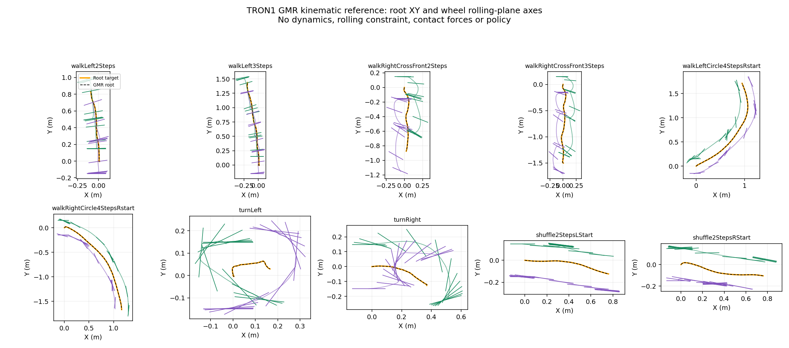

# HDM05 → TRON1: GMR and bilateral heading features

## Result

Ten predeclared clips from one actor (`bd`) completed real upstream GMR
retargeting: 3,446 frames, with no policy training or dynamics rollout. Lateral
and crossover steps are the strongest high-angle candidates in this first
sample; circular walking and shuffling provide lower-angle controls. This is
a **retarget-only geometry experiment**, not a human sim2sim result.

## Source and method

The [download audit](2026-10-14-hdm05-downloads.md) identifies the HDM05 source
through re3data and records the public Holden archive. Its BVH clips already
use human-to-human Jacobian IK skeleton standardization. Consequently these
are **processed-reference features**, not verified original foot axes or
sensor-measured slip. The 15 separately downloaded sneak AMC clips were not
substituted for the lateral/turning clips and are not used in this experiment.

The exact [GMR submodule](../upstream/GMR) commit is
`bb1bbe40774794fceb2a7c579a3464a28e68c844`. Both upstream retarget stages run
unmodified on every native BVH sample. A module-local compatibility shim routes
GMR's older positional `limits` argument to Mink 1.2's `limits` keyword; it
does not replace the GMR algorithm. Source hashes, settings and package
versions are in [experiment.json](hdm05_gmr_bd/experiment.json).

The pinned GMR BVH reader/FK is used directly and its Euler composition is
independently checked against SciPy. Here BVH **joint pivots** `lfemur`,
`ltibia`, `lfoot`, `ltoes` mean hip, knee, ankle, toe base, respectively.
They are not the same endpoint semantics as ASF segment names. No heel
marker, sole normal or measured contact force is invented.

One fixed coordinate rotation makes Z-up, followed by initial heading
alignment. Native BVH length units are not assumed to be centimeters:
`s = mean(robot hip–knee–wheel length) / mean(source hip–knee–ankle length)`.
Thus reference distances, heights and speeds are **at robot leg scale**, not
an anatomical SI calibration. The first clip uses 0.0408109312 m/source-unit.
The native frame interval is 0.008333 s; samples are not retimed.

For scaled pelvis `r*` and wheel-center targets `w_i*`, the mapping is:

```text
r*(t)   = r0 + s [p(t) − p(0)]
c_i     = w_i0 − r0 − s [a_i(0) − p(0)]
w_i*(t) = r*(t) + s [a_i(t) − p(t)] + R(t) R(0)^T c_i
```

`p` and `a_i` are aligned human pelvis/ankle pivots; `R` retains relative
pelvis rotation after a constant initial mounting calibration. GMR optimizes
the floating root and six leg joints using pelvis pose and bilateral ankle
positions. There is no standalone custom Mink-baseline solve. Wheel spin is
held at zero; wheel orientation is robot FK, not a human ankle-orientation
command. No per-frame grounding, rolling, collision-avoidance or leg-speed
constraint is imposed.

## Heading and near-ground protocol

For each side independently:

```text
gamma_human_i = wrap180(course_of_reference_pelvis − ankle_to_toe_heading_i)
gamma_robot_i = wrap180(course_of_GMR_root − wheel_rolling_plane_heading_i)
axial_gamma   = wrap90(gamma)     # wheel/foot axis is compared modulo 180°
```

Signed directed angles are retained in traces; mean absolute **axial** angles
rank the candidates without calling reversed travel a 180° sideslip. Human
and robot courses are computed from their own XY paths, not conflated.
The foot-heading-minus-wheel-heading sidecar is retained as a feature, **not
a mismatch or an independent wheel-yaw command**. Additional ankle-velocity
and wheel-center-velocity angles have separate 0.15 m/s masks; they are not
contact-patch slip measurements.

Human near-ground: the lower ankle/toe-base height is within 0.10 m of one
shared, constant fifth-percentile floor proxy. Robot near-ground: the exact
tilted collision-cylinder bottom is between −0.02 and +0.03 m relative to
the model floor. Neither mask is measured stance. Penetration is a geometry
diagnostic, **not an episode failure condition**; no frames are terminated.

The common speed threshold remains **0.8 m/s**. Because most clips are slow,
a separately labeled **0.2 m/s sensitivity** is also reported. The table below
uses only time-aligned samples valid for **both** human and robot masks on the
given side. It must not be presented as a same-speed car comparison. A high
offset event requires |axial gamma| ≥20° for at least 0.20 s of contiguous
valid samples; masked gaps are never bridged.

## Results and synchronized top-down playback

Table angles are mean absolute axial degrees, left/right. Counts are paired
near-ground moving samples. Animations place human FK keypoints beside the
actual TRON1 mesh replay; no dynamics is stepped. Green is left, purple right.

| Action / animation | Human L/R at 0.2 m/s | GMR wheel L/R at 0.2 m/s | Paired samples at 0.2 m/s | Paired samples at 0.8 m/s |
| --- | ---: | ---: | ---: | ---: |
| [Lateral 2 steps](hdm05_gmr_bd/renders/HDM_bd_walkLeft2Steps_001_120.gif) | 81.7 / 78.6 | 84.1 / 83.4 | 153 / 185 | 0 / 0 |
| [Lateral 3 steps](hdm05_gmr_bd/renders/HDM_bd_walkLeft3Steps_001_120.gif) | 81.9 / 78.7 | 83.2 / 82.2 | 242 / 285 | 13 / 15 |
| [Crossover 2 steps](hdm05_gmr_bd/renders/HDM_bd_walkRightCrossFront2Steps_001_120.gif) | 58.4 / 65.6 | 64.5 / 64.4 | 203 / 184 | 0 / 0 |
| [Crossover 3 steps](hdm05_gmr_bd/renders/HDM_bd_walkRightCrossFront3Steps_001_120.gif) | 54.5 / 64.3 | 59.9 / 63.0 | 350 / 325 | 0 / 0 |
| [Left circular walk](hdm05_gmr_bd/renders/HDM_bd_walkLeftCircle4StepsRstart_001_120.gif) | 14.0 / 11.9 | 10.3 / 15.7 | 219 / 165 | 168 / 126 |
| [Right circular walk](hdm05_gmr_bd/renders/HDM_bd_walkRightCircle4StepsRstart_001_120.gif) | 12.0 / 3.5 | 9.1 / 6.4 | 216 / 205 | 106 / 113 |
| [Left turn](hdm05_gmr_bd/renders/HDM_bd_turnLeft_001_120.gif) | 40.9 / 72.2 | 78.4 / 78.4 | 40 / 40 | 0 / 0 |
| [Right turn](hdm05_gmr_bd/renders/HDM_bd_turnRight_001_120.gif) | 41.9 / 44.6 | 47.9 / 35.0 | 90 / 10 | 0 / 0 |
| [Left-start shuffle](hdm05_gmr_bd/renders/HDM_bd_shuffle2StepsLStart_001_120.gif) | 2.7 / 6.1 | 12.0 / 8.1 | 45 / 159 | 0 / 0 |
| [Right-start shuffle](hdm05_gmr_bd/renders/HDM_bd_shuffle2StepsRStart_001_120.gif) | 10.6 / 7.2 | 9.1 / 11.6 | 151 / 167 | 0 / 0 |

The strongest sustained robot high-offset windows last approximately
0.74–0.86 s for lateral steps and 0.87–1.13 s for crossover steps, depending
on side and clip (robot-only valid masks; complete event lists are recorded).
Left turns have short, low-speed support (40 paired samples/side); right
turns have only 10 paired right-side samples and up to 46 mm wheel-ground
penetration. Do not rank these turns from their angle means alone.

Across all clips, the largest per-clip wheel-center p95 target error is
0.1043 mm; the largest root-XY target error is 2.6104 mm. Joint limits are
satisfied and wheel spin remains frozen. The largest inter-sample leg speed
is 8.58 rad/s; it is measured, not a feasibility-certified bound. Low fitting
error proves positional fit only, **not control, rolling or force feasibility**.
The [independent geometry replay](hdm05_gmr_bd/geometry_audit.json) reproduces
wheel axes/bottoms from every saved pose and finds no self or non-wheel-floor
penetration in the model's active collision pairs. This is not a complete
collision certificate or dynamics check.



[Left/right near-ground angle time series](hdm05_gmr_bd/renders/near_ground_offsets.png)
use each stream's own mask, whereas the table uses their intersection.

## Reproduce

```bash
git submodule update --init --recursive
python -m pip install -r requirements-retarget.txt
python -m pytest -q tests

# Model-free metric replay from the published derived traces:
python scripts/audit_hdm05_gmr.py --experiment-dir results/hdm05_gmr_bd

# Model-free FK-schematic playback from the same saved trajectory:
python scripts/render_hdm05_gmr.py \
  --experiment-dir results/hdm05_gmr_bd \
  --output-dir outputs/hdm05_schematic_replay --schematic

# Re-run actual GMR using downloaded sources and a licensed local TRON1 model:
python scripts/download_hdm05_walking.py --output-dir outputs/data/hdm05_walking
python scripts/hdm05_gmr.py \
  --model /path/to/WF_TRON1A/mujoco/robot.xml \
  --output-dir outputs/new_hdm05_gmr
MUJOCO_GL=egl python scripts/render_hdm05_gmr.py \
  --experiment-dir outputs/new_hdm05_gmr \
  --model /path/to/WF_TRON1A/mujoco/robot.xml \
  --output-dir outputs/new_hdm05_mesh_replay
```

The default 10-clip selection and speed/contact settings are locked in
[config/hdm05_gmr_experiment.json](../config/hdm05_gmr_experiment.json).
Use fresh output directories. The public bundle contains transformed
kinematic poses/FK-derived traces, diagnostics and rendered output, not raw
BVH, licensed robot meshes, a human policy checkpoint or friction rollouts.

Attribution: The data used in this project was obtained from HDM05. Cite
Müller et al., *Documentation Mocap Database HDM05*, CG-2007-2, 2007, and
Holden, Saito and Komura, *A Deep Learning Framework for Character Motion
Synthesis and Editing*, 2016. Human motion-derived outputs retain HDM05
CC BY-SA 3.0 attribution; see the bundle's LICENSE.txt. GMR code remains in
its pinned upstream submodule. These results cover one actor and one take per
class, not population robustness or sensor-ground-truth agreement.
