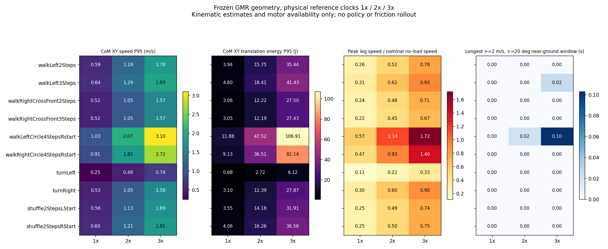

# HDM05 GMR reference rates: 1x / 2x / 3x

## Outcome

All ten [published GMR paths](2026-10-14-hdm05-gmr.md) were evaluated at three
reference clock rates: **30 kinematic/motor-availability prechecks**. Faster
references have substantially more estimated translation momentum and energy,
but none passes the exploratory sustained-speed, high-angle and turning
screens together. **No human policy or dynamics rollout was run**. This is
not evidence of physical success or failure at any contact friction.

For the lateral-three-step reference:

| Rate | CoM speed P95 | CoM XY translation energy P95 | Peak leg speed | Minimum nominal same-direction motoring torque available |
| ---: | ---: | ---: | ---: | ---: |
| 1x | 0.643 m/s | 4.60 J | 4.65 rad/s | 55.19 Nm |
| 2x | 1.286 m/s | 18.41 J | 9.30 rad/s | 30.39 Nm |
| 3x | 1.929 m/s | 41.43 J | 13.95 rad/s | 5.58 Nm |

These are estimates from imposed reference states, not achieved motion. The
2x case is a less aggressive side-translation stress-test candidate; the 3x
case exposes speed/torque headroom. Neither becomes a large turning motion
merely by changing its clock.

## Shared-clock playback and 3x comparison

Each animation has 1x/2x/3x columns, human FK keypoints above and actual TRON1
mesh replay below. All columns share one presentation wall clock and use
their **different reference time arrays**. Faster clips freeze at their final
pose and are marked ENDED; they do not loop or claim subsequent motion.

| Motion / 1x–3x animation | 3x CoM speed P95 | 3x peak leg speed | Longest >=2 m/s, >=20-degree, any-near-ground window | Fixed-core course change |
| --- | ---: | ---: | ---: | ---: |
| [Lateral 2 steps](hdm05_rate_sweep/renders/HDM_bd_walkLeft2Steps_001_120.gif) | 1.784 m/s | 11.66 rad/s | none | +6.7 deg |
| [Lateral 3 steps](hdm05_rate_sweep/renders/HDM_bd_walkLeft3Steps_001_120.gif) | 1.929 m/s | 13.95 rad/s | 0.025 s | +15.2 deg |
| [Crossover 2 steps](hdm05_rate_sweep/renders/HDM_bd_walkRightCrossFront2Steps_001_120.gif) | 1.572 m/s | 10.71 rad/s | none | -7.3 deg |
| [Crossover 3 steps](hdm05_rate_sweep/renders/HDM_bd_walkRightCrossFront3Steps_001_120.gif) | 1.569 m/s | 10.12 rad/s | none | -4.4 deg |
| [Left circle](hdm05_rate_sweep/renders/HDM_bd_walkLeftCircle4StepsRstart_001_120.gif) | 3.098 m/s | 25.74 rad/s | 0.103 s | +52.5 deg |
| [Right circle](hdm05_rate_sweep/renders/HDM_bd_walkRightCircle4StepsRstart_001_120.gif) | 2.716 m/s | 21.01 rad/s | 0 s, one sample | -49.6 deg |

Thus a large course-to-wheel angle in a side step must not be confused with
a large change of travel direction. Temporal scaling does not alter the
underlying turn geometry. At 3x, the circle cases have intervals with no
positive same-direction motoring torque available in the nominal motor model;
this is a warning, not automatic physical failure or a hard speed clip.

At 3x the lateral-three-step peak CoM speed is 2.133 m/s, but its >=2 m/s /
>=20-degree interval is brief: 1.108289–1.133288 s, ten native samples. Removing
the ground mask gives the same 0.025 s interval. For the left circle the
unmasked interval is 0.111 s versus 0.103 s near ground. **Flight is not used
as an episode failure condition**, and these rejections are not caused solely
by requiring a near-ground proxy.



## What was changed and measured

The saved GMR poses, human FK geometry, wheel headings, collision geometry and
source phases remain unchanged. The physical reference clock and derivatives
are changed together, without re-running a different IK solve:

```text
t_new = t_source / alpha
dq_new = alpha * dq_source
ddq_new = alpha^2 * ddq_source
p_COM_XY = M * v_COM_XY
E_COM_XY = 0.5 * M * |v_COM_XY|^2
```

The exact robot model from the GMR run reconstructs every whole-body CoM
position using FK. Nominal mass is 22.273 kg. CoM velocity/acceleration use
finite differences on the new clock; the stated energy is **only planar CoM
translation**, not complete link/rotor kinetic energy. The motor and CoM
estimates are not force/contact-feasible trajectories simply because their
kinematic positions fit. Raw finite-difference acceleration is sensitive to
the source/GMR path's lack of temporal smoothing: at 3x, lateral-three-step
peak leg acceleration is about 1,934 rad/s^2 and its largest 50 Hz leg target
increment is 0.268 rad. These are diagnostics, not requested/realized torque.

The heading feature here uses **CoM velocity course**, independently per wheel,
while the older root-course features remain in the delta traces for comparison.
Human and robot speed masks are recomputed on the changed clock; they are not
copied unchanged from the low-speed case. Original ankle-to-toe source axes,
geometry-only near-ground masks, wheel-spin freeze and human-skeleton
standardization limitations are inherited. There is no measured tire slip.

The nominal actuator contract and exact torque-speed helper are loaded from
the pinned public TRON1 source submodule, with source hashes checked. The
contract uses 80 Nm leg effort/stall torque and 15 rad/s no-load speed; wheels
use 12 Nm and 100 rad/s. The no-load value is **not** a hard joint-speed limit:
above it, available torque can be entirely braking. No motor model limits
were relaxed. Required torque was not solved because no physically consistent
contact-force solution or tracking controller has been evaluated. Friction
randomization and the existing BeyondMimic training setup were not changed.

The [configuration](../config/hdm05_rate_sweep.json) predeclares speed gates
0.8/1.5/2.0 m/s and an absolute axial CoM-to-wheel offset of 20 degrees.
Contiguous windows are recorded per wheel, for any near-ground wheel and
without a ground mask. No gap is bridged; one sample has zero observed duration.
An exploratory duration screen requires 0.5 s at the 2 m/s gate. Separate
geometry/retention screens use a fixed source-phase core [0.15, 0.85], with
entry/exit windows [0.15, 0.25] and [0.75, 0.85]. Core course change must reach
30 degrees and core speed P10 must remain >=80% of entry median speed.
The same native frame indices define these windows at every rate. These are
**exploratory reference-selection screens**, not calibrated drift or dynamics
success criteria, and not proof that all conditions hold in one physical turn.

## Reproduce and inspect

All 30 cases, per-wheel windows, torque envelopes, acceleration arrays, fixed
phase indices and source/model hashes are in
[summary.json](hdm05_rate_sweep/summary.json) and its linked trace-delta files.
The deltas reference the existing published GMR poses instead of copying raw
BVH or robot meshes. All scientific metrics use native retimed clocks, not
GIF timings. Rendering uses fixed 10 fps; end-frame presentation padding is
recorded in the render audit and is not additional reference motion.

```bash
python -m pip install -r requirements-retarget.txt
python -m pytest -q tests

# Recompute all saved numerical results without the licensed robot model:
python scripts/retime_hdm05_gmr.py \
  --replay results/hdm05_rate_sweep/summary.json

# Rebuild CoM geometry and the rate sweep from original published GMR poses:
python scripts/retime_hdm05_gmr.py \
  --model /path/to/WF_TRON1A/mujoco/robot.xml \
  --output-dir outputs/new_hdm05_rates
MUJOCO_GL=egl python scripts/render_hdm05_rate_sweep.py \
  --rate-dir outputs/new_hdm05_rates \
  --model /path/to/WF_TRON1A/mujoco/robot.xml \
  --output-dir outputs/new_hdm05_rate_render
```

Use fresh output directories. The exact GMR base bundle and pinned submodules
are required. Human-motion-derived outputs retain the
[base attribution/license](hdm05_gmr_bd/LICENSE.txt). This experiment covers
one actor/take per action and synthetic temporal scaling, not newly captured
high-speed human motion. A tracking policy and a frozen-actor friction sweep
remain separate subsequent experiments; no human sim2sim result is claimed.
