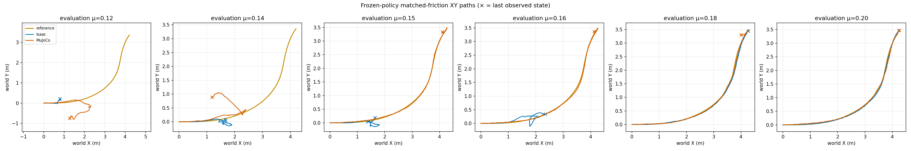
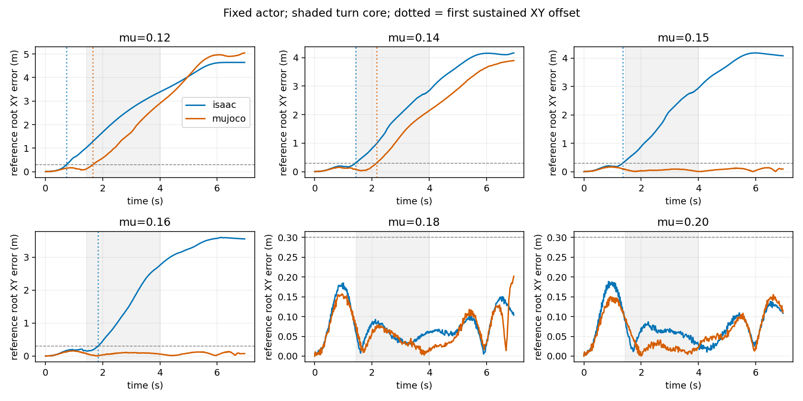

# Car-reference sim2sim: low-friction XY transition refinement

Human source search/retargeting is paused. This experiment keeps the existing
`drift_drl/traj_4` car-derived TRON1 reference and BeyondMimic-randomized actor;
it does not substitute XCAR tasks, retarget another motion or retrain the policy.

## Result

Six fixed-friction pairs, one environment per engine, seed 42. All twelve
rollouts reached 6.98 s. Static and dynamic coefficients are equal within each
case; validation randomization/noise are off. Pose/height predicates are recorded
but **do not define failure or terminate these episodes**. The turn core remains
1.44–4.00 s, with the unchanged exploratory reference-XY screen of RMSE >0.15 m
or peak >0.30 m.

| Fixed µ | Isaac reference-core XY RMSE | MuJoCo reference-core XY RMSE | Isaac↔MuJoCo core XY RMSE | Large reference-XY screen |
| ---: | ---: | ---: | ---: | --- |
| 0.12 | 2.4548 m | 1.6612 m | 1.3955 m | Both |
| 0.14 | 1.8285 m | 1.1950 m | 0.7289 m | Both |
| 0.15 | 1.8932 m | 0.0568 m | 1.9376 m | Isaac only |
| 0.16 | 1.5940 m | 0.0795 m | 1.6655 m | Isaac only |
| 0.18 | 0.0555 m | 0.0466 m | 0.0311 m | Neither |
| 0.20 | 0.0588 m | 0.0312 m | 0.0489 m | Neither |



[Animated top-down root-XY replay](car_bm_dr_refine_seed42/root_xy_replay.gif)
shows reference/Isaac/MuJoCo, **not robot meshes, wheel headings or contact slip**.
The final reference keyframe is 6.96 s; the simulation's terminal policy step
ends at 6.98 s. The animation/onset diagnostic stop at the final reference
keyframe to avoid reference extrapolation. GIF presentation uses 10 fps and
lasts 7.1 s; numeric metrics use native physics timestamps, not GIF frames.

For this actor, source and deterministic reset, the adjacent sampled verdict
change is bracketed by **µ=0.16–0.18 in Isaac** and **µ=0.14–0.15 in MuJoCo**.
The brackets do not establish a unique monotone or statistically calibrated
threshold. These low validation coefficients deliberately stress the actor
outside the nominal training material range. Equal numeric friction is not an
equivalent calibrated tire/contact law across engines.

## When does horizontal tracking diverge?

An additional diagnostic finds the first native-clock contiguous interval with
reference-root XY error >0.30 m for at least 0.20 s. This does **not** replace
the original core RMSE/peak screen or add a height gate.

| Fixed µ | Isaac sustained XY onset | MuJoCo sustained XY onset |
| ---: | ---: | ---: |
| 0.12 | 0.735 s, before core | 1.655 s, within core |
| 0.14 | 1.430 s, before core | 2.165 s, within core |
| 0.15 | 1.365 s, before core | None observed |
| 0.16 | 1.830 s, within core | None observed |
| 0.18 | None observed | None observed |
| 0.20 | None observed | None observed |



**Interpretation:** µ=0.16 is the clearer new case of horizontal divergence
starting during the selected turn core. At µ=0.12, 0.14 and 0.15, Isaac's
sustained horizontal error starts before that core; those failures cannot be
attributed specifically to large drift angle. Even the µ=0.16 timing does not
by itself identify the causal contact/actuator difference or demonstrate actual
tire-patch sliding. Full-horizon continuations can include failed posture.

Repeated controls at **µ=0.15 and 0.20 reproduce the previous native-clock XY
paths exactly** in both engines: overlap RMSE/peak differences are zero. This
supports comparison to the earlier grid; it is not multi-seed robustness evidence.

## Reproduce and audit

The [six-case specification](../config/car_boundary_refinement.json),
[compact traces](car_bm_dr_refine_seed42/xy_trace.npz),
[provenance/material readbacks](car_bm_dr_refine_seed42/xy_trace.provenance.json),
[core metrics](car_bm_dr_refine_seed42/summary.json),
[onsets/control-repeat audit](car_bm_dr_refine_seed42/boundary_summary.json), and
[execution audit](car_bm_dr_refine_seed42/run_audit.json) are retained. No licensed
models, checkpoint payloads or third-party raw motion files are published here.

Checkpoint SHA-256 remains
`f803a8507752d5767a756a537bc844589523de0fb827e669865ac774343db20e`.
The evaluator hashes match the previous isolated full-horizon source. Remote
BeyondMimic lacks Git metadata, but all 27 Python source files match the pinned
submodule content fingerprint. Native PhysX and tensor readbacks both select
unmasked `cuda:1`; that audit does not certify GPU exclusivity or physical UUID
mapping. Runtime versions: Python 3.11.15, Torch 2.7.0+cu128, MuJoCo 3.8.1,
Isaac Sim 5.1 / PhysX through the existing Isaac Lab environment.

```bash
python scripts/analyze_friction_grid.py \
  --trace results/car_bm_dr_refine_seed42/xy_trace.npz \
  --expected-summary results/car_bm_dr_refine_seed42/summary.json \
  --output-dir outputs/replayed_refined_grid
python scripts/analyze_car_boundary.py \
  --trace results/car_bm_dr_refine_seed42/xy_trace.npz \
  --previous-trace results/car_bm_dr_full_horizon_seed42/xy_trace.npz \
  --output-dir outputs/replayed_refined_onsets --gif
```

For physics reruns, use the existing `run_car_validation.py` invocation with
`--source-root outputs/full_horizon_source`, a fresh output directory,
`--mu 0.12 0.14 0.15 0.16 0.18 0.20 --full-horizon-diagnostic` and the original
checkpoint/assets. Set `TRON1_BEYONDMIMIC_ROOT` to the pinned upstream checkout
before launching. The first attempt omitted this dependency path and produced
no valid rollout; it is excluded from the physical results. The new driver
checks this dependency before launching Isaac and rejects missing rollout
artifacts even if Isaac exits with status zero. No physical evaluator was
modified to recover the successful run.

Next controlled question: inspect contact/actuation onset around the µ=0.16
case and sample the 0.16–0.18 interval more finely, before changing the actor or
reference. Do not infer a universal failure threshold from one clip/seed.
