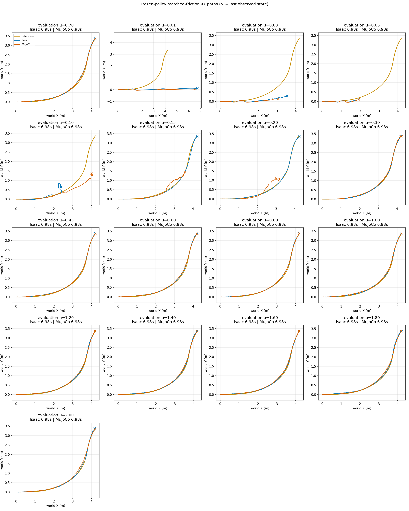

# Primary PPO: height-smooth fixed-friction grid

The newly trained height-smooth PPO crosses the exploratory large-XY-error
screen in 4/17 Isaac cases and 6/17 MuJoCo cases. At the sampled coefficients
μ=0.15 and 0.20, Isaac remains below the screen while MuJoCo exceeds it.
All 34 engine episodes were recorded through the full reference; completion
is not a claim of successful upright turning or controlled tire slip.
This is a PPO-only result, not a PPO/SAC/NMPC ranking.

## Task and completed training

The primary `drift_drl_traj4` reference comes from a pinned CARLA simulation,
not physical-car motion capture. Its turn core is 1.44–4.00 s. The separate
S-avoidance supplement is not included or pooled here.

One PPO policy, seed 42, completed 1,000 iterations × 24 rollout steps ×
512 environments = **12,288,000 actual environment transitions**, with no
setup-smoke collection. Its training objective tracks position and linear
velocity in XY only. Absolute-height tracking, reference vertical-velocity
tracking and height-based stopping are absent; bounded vertical-acceleration
smoothness replaces them. Orientation, posture, contact and action regularizers
remain. This is a newly trained policy, not a relabeled historical checkpoint.

Training used the mapped BeyondMimic events: static friction U[0.3,1.6],
dynamic friction U[0.3,1.2], restitution U[0,0.5], 64 material buckets,
joint-default offsets, base-CoM offsets and velocity pushes. Validation freezes
that actor, disables random events/noise and runs one deterministic episode per
coefficient per engine at equal numeric static/dynamic friction. Equal numeric
coefficients are not calibrated equivalence between PhysX and MuJoCo contacts.
The [sanitized training metadata](controller_primary_ppo_height_smooth_seed42_v1/training_metadata.json)
records the actual budget, objective, DR recipe, source hashes and checkpoint
SHA-256 `6ec411efeaea37fc61389285978b377aa7c5be80e326ce7f18581efc9acdf27b`.

## XY results

The screen is core reference-XY RMSE >0.15 m **or** peak >0.30 m. These are
exploratory analysis limits, not drift physics thresholds. Height, flight and
heading separation do not determine this verdict. Historical pose predicates
are diagnostics only during these full-horizon recordings.

| Fixed μ | Isaac core RMSE / peak (m) | MuJoCo core RMSE / peak (m) | Core sim2sim RMSE (m) | XY screen exceeded |
| ---: | ---: | ---: | ---: | --- |
| 0.01 | 1.0479 / 1.9088 | 1.0840 / 1.9145 | 0.0881 | Both |
| 0.03 | 1.1701 / 1.8651 | 1.2114 / 1.9364 | 0.0498 | Both |
| 0.05 | 1.6159 / 2.5287 | 1.6261 / 2.5185 | 0.0307 | Both |
| 0.10 | 1.0950 / 1.9113 | 0.4061 / 0.8189 | 1.2089 | Both |
| 0.15 | 0.0445 / 0.0695 | 0.2646 / 0.6691 | 0.2764 | MuJoCo |
| 0.20 | 0.0275 / 0.0472 | 0.4659 / 1.0744 | 0.4629 | MuJoCo |
| 0.30 | 0.0210 / 0.0416 | 0.0432 / 0.0669 | 0.0332 | Neither |
| 0.45 | 0.0463 / 0.0752 | 0.0436 / 0.0763 | 0.0099 | Neither |
| 0.60 | 0.0426 / 0.0707 | 0.0574 / 0.0888 | 0.0180 | Neither |
| 0.70 | 0.0565 / 0.1009 | 0.0498 / 0.0779 | 0.0157 | Neither |
| 0.80 | 0.0422 / 0.0722 | 0.0429 / 0.0692 | 0.0088 | Neither |
| 1.00 | 0.0418 / 0.0628 | 0.0527 / 0.0783 | 0.0220 | Neither |
| 1.20 | 0.0387 / 0.0645 | 0.0521 / 0.0883 | 0.0235 | Neither |
| 1.40 | 0.0321 / 0.0549 | 0.0537 / 0.0868 | 0.0251 | Neither |
| 1.60 | 0.0391 / 0.0704 | 0.0548 / 0.0855 | 0.0262 | Neither |
| 1.80 | 0.0344 / 0.0568 | 0.0704 / 0.1160 | 0.0405 | Neither |
| 2.00 | 0.0329 / 0.0584 | 0.0696 / 0.1175 | 0.0446 | Neither |



Across this sampled grid, the XY verdict changes between μ=0.10 and 0.15 in
Isaac, and between μ=0.20 and 0.30 in MuJoCo. Those are descriptive neighboring
samples for this checkpoint, not universal or statistically estimated friction
thresholds. MuJoCo's error at μ=0.20 is larger than at 0.15, so error magnitude
is not monotone. Both engines stay below the XY screen at every tested point
from μ=0.30 through 2.00. The largest core engine gap is 1.2089 m at μ=0.10;
conversely, a small sim2sim gap can coexist with both engines missing the
reference badly, as at μ=0.05.

## Public artifacts and metric replay

The [exact summary](controller_primary_ppo_height_smooth_seed42_v1/summary.json),
[compact root-XY traces](controller_primary_ppo_height_smooth_seed42_v1/xy_trace.npz)
and [hash/material-readback provenance](controller_primary_ppo_height_smooth_seed42_v1/xy_trace.provenance.json)
contain all 17 matched cases. Replay reproduces the summary exactly without
Isaac, MuJoCo, policy weights or robot assets:

```bash
python scripts/analyze_friction_grid.py \
  --trace results/controller_primary_ppo_height_smooth_seed42_v1/xy_trace.npz \
  --expected-summary results/controller_primary_ppo_height_smooth_seed42_v1/summary.json \
  --output-dir outputs/NEW_primary_ppo_grid_replay
```

Each engine contributes one episode per coefficient from one trained seed.
These observations are not a statistical success rate, a speed-retention
comparison, a measured wheel-contact-slip result, hardware validation, or a
comparison against SAC/NMPC. Raw motion, source CSV, robot models and weights
are not redistributed. Historical policies/results remain unchanged.
