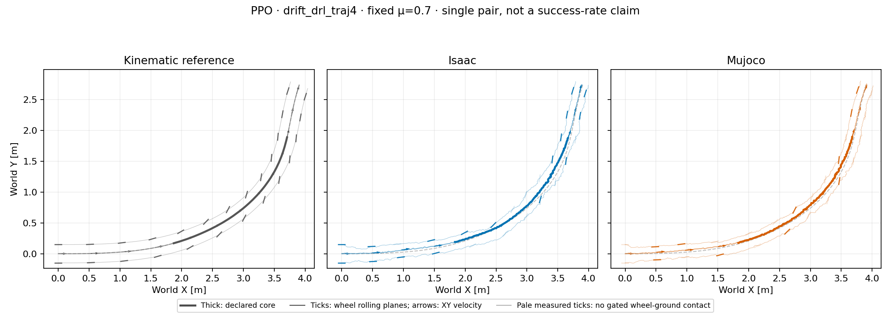

# Height-smooth PPO: primary turn, fixed μ=0.70

One frozen seed-42 PPO, newly trained with the height-smooth task, was evaluated
in both engines. This is one matched case, not a controller ranking or a
statistical success rate. The actor uses 51 observations and eight leg/wheel
actions; training collected 12,288,000 transitions over 1,000 PPO iterations.
BeyondMimic-style training randomization is retained. Validation uses equal
fixed static/dynamic μ=0.70, no random events and no height/flight stopping.

The predeclared primary core is 1.44–4.00 s. Both recordings cover it and the
full 6.98 s episode without prescribed post-reset root motion.

| Core diagnostic | Isaac | MuJoCo |
| --- | ---: | ---: |
| Reference root-XY RMSE | 0.0565 m | 0.0498 m |
| Reference root-XY peak error | 0.1009 m | 0.0779 m |
| Mean COM-speed retention | 99.41% | 99.74% |
| Net COM-course turn | 52.05° | 62.14° |
| Ground-gated wheel-center heading offset, mean absolute L/R | 12.19° / 8.69° | 16.23° / 10.88° |
| Ground-contact lateral-slip RMS, L/R | 0.380 / 0.265 m/s | 0.423 / 0.412 m/s |

The **Isaac–MuJoCo** core XY gap is 0.0157 m RMSE, with 0.0400 m peak.
This is separate from each engine's reference error. There is no spatial
registration or time warping. Neither engine crosses the exploratory XY-only
screen (RMSE >0.15 m or peak >0.30 m). Full-episode peak tilts are 5.22° and
5.65°; posture and contact are diagnostics, not height-based failure gates.

## Heading and contact semantics

Heading separation is an intended feature, **not a mismatch**. Each wheel is
measured independently. The table uses its analytic wheel-link-origin velocity
and axial rolling-plane heading (modulo 180°), restricted to samples with an
actual ground-filtered contact and upward normal force >5 N. Geometry outside
contact remains available separately. A zero slip value without contact is
unavailable evidence, not proof of rolling. Contact-point lateral-slip RMS is
measured separately and is not inferred from the geometric angle.

The geometric reference has no measured contact label. Its core COM-course
turn is **59.255°**. The catalog's **60.928°** selection statistic instead uses
the root-origin position derivative, at the same frames 72–200. Subtracting
`ω × R(COM_offset)` from the stored COM velocity reproduces that origin
derivative within 5.92×10⁻⁸ m/s per component. The catalog is unchanged.
Its 11.27° mean absolute wheel offset describes all moving source frames,
not the selected core's approximately 19.35° root-course offset.

The planar angles here also differ from the reward's body-frame β when the
robot pitches or rolls. No angle is driven to zero by this analysis. The
roughly 1 m/s robot-scale input does not establish car-like dynamic similarity
or a high-speed hardware capability.

## Audit and reproduction

The [sanitized summary](controller_primary_ppo_nominal_pair_v1/summary.json)
contains reference/asset/source hashes, checkpoint-byte and training-status
checks, material readbacks, FK residuals, per-wheel masks and all metrics.
The [compact trace](controller_primary_ppo_nominal_pair_v1/pair_trace.npz)
contains retargeted reference states, simulated states, derived wheel geometry
and measured contact diagnostics. It is not a robot model, original source
CSV, the original full-body `motion.npz`, or policy weights.

Use [analyze_controller_pair.py](../scripts/analyze_controller_pair.py) with
the frozen primary files, licensed model, original native traces/reports and
the adjacent completed training manifest/checkpoint. For older MuJoCo reports
without a rollout hash, supply the independently captured
`--mujoco-trace-sha256`; this binds the captured file, not a physics proof.
The accompanying tests cover invalid provenance, missing contacts, censored
windows and no-step FK. This result does not establish the other controllers'
performance, a universal friction boundary or a causal explanation of contact
differences.
