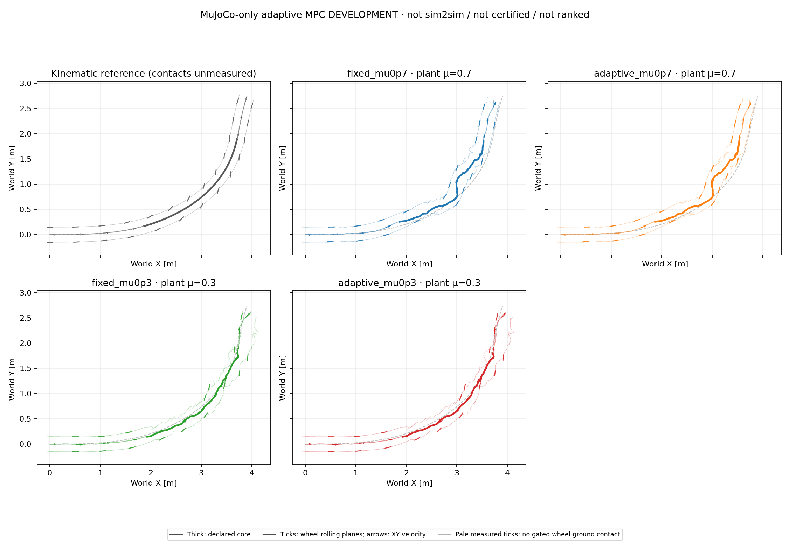

# First contact-adaptive MPC pilot

This controller adds causal prediction-model selection to the existing full-body
NMPC. It is **not certified robust MPC**, physical-friction sensing, or a learned
policy. The bounded pilot compares fixed and adaptive prediction at plant
μ=0.7 and 0.3 in MuJoCo; Isaac results are not yet available. No controller or
estimator parameters are changed after observing these pilot episodes.

## Method

The fixed model bank is μ = {0.3, 0.7, 1.6}, initially selecting 0.7. The endpoint
range follows the previously declared training friction range; these are
effective MuJoCo contact hypotheses, not calibrated tire coefficients or an
oracle reading of the validation plant. At decision k>0, each model predicts
only the completed transition from measured x[k−1], using the actual applied
float32 action a[k−1] for four 5 ms substeps. Identification does not receive
reference errors, reward, future measured states, or plant-friction metadata.

Let y = [base-COM world vx, vy, world angular ωz], with scales
s = [0.05 m/s, 0.05 m/s, 0.5 rad/s]. The per-model residual is
`r_mu = (predicted_y_mu − observed_y) / s`. Endpoint residuals equal increment
residuals because every prediction starts from the same measured state.
Each score is the RMS of these scaled residuals over informative transitions
in the last ten intervals. Equal XY scales make the score invariant to a
rotation of the planar world frame. Raw generalized velocities, contact-force
magnitudes, wheel-spin angles and zero-sideslip targets are not fitting channels.

Selection requires at least five informative transitions, pairwise prediction
spread of at least one scaled RMS unit, and a best supported RMS no larger
than three. A different model must improve the current score by at least 20%.
Exact ties retain the current model. These are declared prototype settings,
not calibrated confidence levels, noise bounds or a Bayesian posterior.

Any observed wheel-ground contact within the previous four physical samples
provides contact evidence. No contact, nonwheel ground impact, indistinguishable
model predictions, or an unsupported observation holds the current selection;
skipped evidence still ages out of the finite window. These gates affect
**identification only**: flight, height and nonzero heading offset do not become
task-failure criteria. A prediction error propagates as an execution failure;
there is no silently discarded model, automatic worker restart or retry.

The next CEM solve scores one selected model, retains its warm plan and RNG,
and fully rescores the incumbent. This is adaptive singleton-model MPC, not a
worst-case solve over the entire bank. The horizon, candidates, rewards and
actuators remain unchanged: H30/B10/I3, 64 candidates, 8 elites, seed 42,
the same 15-term height-smooth objective and eight bounded leg/wheel actions.

## Evidence and limits

All four full episodes completed 349 decisions / 1,396 physics steps (1,397
recorded physical samples, 6.98 s) without solver failures or nonwheel-ground
contact. The same current CEM, objective and actuator sources were used for
both controllers. Canonical metrics use the unchanged 1.44–4.00 s core:

| Controller | Plant μ | XY RMSE / peak [m] | Mean speed [m/s] / retained | Maximum tilt [°] | Contact slip RMS, L / R [m/s] |
| --- | ---: | ---: | ---: | ---: | ---: |
| Fixed prediction 0.7 | 0.7 | 0.1700 / 0.3064 | 0.984 / 95.68% | 14.54 | 0.254 / 0.222 |
| Adaptive prediction | 0.7 | 0.1700 / 0.3064 | 0.984 / 95.68% | 14.54 | 0.254 / 0.222 |
| Fixed prediction 0.7 | 0.3 | 0.0720 / 0.1092 | 1.007 / 97.90% | 18.30 | 0.616 / 0.490 |
| Adaptive prediction | 0.3 | 0.0720 / 0.1092 | 1.007 / 97.90% | 18.30 | 0.616 / 0.490 |

Tilt covers the full playback, not just the core. Slip is measured at actual
wheel-ground contact points and gated by contact count and upward force >5 N;
it is not wheel-center heading error. The reference core speed is about
1.03 m/s, not a hardware high-speed-car claim. The μ=0.7 pair exceeds the
0.15 m RMSE / 0.30 m peak XY screen; the μ=0.3 pair does not. Larger slip at
μ=0.3 coexists with smaller XY error in these particular episodes; it is not
an extra failure gate or evidence that reducing friction generally improves
tracking.



The [aggregate and source hashes](adaptive_mpc_pilot_20261016_v1/summary.json)
and [derived native-clock replay](adaptive_mpc_pilot_20261016_v1/development_trace.npz)
retain heading/contact features separately. Reference contacts remain
unmeasured. At each plant μ, fixed and adaptive applied actions, named
body/joint states and measured contact arrays are bitwise identical. An
independent audit of the hash-bound source logs additionally verified identical
raw float64 CEM actions, generalized states and actual applied torques; those
raw source arrays are not redistributed in the derived replay.

There were **zero model switches**: both adaptive episodes selected 0.7 for
all 349 solves. At plant μ=0.7 the status counts were 1 initial prior,
288 low spread, 59 contact-free intervals and 1 insufficient-evidence update;
at μ=0.3 they were 1, 278, 69 and 1 respectively. The source-log audit found
only one informative transition per episode in the ten-interval window,
below the required five. Maximum scaled prediction spread was 1.065 at
decision 291 (μ=0.7), and 1.113 at decision 88 (μ=0.3). Hence this is a
conservative **no-switch outcome**, not demonstrated closed-loop adaptation
gain or a robustness certificate. Thresholds were not relaxed after seeing it.

Each solve used one selected model, not worst-case planning over the bank.
Each episode requested 68,054 candidate/scenario evaluations and 8,166,480
planning physics substeps. Identification added 867 predictions / 3,468
substeps at μ=0.7, and 837 / 3,348 at μ=0.3. Its total recorded computation
was 2.414 s and 2.281 s, with median/P95/max call times of
6.97/13.37/17.85 ms and 6.88/12.57/22.16 ms respectively. This cost is included
in the outer controller timing. Complete solves took roughly 1.2 s median,
well above 20 ms: **not real-time**. Four applications ran concurrently, so
their timings are not a controlled hardware performance comparison.

The [predeclared four-episode plan](../config/adaptive_mpc_pilot.json) and
[estimator settings](../config/adaptive_contact_mpc.json) are separate from the
existing qualified frozen-grid workflow. Fixed μ=0.7 prediction is rerun with
the same current source as the adaptive case, at both validation coefficients.
This is a two-point development pilot, not the 17-point friction sweep or a
statistical ranking. Identification calls and timing are charged separately;
the outer controller timing includes identification plus CEM. Simulated time
still waits for the optimizer and does not inject its wall-clock delay.

The twelve-step interface smoke completed 0.24 s with no solver failure and
33 identification predictions / 132 predicted substeps. All eleven observed
transitions had insufficient prediction spread and correctly retained μ=0.7.
The smoke does not cover the turn core and makes no tracking-quality claim.

Even when a bank model fits, the selected value must not be interpreted as a
measured physical coefficient. Cross-engine contact laws, integration memory,
actuator state and unmodeled dynamics can produce similar residuals. The
previous bounded Isaac audit already found nonzero prediction error at the
same numeric μ; it provides no universal discrepancy bound. Full simulator
state and future reference remain privileged inputs relative to PPO/SAC actors.

## Reproduction

Provide the locked motion and locally licensed robot model; no model, weight,
credential or compiled library is redistributed. Build a native library only
through the existing explicit build step, or select the slower Python backend.
Use distinct new output directories for all four plan cases:

```sh
CUDA_VISIBLE_DEVICES='' python scripts/run_nmpc_tracking.py \
  --model /path/to/mujoco_model.xml --motion /path/to/motion.npz \
  --contract /path/to/policy_contract.json --reference-id drift_drl_traj4 \
  --plant-mu 0.7 --settings config/nmpc_height_smooth_residual.json \
  --task-profile config/car_drift_height_smooth_task.json \
  --adaptive-contact-config config/adaptive_contact_mpc.json \
  --horizon-steps 30 --control-blocks 10 --iterations 3 --candidates 64 --elite-count 8 \
  --prediction-backend native --native-library /path/to/libtron1_nmpc_batch.so \
  --output-dir outputs/NEW_adaptive_mu0p7
```

Repeat with plant μ=0.3, without changing the model bank or estimator settings.
Omit `--adaptive-contact-config` for the two fixed-prediction controls; do not
set `--prediction-mu-scenarios` from the validation coefficient.
The approved 16-file v3 diagnostic snapshot was uploaded and hash-verified.
The same adaptive option is implemented in `run_nmpc_tracking_isaac.py`, but this
new adaptive code is **not** part of that snapshot.
No adaptive code or job has been deployed to the remote host in this update.

Analyze the four completed episodes without stepping dynamics or realigning
their native clocks:

```sh
python scripts/analyze_adaptive_mpc.py \
  --model /path/to/mujoco_model.xml --motion /path/to/motion.npz \
  --reference-file /path/to/robot_reference.npz --source-root /path/to/source_project \
  --run fixed_mu0p7=outputs/NEW_fixed_mu0p7 \
  --run adaptive_mu0p7=outputs/NEW_adaptive_mu0p7 \
  --run fixed_mu0p3=outputs/NEW_fixed_mu0p3 \
  --run adaptive_mu0p3=outputs/NEW_adaptive_mu0p3 \
  --output-dir results/NEW_adaptive_pilot
```

This is MuJoCo-only development, not sim2sim, not a frozen controller ranking,
and not an Isaac qualification. The completed adaptive pilot is retained as-is;
the next independent controller is TVLQR, rather than another estimator-tuning
loop.

Related work motivates separating model learning from its uncertainty, not
claiming guarantees from model selection alone:
[Vaskov et al., friction-adaptive stochastic NMPC](https://arxiv.org/abs/2305.03798)
uses online tire-model learning with uncertainty-aware planning; this pilot
does not reproduce its Bayesian estimator or stochastic controller.
[Köhler et al., robust adaptive MPC](https://arxiv.org/abs/1911.02899)
uses set-membership uncertainty bounds and tube-based control under explicit
conditions; this pilot supplies neither those tubes nor their guarantees.
