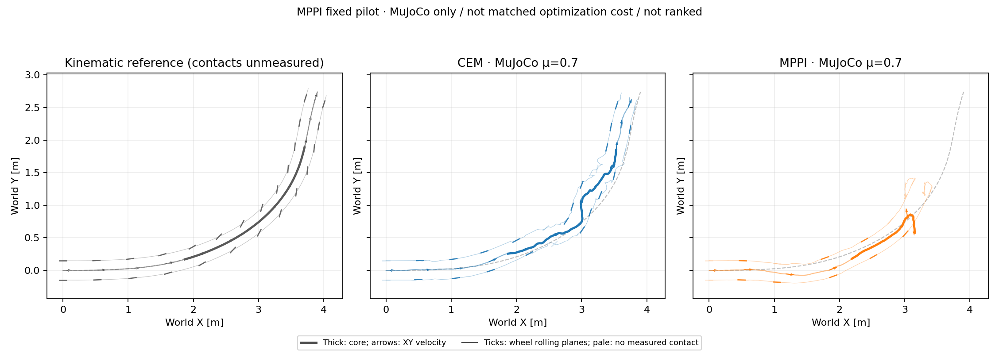

# MPPI: first fixed-parameter turning pilot

The first fixed MPPI configuration **fails nominal tracking**: core XY RMSE is
0.6662 m, peak error 1.4216 m and mean speed retention 60.48%. It loses posture,
with first nonwheel-ground contact at 2.395 s and maximum tilt 111.59°.
All 349 decisions complete with zero prediction/optimization failures or
fallbacks; finite successful optimization calls do not imply successful control.



The [audited summary](mppi_primary_mu0p7_pilot_20261016_v1/summary.json) and
[derived replay](mppi_primary_mu0p7_pilot_20261016_v1/development_trace.npz)
retain the original world axes and clocks:

| Recorded episode | Core XY RMSE / peak [m] | Mean speed / retained | Contact slip RMS, L / R [m/s] |
| --- | ---: | ---: | ---: |
| Existing CEM H30/B10/I3 | 0.1700 / 0.3064 | 0.984 m/s / 95.68% | 0.254 / 0.222 |
| Fixed MPPI | 0.6662 / 1.4216 | 0.622 m/s / 60.48% | 0.085 / 0.080 |

Both episodes exceed the exploratory XY screen. MPPI's lower contact-slip
number is **not improved drifting**: speed falls and nonwheel-ground contact
occupies 56.53% of core samples. Speed is below 80% of the reference in 63.16%
of core samples. Tilt exceeds 60° in 64.42% of the full clip. Heading/course
geometry during fallen or near-stationary states must be interpreted cautiously;
there is no valid end-to-end MPPI core course-change measurement.

This is one MuJoCo-only development episode, not an Isaac↔MuJoCo result,
controller ranking or new friction sweep. The parameter set was fixed before
the 12-step interface check and full episode; no temperature/noise tuning follows.

## Controller and comparison

The independent [runner](../scripts/run_mppi_tracking.py) uses the same full-body
predictor, actuator interface and 15-term height-smooth physical rollout score as
the archived CEM H30/B10/I3 baseline. Both use the locked `drift_drl_traj4`
reference, plant μ=0.7 and a separately specified prediction μ=0.7. The predictor
does not read the validation plant's coefficient. No PPO/donor action plan,
root-force correction or state reset is used after initialization.

The [MPPI core](../scripts/mppi_shooting.py) is a fixed-covariance latent Gaussian
importance sampler, not a renamed elite/argmin controller. For each solve,
select and freeze a full initial baseline `b`, then sample block residuals
`z = m + ε`, `ε ~ N(0, Σ)`. Physical actions are `clip(b + z, -1, 1)`;
the latent samples remain unclipped. With prior `P=N(0,Σ)` and proposal
`Q=N(m,Σ)`, normalized weights and the update are

```text
log w_i = -J_i / λ - Σ_blocks mᵀ Σ⁻¹ ε_i   (up to a common constant)
m_next = m + Σ_i normalized(w_i) ε_i
```

All finite samples participate. Apply the **final weighted-mean plan** after a
fresh finite-cost rollout, not the best sample or best initial plan. The density
ratio is counted once per sampled block, not once per repeated horizon step.
This follows the importance-sampling formulation in
[Williams et al.](https://arxiv.org/abs/1707.02342). The Gaussian prior adds
implicit regularization: an identical physical score does **not** make the
overall optimization objective identical to pure task-cost CEM.

The reference implementation is linked as the MIT-licensed
[`pytorch_mppi` submodule](../upstream/pytorch_mppi), pinned to
`e04a569cd4215e705f9013145c496fc59cb25ed6`. It is not imported at runtime;
this NumPy/native-MuJoCo implementation is not a bitwise reproduction of that
package's bounded-noise handling.

## Fixed budget and interpretation

The [settings](../config/mppi_height_smooth.json) declare horizon 30 controls
(0.60 s), 10 residual blocks, λ=1, seed 42 and noise standard deviations
`[0.04 × 6 legs, 0.35 × 2 wheels]`. Each of three iterations evaluates 63 IID
Gaussian plans plus one updated mean. Initial plans are repeated previous
action, shifted previous full plan when available, and bounded bias-force
feedforward; none is an extra deterministic member of the weighted population.
The [pilot manifest](../config/mppi_pilot.json) records these choices.

Successful full runs therefore request 68,054 candidate/scenario evaluations
and 8,166,480 predicted 5 ms substeps, matching the baseline's rollout count.
Matching count does not match optimization objective or information content.
The mean check is a separate batch call: MPPI uses 3,140 native calls versus
2,093 for CEM, even with the same number of predicted trajectories.
The baseline's recorded wall time came from concurrent jobs; the MPPI run was
launched separately. Timing is uncontrolled, and the simulator waits for each
solve without injecting actuation delay. No 20 ms or hardware-real-time claim
is made.

The recorded MPPI call median/P95/max is 1,153.56/1,384.08/1,604.59 ms;
all calls exceed 20 ms. Full episode wall time is 408.36 s for 6.98 s of
simulation. Across 1,047 weighted updates, ESS median/P95 is 21.63/62.75 out
of 63 samples, minimum 1.02; maximum single-sample weight reaches 0.9903.
These show both diffuse and concentrated updates, not a uniform numerical
failure. They do not isolate the cause of posture loss or establish that a
different temperature would fix it. This pilot does not establish an intrinsic
advantage of CEM over MPPI; prior, sampling and tuning choices differ.

Evaluation keeps the original 1.44–4.00 s core and timestamps, without alignment
or time warp. XY exploratory limits remain RMSE ≤0.15 m and peak ≤0.30 m.
Speed retention, base posture and actual ground-contact lateral slip are
separate diagnostics. Neither height/flight nor nonzero heading offset is a
failure gate. Kinematic reference contacts are unmeasured. No global stability
or robustness guarantee is inferred for the hybrid contact dynamics.

## Reproduction

Use MuJoCo 3.8.1 and the hash-locked model/motion/actuator contract. Licensed
assets, compiled libraries and original raw archives are not redistributed.
Build the native library explicitly using the README instructions; runners
never build or restart it automatically. Choose a fresh output directory:

```sh
CUDA_VISIBLE_DEVICES='' python scripts/run_mppi_tracking.py \
  --model /path/to/mujoco_model.xml --motion /path/to/motion.npz \
  --contract /path/to/policy_contract.json --reference-id drift_drl_traj4 \
  --plant-mu 0.7 --settings config/mppi_height_smooth.json \
  --task-profile config/car_drift_height_smooth_task.json \
  --prediction-backend native --native-library /path/to/libtron1_nmpc_batch.so \
  --output-dir outputs/NEW_mppi_episode

CUDA_VISIBLE_DEVICES='' python scripts/analyze_mppi_pilot.py \
  --motion /path/to/motion.npz --reference-file /path/to/robot_reference.npz \
  --model /path/to/mujoco_model.xml --source-root /path/to/audited/source \
  --run CEM=/path/to/fixed_cem_episode --run MPPI=outputs/NEW_mppi_episode \
  --output-dir results/NEW_mppi_analysis
```

The analyzer checks raw report/trace/log hashes, the actual float32 action
interface, original clocks, source/actuator/objective identities and weighted
update counters. Published compact data retain derived geometry/contact
evidence, not raw actions or learned weights. Aggregate ESS/weight diagnostics
are source-bound logs, not an independent replay of unsaved candidate arrays.
