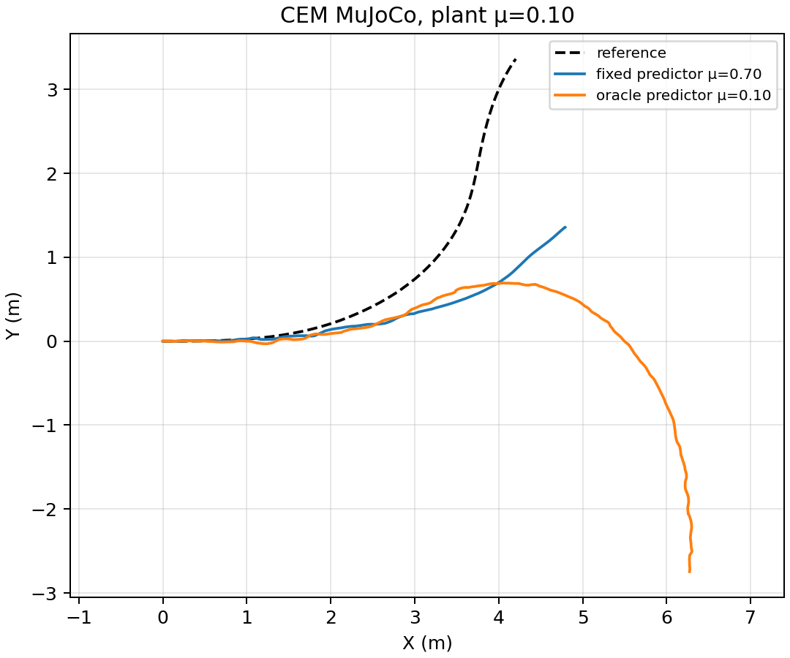
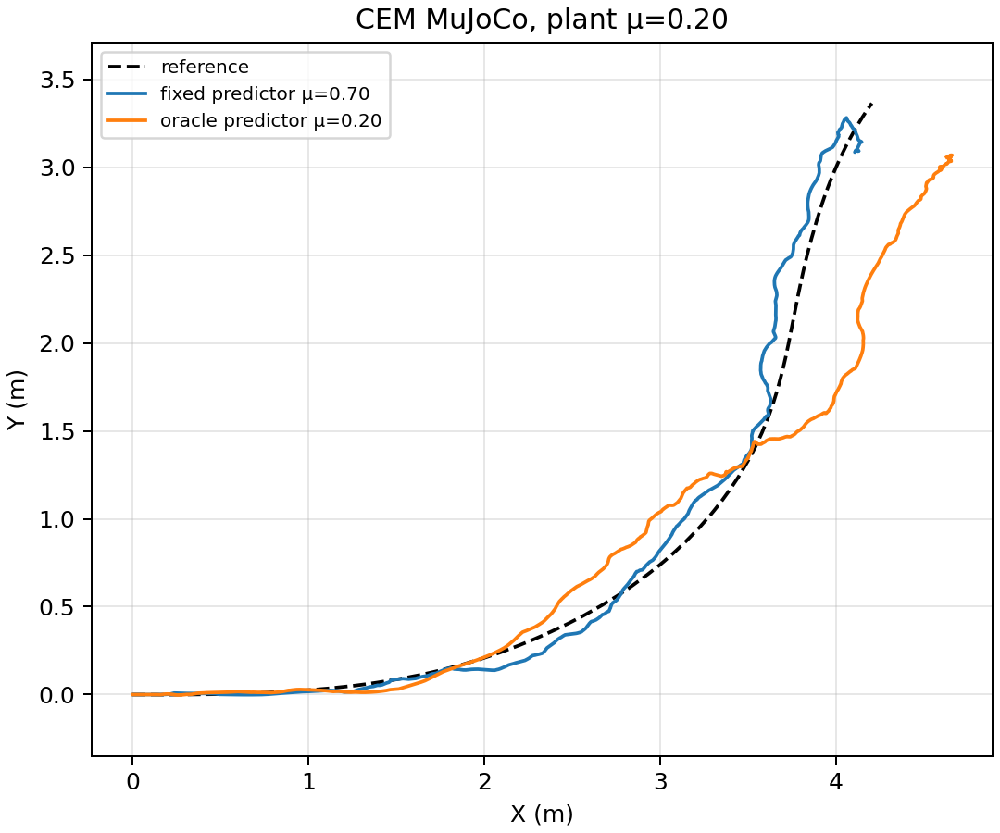

# CEM MPC with ground friction known before rollout

An explicit `--oracle-plant-friction` mode now gives the MPC **prediction model** the validation plant's exact scalar ground μ before the episode. The ordinary fixed-model mode still predicts with μ=0.70. This is a privileged-information diagnostic, not an estimator, an adaptive MPC controller, or a deployable friction sensor. The flag rejects simultaneous manual prediction scenarios and causal contact adaptation. It is available in both the [MuJoCo runner](../scripts/run_nmpc_tracking.py) and [Isaac runner](../scripts/run_nmpc_tracking_isaac.py); the completed pilot below is **MuJoCo only**.

The reference (`drift_drl_traj4`), no-sideslip-reward task, actuator model, plant μ, seed 42, native CEM predictor, 30-step horizon, 10 control blocks, 64 candidates × 3 iterations and 8 elites are held fixed within each pair. The only algorithmic change is predictor friction μ=0.70 versus μ=plant. The [pair audit](../scripts/analyze_nmpc_oracle_friction.py) checks these identities, source dependencies (except the runner changed to add the flag), material readback, saved trace hashes and full 6.98 s physical clock. Each cell is one full-horizon episode; errors cover the 1.44–4.00 s turn core.

| Plant μ | Prediction μ | Core XY RMSE / peak (m) | Core speed retained | XY screen crossed? |
| ---: | ---: | ---: | ---: | :---: |
| 0.10 | fixed 0.70 | 0.872 / 1.165 | 114.5% | yes |
| 0.10 | known 0.10 | 0.854 / 1.933 | 125.3% | yes |
| 0.20 | fixed 0.70 | 0.0746 / 0.1376 | 98.8% | no |
| 0.20 | known 0.20 | 0.1741 / 0.3628 | 96.8% | yes |

The exploratory XY screen is core RMSE >0.15 m **or** peak >0.30 m. Giving the exact scalar μ did **not** consistently help: at μ=0.10, mean XY error improves by only 0.018 m while peak error increases by 0.768 m; at μ=0.20, mean error worsens by 0.100 m. All four episodes have zero reported solver failures, so these are physical tracking differences, not exceptions from the optimizer. High retained speed at μ=0.10 does not imply a successful turn. This result does not establish *why* the oracle underperforms; finite-horizon search, contact-model mismatch and the objective may all matter. In particular, knowing a numeric MuJoCo ground coefficient is not knowing the effective tire–ground interaction in PhysX or in hardware.

Machine-readable summaries: [μ=0.10](nmpc_oracle_friction_mu0p10_mujoco_20261016_v1/summary.json), [μ=0.20](nmpc_oracle_friction_mu0p20_mujoco_20261016_v1/summary.json). Both summaries and plots were reproduced byte-for-byte from the saved raw rollouts. Raw episodes are under gitignored `outputs/no_sideslip_cem_oracle_friction_pilot_20261016_v1/`; fixed-model episodes are under `outputs/no_sideslip_cem_friction_pilot_20261016_v1/`. To extend the comparison, rerun the same CEM command with `--oracle-plant-friction --plant-mu <μ>` and a new output directory, then pass the resulting fixed/oracle directories to the pair audit. The runner records `prediction_receives_plant_mu=true` and `prediction_friction_source=plant_friction_oracle` for this mode.

No Isaac oracle episode or remaining four friction-grid points has been run yet. CEM solve time remains much longer than the 20 ms control period (roughly 0.87–1.07 s median in these oracle runs), so these are offline comparisons. Sideslip angle, wheel-heading offset, height and brief flight are not failure gates.
