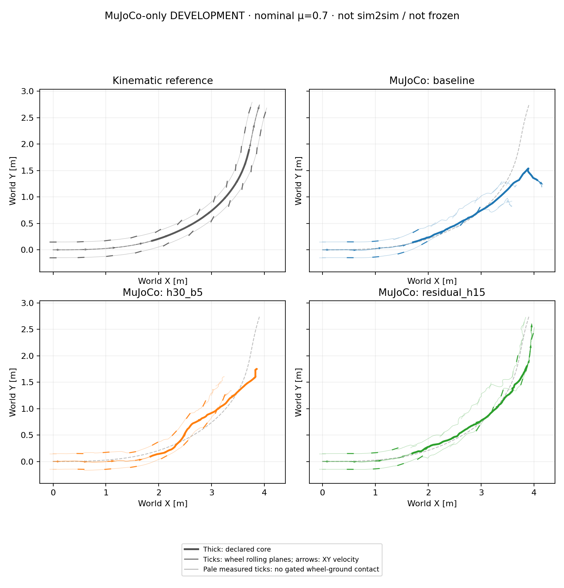

# Nominal NMPC development: horizon and residual search

These are **MuJoCo-only DEVELOPMENT results at μ=0.70**, not sim2sim, a frozen
controller, a friction sweep or a statistical ranking. The residual H15 run
improves the observed core XY error and avoids the large tilt/nonwheel contact
seen in the two absolute-block runs. This single episode does not establish
robustness or approve freezing the controller.

Follow-up: the [completed residual Isaac comparison](2026-10-16-primary-nmpc-residual-nominal-pair.md)
still exceeds the nominal XY screen. The MuJoCo-only results below remain the
original development record, not two-engine qualification.



## What changed

All runs use the same locked primary `drift_drl_traj4` reference, model,
15-term height-smooth objective and actuator-source identity. Each completes
349 decisions / 1,397 native physical samples / 6.98 s, with 5 ms physics and
20 ms control. Prediction and plant coefficients are both the predeclared
0.70; no learned-policy initialization, root prescription or external root
forces are used. The 1.44–4.00 s core alone determines the exploratory XY
screen: RMSE >0.15 m or peak >0.30 m. Height, flight and heading offsets are
not failure gates.

| Variant | Search coordinates | Horizon / blocks | Horizon / block duration |
| --- | --- | ---: | ---: |
| baseline | Absolute normalized-action blocks | 15 / 5 | 0.30 / 0.06 s |
| h30_b5 | Absolute normalized-action blocks | 30 / 5 | 0.60 / 0.12 s |
| residual_h15 | Blocks of residuals around a fixed full initial plan | 15 / 5 | 0.30 / 0.06 s |

Population 64, three CEM iterations, eight elites and seed 42 are unchanged.
H30 changes both look-ahead and block duration, so it is not a causal
"horizon only" experiment. Residual search copies the winning bounded
initial full plan once per solve, adds block residuals and clips decoded
actions. Its zero residual preserves that full plan without reblocking it;
elite updates remain in residual coordinates. The plan comes from bounded
previous/shifted/physics-only candidates, not a PPO/SAC demonstration.
Legacy modes are identified by the known reported CEM source hash; the new
residual mode and decoder are explicitly recorded, not inferred from labels.

## Observed tracking and separate posture/contact diagnostics

Speed ratio is mean measured base-COM XY speed divided by mean reference
speed over the core. Tilt and first nonwheel contact use the entire episode;
they are separate diagnostics, not additions to the formal XY screen.

| Variant | Core XY RMSE / peak (m) | Core speed ratio | XY screen exceeded | Max tilt | First nonwheel-ground contact |
| --- | ---: | ---: | --- | ---: | ---: |
| baseline | 0.2803 / 0.6708 | 1.0007 | Yes | 92.67° | 3.110 s |
| h30_b5 | 0.1403 / 0.2285 | 0.9411 | No | 88.53° | 3.685 s |
| residual_h15 | 0.1154 / 0.1957 | 1.0513 | No | 21.69° | None recorded |

Thus H30 stays below the core XY limits but still develops substantial tilt
and nonwheel contact; small core XY error alone is not controlled upright
execution. Residual H15 has no recorded nonwheel-ground contact and no tilt
over 60° in this episode. Its measured core contact-point lateral-slip RMS
is 0.3624/0.3300 m/s for left/right wheels, summarized only under the common
ground-count/upward-force gate. This is measured sliding evidence, not a
zero-slip objective or a universal controlled-drift certificate.

All three logs contain 68,054 finite candidate/scenario evaluations, 2,093
batch calls and zero solver/batch failures. That does not prove optimality.
Residual diagnostics are available at all 349 decisions: the mean initial
full-plan block-projection error is 0.2918 normalized action units, while
decoded-action clipping averages 0.7372%. Legacy diagnostics were not
recorded and remain unavailable, not zero. These statistics describe search
coordinates; they do not isolate the cause of the tracking improvement.

| Variant | Solve median / P95 / max (ms) | Calls above 20 ms |
| --- | ---: | ---: |
| baseline | 520.94 / 622.19 / 756.94 | 349/349 |
| h30_b5 | 1184.71 / 1396.39 / 1696.88 | 349/349 |
| residual_h15 | 548.14 / 660.89 / 884.85 | 349/349 |

These are saved, uncontrolled original-run timings, including worker IPC and
solver bookkeeping but excluding model/worker startup and plant/logging.
The simulator waits for solves; wall-latency actuation delay was not injected.
No real-time result or controlled hardware timing comparison is established.

## What remains unresolved

The [existing 16-interval one-step audit](2026-10-16-primary-nmpc-nominal-pair.md#existing-one-step-model-probe)
found original-baseline prediction errors at numerical precision, including
impacts: maximum root-XY error 4.34×10⁻¹⁹ m and stage-cost error 1.11×10⁻¹⁶;
all 15 logged terms reconstructed exactly. This does not certify longer
horizons, counterfactual candidates or either new variant's predictions.

The [termination-semantics audit](2026-10-16-controller-termination-semantics.md)
also distinguishes matching stage rewards from matching RL returns. These
three NMPC variants still score undiscounted stages through the planning
horizon, without RL's orientation-termination continuation semantics or a
terminal value. The proposed termination-consistent objective is **not
implemented in these runs**; no height/flight/slip failure rule was added.

## Audited artifacts and offline reproduction

Reproduce the residual episode with the explicitly built native library
described in the [README](../README.md), the locked reference, and the same
audited 80/12 Nm DC-motor policy contract:

```bash
CUDA_VISIBLE_DEVICES='' python scripts/run_nmpc_tracking.py \
  --model /path/to/tron1_model.xml --motion /path/to/locked/motion.npz \
  --contract /path/to/policy_contract.json --reference-id drift_drl_traj4 \
  --plant-mu .7 --prediction-mu-scenarios .7 \
  --settings config/nmpc_height_smooth_residual.json \
  --prediction-backend native --native-library /path/to/libtron1_nmpc_batch.so \
  --output-dir outputs/NEW_residual_h15
```

For the baseline, use `config/nmpc_height_smooth.json` instead. For H30, use
that baseline file plus `--horizon-steps 30 --control-blocks 5`. Choose a new
output directory for every run. This command generates a physics episode;
the separate analysis command below never steps physics. At this development
milestone the residual mode had not yet been evaluated in Isaac; see the
follow-up above for its later result. No NMPC friction sweep has started.

The [sanitized summary](nmpc_nominal_development_20261016_v1/summary.json)
preserves input/source hashes, exact objective/actuator-clock checks,
effective knobs, mode declarations, saved timings and all counter aggregates.
The [compact derived states](nmpc_nominal_development_20261016_v1/development_trace.npz)
retain native clocks, named joints, reference/robot/wheel states, validity
masks and original measured contacts; no model, weights or raw source motion
are included. Plot bounds include root and both wheels, use one world frame
and equal aspect, and show the demonstrated interval only. Pale ticks mean
no gated wheel-ground contact, not a failure verdict.

With the original local episode artifacts and compatible private inputs:

```bash
python scripts/analyze_nmpc_nominal_development.py \
  --motion-file /path/to/locked/motion.npz \
  --reference-file /path/to/locked/robot_reference.npz \
  --model /path/to/tron1_model.xml \
  --source-root upstream/tron1-learning-from-human \
  --run baseline=outputs/nmpc_primary_nominal_20261015_v2 \
  --run h30_b5=outputs/nmpc_primary_nominal_h30_b5_20261016_v1 \
  --run residual_h15=outputs/nmpc_primary_nominal_residual_h15_20261016_v1 \
  --output-dir outputs/NEW_nominal_development_analysis
```

This analysis performs FK/metrics/rendering only: no physics stepping,
inference, CEM search, training or new episode generation.
