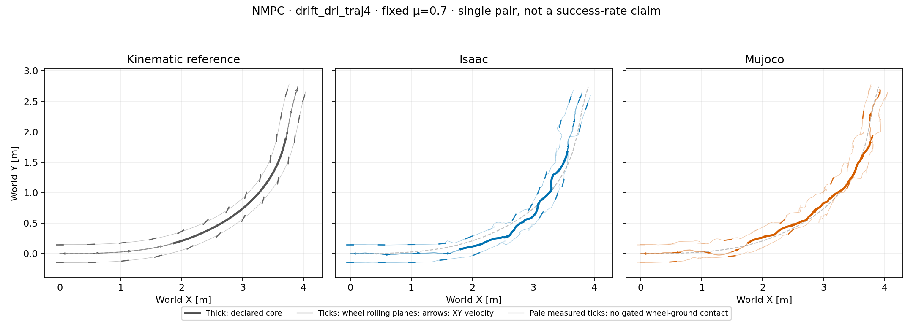

# Nominal NMPC: progress error, model audit and longer look-ahead

This follow-up uses **only the primary turn at μ=0.70**. No NMPC friction
grid, controller freeze, new training or PPO initialization is reported.
The reference, 15-term height-free objective and actuator mapping stay fixed.

## The previous Isaac error is not all lateral sliding

At the same physical timestamp, project root-origin position error onto the
reference root-origin tangent and its left normal. Negative along-track error
means behind the reference. There is no nearest-path fit, time warp, spatial
registration or COM-course substitution. Derivatives use demonstrated
reference samples only, excluding synthetic recovery/tail.

| Core RMS error (m) | Total XY | Along tangent | Along normal |
| --- | ---: | ---: | ---: |
| Absolute H15, Isaac | 0.3244 | 0.1569 | 0.2839 |
| Residual H15, Isaac | 0.2590 | 0.2208 | 0.1354 |
| Absolute H15, MuJoCo | 0.2803 | 0.2198 | 0.1739 |
| Residual H15, MuJoCo | 0.1154 | 0.0878 | 0.0749 |

Residual Isaac's tangent component is behind throughout the core and accounts
for **72.65% of squared XY error**. Normal error improves, but same-time
progress remains inadequate. These components do not measure contact slip or
establish a constant controller delay. Root-origin speed diagnostics also
differ from the previously reported base-COM speed; do not mix those points.
The original total-XY screen remains unchanged.

## Bounded observed-action model audit (residual H15 only)

Sixteen intervals were selected from fixed time strata and measured contact
changes **before prediction**, then predicted independently for one 20 ms
action interval each: 64 physical substeps, no CEM or new closed loop.
Inputs are the exact recorded 111-D controller states, actual float32 actions,
runtime joint limits and original nonzero contact history. Local and original
remote workers match C++ source, MuJoCo headers/library and compiled model
snapshot; their host-specific native binary hashes remain distinct.

| Maximum prediction difference | Value | Scope |
| --- | ---: | --- |
| Root XY distance | 0.780 mm | All 64 substeps; maximum occurs at 20 ms |
| Root COM-velocity component | 0.0296 m/s | All substeps/components |
| Root angular-velocity component | 0.703 rad/s | All substeps/components |
| Joint torque, first substep | 0.0000155 Nm | Same measured initial state |
| Joint torque, all substeps | 21.28 Nm | Subsequent predicted states evolve independently |

No sizeable action-mapping error was found in this sample. Subsequent contact,
angular velocity and torque differences remain, so small short-interval XY
error does **not** certify long-horizon/counterfactual accuracy or explain the
whole tracking discrepancy. Contact-force channels have different engine
semantics. Nonroot body channels reconstructed by FK are not extra measured
Isaac snapshots; the logged actual objective remains authoritative.
The [sanitized diagnostics](nmpc_nominal_diagnostics_20261016_v1/summary.json)
record exact input/source hashes, sample selection and component definitions.
This is not an audit of H30 states or a causal explanation of its results.

## Longer look-ahead development

Residual H30/B5 predicts 0.60 s instead of 0.30 s, retaining five blocks.
Block duration therefore also changes from 0.06 to 0.12 s: this is not a
horizon-only causal experiment. Population 64, three CEM iterations, eight
elites, seed 42, 20 ms control and nominal prediction μ=0.70 remain unchanged.
Both plants independently replan using MuJoCo prediction, not action replay.



The [strict H30 pair](controller_primary_nmpc_residual_h30_b5_nominal_pair_v1/summary.json)
completes 349 decisions / 1,397 physical samples in each engine:

| H30 core diagnostic | Isaac | MuJoCo |
| --- | ---: | ---: |
| XY RMSE / peak | 0.2318 / 0.3350 m | 0.0916 / 0.1252 m |
| Mean COM-speed retention | 95.84% | 101.16% |
| Net COM-course turn | 60.38° | 36.48° |
| Maximum full-episode tilt | 15.81° | 18.44° |
| Median replanning time | 659 ms | 969 ms |

Neither engine records nonwheel-ground contact or solver failure. Isaac improves
on H15 but still exceeds both XY limits, so H30 is **not frozen or qualified
for a friction grid**. Net-course values are endpoint velocity diagnostics,
not path-turn equivalence; reference COM-course turn is 59.255°.
The simulator waits for solves: these are not 20 ms real-time results or
controlled cross-host timing comparisons.

Height, flight and nonzero heading offsets are not failure gates. Mean speed,
coverage, a small one-step prediction error or an XY pass alone do not prove
a controlled high-speed turn, continuous-uncertainty robustness or hardware
readiness. Current reference speed remains approximately 1 m/s.

## Reproduction

The vector-only diagnostic needs the existing public compact pairs, not models:

```sh
python scripts/analyze_xy_error_components.py \
  --baseline-dir results/controller_primary_nmpc_nominal_pair_v1 \
  --residual-dir results/controller_primary_nmpc_residual_nominal_pair_v1 \
  --output-dir outputs/NEW_nominal_xy_components
```

The bounded [prediction probe](../scripts/probe_nmpc_isaac_prediction.py) requires
the hash-locked original Isaac episode, licensed model/motion, matching helper
snapshot, contract and an explicitly built native library; its CLI documents
those inputs. It is bound to this particular H15 episode, not a generic model
certificate. Reproduce the H30 episode using the shared
[residual runner command](2026-10-16-nmpc-nominal-development.md#audited-artifacts-and-offline-reproduction)
plus `--horizon-steps 30 --control-blocks 5` and a fresh output directory.
