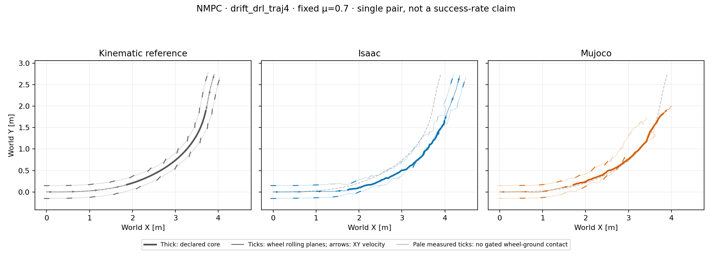
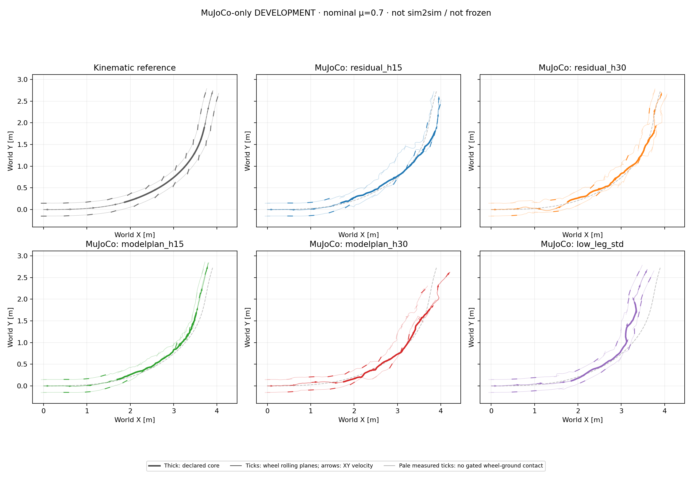
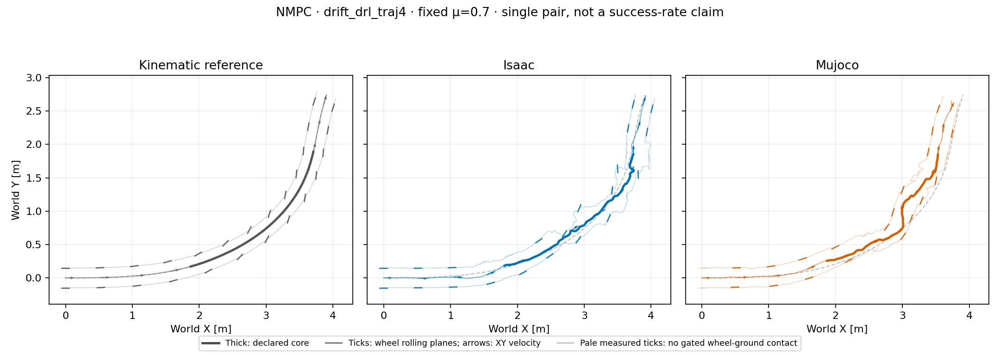
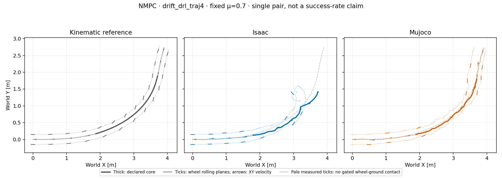

# Nominal NMPC: progress, model audit and finite-scenario tests

This follow-up uses **only the primary turn at μ=0.70**. No NMPC friction
grid, controller freeze, new training or PPO initialization is reported.
The reference, 15-term height-free objective and actuator mapping stay fixed.

## The previous Isaac error is not all lateral sliding

At the same physical timestamp, project root-origin position error onto the
reference root-origin tangent and its left normal. Negative along-track error
means behind the reference. There is no nearest-path fit, time warp, spatial
registration or COM-course substitution. Derivatives use demonstrated
reference samples only, excluding synthetic recovery/tail.

| Core RMS error (m) | Total XY | Along tangent | Along normal |
| --- | ---: | ---: | ---: |
| Absolute H15, Isaac | 0.3244 | 0.1569 | 0.2839 |
| Residual H15, Isaac | 0.2590 | 0.2208 | 0.1354 |
| Absolute H15, MuJoCo | 0.2803 | 0.2198 | 0.1739 |
| Residual H15, MuJoCo | 0.1154 | 0.0878 | 0.0749 |

Residual Isaac's tangent component is behind throughout the core and accounts
for **72.65% of squared XY error**. Normal error improves, but same-time
progress remains inadequate. These components do not measure contact slip or
establish a constant controller delay. Root-origin speed diagnostics also
differ from the previously reported base-COM speed; do not mix those points.
The original total-XY screen remains unchanged.

## Bounded observed-action model audit (residual H15 only)

Sixteen intervals were selected from fixed time strata and measured contact
changes **before prediction**, then predicted independently for one 20 ms
action interval each: 64 physical substeps, no CEM or new closed loop.
Inputs are the exact recorded 111-D controller states, actual float32 actions,
runtime joint limits and original nonzero contact history. Local and original
remote workers match C++ source, MuJoCo headers/library and compiled model
snapshot; their host-specific native binary hashes remain distinct.

| Maximum prediction difference | Value | Scope |
| --- | ---: | --- |
| Root XY distance | 0.780 mm | All 64 substeps; maximum occurs at 20 ms |
| Root COM-velocity component | 0.0296 m/s | All substeps/components |
| Root angular-velocity component | 0.703 rad/s | All substeps/components |
| Joint torque, first substep | 0.0000155 Nm | Same measured initial state |
| Joint torque, all substeps | 21.28 Nm | Subsequent predicted states evolve independently |

No sizeable action-mapping error was found in this sample. Subsequent contact,
angular velocity and torque differences remain, so small short-interval XY
error does **not** certify long-horizon/counterfactual accuracy or explain the
whole tracking discrepancy. Contact-force channels have different engine
semantics. Nonroot body channels reconstructed by FK are not extra measured
Isaac snapshots; the logged actual objective remains authoritative.
The [sanitized diagnostics](nmpc_nominal_diagnostics_20261016_v1/summary.json)
record exact input/source hashes, sample selection and component definitions.
This is not an audit of H30 states or a causal explanation of its results.

## Longer look-ahead development

Residual H30/B5 predicts 0.60 s instead of 0.30 s, retaining five blocks.
Block duration therefore also changes from 0.06 to 0.12 s: this is not a
horizon-only causal experiment. Population 64, three CEM iterations, eight
elites, seed 42, 20 ms control and nominal prediction μ=0.70 remain unchanged.
Both plants independently replan using MuJoCo prediction, not action replay.


The [strict H30 pair](controller_primary_nmpc_residual_h30_b5_nominal_pair_v1/summary.json)
completes 349 decisions / 1,397 physical samples in each engine:

| H30 core diagnostic | Isaac | MuJoCo |
| --- | ---: | ---: |
| XY RMSE / peak | 0.2318 / 0.3350 m | 0.0916 / 0.1252 m |
| Mean COM-speed retention | 95.84% | 101.16% |
| Net COM-course turn | 60.38° | 36.48° |
| Maximum full-episode tilt | 15.81° | 18.44° |
| Median replanning time | 659 ms | 969 ms |

Neither engine records nonwheel-ground contact or solver failure. Isaac improves
on H15 but still exceeds both XY limits, so H30 is **not frozen or qualified
for a friction grid**. Net-course values are endpoint velocity diagnostics,
not path-turn equivalence; reference COM-course turn is 59.255°.
The simulator waits for solves: these are not 20 ms real-time results or
controlled cross-host timing comparisons.

## Three fixed prediction models did not fix nominal tracking

The [finite-scenario pair](controller_primary_nmpc_residual_scenario3_nominal_pair_v1/summary.json)
returns to residual H15/B5, with the previously declared prediction coefficients
`[0.3, 0.7, 1.6]`. Each candidate uses one shared action sequence; CEM minimizes
the maximum **summed horizon cost** over those constant-coefficient models.
Both actual plants remain fixed at μ=0.70. This is not a validation-friction
sweep, a switching-uncertainty controller or a formal robustness guarantee.



| Three-model core diagnostic | Isaac | MuJoCo |
| --- | ---: | ---: |
| XY RMSE / peak | 0.2745 / 0.3760 m | 0.1282 / 0.2008 m |
| Mean COM-speed retention | 109.04% | 96.56% |
| Maximum full-episode tilt | 13.68° | 98.51° |

All 349 decisions and 1,397 physical samples are complete, with zero solver
failures. Isaac is worse than both single-model residual variants. MuJoCo's
core XY screen passes despite its large tilt and first nonwheel-ground contact
at 3.180 s; this is not stable controlled execution. Posture remains a separate
diagnostic, not a replacement height/flight failure gate. All 68,054 candidate
evaluations are finite, with 204,162 scenario evaluations and 6,279 batch calls
per episode: three-model prediction also spends more computation.

Following the explicit experiment decision, **nominal XY must pass before any
controller freeze or friction sweep**. These completed failures are preserved;
the next improvement is not selected using held-out validation coefficients.

Height, flight and nonzero heading offsets are not failure gates. Mean speed,
coverage, a small one-step prediction error or an XY pass alone do not prove
a controlled high-speed turn, continuous-uncertainty robustness or hardware
readiness. Current reference speed remains approximately 1 m/s.

## Model-only initialization and narrower leg sampling did not improve tracking

The [local search-development summary](nmpc_nominal_search_development_20261016_v1/summary.json)
preserves five MuJoCo variants, including the earlier unseeded H15 baseline.
All five complete 349 decisions / 1,397 physical samples at plant and prediction
μ=0.70, seed 42, with zero solver failures. These are nominal development
results, not a frozen benchmark or a validation-friction grid.



| MuJoCo variant | Core XY RMSE / peak (m) | Mean COM-speed retention | Maximum full-clip tilt |
| --- | ---: | ---: | ---: |
| Unseeded residual H30/B5 | 0.091639 / 0.125206 | 101.16% | 18.44° |
| Model-only initializer, H15/B5 | 0.203165 / 0.297071 | 94.69% | 10.43° |
| Model-only initializer, H30/B5 | 0.153742 / 0.192481 | 98.58% | 94.31° |
| H30/B5, lower initial leg standard deviation | 0.205810 / 0.396978 | 95.54% | 13.39° |

The initializer contains only 349×8 applied actions generated by the earlier
MuJoCo residual H30/B5 controller: no PPO, learned actor or human demonstration
is used as its donor. It is an **additional** initial candidate, alongside
previous-action, shifted-plan and bias-only candidates, rescored from the
current measured state under every declared prediction model. CEM can reject
or correct it; it does not replay actions or prescribe robot state. The feature
is default OFF, with exact default action/plan/cost/RNG golden regression tests.
Donor generation already spent 8,166,480 prediction substeps plus 1,396 donor
plant substeps; subsequent online CEM and antecedent development are additional.

The narrower-search variant has no initializer and changes only the six initial
leg sampling standard deviations from 0.04 to 0.02. Minimum standard deviations
and both wheel sampling widths remain unchanged. Neither search change improves
on unseeded H30. The H30 initializer variant first records nonwheel-ground
contact at 4.240 s, outside the core, and reaches 94.31° full-clip tilt; the other
four variants record no nonwheel-ground contact. Posture/contact measurements
remain diagnostics, not new height or flight failure gates.

Neither initializer nor lower-leg-width variant has been evaluated in Isaac;
the prepared initializer snapshot has not been uploaded. No controller is
frozen and no NMPC friction grid has started: **both engines must first achieve
core XY RMSE ≤0.15 m and peak ≤0.30 m**.

## Finer residual blocks pass the XY screen in Isaac, not in MuJoCo

The completed [H30/B10 pair](controller_primary_nmpc_residual_h30_b10_nominal_pair_v1/summary.json)
keeps the 0.60 s horizon but changes residual-correction blocks from 0.12 to
0.06 s, doubling search parameters from 40 to 80. Actual control remains
0.02 s; the full shifted baseline can retain 20 ms variation. Population 64,
three iterations, eight elites, seed 42 and plant/prediction μ=0.70 remain
unchanged. This is not a causal block-resolution-only test.



| H30/B10 core diagnostic | Isaac | MuJoCo |
| --- | ---: | ---: |
| XY RMSE / peak (m) | 0.067409 / 0.112176 | 0.170030 / 0.306377 |
| Mean COM-speed retention | 102.25% | 95.68% |
| Maximum full-episode tilt | 14.58° | 14.54° |

Both runs complete 349 decisions / 1,397 physical samples, with zero solver
failures and no nonwheel-ground contact. Isaac passes both XY limits; MuJoCo
exceeds both, so this configuration is **not frozen or qualified for the
friction grid**. Neither posture nor flight becomes a new failure gate.

The engines also use different implementation bytes: remote Isaac retains
the approved CEM source `8d2ac598…`, while local MuJoCo uses `d7d50588…`, which
adds optional model-plan instrumentation with that feature OFF here. Effective
configuration and objective match, and default-OFF behavior has exact golden
regression coverage; separate source hashes are retained. This is development
evidence, **not an identical-source frozen benchmark**.

## Six iterations: preserved runtime failure, not a valid comparison

The [I6 diagnostic pair](controller_primary_nmpc_residual_h30_b5_i6_diagnostic_pair_v1/summary.json)
preserves complete 349-decision / 1,397-sample physical traces, including the
failed predictions and resulting fallback actions. It is **not a valid nominal
controller comparison**, a controller ranking or qualification for freezing.

The intended algorithm change from unseeded H30/B5/I3 is only three to six CEM
iterations: the 0.60 s horizon, five 0.12 s residual-correction blocks, 40 search
parameters, population 64, eight elites, seed 42, 20 ms actions and fixed plant
and prediction μ=0.70 remain unchanged. This increases search computation;
there is no model-plan or learned-policy initializer. The separate remote/local
implementation hashes described above remain preserved.



| H30/B5/I6 diagnostic | Isaac, including fallbacks | MuJoCo |
| --- | ---: | ---: |
| Core XY RMSE / peak (m) | 0.182958 / 0.480784 | 0.067312 / 0.118123 |
| Mean COM-speed retention | 89.05% | 97.82% |
| Maximum full-episode tilt | 107.81° | 16.45° |

Isaac's first failed prediction batch is decision 137; decision 136 is the last
without a failed batch. Decision 137 still selects a finite initial candidate.
At decisions 138–348 all initial candidates fail, producing **211 previous-action
fallbacks**. The saved counters contain 53,341 finite and 81,511 failed candidate
evaluations, with 1,690 failed batch calls. MuJoCo records zero solver failures.
The complete finite physical trace does not make the Isaac solves successful.

The underlying exception was not recorded by the original controller. Its actual
app exit code is also **unknown**: the supervisor/transport ended without a
terminal status, while the completed report and original stale launch status
were preserved. An absent worker after cleanup is not proof of a worker crash;
the evidence does not establish OOM, timeout, MuJoCo warning or SSH causality.
All original snapshot/runtime hashes match before and after the run.

The approximately 8.06 ms whole-episode median mixes fast failed-prediction
fallbacks with successful solves. It is **not normal six-iteration timing**, a
speed advantage or evidence of 20 ms real-time control. Large tilt remains a
posture diagnostic, not a height/flight failure gate; XY limits and nonzero
heading-offset semantics are unchanged. Neither this diagnostic nor the earlier
variants qualify both engines: **no controller is frozen and no NMPC friction
grid has started**.

The local diagnostic-only patch now retains the first eight caught prediction
exceptions per solve, their total count, bounded messages and native/IPC worker
status. It distinguishes native-return, child-exception, IPC and timeout events
without changing the objective, candidate order, action/RNG behavior, fallback
or automatic-restart policy. It has not been deployed; the archived episode is
not retrofitted with new error details or an inferred failure cause.

A separate [bounded observed-input probe](nmpc_i6_failed_inputs_probe_20261016_v1.json)
uses the original hash-matched native wrapper, model and evaluator helpers,
not the new telemetry implementation. Recorded pre-action states 136–139 and
their future applied actions produce finite H1/B4 and H30/B4 batches: exactly
two calls / 496 physical substeps. This is not a new closed loop or CEM search.
It does not test the objective adapter, reproduce the unrecorded failing
candidate population, or establish the original failure cause.

## Reproduction

The vector-only diagnostic needs the existing public compact pairs, not models:

```sh
python scripts/analyze_xy_error_components.py \
  --baseline-dir results/controller_primary_nmpc_nominal_pair_v1 \
  --residual-dir results/controller_primary_nmpc_residual_nominal_pair_v1 \
  --output-dir outputs/NEW_nominal_xy_components
```

The bounded [prediction probe](../scripts/probe_nmpc_isaac_prediction.py) requires
the hash-locked original Isaac episode, licensed model/motion, matching helper
snapshot, contract and an explicitly built native library; its CLI documents
those inputs. It is bound to this particular H15 episode, not a generic model
certificate. Use historical checkout `3faf08d` for this probe: the later optional
initializer changes runtime CEM/runner hashes, and the probe deliberately rejects
those different source bytes. Reproduce the H30 episode using the shared
[residual runner command](2026-10-16-nmpc-nominal-development.md#audited-artifacts-and-offline-reproduction)
plus `--horizon-steps 30 --control-blocks 5` and a fresh output directory.

For the optional initializer, inspect
`python scripts/export_model_nominal_plan.py --help` and first export a local,
hash-locked action artifact from the completed unseeded residual H30 donor.
Add `--model-nominal-plan /path/to/NEW_artifact/plan.json` to that residual H30
command (or set `--horizon-steps 15` for the initializer H15 case). Original donor
report/trace/solver files and the standalone action NPZ are not published. The
public compact development trace does include derived held-action samples;
its summary retains portable donor metadata, hashes and generation budget.
For the narrower-leg H30 case, use
`--settings config/nmpc_height_smooth_residual_h30_low_leg_std.json` in the
same base command, retain `--horizon-steps 30 --control-blocks 5`, and leave
`--model-nominal-plan` unset. These commands generate new physics episodes;
they are not asset-free replays of the public summary.

The [failed-input probe](../scripts/probe_nmpc_isaac_failed_inputs.py) documents
its required original I6 archive, hash-locked helpers and native library in
`--help`. Its mandatory `--runtime-source-root` must contain the exact original
native wrapper/objective/C++ files from `0e1d884`, plus their source manifest;
the current telemetry wrapper is intentionally rejected. No build, retry,
model normalization or replacement contact history is performed.
