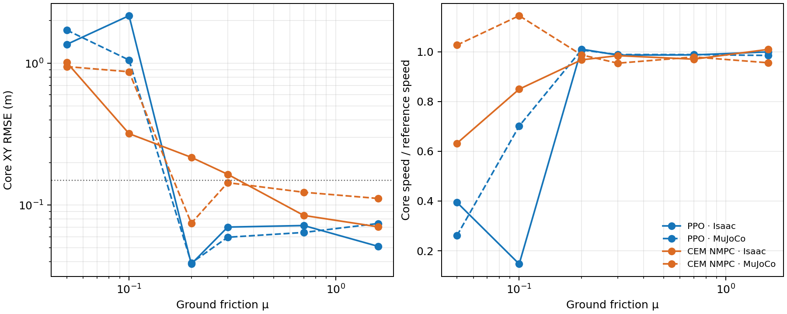
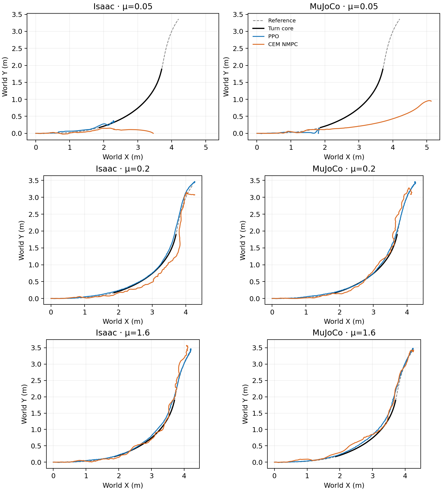

# Ground-friction pilot: high-speed turn without direct sideslip reward

This extends the [fixed-μ=0.7 no-sideslip-reward ablation](2026-10-16-no-sideslip-reward-ablation.md) to six predeclared validation ground-friction values. The target remains `drift_drl_traj4`; the turn core is 1.44–4.00 s of a 6.98 s reference. Only the **validation plant's ground material** changes. Both numeric static and dynamic friction are set to the listed μ in each engine. The PPO checkpoint and CEM objective/search parameters stay frozen; the CEM prediction model remains at μ=0.7, with no friction oracle or online adaptation. No policy is retrained.

PPO was previously trained with BeyondMimic-style friction randomization (static U[0.3,1.6], dynamic U[0.3,1.2]); μ=0.05, 0.10 and 0.20 lie outside both training intervals, while μ=1.60 is outside the dynamic-friction interval. μ=0.70 reuses the completed nominal episodes. Each cell below is **one seed-42 full-horizon episode**, not a statistical estimate.

| Ground μ | PPO XY RMSE, Isaac / MuJoCo (m) | CEM XY RMSE, Isaac / MuJoCo (m) | PPO speed retained, Isaac / MuJoCo | CEM speed retained, Isaac / MuJoCo |
| ---: | ---: | ---: | ---: | ---: |
| 0.05 | 1.361 / 1.715 | 1.013 / 0.949 | 39% / 26% | 63% / 103% |
| 0.10 | 2.168 / 1.055 | 0.319 / 0.872 | 15% / 70% | 85% / 115% |
| 0.20 | 0.039 / 0.039 | 0.217 / 0.075 | 101% / 101% | 97% / 99% |
| 0.30 | 0.070 / 0.059 | 0.165 / 0.144 | 99% / 99% | 98% / 95% |
| 0.70 | 0.072 / 0.064 | 0.085 / 0.123 | 99% / 99% | 97% / 98% |
| 1.60 | 0.051 / 0.074 | 0.070 / 0.112 | 100% / 99% | 101% / 96% |

Using the existing *position-only* exploratory screen (core XY RMSE >0.15 m **or** peak >0.30 m), PPO crosses it in both engines at μ=0.05 and 0.10, but not at the four higher sampled values. CEM crosses it in Isaac at μ=0.05–0.30, and in MuJoCo at μ=0.05 and 0.10. This is a sampled transition, **not** a calibrated friction threshold: for example, CEM's Isaac–MuJoCo core XY separation is still 0.235 m at μ=0.20 and 0.30, versus about 0.02 m for PPO. At μ=0.05–0.10, CEM can retain speed while missing the XY turn; speed alone is not successful tracking. All 24 episodes reach the full 6.98 s; CEM reports zero solver failures.

This screen does **not** classify sideslip angle, wheel-heading offset, flight, or height as failures. A large sideslip angle may be the desired behavior; the tested failure mode is large XY displacement from the turn reference. Equal numeric μ in PhysX and MuJoCo does not establish equivalent tire–ground physics. CEM is an offline comparison here: its nominal Isaac median solve time was about 635 ms against a 20 ms control period.

The [locked pilot configuration](../config/no_sideslip_friction_pilot.json), [analysis code](../scripts/analyze_no_sideslip_friction_pilot.py), [machine-readable summary](no_sideslip_friction_pilot_20261016_v1/summary.json), and [compact XY traces](no_sideslip_friction_pilot_20261016_v1/xy_trace.npz) record parameters, material readbacks, input hashes, full-horizon checks, core/peak errors, speeds and sim2sim gaps. Raw controller outputs are gitignored under `outputs/no_sideslip_{ppo,cem_isaac,cem}_friction_pilot_20261016_v1/`; nominal μ=0.7 raw outputs are listed in the fixed-μ report. Re-running the analysis against those saved outputs reproduced all four published artifacts byte-for-byte.

A separate [known-friction MPC pilot](2026-10-16-nmpc-known-friction-pilot.md) compares this fixed predictor against an exact-ground-μ oracle at two MuJoCo friction points.
