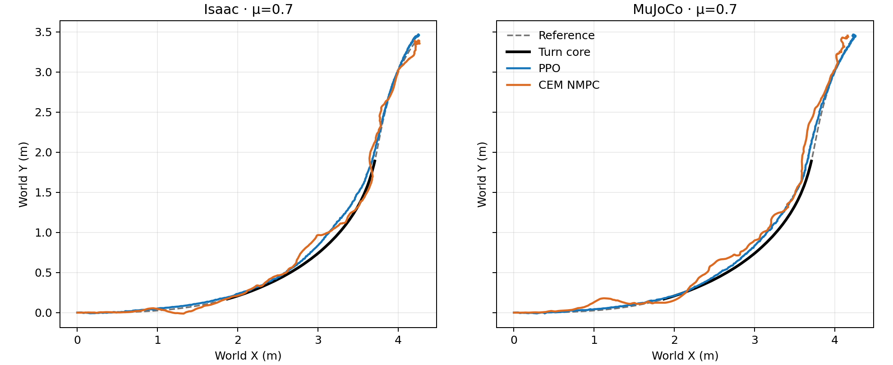

# Primary turn: no-sideslip-reward ablation at fixed μ=0.7

This ablation asks whether direct sideslip-angle reward is needed for high-speed, large-angle turning. It does **not** define sideslip, wheel-heading offset, or brief flight as a failure. The reference remains `drift_drl_traj4` (a scaled CARLA trajectory, not measured tire slip), with the 1.44–4.00 s turn core and 6.98 s full episode.

## Task and controllers

The [ablation profile](../config/car_drift_height_smooth_no_sideslip_task.json) changes only `reward_weights.sideslip` from 2.0 to 0.0 relative to [the primary height-smooth profile](../config/car_drift_height_smooth_task.json). XY position and velocity tracking, yaw-rate, speed, groundedness, tilt, height smoothness, posture and action regularization stay in place. The PPO action space and CEM objective structure are unchanged. Any sideslip or wheel–course heading separation remains a diagnostic, never a success/failure gate.

The no-sideslip PPO is trained from scratch with the same seed-42 BeyondMimic-style recipe as the primary PPO: 512 environments, 1000 iterations, 24 steps per iteration (12,288,000 transitions). Training material friction is randomized as before: static U[0.3,1.6], dynamic U[0.3,1.2]. The nominal evaluation fixes both static and dynamic ground friction to μ=0.7, and uses one full-horizon episode per controller per engine. The nominal CEM uses the existing H30/B10, 64 candidates × 3 iterations, 8 elites, seed-42 residual-plan setup, with prediction and plant friction both μ=0.7. CEM does not use the learned policy as an initializer.

## Fixed-μ results

All four no-sideslip-reward episodes cover the 1.44–4.00 s core and complete the 6.98 s reference. The table uses root XY position error and original base-Link COM XY-speed retention against the same reference. Each value is from **one** seed-42 episode. The full physical traces, material readbacks and file hashes were audited by [the comparison script](../scripts/analyze_no_sideslip_ablation.py); the [machine-readable summary](no_sideslip_reward_mu0p7_v1/summary.json) preserves the values and input hashes.

| Controller | Engine | Core XY RMSE / peak (m) | Mean speed retained | Core Isaac–MuJoCo XY gap (m) |
| --- | --- | ---: | ---: | ---: |
| PPO | Isaac | 0.0718 / 0.1170 | 98.75% | 0.0158 |
| PPO | MuJoCo | 0.0642 / 0.1026 | 98.88% | 0.0158 |
| CEM NMPC | Isaac | 0.0846 / 0.1766 | 97.03% | 0.0843 |
| CEM NMPC | MuJoCo | 0.1233 / 0.2002 | 97.91% | 0.0843 |



For context, under the **original** sideslip-reward objective, PPO core RMSE was 0.0565 m in Isaac and 0.0498 m in MuJoCo; CEM was 0.0674 m and 0.1700 m respectively. With the ablated objective, PPO XY error is modestly higher in both engines; CEM error is higher in Isaac but lower in MuJoCo. The no-sideslip PPO has lower core XY error and a smaller sim2sim XY gap than the no-sideslip CEM in this nominal condition. These are descriptive single-run comparisons, not statistical effects of reward removal: the PPO was retrained, its Isaac validation used another idle GPU, and the CEM Isaac runner includes newer optional branches that were disabled here. PPO and CEM also do not have mathematically identical objectives or plant models.

The CEM search reports zero solver failures but a 635 ms median Isaac solve against a 20 ms control period. It is therefore an **offline tracking comparison**, not a real-time controller demonstration. The XY screen (RMSE >0.15 m or peak >0.30 m) is not crossed by any of the four ablation episodes. It is an exploratory position screen, not a physical drift criterion. No absolute-height, flight or heading-offset failure gate is used.

## Reproduction and provenance

The completed [PPO trainer](../scripts/train_beyondmimic_style.py) used 12,288,000 environment transitions and produced checkpoint SHA-256 `cb336fa90a44ba73056fd6a1b4f5247a8a90fdcd636f0d05945ec973a24ec87f` (training manifest SHA-256 `ca865361294cad54678730ae4377866e294c3f247c7d471ee05b6d5259b2aa0f`; completion-status SHA-256 `6965f6ee8da5d3504d084d354bdae6a168f8225ff0cac272456e97b09a409184`). The fixed-μ validation reported equal 0.7 ground and robot material readback in Isaac and compiled [0.7,0.7] sliding-friction range in MuJoCo. The [CEM runner](../scripts/run_nmpc_tracking.py) used fixed 0.7 in both the prediction model and each plant. The new no-sideslip task profile is the only reward-profile change; the new PPO was trained from scratch, not a renamed original checkpoint.

Raw local outputs (intentionally gitignored): `outputs/no_sideslip_ppo_mu0p7_validation_20261016_v1/`, `outputs/no_sideslip_nmpc_isaac_mu0p7_20261016_v1/`, and `outputs/no_sideslip_nmpc_mu0p7_full_20261016_v1/`. Recompute the published summary and figure from these traces with:

```bash
python scripts/analyze_no_sideslip_ablation.py \
  --motion-file /home/roy/tron1-learning-from-human/results/2026-10-14-car-drift/matched-friction-mu0p70/motion.npz \
  --reference-file /home/roy/tron1-learning-from-human/results/2026-10-14-car-drift/matched-friction-mu0p70/robot_reference.npz \
  --ppo-dir outputs/no_sideslip_ppo_mu0p7_validation_20261016_v1 \
  --cem-isaac-dir outputs/no_sideslip_nmpc_isaac_mu0p7_20261016_v1 \
  --cem-mujoco-dir outputs/no_sideslip_nmpc_mu0p7_full_20261016_v1 \
  --output-dir outputs/REPLAY_no_sideslip_mu0p7
```

Equal numeric friction coefficients do not imply calibrated PhysX–MuJoCo tire-contact equivalence. The reference is CARLA-derived and retargeted; it does not provide measured tire contact slip. Sideslip angle can be inspected separately, but this ablation neither rewards it nor treats it as a mismatch. The original PPO and CEM runs and outputs remain unchanged. The frozen-controller [ground-friction pilot](2026-10-16-no-sideslip-friction-pilot.md) extends the nominal comparison to six validation friction values.
