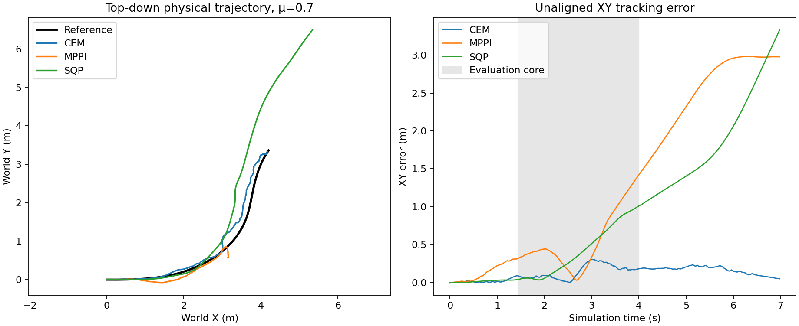

# Nominal optimizer comparison: primary large-angle turn

This is a **MuJoCo-only development experiment** on `drift_drl_traj4` at
plant μ=0.70 and predictor μ=0.70. It compares complete 349-decision physical
episodes using the same model, motion, 20 ms action clock, actuator interface,
and 15-term height-smooth rollout score. CEM and MPPI are the unchanged prior
recordings; SQP is a new bounded, finite-difference SLSQP shooting baseline.
No policy training, Isaac result, friction sweep, or hardware-real-time claim
is made here.

| Optimizer | Core XY RMSE / peak (m) | Core speed retained | Max tilt | Median solve (ms) | Predicted rollouts |
| --- | ---: | ---: | ---: | ---: | ---: |
| CEM | 0.1700 / 0.3064 | 95.68% | 14.54° | 999.0 | 68,054 |
| MPPI | 0.6662 / 1.4216 | 60.48% | 111.59° | 1,153.6 | 68,054 |
| SQP / SLSQP | 0.5345 / 1.0118 | 129.00% | 10.17° | 470.5 | 63,069 |



The primary evaluation core is 1.44–4.00 s, unchanged and without time warp.
CEM tracks best of these three recorded configurations, though it misses the
exploratory 0.15 m RMSE / 0.30 m peak screen. SQP remains upright with no
recorded non-wheel ground contact in the core, but overspeeds and accumulates
XY error; 250 of 349 SLSQP calls report optimizer convergence, while 99 stop
at the three-iteration cap. MPPI loses posture and slows: non-wheel ground
contact occurs in 56.53% of its core physical samples. Zero prediction
fallbacks does **not** mean successful motion control.

SQP uses the same 30-step (0.60 s), 10-block action horizon as the archived
CEM/MPPI pilots, finite-difference gradients from native MuJoCo batch
rollouts, box-bounded block residuals about a frozen physics-only initial
plan, and at most three SLSQP iterations per decision. The best finite
physical plan seen during optimization is applied; a failed optimization
holds the previous action. Neither a learned actor nor a tuned tyre model is
used. Its short convergence cap is a compute-budget choice, not evidence that
the mathematical SQP optimum was reached. The [SQP controller](../scripts/sqp_shooting.py),
[runner](../scripts/run_sqp_tracking.py), and [three-run analyzer](../scripts/analyze_nominal_optimizers.py)
are independently replayable. The [summary](nominal_optimizer_comparison_20261016_v2/summary.json)
binds the three original rollout hashes.

This is **not a causal optimizer ranking**. MPPI's Gaussian action prior
changes its optimization objective even though the physical score is shared;
sampling/finite-difference budgets and nominal wall-time conditions differ.
All observed solves exceed the 20 ms controller period, and simulation waits
for them. Contact transitions are not made differentiable by the finite
difference approximation. One reference and one fixed parameterization per
method do not establish general robustness.

For a future wheel-heading objective, do not use the wheel-link's full
quaternion: reference wheel spin was not observed, so it is intentionally
excluded from the present `motion_body_ori` term. A separate *spin-invariant*
left/right rolling-plane heading target can be derived from each reference
wheel axle, while preserving a nonzero target course-to-wheel offset during
drift. Such a change creates a new task objective and requires rebuilding
the native predictor and rerunning **all three** optimizers; it must not be
mixed into this comparison. The current reference already includes wheel
position and linear velocity, not wheel orientation or angular velocity.

To reproduce the SQP pilot, use the hash-matched MuJoCo 3.8.1 model, reference,
actuator contract and prebuilt native batch library described in the parent
README, and choose a fresh output directory:

```sh
python scripts/run_sqp_tracking.py \
  --model /path/to/mujoco_model.xml \
  --motion /path/to/drift_drl_traj4/motion.npz \
  --contract /path/to/policy_contract.json \
  --native-library /path/to/libtron1_nmpc_batch.so \
  --output-dir outputs/NEW_sqp_mu0p7
```
