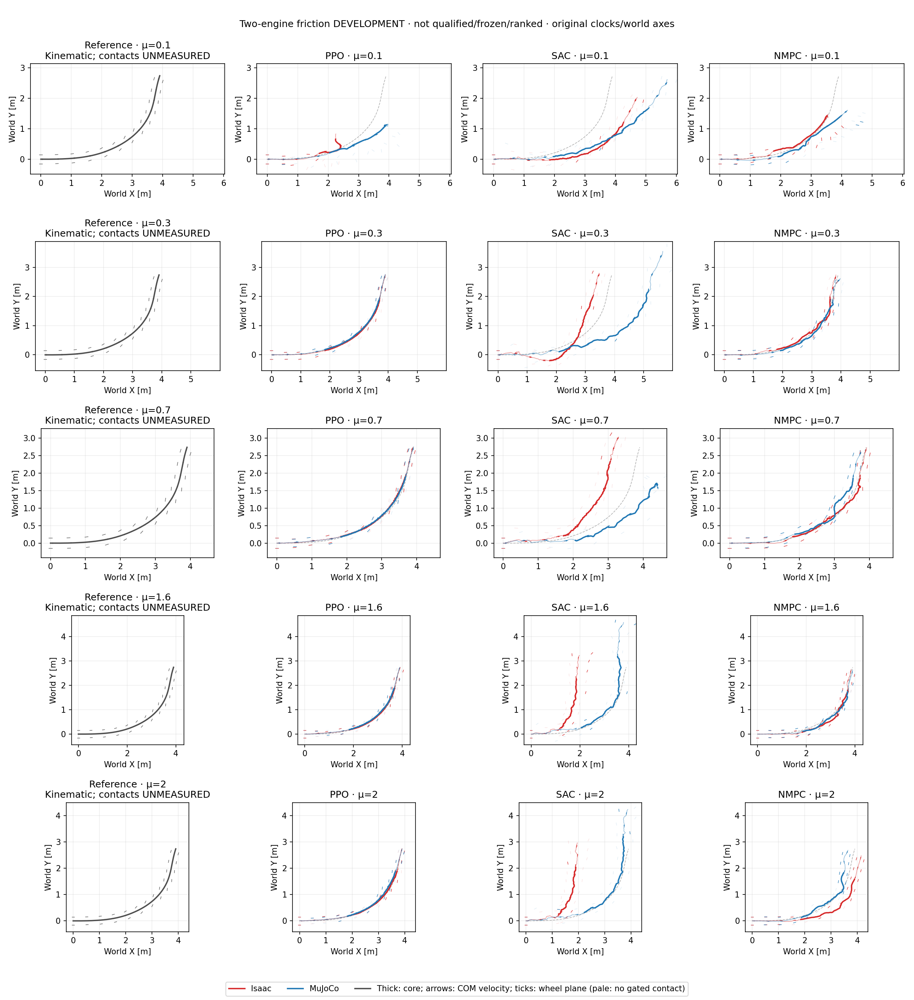

# Fixed-controller friction comparison: primary turn

This record concerns `drift_drl_traj4` only. The separate S-avoidance reference
is not pooled with it. This is a **development comparison**, not a
nominal-qualified frozen benchmark: NMPC's existing μ=0.7 MuJoCo episode
exceeds the original XY screen, and is retained rather than tuned away.
The qualified freeze/execute driver's conditions are unchanged.

## Completed two-engine development results

All 17 NMPC coefficients in **each** engine have complete 349-decision /
1,397-sample physical recordings, zero solver fallbacks and unchanged
controller/source identities. MuJoCo reuses two matching episodes and adds
15; Isaac adds 17. No case was retuned or rerun to replace a failure. Existing
PPO/SAC recordings supply the same full-grid physical diagnostics.

| Controller | Below both XY limits: Isaac | MuJoCo | Both engines at the same μ |
| --- | ---: | ---: | ---: |
| PPO | 13/17 | 11/17 | 11/17 |
| SAC | 0/17 | 0/17 | 0/17 |
| Fixed NMPC | 10/17 | 10/17 | 8/17 |

These are single-episode XY-screen counts, not stability certificates,
statistical success rates or controller-class rankings. Both NMPC grids have
seven failures, but at different coefficients:

- Isaac: μ=0.01, 0.03, 0.05, 0.10, 0.20, 1.20, 2.00.
- MuJoCo: μ=0.01, 0.03, 0.05, 0.10, 0.15, 0.20, 0.70.

The nominal μ=0.70 MuJoCo failure remains. No monotone friction threshold is
inferred. At μ=0.01 both engines have about 1.23 m XY RMSE but only 0.015 m
inter-engine XY RMSE: matching each other is not sufficient to track the target.

All entries below are core XY RMSE [m], **Isaac / MuJoCo**. The screen also
checks peak error; exact peaks, speed, heading, contact slip, posture and
same-time inter-engine gaps are retained in the linked summary.

| Fixed μ | PPO | SAC | Fixed NMPC |
| ---: | ---: | ---: | ---: |
| 0.01 | 1.0479 / 1.0840 | 1.2197 / 1.1581 | 1.2297 / 1.2272 |
| 0.03 | 1.1701 / 1.2114 | 1.0562 / 1.0585 | 1.1763 / 1.3654 |
| 0.05 | 1.6159 / 1.6261 | 1.0289 / 1.1760 | 0.6611 / 0.8981 |
| 0.10 | 1.0950 / 0.4061 | 0.6122 / 0.7194 | 0.1870 / 0.2209 |
| 0.15 | 0.0445 / 0.2646 | 0.3743 / 2.0162 | 0.1304 / 0.7077 |
| 0.20 | 0.0275 / 0.4659 | 0.4842 / 1.2189 | 0.2278 / 0.4099 |
| 0.30 | 0.0210 / 0.0432 | 0.5913 / 1.0093 | 0.0541 / 0.0720 |
| 0.45 | 0.0463 / 0.0436 | 0.6685 / 2.4958 | 0.1384 / 0.1298 |
| 0.60 | 0.0426 / 0.0574 | 0.6933 / 2.4668 | 0.1325 / 0.1026 |
| 0.70 | 0.0565 / 0.0498 | 0.5748 / 0.7543 | 0.0674 / 0.1700 |
| 0.80 | 0.0422 / 0.0429 | 0.6595 / 1.0102 | 0.1097 / 0.0950 |
| 1.00 | 0.0418 / 0.0527 | 0.9168 / 0.8024 | 0.0919 / 0.0621 |
| 1.20 | 0.0387 / 0.0521 | 1.1070 / 0.5335 | 0.1900 / 0.0876 |
| 1.40 | 0.0321 / 0.0537 | 2.1315 / 0.7782 | 0.1418 / 0.0470 |
| 1.60 | 0.0391 / 0.0548 | 1.4425 / 0.7250 | 0.1370 / 0.1100 |
| 1.80 | 0.0344 / 0.0704 | 1.0241 / 0.7096 | 0.1121 / 0.1268 |
| 2.00 | 0.0329 / 0.0696 | 1.4232 / 0.8954 | 0.3293 / 0.1266 |



Red is Isaac, blue MuJoCo and gray the reference; thick curves mark the core.
Arrows show recorded COM velocity, ticks show wheel rolling planes, and pale
ticks indicate samples without eligible measured contact—not necessarily flight.
Reference contacts are unmeasured. World axes and original clocks are preserved.

The [complete paired summary](nmpc_primary_friction_pair_development_20261016_v1/summary.json)
and [public physical-signal archive](nmpc_primary_friction_pair_development_20261016_v1/development_trace.npz)
support independent replay without assets or weights. The earlier
[MuJoCo bundle](nmpc_primary_mujoco_friction_development_20261016_v1/summary.json)
and [original PPO/SAC dynamics replay](policy_primary_friction_dynamics_20261016_v1/summary.json)
remain unchanged. The final plot uses full measured policy dynamics, not only XY.
For sampled μ=0.30–2.00, PPO retains 99.41–101.30% speed in Isaac and
98.45–100.17% in MuJoCo, with full-clip maximum tilt ≤6.41° / 7.42° respectively.
SAC's nominal MuJoCo speed is 119.61% but its tilt reaches 138.07°; overspeed
alone is not controlled turning.

Canonical dynamics use the motion file's float32 reference positions; the old
XY grid used the locked float64 retarget positions. Exact float32-cast equality
and identical timestamps are verified. Their maximum XY knot difference is
2.40e-7 m; the resulting RMSE/peak differences obey the analytic bound and
change none of the 68 historical policy XY verdicts. Neither reference is
modified or aligned, and both legacy and canonical values are retained.

## Separating XY failure from sideslip and posture

The completed μ=0.15 and 0.70 NMPC recordings illustrate why the measurements
must remain separate. Values below use the unchanged 1.44–4.00 s core; full-clip
tilt covers 0–6.98 s. Course is the direction of recorded COM velocity, whose
reference endpoint change is 59.26° in the core.

| Engine / μ | XY RMSE / peak [m] | Speed retained | Course change | Maximum tilt: core / full |
| --- | ---: | ---: | ---: | ---: |
| Isaac / 0.15 | 0.130 / 0.238 | 104.6% | 52.91° | 20.04° / 108.80° |
| MuJoCo / 0.15 | 0.708 / 1.461 | 163.7% | 39.79° | 105.69° / 109.04° |
| Isaac / 0.70 | 0.067 / 0.112 | 102.2% | 64.59° | 14.48° / 14.58° |
| MuJoCo / 0.70 | 0.170 / 0.306 | 95.7% | 66.06° | 14.54° / 14.54° |

At μ=0.15 in MuJoCo, instantaneous XY error first exceeds 0.30 m at 2.580 s.
At 3.000 s it is already 0.636 m while tilt is only 5.09°. Tilt first exceeds
30° at 3.495 s and first nonwheel ground contact occurs at 3.820 s. Thus XY
divergence precedes marked posture loss in this recording; this event order is
not a causal identification. Isaac's 108.80° maximum occurs at 5.525 s, outside
the core: its core XY screen passes, but this is not a full-clip stability claim.

At μ=0.70, MuJoCo exceeds 0.30 m at 2.980 s despite remaining upright. Isaac
has **more** contact-point lateral slip RMS (left/right 0.613/0.381 m/s versus
0.254/0.222 m/s), but smaller XY error. Contact-gated mean absolute COM-course
to wheel-plane angles are similar: 16.48°/16.39° versus 15.56°/15.44°.
Larger measured slip or geometric heading offset alone therefore does not
identify a tracking failure in these examples. These are descriptive sampled
events, not additional pass/fail criteria; contact eligibility still requires
measured wheel-ground contact and upward force >5 N.

## What is held fixed

The 17 validation coefficients are the existing grid from μ=0.01 through 2.0.
Only the plant coefficient changes; fixed NMPC always predicts μ=0.7, with
H30/B10/C64/I3/E8, seed 42 and the same residual parameterization, noise,
15-term physical score, initialization and actuator interface. There is no
per-coefficient model fitting, adaptive selector, PPO demonstration, action
replay, root correction or controller retuning. Existing current-source
MuJoCo μ=0.3 and 0.7 episodes are reused, not selected or rerun for a better score.
The [predeclared configuration](../config/nmpc_friction_development.json)
binds the runtime sources, inputs and effective CEM configuration.

PPO and SAC retain their original seed-42 checkpoints and completed
12,288,000-transition training budgets. Their BeyondMimic-style training
randomization includes static friction U[0.3,1.6], dynamic friction U[0.3,1.2]
and restitution U[0,0.5]. Validation uses fixed equal static/dynamic coefficients,
no random events and full-reference physical recording. Existing policy raw
archives are checked against the previously published grid identities; no new
policy training or inference is needed to recover COM speed/contact diagnostics.

All controllers use six leg position commands and two wheel torques, bounded
normalized actions, 50 Hz decisions and 200 Hz physical recording. Evaluation
keeps the original 1.44–4.00 s core, world axes and timestamps. XY limits remain
RMSE 0.15 m / peak 0.30 m. Speed retention is a continuous diagnostic, not a
new pass gate. Height, flight and nonzero sideslip are not failure criteria.

## Reading the evidence

Speed comes from recorded original-link COM velocity, not differentiated XY.
Wheel rolling-plane heading is reconstructed from the measured link/joint
state; actual contact-point lateral slip comes from each engine's original
ground-filtered contact recording, not from forward kinematics. Contact angles
and slip retain their measured-contact coverage and 5 N upward-force gate.
No contact is unavailable slip evidence, not evidence of perfect rolling.
Reference contacts are unmeasured. Speed/slip after posture loss must not be
read as successful upright drifting.

The source is a pinned CARLA trajectory, not physical-car motion capture.
Retargeted reference speeds are roughly 1 m/s; retaining that speed is not a
demonstration of full-size-car dynamic similarity or high-speed hardware control.
Equal numeric μ is also not calibrated contact equivalence across engines.

## Reproduction

To verify the published 17 NMPC pairs and 68 policy episodes directly from
the public compact archives (no robot asset, checkpoint or simulator stepping):

```sh
python -m pytest -q tests/test_controller_friction_publication.py tests/test_nmpc_pair_publication.py
```

Use the hash-locked model, motion and shared actuator contract, with MuJoCo
3.8.1 and an explicitly built native library. This read-only planner verifies
bytes and prints commands; it does not launch, compile or overwrite outputs:

```sh
python scripts/run_nmpc_friction_development.py \
  --model /path/to/mujoco_model.xml --motion /path/to/motion.npz \
  --contract /path/to/policy_contract.json \
  --native-library /path/to/libtron1_nmpc_batch.so \
  --output-root outputs/NEW_nmpc_mu_cases
```

Optional `--reused-case 0.3=DIR --reused-case 0.7=DIR` excludes only complete,
matching recorded episodes, without requiring their XY/posture to pass. The
ordinary independent episode runners execute each command; this does not
create a qualified freeze artifact. The Isaac bridge replans from actual
measured Isaac state using the same MuJoCo predictor; it is not action replay
or an Isaac prediction model. Separate source, build, material and device
readbacks remain bound in the results. Only a completely idle RTX card is used
for one Isaac environment/job at a time; no other user's work is interrupted.

Offline analyzers:

- [MuJoCo fixed-controller development](../scripts/analyze_nmpc_friction_development.py).
- [Isaac↔MuJoCo development comparison](../scripts/analyze_nmpc_friction_pair_development.py).
- [Original PPO/SAC physical-recording replay](../scripts/analyze_policy_friction_dynamics.py).

Each analyzer requires a fresh output directory and original input identities.
Licensed assets, checkpoints, compiled binaries, full action archives and
credentials are not redistributed.

## Interpretation limits

Each coefficient has one deterministic episode from one controller seed, not
a statistical success rate or universal friction boundary. Errors need not be
monotone in μ. PPO/SAC use 51-input actors; NMPC has privileged physical/contact
memory and future-reference preview. Equal stage terms do not equalize RL
discount/bootstrap/orientation-termination semantics or optimization compute.
Solver timings are uncontrolled and no wall-latency actuation delay is injected;
no real-time or robustness certificate is claimed.

The additional [adaptive MPC](2026-10-16-adaptive-mpc.md),
[TVLQR](2026-10-16-tvlqr-model-nominal.md) and [MPPI](2026-10-16-mppi-pilot.md)
pilots retain their own limitations/failures and are not silently promoted to
full-grid benchmarks or a controller-class ranking.
