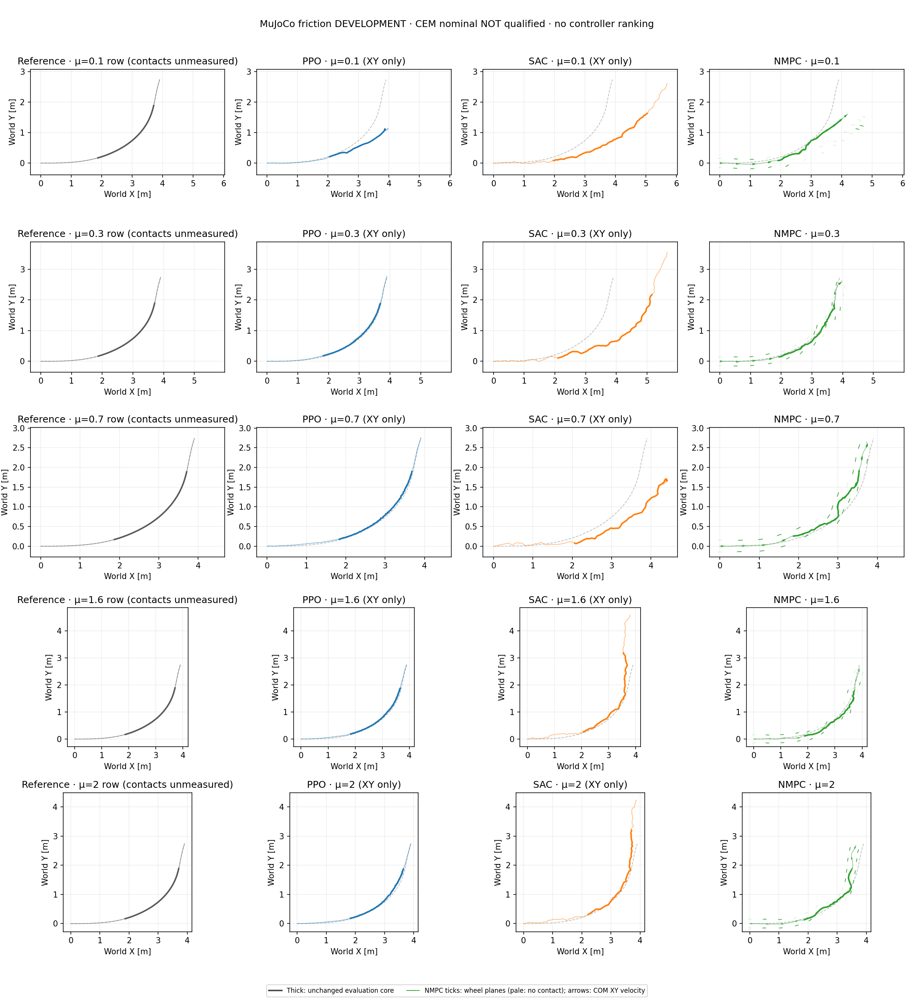

# Fixed-controller friction comparison: primary turn

This record concerns `drift_drl_traj4` only. The separate S-avoidance reference
is not pooled with it. This is a **development comparison**, not a
nominal-qualified frozen benchmark: NMPC's existing μ=0.7 MuJoCo episode
exceeds the original XY screen, and is retained rather than tuned away.
The qualified freeze/execute driver's conditions are unchanged.

## Completed MuJoCo development results

All 17 NMPC coefficients have complete 349-decision / 1,397-sample physical
recordings, zero solver fallbacks and unchanged controller/source identities.
Fifteen episodes are new and two are reused. NMPC exceeds the XY screen at
7/17 points; the same MuJoCo screen is exceeded at 6/17 for PPO and 17/17 for
SAC. These counts are descriptive observations, not controller-class rankings.
The matching current-source Isaac sweep is still in progress, so this is not
yet a completed new NMPC sim2sim sweep.

| Fixed μ | PPO XY RMSE [m] | SAC XY RMSE [m] | NMPC XY RMSE / peak [m] | NMPC speed retained |
| ---: | ---: | ---: | ---: | ---: |
| 0.01 | 1.0840 | 1.1581 | 1.2272 / 2.1732 | 106.4% |
| 0.03 | 1.2114 | 1.0585 | 1.3654 / 2.3197 | 81.1% |
| 0.05 | 1.6261 | 1.1760 | 0.8981 / 1.6418 | 80.8% |
| 0.10 | 0.4061 | 0.7194 | 0.2209 / 0.5504 | 95.8% |
| 0.15 | 0.2646 | 2.0162 | 0.7077 / 1.4614 | 163.7% |
| 0.20 | 0.4659 | 1.2189 | 0.4099 / 1.0258 | 67.9% |
| 0.30 | 0.0432 | 1.0093 | 0.0720 / 0.1092 | 97.9% |
| 0.45 | 0.0436 | 2.4958 | 0.1298 / 0.2147 | 100.8% |
| 0.60 | 0.0574 | 2.4668 | 0.1026 / 0.1856 | 96.3% |
| 0.70 | 0.0498 | 0.7543 | 0.1700 / 0.3064 | 95.7% |
| 0.80 | 0.0429 | 1.0102 | 0.0950 / 0.1616 | 99.4% |
| 1.00 | 0.0527 | 0.8024 | 0.0621 / 0.1105 | 99.2% |
| 1.20 | 0.0521 | 0.5335 | 0.0876 / 0.1771 | 98.7% |
| 1.40 | 0.0537 | 0.7782 | 0.0470 / 0.0986 | 99.0% |
| 1.60 | 0.0548 | 0.7250 | 0.1100 / 0.1607 | 98.5% |
| 1.80 | 0.0704 | 0.7096 | 0.1268 / 0.1693 | 102.8% |
| 2.00 | 0.0696 | 0.8954 | 0.1266 / 0.2721 | 98.1% |

NMPC's below-screen coefficients are μ=0.30, 0.45, 0.60 and 0.80–2.00 at
the sampled points. The isolated nominal μ=0.70 failure remains; no monotone
friction threshold is inferred. At μ=0.15, 163.7% retained speed coexists with
0.708 m core XY RMSE and 109.0° maximum full-clip tilt. At μ=0.01, neither wheel has
eligible >5 N contact in the core, so contact-slip RMS is unavailable—not zero.



The [MuJoCo summary](nmpc_primary_mujoco_friction_development_20261016_v1/summary.json)
contains all 17 exact cases and contact/posture diagnostics. This plot uses
policy XY-only inputs; the separate
[full PPO/SAC dynamics replay](policy_primary_friction_dynamics_20261016_v1/summary.json)
adds measured velocity, heading and contacts from the same original recordings.
For sampled μ=0.30–2.00, PPO retains 99.41–101.30% speed in Isaac and
98.45–100.17% in MuJoCo, with full-clip maximum tilt ≤6.41° / 7.42° respectively.
SAC's nominal MuJoCo speed is 119.61% but its tilt reaches 138.07°; overspeed
alone is not controlled turning.

Canonical dynamics use the motion file's float32 reference positions; the old
XY grid used the locked float64 retarget positions. Exact float32-cast equality
and identical timestamps are verified. Their maximum XY knot difference is
2.40e-7 m; the resulting RMSE/peak differences obey the analytic bound and
change none of the 68 historical policy XY verdicts. Neither reference is
modified or aligned, and both legacy and canonical values are retained.

## What is held fixed

The 17 validation coefficients are the existing grid from μ=0.01 through 2.0.
Only the plant coefficient changes; fixed NMPC always predicts μ=0.7, with
H30/B10/C64/I3/E8, seed 42 and the same residual parameterization, noise,
15-term physical score, initialization and actuator interface. There is no
per-coefficient model fitting, adaptive selector, PPO demonstration, action
replay, root correction or controller retuning. Existing current-source
MuJoCo μ=0.3 and 0.7 episodes are reused, not selected or rerun for a better score.
The [predeclared configuration](../config/nmpc_friction_development.json)
binds the runtime sources, inputs and effective CEM configuration.

PPO and SAC retain their original seed-42 checkpoints and completed
12,288,000-transition training budgets. Their BeyondMimic-style training
randomization includes static friction U[0.3,1.6], dynamic friction U[0.3,1.2]
and restitution U[0,0.5]. Validation uses fixed equal static/dynamic coefficients,
no random events and full-reference physical recording. Existing policy raw
archives are checked against the previously published grid identities; no new
policy training or inference is needed to recover COM speed/contact diagnostics.

All controllers use six leg position commands and two wheel torques, bounded
normalized actions, 50 Hz decisions and 200 Hz physical recording. Evaluation
keeps the original 1.44–4.00 s core, world axes and timestamps. XY limits remain
RMSE 0.15 m / peak 0.30 m. Speed retention is a continuous diagnostic, not a
new pass gate. Height, flight and nonzero sideslip are not failure criteria.

## Reading the evidence

Speed comes from recorded original-link COM velocity, not differentiated XY.
Wheel rolling-plane heading is reconstructed from the measured link/joint
state; actual contact-point lateral slip comes from each engine's original
ground-filtered contact recording, not from forward kinematics. Contact angles
and slip retain their measured-contact coverage and 5 N upward-force gate.
No contact is unavailable slip evidence, not evidence of perfect rolling.
Reference contacts are unmeasured. Speed/slip after posture loss must not be
read as successful upright drifting.

The source is a pinned CARLA trajectory, not physical-car motion capture.
Retargeted reference speeds are roughly 1 m/s; retaining that speed is not a
demonstration of full-size-car dynamic similarity or high-speed hardware control.
Equal numeric μ is also not calibrated contact equivalence across engines.

## Reproduction

Use the hash-locked model, motion and shared actuator contract, with MuJoCo
3.8.1 and an explicitly built native library. This read-only planner verifies
bytes and prints commands; it does not launch, compile or overwrite outputs:

```sh
python scripts/run_nmpc_friction_development.py \
  --model /path/to/mujoco_model.xml --motion /path/to/motion.npz \
  --contract /path/to/policy_contract.json \
  --native-library /path/to/libtron1_nmpc_batch.so \
  --output-root outputs/NEW_nmpc_mu_cases
```

Optional `--reused-case 0.3=DIR --reused-case 0.7=DIR` excludes only complete,
matching recorded episodes, without requiring their XY/posture to pass. The
ordinary independent episode runners execute each command; this does not
create a qualified freeze artifact. The Isaac bridge replans from actual
measured Isaac state using the same MuJoCo predictor; it is not action replay
or an Isaac prediction model. Separate source, build, material and device
readbacks remain bound in the results. Only a completely idle RTX card is used
for one Isaac environment/job at a time; no other user's work is interrupted.

Offline analyzers:

- [MuJoCo fixed-controller development](../scripts/analyze_nmpc_friction_development.py).
- [Isaac↔MuJoCo development comparison](../scripts/analyze_nmpc_friction_pair_development.py).
- [Original PPO/SAC physical-recording replay](../scripts/analyze_policy_friction_dynamics.py).

Each analyzer requires a fresh output directory and original input identities.
Licensed assets, checkpoints, compiled binaries, full action archives and
credentials are not redistributed.

## Interpretation limits

Each coefficient has one deterministic episode from one controller seed, not
a statistical success rate or universal friction boundary. Errors need not be
monotone in μ. PPO/SAC use 51-input actors; NMPC has privileged physical/contact
memory and future-reference preview. Equal stage terms do not equalize RL
discount/bootstrap/orientation-termination semantics or optimization compute.
Solver timings are uncontrolled and no wall-latency actuation delay is injected;
no real-time or robustness certificate is claimed.

The additional [adaptive MPC](2026-10-16-adaptive-mpc.md),
[TVLQR](2026-10-16-tvlqr-model-nominal.md) and [MPPI](2026-10-16-mppi-pilot.md)
pilots retain their own limitations/failures and are not silently promoted to
full-grid benchmarks or a controller-class ranking.
