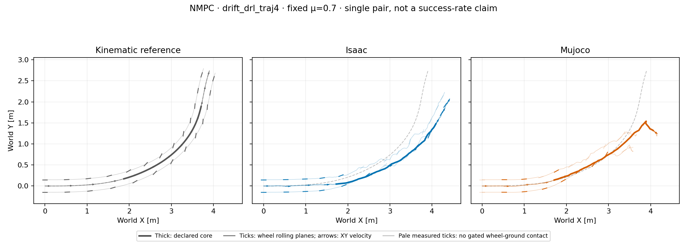

# Untuned NMPC diagnostic: primary turn, fixed μ=0.70

Both engines exceed the exploratory XY tracking screen. This is an untuned
baseline: **not frozen, not a successful-turn claim, and not a ranking**.
No friction sweep or retuning is reported here.

Both plants independently replan with native-batched MuJoCo prediction:
15 control-step horizon (0.30 s), five control blocks, population 64, three
CEM iterations, eight elites and seed 42. The normalized eight-action
interface uses the height-smooth task and held pre-action reference. There is
no PPO initialization, TVLQR, action replay or post-initialization root
prescription. Unlike the learned actor, NMPC has privileged state/reference
preview.

Plant static/dynamic friction is fixed at μ=0.70. Prediction also uses a
predeclared nominal μ=0.70, not an oracle input read from the validation plant.
This is nominal NMPC, not a robustness guarantee. MuJoCo's approximate soft
joint limits/contact forces remain disclosed surrogates for Isaac's channels.



Both recordings contain 349 applied control intervals and 1,397 physical
samples over 6.98 s; the declared 1.44–4.00 s core contains 513 physical
samples per engine. Coverage is not controlled-execution success. The figure
has shared equal-aspect bounds and excludes synthetic recovery/tail.

| Core diagnostic | Isaac | MuJoCo |
| --- | ---: | ---: |
| Reference root-XY RMSE | 0.3244 m | 0.2803 m |
| Reference root-XY peak error | 0.5641 m | 0.6708 m |
| Mean COM-speed retention | 106.27% | 100.07% |
| Samples below 80% reference speed | 0.00% | 20.27% |
| Net COM-course turn | 50.15° | unavailable |
| Ground-gated wheel-center heading offset, mean absolute L/R | 5.22° / 6.01° | 9.82° / 6.55° |
| Ground-contact lateral-slip RMS, L/R | 0.180 / 0.213 m/s | 0.164 / 0.206 m/s |
| Wheel-ground contact-gate fraction, L/R | 11.70% / 82.46% | 27.49% / 46.00% |

The unaligned Isaac–MuJoCo core XY gap is **0.2955 m RMSE, 0.4964 m peak**,
separate from reference error. Both cross RMSE >0.15 m or peak >0.30 m.
Mean speed alone does not establish correct turning. MuJoCo's net course is
withheld: only 462/513 core samples meet the speed/heading validity gate.

Heading separation remains an intended geometric feature, not mismatch or
measured slip. Per-wheel angles use analytic wheel-link-origin velocity and
axial rolling-plane heading, gated by measured contact and upward force >5 N.
Valid counts are 60/423 in Isaac and 118/236 in MuJoCo. Contact-point slip
is measured separately; inactive contact is not zero-slip evidence. Reference
geometry has no measured contact labels. Its COM-course turn is 59.255°;
the catalog's unchanged 60.928° uses the root-origin derivative.

Full-episode maximum tilts are 15.67°/92.67°: diagnostic, not height/flight
failure gates. Projected angles differ from reward body-frame β under tilt.
Zero solver failures do not prove optimality/stability. Median solves took
361/521 ms against a 20 ms control interval; simulators waited. No real-time
or hardware-matched compute comparison is established.

## Existing one-step model probe

A separate existing probe checked 16 selected original MuJoCo intervals
(64 substeps), using actual float32-rounded actions including impacts. Maximum
errors were 4.34×10⁻¹⁹ m in root XY, 3.61×10⁻¹⁶ m/s in COM velocity,
1.29×10⁻¹² N in contact history and 1.11×10⁻¹⁶ in stage cost. Logged
15-term objective reconstruction matched exactly. No sizeable local
same-model inconsistency was observed at these actions.

This does **not** validate Isaac predictions, longer-horizon or counterfactual
candidate accuracy, optimality or tracking. Missing `qacc_warmstart`/full
integration state prevents isolating solver warm-start/clock effects;
shifted CEM plans are different state. No causal attribution to horizon,
search or reward follows. Probe report SHA-256:
`17dbccc2206c1efa142f56fa92194dd85f56fe858a7db5d2d9a034519d2f4408`;
the [probe implementation](../scripts/probe_nmpc_nominal_prediction.py) is
available for reproduction with the original artifacts.

## Artifact audit and reproduction

The [sanitized summary](controller_primary_nmpc_nominal_pair_v1/summary.json)
records input/source hashes, friction readbacks, no-prescription checks and
no-step FK. Its generic eligibility flag means artifact/coverage gates passed,
**not approval to freeze or rank this controller**. The
[compact trace](controller_primary_nmpc_nominal_pair_v1/pair_trace.npz)
contains derived retargeted/simulated state vectors, wheel geometry and
measured contacts—not original CSV/full-body motion, models or weights.

The Isaac input is the completed native nominal v1 run. The MuJoCo input is
metadata-complete v2: all 37 non-timing arrays, actions, objectives and solver
scores/counters match v1 exactly; original reports are unchanged. Parity SHA-256:
`64340ee9ac5a5a59467052b4c04125ee67471c9bee315bae3b84ea0ccd6e15d9`.

With the hash-locked files and licensed model supplied through the three
`TRON1_*` paths, the actual analysis command was:

```sh
python scripts/analyze_controller_pair.py \
  --algorithm NMPC --reference-id drift_drl_traj4 \
  --motion-file "$TRON1_MOTION" --reference-file "$TRON1_REFERENCE" \
  --model "$TRON1_MODEL" --source-root upstream/tron1-learning-from-human \
  --isaac-trace outputs/nmpc_isaac_primary_nominal_native_20261015_v1/rollout.npz \
  --isaac-report outputs/nmpc_isaac_primary_nominal_native_20261015_v1/report.json \
  --mujoco-trace outputs/nmpc_primary_nominal_20261015_v2/rollout.npz \
  --mujoco-report outputs/nmpc_primary_nominal_20261015_v2/report.json \
  --output-dir outputs/nmpc_primary_nominal_pair_analysis_20261016_v1
```

Analyzer SHA-256:
`309d5cff801858a60a9dd2b066185fac293c03537a2a21660c4e6adc4ef6803e`.
Publication used existing artifacts only; no new simulation/training/controller
changes or hardware tests. Primary/supplementary references are not pooled.
