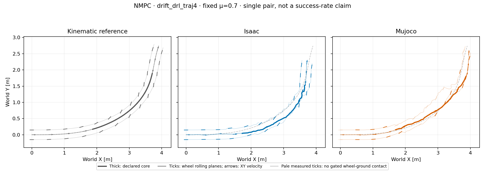

# Residual H15 NMPC: nominal improvement, Isaac XY screen still exceeded

Residual search improves the MuJoCo nominal result, but **Isaac still exceeds
the XY tracking screen**. This μ=0.70 development case is **not frozen, not
qualified for a friction grid, and not an algorithm ranking**.



Both independent closed loops completed 349 control intervals / 1,397 physical
samples over 6.98 s, with zero solver failures. The declared 1.44–4.00 s core
contains 513 samples per engine. Shared equal-aspect plots show the demonstrated
interval, excluding synthetic reference recovery/tail.

| Core diagnostic | Isaac | MuJoCo |
| --- | ---: | ---: |
| Reference root-XY RMSE | 0.2590 m | 0.1154 m |
| Reference root-XY peak error | 0.3571 m | 0.1957 m |
| XY screen: RMSE >0.15 m or peak >0.30 m | exceeded | not exceeded |
| Mean COM-speed retention | 99.18% | 105.13% |
| Samples below 80% reference speed | 5.07% | 6.43% |
| Net COM-course turn | 74.61° | 47.49° |
| Ground-gated wheel-center heading offset, mean absolute L/R | 15.90° / 9.59° | 7.68° / 8.94° |
| Ground-contact lateral-slip RMS, L/R | 0.643 / 0.310 m/s | 0.362 / 0.330 m/s |
| Wheel-ground contact-gate fraction, L/R | 30.41% / 66.86% | 24.17% / 67.64% |

The unaligned engine-to-engine XY gap is **0.2678 m RMSE, 0.3306 m peak**,
separate from either reference error. Against the
[original H15 absolute-block baseline](2026-10-16-primary-nmpc-nominal-pair.md),
reference RMSE changes from 0.3244→0.2590 m in Isaac and 0.2803→0.1154 m in
MuJoCo. This is descriptive evidence from one seed/coefficient, not robustness
or statistical qualification. Root-XY error can include along-track lag as
well as cross-track deviation; it does not itself measure lateral slip.

## What stayed fixed, and what the diagnostics mean

Both plants replan using the same MuJoCo predictor, nominal μ=0.70, H15
(0.30 s), five blocks, 64 candidates, three iterations, eight elites and seed
42. Prediction friction is predeclared, not read from the plant. The ablation
uses block residuals about a copied full-plan baseline fixed within each solve.
The original 15 reward components, held reference and actuator mapping remain
unchanged. There is no PPO seed, learned fallback, action replay, post-reset
root prescription or external root force.

Height, flight and β/heading offsets are **not failure gates**. Per-wheel
geometric offsets remain intended features, not zero targets or measured
contact slip. Angle averages use actual ground contact, upward force >5 N
and valid wheel-center velocity: 151/304 samples in Isaac and 124/346 in
MuJoCo. Contact-point slip is recorded separately; reference geometry has no
measured contact labels. Reference COM-course turn is 59.255°; the unchanged
catalog's 60.928° uses the root-origin derivative.

Full-episode maximum tilts are 14.93°/21.69°, diagnostic only. Each plant
replans from its own evolving state and therefore can choose different actions:
the resulting gap, contacts and slip **do not isolate a contact-engine cause**.
Mean speed or full coverage alone is not a controlled-turn certificate.
Median replanning took 359/548 ms versus a 20 ms control interval; simulation
waited for solutions. This is offline, not demonstrated 20 ms operation.

## Audited artifacts

The [summary](controller_primary_nmpc_residual_nominal_pair_v1/summary.json)
checks report-owned trace hashes, locked motion/model identity, friction
readbacks, no-reset evidence, no-step FK, exact shared CEM configuration and
matching residual contracts. Generic artifact eligibility is **not approval
to freeze** this controller. The
[compact trace](controller_primary_nmpc_residual_nominal_pair_v1/pair_trace.npz)
contains derived retargeted/simulated states, wheel geometry and measured
contacts—not original CSV/full-body motion assets, robot models or weights.

Captured source/archive SHA-256 values:

- Approved 15-file deployment archive: `19a210cee30add02de5888645273320f3c983ef0d3d4ab4cf3a27039c0083535`.
- Shared CEM source: `8d2ac598d9e0e2765f9566954ba3fd0f443d939d2a5c6566125cca18668b35bd`.
- Shared objective source: `ff22eebb2b22b9af7dba114c64fcd10f6b0a90822559af8f32cbe6884015b860`.
- Pair analyzer: `2936bcfd72f2ebbff3506495f7a32a64bbfbbd5dfb04060b1c363ed2e98b6d1e`.

Reproduce offline with [the common analyzer](../scripts/analyze_controller_pair.py),
the hash-locked files/licensed model in the three `TRON1_*` paths, and a fresh
output directory:

```sh
python scripts/analyze_controller_pair.py \
  --algorithm NMPC --reference-id drift_drl_traj4 \
  --motion-file "$TRON1_MOTION" --reference-file "$TRON1_REFERENCE" \
  --model "$TRON1_MODEL" --source-root upstream/tron1-learning-from-human \
  --isaac-trace outputs/nmpc_isaac_primary_nominal_residual_20261016_v1/rollout.npz \
  --isaac-report outputs/nmpc_isaac_primary_nominal_residual_20261016_v1/report.json \
  --mujoco-trace outputs/nmpc_primary_nominal_residual_h15_20261016_v1/rollout.npz \
  --mujoco-report outputs/nmpc_primary_nominal_residual_h15_20261016_v1/report.json \
  --output-dir outputs/nmpc_primary_nominal_residual_pair_reproduction_v1
```

Publication used completed artifacts only, with no physics or training launch.
Earlier baseline bundles remain unchanged; primary/supplementary tasks are not
pooled.
