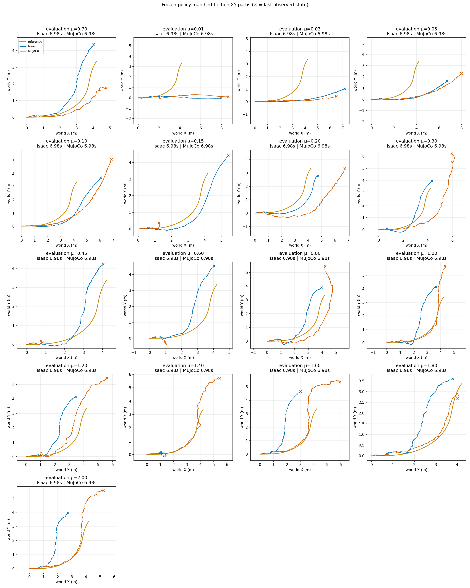

# Primary SAC: height-smooth fixed-friction grid

The completed SAC run exceeds the exploratory large-XY-error screen at all
17 tested friction coefficients in both Isaac and MuJoCo. All 34 episodes
were recorded through the full reference, but none stays below the core XY
screen. This is one SAC configuration and training seed, not an algorithm
ranking or evidence that SAC cannot solve the task. No additional training
or simulations were launched to prepare this publication.

## Task and completed training

The primary `drift_drl_traj4` reference is derived from a pinned CARLA
simulation, not physical-car motion capture. Only its 1.44–4.00 s large-turn
core is scored here; the separate S-avoidance supplement is not pooled.

Seed 42 completed 24,000 vector control steps × 512 environments =
**12,288,000 actual environment transitions**, including random warmup,
and 23,981 SAC learner updates. The actor has 51 inputs, the privileged critic
120 inputs, and the action vector eight components. Networks use ELU with
hidden widths 256/128/128. SAC uses fixed identity input normalization,
unchanged dt-scaled environment rewards, automatic entropy tuning initialized
at α=0.004, a 500,000-transition replay buffer and batch size 1,024. An equal
transition budget alone does not equalize learner updates or compute.

The task tracks position/linear velocity in XY, with bounded vertical-
acceleration smoothness instead of absolute-height tracking. Height-based
stopping and reference vertical-velocity tracking are absent; orientation,
posture, contact and action regularizers remain. Training used mapped
BeyondMimic events: static friction U[0.3,1.6], dynamic friction U[0.3,1.2],
restitution U[0,0.5], 64 material buckets, joint-default/CoM offsets and
velocity pushes. Validation freezes the deterministic actor and disables
random events and observation noise. The
[sanitized metadata](controller_primary_sac_height_smooth_seed42_v1/training_metadata.json)
records the actual budget, SAC configuration, bootstrap contract, DR recipe,
source hashes and checkpoint SHA-256
`2722b4118347e26aa7c0ce58b3ff5cc67c40194b1350c876becf38a1cd9eeeae`.

## XY results

Each row uses one episode per engine with equal numeric static/dynamic μ.
The screen is core reference-XY RMSE >0.15 m **or** peak >0.30 m, not an
absolute-height, airborne or heading-separation gate. Historical pose
predicates remain diagnostics during full-horizon evaluation.

| Fixed μ | Isaac core RMSE / peak (m) | MuJoCo core RMSE / peak (m) | Core sim2sim RMSE (m) | XY screen exceeded |
| ---: | ---: | ---: | ---: | --- |
| 0.01 | 1.2197 / 2.2799 | 1.1581 / 2.3071 | 0.2946 | Both |
| 0.03 | 1.0562 / 1.9524 | 1.0585 / 1.9654 | 0.1974 | Both |
| 0.05 | 1.0289 / 1.7893 | 1.1760 / 2.1147 | 0.3971 | Both |
| 0.10 | 0.6122 / 0.9238 | 0.7194 / 1.3631 | 0.5462 | Both |
| 0.15 | 0.3743 / 0.4417 | 2.0162 / 2.8868 | 2.0753 | Both |
| 0.20 | 0.4842 / 0.6449 | 1.2189 / 1.7078 | 0.7578 | Both |
| 0.30 | 0.5913 / 0.7139 | 1.0093 / 1.4783 | 1.5013 | Both |
| 0.45 | 0.6685 / 0.7568 | 2.4958 / 3.4080 | 1.8976 | Both |
| 0.60 | 0.6933 / 0.9808 | 2.4668 / 3.4730 | 1.9105 | Both |
| 0.70 | 0.5748 / 0.7865 | 0.7543 / 1.0427 | 1.2557 | Both |
| 0.80 | 0.6595 / 0.8626 | 1.0102 / 1.7995 | 1.4647 | Both |
| 1.00 | 0.9168 / 1.1775 | 0.8024 / 1.6176 | 1.4088 | Both |
| 1.20 | 1.1070 / 1.4119 | 0.5335 / 0.6536 | 0.6811 | Both |
| 1.40 | 2.1315 / 3.2058 | 0.7782 / 1.1498 | 2.8026 | Both |
| 1.60 | 1.4425 / 1.8900 | 0.7250 / 1.3029 | 1.6725 | Both |
| 1.80 | 1.0241 / 1.2824 | 0.7096 / 1.2474 | 1.4171 | Both |
| 2.00 | 1.4232 / 1.8208 | 0.8954 / 1.3202 | 1.8739 | Both |



At nominal μ=0.70, core RMSE is 0.5748 m in Isaac and 0.7543 m in MuJoCo,
with a 1.2557 m paired engine gap. The largest core engine gap is 2.8026 m
at μ=1.40. Errors vary non-monotonically with friction. Because no tested
coefficient is below the XY screen, this sweep does not bracket a transition
from acceptable tracking to large XY error, or identify a universal friction
failure threshold. Small engine disagreement is also not sufficient: at
μ=0.03, paired RMSE is 0.1974 m while both reference RMSEs exceed 1 m.

## Public artifacts and metric replay

The [exact summary](controller_primary_sac_height_smooth_seed42_v1/summary.json),
[compact XY traces](controller_primary_sac_height_smooth_seed42_v1/xy_trace.npz)
and [hash/material-readback provenance](controller_primary_sac_height_smooth_seed42_v1/xy_trace.provenance.json)
cover all 17 matched cases. Recompute the summary exactly without a simulator,
policy checkpoint or robot model:

```bash
python scripts/analyze_friction_grid.py \
  --trace results/controller_primary_sac_height_smooth_seed42_v1/xy_trace.npz \
  --expected-summary results/controller_primary_sac_height_smooth_seed42_v1/summary.json \
  --output-dir outputs/NEW_primary_sac_grid_replay
```

These are single-seed, single-episode observations, not statistical success
rates, a speed-retention comparison, a measured wheel-contact-slip result,
hardware validation or a PPO/SAC/NMPC ranking. Equal numeric friction is not
cross-engine tire/contact calibration. This publication does not diagnose
why this SAC configuration lost tracking. No raw motion, source CSV, robot
models or weights are redistributed; historical results remain unchanged.
