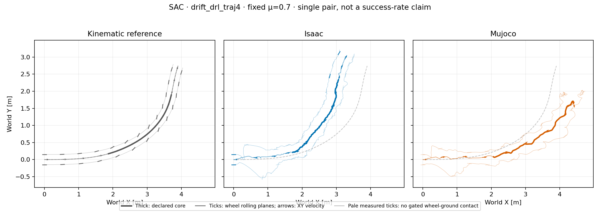

# Height-smooth SAC: primary turn, fixed μ=0.70

Both engines exceed the exploratory XY tracking screen in this matched case.
Completed training and full episode coverage do not establish a successful
turn. This is one frozen seed-42 SAC at one coefficient, not an inherent
SAC-versus-PPO ranking or a statistical success rate.

Training collected 12,288,000 transitions using 512 environments and 24,000
control steps per environment, with 23,981 learner updates. The actor uses the
same 51-observation/eight-action interface, height-smooth task and
BeyondMimic-style training randomization as the PPO comparison. Validation
uses equal fixed static/dynamic μ=0.70, no random events and no height/flight
stopping.

The declared primary core is 1.44–4.00 s. Each engine provides 513 physical
samples in this core and 1,397 samples over the full 6.98 s episode at 200 Hz.
Root motion after initialization is not prescribed. The figure displays the
demonstrated interval, excluding synthetic recovery/tail; its shared,
equal-aspect bounds include both root and wheel trajectories. Metrics use
the full saved arrays, not measurements read from the image.

| Core diagnostic | Isaac | MuJoCo |
| --- | ---: | ---: |
| Reference root-XY RMSE | 0.5748 m | 0.7543 m |
| Reference root-XY peak error | 0.7865 m | 1.0427 m |
| Mean COM-speed retention | 100.23% | 119.61% |
| Samples below 80% reference speed | 15.79% | 33.92% |
| Net COM-course turn | 82.57° | unavailable |
| Ground-gated wheel-center heading offset, mean absolute L/R | 26.17° / 26.07° | 51.28° / 16.33° |
| Ground-contact lateral-slip RMS, L/R | 0.659 / 1.352 m/s | 0.620 / 0.701 m/s |
| Wheel-ground contact-gate fraction, L/R | 14.62% / 11.89% | 1.17% / 3.51% |

The Isaac–MuJoCo core XY gap is **1.2557 m RMSE, 1.5310 m peak**. It is
separate from each engine's reference error; no spatial registration or time
warping is applied. Both engines exceed the XY-only screen of RMSE >0.15 m
or peak >0.30 m. Mean speed retention above 100% does not mean successful
high-speed turning: the path deviates substantially and speed is uneven.
MuJoCo's net course is withheld because only 406/513 core samples meet the
speed/heading validity gate; its minimum core COM speed is 0.0087 m/s.

Full-episode maximum base tilts are 25.70° in Isaac and 138.07° in MuJoCo.
These are posture diagnostics, not height/flight failure gates. Full duration
is not evidence of upright controlled execution, and sparse wheel contact
alone does not identify flight or exclude nonwheel contacts.

## Heading and contact semantics

Heading separation is an intended feature, **not a mismatch**. Each wheel's
analytic link-origin velocity is compared with its axial rolling-plane
heading, modulo 180°. The table gates this geometry by measured ground
contact and upward wheel-ground force >5 N. MuJoCo's wheel-center angle
means use only 5 left and 18 right valid samples, versus 73/61 in Isaac;
these sparse conditional averages should not be overinterpreted.
Contact-point lateral-slip RMS is a separate recorded measurement, not
inferred from the geometric angle. A zero without contact is unavailable
evidence, not proof of rolling.

The reference has no measured contact labels. Its core COM-course turn is
59.255°; the unchanged catalog's 60.928° selection descriptor instead uses
the root-origin position derivative at frames 72–200. The summary retains
the explicit point/velocity-transport audit. World-XY geometric angles also
differ from the reward's body-frame β under pitch/roll, especially relevant
to the large MuJoCo tilt. No angle is driven to zero by this analysis.

## Descriptive comparison and audit

For the [previous PPO at the same reference and μ](2026-10-15-primary-ppo-nominal-pair.md),
the Isaac/MuJoCo reference XY RMSE was 0.0565/0.0498 m and their engine gap
was 0.0157 m RMSE. The present SAC checkpoint deviates more in this single
case. Equal transition budgets do not equalize optimization effort or tuning:
SAC uses fixed identity observation normalization and off-policy updates;
PPO uses online RSL normalization and rollout-based updates. SAC retained
the same dt-scaled reward without a SAC-only multiplier and used automatic
entropy tuning. These observations do not establish a universal algorithm
ranking or explain the causal origin of the failure.

The [sanitized summary](controller_primary_sac_nominal_pair_v2/summary.json)
contains actual checkpoint-byte, completed-training, selected-reference,
height-adapter, material-readback, trace-hash and no-step FK checks.
The [compact trace](controller_primary_sac_nominal_pair_v2/pair_trace.npz)
contains derived retargeted reference states, simulated state vectors,
analytic wheel geometry and measured contact diagnostics. It is not an
original source asset: no raw CSV, original full-body `motion.npz`, robot
model or policy weights are published in this bundle.

Reproduce with [analyze_controller_pair.py](../scripts/analyze_controller_pair.py)
using `--algorithm SAC --reference-id drift_drl_traj4`, the frozen reference
pair, licensed model, native engine traces/reports, and adjacent completed
training manifest/checkpoint. This result used analyzer SHA-256
`309d5cff801858a60a9dd2b066185fac293c03537a2a21660c4e6adc4ef6803e`;
its only change from the PPO analysis includes wheel positions in plot bounds,
with a regression test. Numeric metrics and provenance checks are unchanged.
The legacy MuJoCo report lacks its own rollout hash; its independently
captured SHA-256 was supplied through `--mujoco-trace-sha256` and checked
against the downloaded bytes. This is file-identity binding, not independent
proof of simulator internals. No physics stepping or training was performed
by the offline analysis. No hardware capability, universal friction boundary
or pooled primary/supplementary success statistic is claimed.
