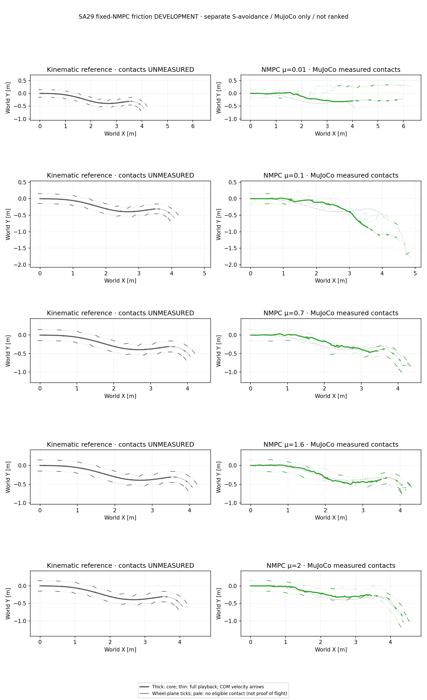

# SA29: fixed-NMPC friction development

This is the separate `doa_sa29_scale2` S-avoidance supplement, not another
trial of the primary large-angle turn. Do not pool its statistics with
`drift_drl_traj4`. SA29-specific PPO/SAC training and Isaac validation remain
missing; this record concerns the local MuJoCo fixed-controller grid only.

## Results

All 17 predeclared coefficients have complete recordings and zero solver
fallbacks. The nominal μ=0.7 pilot is reused byte-for-byte; the 16 new episodes
each exited 0 and passed full clock, source, action and common-score audits.
At most three local episodes ran at once, without retries or controller tuning.

The core XY screen is exceeded at **6/17** points: μ=0.01, 0.03, 0.05, 0.10,
0.15 and 1.40. The other 11 stay below both limits. This is not a monotone
friction threshold or a statistical success rate. In particular μ=1.40 fails
despite remaining upright (20.06° full maximum tilt), while 1.60 and 1.80 pass.

Speed and XY use the core; maximum tilt uses the entire 5.16 s playback.
Posture/overspeed are diagnostics, not extra criteria changing the XY column.

| μ | XY RMSE / peak [m] | Speed retained | Full maximum tilt | XY screen |
| ---: | ---: | ---: | ---: | --- |
| 0.01 | 0.2404 / 0.5154 | 109.5% | 113.69° | Exceeded |
| 0.03 | 0.2873 / 0.4476 | 94.7% | 113.54° | Exceeded |
| 0.05 | 0.3047 / 0.4646 | 92.9% | 113.75° | Exceeded |
| 0.10 | 0.2439 / 0.5706 | 109.5% | 109.17° | Exceeded |
| 0.15 | 0.7858 / 1.7219 | 139.2% | 95.57° | Exceeded |
| 0.20 | 0.1175 / 0.2430 | 99.0% | 108.88° | Below both limits |
| 0.30 | 0.0482 / 0.0808 | 101.2% | 18.80° | Below both limits |
| 0.45 | 0.0701 / 0.1353 | 100.7% | 18.92° | Below both limits |
| 0.60 | 0.0465 / 0.1217 | 100.2% | 30.16° | Below both limits |
| 0.70 | 0.1015 / 0.1602 | 99.1% | 21.73° | Below both limits |
| 0.80 | 0.0565 / 0.1135 | 99.3% | 15.80° | Below both limits |
| 1.00 | 0.0849 / 0.1584 | 96.3% | 16.80° | Below both limits |
| 1.20 | 0.0689 / 0.1096 | 98.8% | 14.74° | Below both limits |
| 1.40 | 0.1903 / 0.3283 | 97.8% | 20.06° | Exceeded |
| 1.60 | 0.0584 / 0.1102 | 100.9% | 13.03° | Below both limits |
| 1.80 | 0.0733 / 0.1633 | 97.1% | 19.33° | Below both limits |
| 2.00 | 0.0633 / 0.1012 | 99.0% | 14.73° | Below both limits |



The [complete summary](nmpc_sa29_friction_development_20261016_v1/summary.json)
and [public signal archive](nmpc_sa29_friction_development_20261016_v1/development_trace.npz)
retain all 17 original clocks, measured COM velocity, heading geometry,
wheel-ground contact/slip, posture and both descriptive event windows.
Recorded optimization budgets total 855,253 candidate/scenario evaluations
and 102,630,360 requested 5 ms prediction substeps, including the reused pilot;
all 17 plant episodes contain 17,544 actual physics substeps.

### XY, contact and posture are distinct measurements

At μ=0.10 and 0.15, instantaneous XY error first exceeds 0.30 m at 1.475 s
and 1.815 s, while tilt is only 5.97° and 14.35° respectively. Tilt first
exceeds 60° at 2.065 s and 2.195 s. This is a temporal ordering, not a causal
identification or an added failure gate. At the first XY crossing, both wheels
have zero measured ground-contact count/force in these two recordings; this
single sample does not establish that an entire interval was airborne.

μ=0.20 stays below the core XY limits (0.117 / 0.243 m), despite a 92.18°
core maximum tilt and first nonwheel-ground contact at 3.050 s. Its first
0.30 m XY crossing is at 3.395 s, outside the 0–3.14 s core. The XY screen
therefore remains passed, but this is not controlled upright success.
Its net measured core COM-course change is 37.61°, versus the reference's
1.97°; retained mean speed alone is not exact direction tracking.

## Fixed experiment contract

The [separate grid declaration](../config/nmpc_sa29_friction_development.json)
binds 21 unchanged runtime sources, model, actuator contract, native library,
motion/reference and effective controller settings. It is not the earlier
one-episode pilot declaration. Fixed CEM remains H30/B10/C64/I3/E8, seed 42,
prediction μ=0.7, with the same full-body 15-term height-smooth score. Only
actual plant μ changes. The residual settings file retains H15/B5 defaults;
the effective H30/B10 values are explicit, unchanged command-line overrides.
No learned donor, model-plan initialization, adaptive selector or plant-μ
oracle is used.

Each full playback has 258 decisions / 1,033 physical samples / 5.16 s.
Evaluation keeps the source-demo core 0–3.14 s and world axes/original clocks.
The two windows 0.78–1.54 s and 1.88–3.04 s are descriptive, not extra gates.
The existing XY screen is RMSE >0.15 m OR peak >0.30 m. Speed retention,
heading offsets, contact slip, posture, height and flight do not add gates.
Synthetic recovery/tail remains visible but is not added to the core score.

COM speed uses recorded velocity, not a position derivative. Wheel-plane
geometry uses FK from measured states; actual contact-point slip remains the
recorded MuJoCo measurement. Contact eligibility requires wheel-ground count
>0 and upward net force >5 N. Ineligible zero slip is unavailable evidence,
not proof of rolling or flight; reference contacts are unmeasured.

The display coefficients are μ={0.01,0.10,0.70,1.60,2.00}; the lowest-friction
case is included to illustrate an observed failure, not to select a better
controller or exclude any of the 17 results. Thick curves mark the core;
arrows show COM velocity and ticks wheel planes. Pale ticks lack eligible
measured contact. No alignment, time warp, root correction or new retargeting.

## Reproduction and limits

Use the unchanged single-case `scripts/run_nmpc_tracking.py` with
`--reference-id doa_sa29_scale2`, matching locked input files, explicit native
backend/library and all five fixed H30/B10/C64/I3/E8 overrides. Repeat only for
the declared coefficients, preserving existing cases and reusing μ=0.7.
The [offline grid analyzer](../scripts/analyze_nmpc_sa29_friction_development.py)
accepts actual `--run MU=DIR` recordings and refuses relabeled primary data,
changed sources/controllers, a substituted nominal rerun or false completion.
It uses FK only and never steps dynamics or loads a learned policy.

The public-vector tests need no robot asset, policy weight or physics rollout:

```sh
python -m pytest -q tests/test_nmpc_sa29_friction_development.py
```

One seed and one episode per coefficient do not establish a statistical
success rate, universal friction boundary or controller-class ranking.
The simulator waits for each solve; wall-latency actuation delay is not
injected. No real-time, robust-stability, controlled-execution or hardware
claim is made. CARLA S-avoidance and reconstructed source timing do not
establish physical-car dynamic similarity.

The [completed primary three-controller paired grid](2026-10-16-primary-controller-friction-development.md)
and [original SA29 nominal pilot](2026-10-16-sa29-nmpc-pilot.md) remain unchanged.
Completing the original two-reference comparison still requires supplementary-
specific PPO/SAC training and both-engine fixed-friction validation. The new
43-file remote snapshot/work proposal remains unapproved; no SA29 remote
upload, training or validation job is implied by this local evidence.
