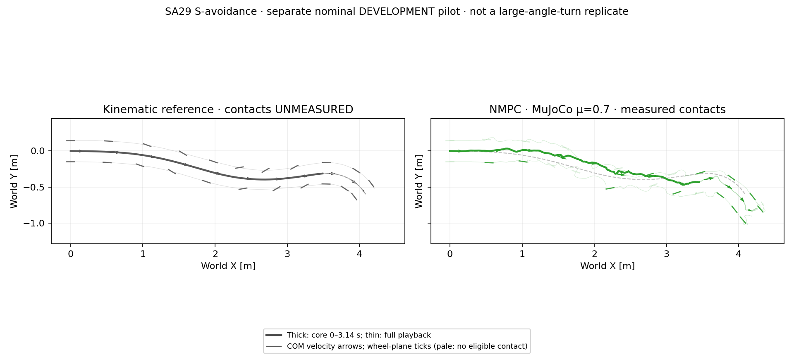

# SA29: separate fixed-NMPC nominal pilot

The unchanged fixed NMPC tracks the locked `doa_sa29_scale2` supplement in
one complete **MuJoCo-only** nominal episode. Core XY RMSE / peak are
**0.102 / 0.160 m**, below the existing 0.15 / 0.30 m screen. Measured COM
speed retention is **99.1%**. This is not a completed supplementary
PPO/SAC/NMPC comparison, sim2sim result, friction boundary or stability certificate.

SA29 is CARLA S-shaped avoidance, not physical-car capture or another trial of
the primary large-angle turn. Its core reference net COM-course change is only
1.97°; large course-to-wheel separation does not imply a large net turn.
Keep all SA29 results separate from `drift_drl_traj4`.

## Measured results

| Window [s] | XY RMSE / peak [m] | Speed retained | Contact slip RMS: left / right [m/s] |
| --- | ---: | ---: | ---: |
| Core: 0–3.14 | 0.102 / 0.160 | 99.1% | 0.452 / 0.283 |
| Event 1: 0.78–1.54 | 0.108 / 0.142 | 96.7% | 0.359 / 0.486 |
| Event 2: 1.88–3.04 | 0.113 / 0.146 | 102.3% | 0.647 / 0.347 |

The two events are predeclared descriptive windows, not extra success gates.
Speed is recorded original-link COM velocity, not differentiated root XY.
Contact slip uses the recorded MuJoCo ground-contact points, conditioned on
wheel-ground count >0 and upward net force >5 N. Core eligible contact fractions
are 45.6% left / 32.1% right. Contact-conditioned mean absolute COM-course to
wheel-plane angles are 13.26° / 9.00°. Missing eligibility means unavailable
contact-slip evidence, not proof of no contact, perfect rolling or flight.

Full playback has 258 decisions / 1,033 physics samples / 5.16 s, with zero
solver fallbacks. Maximum full-clip base tilt is 21.73°, and no nonwheel-ground
contact was recorded. Neither tilt, height, flight nor nonzero heading offset
is a failure gate. The physical core net course change is 19.27°, illustrating
that below-screen XY and mean-speed retention do not prove exact heading tracking.

Thick curves mark the core, thin curves the full playback including the
synthetic recovery/tail. Arrows show COM velocity; ticks show wheel planes.
Pale physical ticks lack eligible measured contact. Reference contacts are
unmeasured. No translation, rotation, time warp or root correction is applied.

## Unchanged controller and evidence

The [predeclaration](../config/nmpc_sa29_nominal_development.json) binds the
same 21 runtime sources, model, actuator contract, native binary and effective
CEM configuration as the completed primary development grid. Only the selected
motion changes: H30/B10/C64/I3/E8, seed 42, fixed prediction μ=0.7 and plant
μ=0.7; no PPO donor, model-generated nominal plan, adaptation or tuning.
All 15 height-smooth stage terms and the bounded six-leg-position / two-wheel-
torque interface are unchanged. Every recorded solve exceeded 20 ms; the plant
waits for the controller and no actuation delay is injected. No real-time claim.

The [summary](nmpc_sa29_nominal_development_20261016_v1/summary.json) and
[public signal archive](nmpc_sa29_nominal_development_20261016_v1/pilot_trace.npz)
retain measured contacts, speed, heading, posture and both event windows.
The [offline analyzer](../scripts/analyze_nmpc_sa29_pilot.py) uses FK only for
wheel geometry; it never simulates contacts, retargets, runs IK or loads a policy.
The actual 258-step clock is audited independently, not relabeled as 349 steps.

## Remaining comparison

There is no SA29-trained PPO or SAC checkpoint and no SA29 Isaac recording.
The primary checkpoints are not supplementary-trained policies. Completing the
original two-reference comparison still requires the following separate work:

1. Train SA29 PPO and SAC, each seed 42 and 12,288,000 actual transitions:
   PPO 512 environments × 1,000 iterations × 24 steps; SAC 512 × 24,000 steps.
   Retain the original height-smooth task and BeyondMimic-style friction/other DR.
2. Freeze those actors and evaluate all three controllers in both engines at
   μ={0.01,0.03,0.05,0.10,0.15,0.20,0.30,0.45,0.60,0.70,0.80,1.00,1.20,1.40,1.60,1.80,2.00}.
   Keep fixed prediction μ=0.7 for NMPC and reuse this matching nominal evidence.
3. Publish the same reference / PPO / SAC / NMPC top-down format and separate
   per-reference XY, speed, heading/contact-slip and computational diagnostics.

No remote SA29 upload, training or validation job has been launched.
The previous exact primary-snapshot/17-case approval does not cover these new
remote operations. A new explicit upload/job scope is required before dispatch;
existing primary runtime sources, results and qualification gates are untouched.
