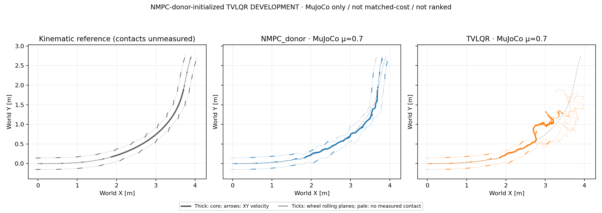

# Model-nominal-initialized TVLQR: first bounded pilot

The first nominal MuJoCo episode completes recording, but **fails tracking**:
core XY RMSE is 0.4385 m and peak error is 0.9061 m. About 43.27% of raw action
components require clipping to the normalized ±1 bounds. The robot also loses
posture: maximum tilt is 118.54°, with first nonwheel-ground contact at 2.635 s.
This is not successful upright high-speed turning. No Q/R retuning follows.



The [audited summary](tvlqr_pilot_20261016_v1/summary.json) and
[derived replay](tvlqr_pilot_20261016_v1/development_trace.npz) use identical
world axes and original timestamps:

| Recorded episode | Core XY RMSE / peak [m] | Mean speed / retained | Contact slip RMS, L / R [m/s] |
| --- | ---: | ---: | ---: |
| NMPC nominal donor | 0.0521 / 0.0967 | 1.049 m/s / 102.05% | 0.468 / 0.378 |
| TVLQR feedback | 0.4385 / 0.9061 | 0.834 m/s / 81.10% | 0.745 / 0.771 |

The donor is the TVLQR initialization, **not an independent competitor** in
this figure. TVLQR speed and slip include fallen states; they do not establish
controlled upright drifting. Tilt exceeds 60° for 43.16% of the full clip;
nonwheel-ground contact occurs in 10.53% of core samples. These are diagnostics,
not newly introduced height/flight failure gates. The original XY screen is
RMSE ≤0.15 m and peak ≤0.30 m. Reference contacts are unmeasured.

## Nominal source and controller

The nominal is the existing successful **pure-model NMPC H30/B10/I6** MuJoCo
episode at μ=0.7: 350 physical boundary states and 349 actual float32 actions.
It is neither PPO initialization nor direct kinematic/reference playback.
The donor's original-reference XY RMSE/peak are 0.0521/0.0967 m. Its generation
cost is charged: 135,062 scenario evaluations and 16,207,440 predicted physical
substeps, plus the donor's 1,396 plant steps. This is **NMPC-nominal-initialized
TVLQR**, not an independently synthesized trajectory or a compute-matched
comparison with PPO/SAC/NMPC.

At each boundary, central differences linearize the unchanged full-body
floating-base dynamics, including leg PD, wheel torque and DC motor limits.
The physical error has 28 tangent coordinates: 14 position/rotation/joint
components and 14 velocities. Eight previous-action deviations augment this
to 36 dimensions. The saved affine defect
`d[k] = error(nominal[k+1], f(nominal[k], nominal_action[k]))`
is retained; the plant is never corrected toward the nominal after reset.

The backward recursion solves an affine quadratic problem with cross and
linear terms, including the actual action difference rather than assuming
zero nominal slew. Online feedback is
`u = float32(clip(ubar[k] + feed[k] + K[k] @ augmented_error, -1, 1))`.
The saved K already includes its negative feedback sign. Actual measured
state and previous applied action affect every decision; nominal actions are
not simply replayed. The offline design uses the whole fixed clip, a preview
advantage that differs from online receding-horizon MPC or actor observations.

## Objective and limits

The **design cost is a quadratic nominal-stabilization surrogate**, not the
original 15-term reward. It tracks nominal XY, orientation and joint motion,
with zero absolute-height and vertical-velocity tracking weights. It adds
`0.1 * ||u - previous_u||²` and a local quadratic approximation to
`0.1 * ((COM_vz_next - COM_vz_current) / (0.02 * 5))²`.
No zero-sideslip target, flight gate or root-force correction is introduced.
The common 15-term task is evaluated separately for diagnostics; the report
explicitly marks the cost mismatch. This is not a controller-class ranking.

Design uses one declared difference step, 1e-5, and preserves contact/action
clipping discontinuities. It completes 25,477 transition calls / 101,908
physical prediction substeps in 18.04 s. There is no automatic Hessian
regularization, eigenvalue clipping, retry or gain tuning. The largest absolute
gain entry is 7,449.55 (mixed coordinate units), maximum affine feed is 0.474,
and `nominal_action + feed` already reaches 1.239 before clipping. These are
local design diagnostics, not a stability certificate or an isolated causal
explanation of failure.

The online tangent-error/feedback call takes median/P95/max
0.168/0.297/0.723 ms in this uncontrolled local run. This excludes offline
donor generation/design and is **not hardware real-time certification**.
The 349-decision, 1,397-sample playback uses the original 5 ms physics / 20 ms
control clocks. Flight/height remain descriptive; XY uses the unchanged
1.44–4.00 s core without registration or time warp. Tilted/fallen heading
geometry and retained speed must not be read as successful upright drifting.
There is no Isaac TVLQR result or sim2sim qualification in this pilot.

## Reproduction

```sh
CUDA_VISIBLE_DEVICES='' python scripts/design_tvlqr_nominal.py \
  --model /path/to/mujoco_model.xml --motion /path/to/motion.npz \
  --contract /path/to/policy_contract.json --donor-dir /path/to/model_only_nmpc_episode \
  --output-dir outputs/NEW_tvlqr_design

CUDA_VISIBLE_DEVICES='' python scripts/run_tvlqr_tracking.py \
  --model /path/to/mujoco_model.xml --motion /path/to/motion.npz \
  --contract /path/to/policy_contract.json --design-dir outputs/NEW_tvlqr_design \
  --plant-mu 0.7 --output-dir outputs/NEW_tvlqr_episode
```

Design, donor and runtime bytes are hash-bound. Compatible physical predictor
sources are checked before plant construction. Licensed model files, full
design gains and original raw donor archives remain local. Public compact
data retain only the declared derived replay evidence; no learned weights or
credentials are required or redistributed.
