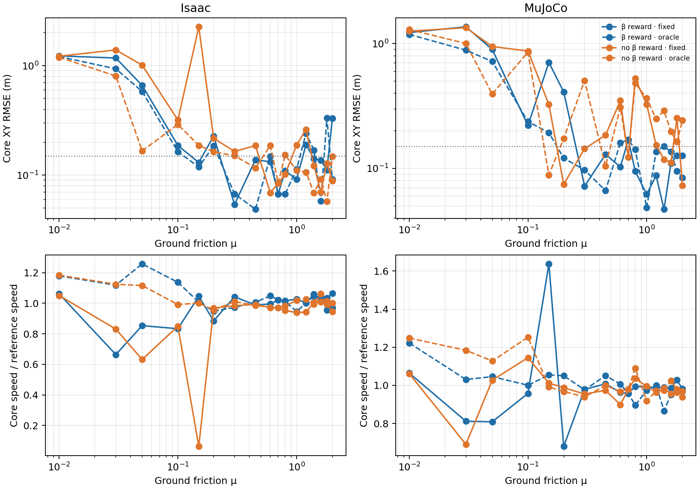

# Sideslip reward × known friction: full 17-point CEM validation

This extends the [six-point factorial](2026-10-17-nmpc-beta-friction-factorial.md) to the exact 17-point development grid for the primary `drift_drl_traj4` turn. It crosses two objective profiles—body-velocity sideslip-angle tracking weight 2.0 versus zero—with two prediction models: ground μ fixed at 0.70 or supplied with the validation plant's exact numeric μ. The latter is a **privileged oracle diagnostic**, not an online friction estimator or a deployable adaptive MPC. No policy training, CEM retuning or new failure gate is involved.

Both engines use one full-horizon seed-42 rollout per distinct cell. The plant has equal static and dynamic ground μ at 0.01, 0.03, 0.05, 0.10, 0.15, 0.20, 0.30, 0.45, 0.60, 0.70, 0.80, 1.00, 1.20, 1.40, 1.60, 1.80 and 2.00. At μ=0.70, fixed and oracle are the same predictor and the physical rollout is reused. The locked CEM search is native MuJoCo shooting, horizon 30 control steps, 10 residual-action blocks, 64 candidates × 3 iterations and 8 elites. The original six-point cells and the pre-existing 17-point β/fixed development cells are reused unchanged; the missing cells are new episodes.

The primary comparison is XY path tracking over the 1.44–4.00 s turn core, with RMSE and peak error in metres. The exploratory screen is exceeded when core RMSE >0.15 m **or** peak >0.30 m. Speed retention is reported separately. Neither β offset, body height nor temporary flight is itself a failure criterion. “β” means the base COM velocity direction in the body frame relative to the retargeted reference, not a direct wheel-ground slip sensor.

There are **136 analysis cells but 132 distinct physical episodes**, because the μ=0.70 fixed episode is reused as its identical oracle counterpart for each objective profile and engine. All episodes reached 6.98 s with zero recorded solver failures. Raw-trace hashes, the 0.005 s physical clock, plant and predictor μ, material readbacks, reference hashes, and common model/search/action identities were checked before summarizing. The table is core XY RMSE in metres; peak error and speed for every cell are in the [machine-readable summary](nmpc_beta_friction_factorial_17_20261017_v1/summary.json).

| Ground μ | Isaac β fixed | Isaac β known μ | Isaac no β fixed | Isaac no β known μ |
| ---: | ---: | ---: | ---: | ---: |
| 0.01 | 1.230 | 1.212 | 1.222 | 1.194 |
| 0.03 | 1.176 | 0.937 | 1.394 | 0.806 |
| 0.05 | 0.661 | 0.583 | 1.013 | 0.167 |
| 0.10 | 0.187 | 0.164 | 0.319 | 0.290 |
| 0.15 | 0.130 | 0.119 | 2.269 | 0.187 |
| 0.20 | 0.228 | 0.186 | 0.217 | 0.163 |
| 0.30 | 0.054 | 0.068 | 0.165 | 0.151 |
| 0.45 | 0.138 | 0.049 | 0.186 | 0.117 |
| 0.60 | 0.132 | 0.149 | 0.069 | 0.187 |
| 0.70 | 0.067 | 0.067 | 0.085 | 0.085 |
| 0.80 | 0.110 | 0.067 | 0.102 | 0.153 |
| 1.00 | 0.092 | 0.113 | 0.189 | 0.111 |
| 1.20 | 0.190 | 0.241 | 0.261 | 0.107 |
| 1.40 | 0.142 | 0.170 | 0.122 | 0.069 |
| 1.60 | 0.137 | 0.058 | 0.070 | 0.092 |
| 1.80 | 0.112 | 0.333 | 0.128 | 0.058 |
| 2.00 | 0.329 | 0.091 | 0.089 | 0.148 |

| Ground μ | MuJoCo β fixed | MuJoCo β known μ | MuJoCo no β fixed | MuJoCo no β known μ |
| ---: | ---: | ---: | ---: | ---: |
| 0.01 | 1.227 | 1.186 | 1.260 | 1.299 |
| 0.03 | 1.365 | 0.886 | 1.343 | 1.002 |
| 0.05 | 0.898 | 0.720 | 0.949 | 0.394 |
| 0.10 | 0.221 | 0.237 | 0.872 | 0.854 |
| 0.15 | 0.708 | 0.194 | 0.326 | 0.089 |
| 0.20 | 0.410 | 0.121 | 0.075 | 0.174 |
| 0.30 | 0.072 | 0.097 | 0.144 | 0.506 |
| 0.45 | 0.130 | 0.066 | 0.185 | 0.104 |
| 0.60 | 0.103 | 0.160 | 0.350 | 0.310 |
| 0.70 | 0.170 | 0.170 | 0.123 | 0.123 |
| 0.80 | 0.095 | 0.142 | 0.525 | 0.483 |
| 1.00 | 0.062 | 0.048 | 0.326 | 0.365 |
| 1.20 | 0.088 | 0.136 | 0.154 | 0.249 |
| 1.40 | 0.047 | 0.151 | 0.118 | 0.290 |
| 1.60 | 0.110 | 0.136 | 0.111 | 0.197 |
| 1.80 | 0.127 | 0.095 | 0.253 | 0.163 |
| 2.00 | 0.127 | 0.084 | 0.073 | 0.243 |

The number of sampled μ points below **both** XY limits is: Isaac β fixed/known 10/9, Isaac no-β fixed/known 7/7; MuJoCo β fixed/known 10/8, MuJoCo no-β fixed/known 6/3. These counts are descriptive, not success probabilities. No variant dominates. For Isaac no-β at μ=0.15, giving the predictor exact μ changes RMSE from 2.269 to 0.187 m and mean speed retention from 6.3% to 100.1%, yet still misses both XY limits (peak 0.308 m). At μ=0.45 and 1.20 it changes a failing Isaac no-β result into a passing one, while at μ=0.60 and 0.80 it changes a passing result into a failing one. MuJoCo no-β at μ=0.30 worsens from 0.144 to 0.506 m when given the exact μ. The very-low-friction μ=0.01 cases all fail, despite some retaining more than reference speed.

Engine agreement is also conditional. At μ=0.15 the no-β fixed controller barely travels through the Isaac turn core (6.3% speed retention), producing a **2.270 m Isaac–MuJoCo core XY path gap**; the oracle reduces that gap to 0.248 m, but only MuJoCo passes the XY screen. At μ=0.60, no-β fixed passes in Isaac but fails in MuJoCo; with known μ, both fail. Equal numeric ground μ therefore does not establish equivalent contact dynamics or matching controller outcomes. This experiment cannot isolate whether a given difference arises from contact modeling, finite CEM search, or their interaction with the objective.



Top-down views compare reference (black), β reward (blue), no β reward (orange), fixed predictor (solid) and known-μ predictor (dashed), with dots at the turn-core endpoint: [0.01](nmpc_beta_friction_factorial_17_20261017_v1/topdown_mu0p010.png), [0.03](nmpc_beta_friction_factorial_17_20261017_v1/topdown_mu0p030.png), [0.05](nmpc_beta_friction_factorial_17_20261017_v1/topdown_mu0p050.png), [0.10](nmpc_beta_friction_factorial_17_20261017_v1/topdown_mu0p100.png), [0.15](nmpc_beta_friction_factorial_17_20261017_v1/topdown_mu0p150.png), [0.20](nmpc_beta_friction_factorial_17_20261017_v1/topdown_mu0p200.png), [0.30](nmpc_beta_friction_factorial_17_20261017_v1/topdown_mu0p300.png), [0.45](nmpc_beta_friction_factorial_17_20261017_v1/topdown_mu0p450.png), [0.60](nmpc_beta_friction_factorial_17_20261017_v1/topdown_mu0p600.png), [0.70](nmpc_beta_friction_factorial_17_20261017_v1/topdown_mu0p700.png), [0.80](nmpc_beta_friction_factorial_17_20261017_v1/topdown_mu0p800.png), [1.00](nmpc_beta_friction_factorial_17_20261017_v1/topdown_mu1p000.png), [1.20](nmpc_beta_friction_factorial_17_20261017_v1/topdown_mu1p200.png), [1.40](nmpc_beta_friction_factorial_17_20261017_v1/topdown_mu1p400.png), [1.60](nmpc_beta_friction_factorial_17_20261017_v1/topdown_mu1p600.png), [1.80](nmpc_beta_friction_factorial_17_20261017_v1/topdown_mu1p800.png), [2.00](nmpc_beta_friction_factorial_17_20261017_v1/topdown_mu2p000.png). The [compact XY traces](nmpc_beta_friction_factorial_17_20261017_v1/xy_trace.npz) support custom top-down views.

This is an offline development comparison, not a qualified controller freeze: CEM solve times exceed the 20 ms control period. One episode per cell cannot estimate success probability or a calibrated friction threshold. Equal numeric friction coefficients also do not equate PhysX and MuJoCo contact dynamics.

Reproduction uses the [locked grid](../config/nmpc_beta_friction_factorial_17.json), [MuJoCo dispatcher](../scripts/dispatch_nmpc_beta_friction_17_mujoco.py), [single-GPU Isaac dispatcher](../scripts/dispatch_nmpc_beta_friction_17_isaac.py), and [trace auditor and top-down renderer](../scripts/analyze_nmpc_beta_friction_factorial.py). The Isaac dispatcher guards for a completely idle selected GPU before each single-environment case and preserves incomplete output instead of silently overwriting it.

The approved isolated Isaac code snapshot and original remote rollouts are at `zengxiong@14.103.233.29:/data/zengxiong/workspaces/tron1-controller-comparison-20261015/nmpc_beta_friction_17_snapshot_v1/`; only GPU 1 was used, sequentially. Locally, the new raw Isaac and MuJoCo episodes are under gitignored `outputs/nmpc_beta_friction_17_{isaac,mujoco}_20261017_v1/`; reused episode locations and their hashes are listed in the summary. To regenerate the audited report artifacts in a **new** output directory:

```bash
python scripts/analyze_nmpc_beta_friction_factorial.py \
  --motion-file ../tron1-learning-from-human/results/2026-10-14-car-drift/matched-friction-mu0p70/motion.npz \
  --reference-file ../tron1-learning-from-human/results/2026-10-14-car-drift/matched-friction-mu0p70/robot_reference.npz \
  --config-file config/nmpc_beta_friction_factorial_17.json \
  --output-dir outputs/replay_beta_friction_factorial_17
```

An independent analysis replay matched the published summary, compact traces and all figures byte-for-byte. The neighboring regression suite passed 11 tests.
