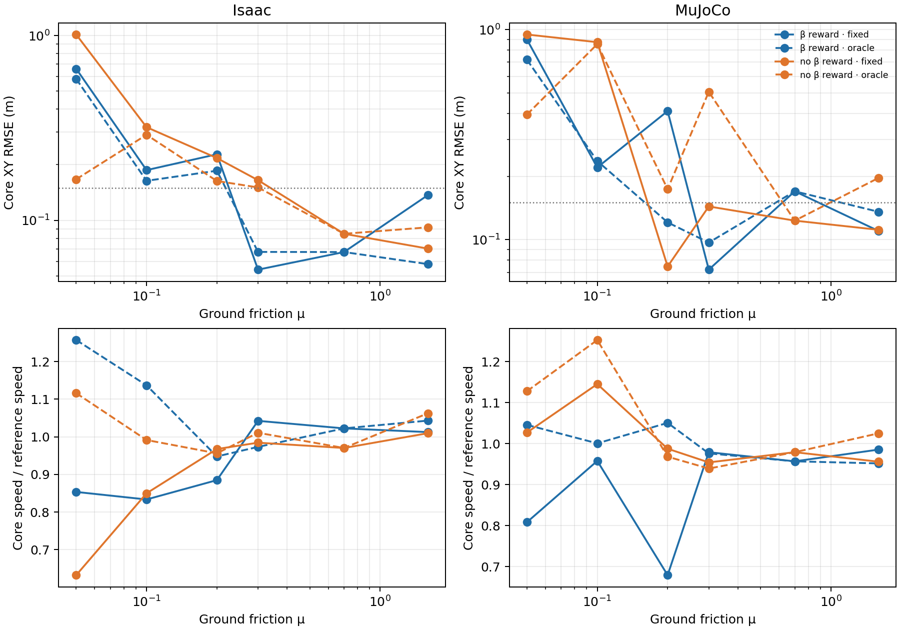

# Sideslip reward × known ground friction: six-point CEM validation

This is the complete **common six-point** follow-up to the [no-sideslip reward ablation](2026-10-16-no-sideslip-reward-ablation.md) and [known-friction pilot](2026-10-16-nmpc-known-friction-pilot.md). It compares the same `drift_drl_traj4` high-angle turn in Isaac and MuJoCo at ground μ = 0.05, 0.10, 0.20, 0.30, 0.70 and 1.60. The four CEM variants are the cross of (i) original body-velocity sideslip-angle tracking weight 2.0 versus weight 0 and (ii) a prediction model fixed at μ=0.70 versus an **oracle** given the validation plant's exact numeric ground μ before the episode. This oracle is privileged diagnostic information, **not** online friction estimation, measured tire slip, or a deployable adaptive MPC. The 17-point controller-development grid is a different experiment; no additional coefficients from it are implied here.

All other tracking terms, actuator/model hashes, CEM search configuration and seed 42 are held fixed: native MuJoCo shooting predictor; horizon 30 control steps, 10 residual-action blocks, 64 candidates × 3 iterations and 8 elites. Each validation plant uses equal static and dynamic ground μ, with per-engine material readback checked. The original no-β and β configurations differ only in the sideslip-tracking weight. The nominal μ=0.70 fixed episode is reused as its oracle counterpart, because both prediction models are identical. There are **48 analysis cells but 44 distinct physical episodes**, one full 6.98 s rollout per distinct cell. No training, friction randomization, or CEM retuning was done for this comparison.

Core XY RMSE is measured over the 1.44–4.00 s turn segment. Values below are metres; smaller is better. “β” here is the **body-frame base COM velocity-direction angle** against the nonzero retargeted reference angle, not a wheel-ground sensor sideslip measurement. The exploratory XY screen is RMSE >0.15 m **or** core peak >0.30 m. It does not treat β offset, height or temporary flight as failure.

| Ground μ | Isaac β, fixed | Isaac β, known μ | Isaac no β, fixed | Isaac no β, known μ |
| ---: | ---: | ---: | ---: | ---: |
| 0.05 | 0.661 | 0.583 | 1.013 | 0.167 |
| 0.10 | 0.187 | 0.164 | 0.319 | 0.290 |
| 0.20 | 0.228 | 0.186 | 0.217 | 0.163 |
| 0.30 | 0.054 | 0.068 | 0.165 | 0.151 |
| 0.70 | 0.067 | 0.067 | 0.085 | 0.085 |
| 1.60 | 0.137 | 0.058 | 0.070 | 0.092 |

| Ground μ | MuJoCo β, fixed | MuJoCo β, known μ | MuJoCo no β, fixed | MuJoCo no β, known μ |
| ---: | ---: | ---: | ---: | ---: |
| 0.05 | 0.898 | 0.720 | 0.949 | 0.394 |
| 0.10 | 0.221 | 0.237 | 0.872 | 0.854 |
| 0.20 | 0.410 | 0.121 | 0.075 | 0.174 |
| 0.30 | 0.072 | 0.097 | 0.144 | 0.506 |
| 0.70 | 0.170 | 0.170 | 0.123 | 0.123 |
| 1.60 | 0.110 | 0.136 | 0.111 | 0.197 |

There is **no uniformly best variant**. Giving the exact numeric μ reduces no-β Isaac error at μ=0.05 from 1.013 to 0.167 m, but this still narrowly crosses the peak-error screen (0.325 m). At μ=0.20, the oracle improves β MuJoCo from 0.410 to 0.121 m while worsening no-β MuJoCo from 0.075 to 0.174 m. At μ=0.30, no-β MuJoCo degrades sharply from 0.144 to 0.506 m, while no-β Isaac changes only from 0.165 to 0.151 m. This is a physical tracking difference with completed episodes and zero reported solver failures, not evidence that the coefficient was read incorrectly. Its mechanism is **not identified** by this grid; contact-model differences, finite-horizon optimization and cost interaction remain possible explanations.

The number of six sampled points below **both** XY screen limits is: Isaac β fixed/known = 3/3, Isaac no-β fixed/known = 2/2; MuJoCo β fixed/known = 2/3, MuJoCo no-β fixed/known = 4/1. These are descriptive counts for one trajectory and one seed, **not** success probabilities or calibrated friction thresholds. Speed retention is separate: at μ=0.05 the no-β Isaac oracle retains 112% of reference mean speed despite failing the XY screen. The no-β μ=0.30 oracle has Isaac–MuJoCo core XY path separation 0.406 m versus 0.235 m for the fixed predictor, so providing the same numeric μ does not make the two engines equivalent. Equal material coefficients do not imply equal tire/contact dynamics.



Individual top-down comparisons (reference black, β blue, no-β orange; fixed solid, known-μ dashed): [μ=0.05](nmpc_beta_friction_factorial_20261017_v1/topdown_mu0p050.png), [0.10](nmpc_beta_friction_factorial_20261017_v1/topdown_mu0p100.png), [0.20](nmpc_beta_friction_factorial_20261017_v1/topdown_mu0p200.png), [0.30](nmpc_beta_friction_factorial_20261017_v1/topdown_mu0p300.png), [0.70](nmpc_beta_friction_factorial_20261017_v1/topdown_mu0p700.png), [1.60](nmpc_beta_friction_factorial_20261017_v1/topdown_mu1p600.png). The μ=0.20 and μ=0.30 views make the large engine-dependent lateral-path changes visible.

The [locked factorial configuration](../config/nmpc_beta_friction_factorial.json), [analysis script](../scripts/analyze_nmpc_beta_friction_factorial.py), [machine-readable summary with all XY/peak/speed/β diagnostics, sim2sim gaps and hashes](nmpc_beta_friction_factorial_20261017_v1/summary.json), and [compact XY traces](nmpc_beta_friction_factorial_20261017_v1/xy_trace.npz) are the reproduction artifacts. The raw reports/rollouts are preserved locally under gitignored `outputs/` directories recorded in `summary.json`; the isolated Isaac snapshot is `/data/zengxiong/workspaces/tron1-controller-comparison-20261015/nmpc_oracle_friction_grid_snapshot_v1/` on `zengxiong@14.103.233.29`. The [sequential Isaac dispatcher](../scripts/dispatch_nmpc_oracle_isaac.py) enforces an idle-GPU check and one environment at a time. Analysis verifies full clocks, trace hashes, actual plant/predictor μ, material readbacks, identical model/search/action identities and the only intended reward-weight change. Re-running the analysis on the saved traces reproduced the summary, compact traces and all figures byte-for-byte.

An initial Isaac μ=0.10 launch under an older source root failed at import time because its existing `whole_body_tracking` dependency was not exposed there; it produced no physical rollout and remains preserved separately. The successful run used an isolated, byte-identical source overlay with the existing dependency linked in. A later GPU guard also stopped a batch after a transient PhysX utilization tail; the batch resumed only once the selected GPU was fully idle. Neither operational event is counted as a tracking failure or included in the 48-cell physical comparison.

To regenerate the analysis from the locally preserved physical episodes:

```bash
python scripts/analyze_nmpc_beta_friction_factorial.py \
  --motion-file ../tron1-learning-from-human/results/2026-10-14-car-drift/matched-friction-mu0p70/motion.npz \
  --reference-file ../tron1-learning-from-human/results/2026-10-14-car-drift/matched-friction-mu0p70/robot_reference.npz \
  --output-dir outputs/replay_beta_friction_factorial
```

For example, rerun the β-reward, known-μ MuJoCo cell at μ=0.20 into a **new** directory:

```bash
python scripts/run_nmpc_tracking.py \
  --model outputs/car_failure_sideslip_20261015/raw/mujoco_model.xml \
  --motion ../tron1-learning-from-human/results/2026-10-14-car-drift/matched-friction-mu0p70/motion.npz \
  --contract outputs/car_failure_sideslip_20261015/raw/mu0p180/isaac/policy_contract.json \
  --task-profile config/car_drift_height_smooth_task.json \
  --settings config/nmpc_height_smooth_residual.json \
  --plant-mu 0.20 --oracle-plant-friction --prediction-backend native \
  --native-library outputs/native_build_20261015_v1/libtron1_nmpc_batch.so \
  --horizon-steps 30 --control-blocks 10 --candidates 64 --iterations 3 --elite-count 8 \
  --output-dir outputs/repro_beta_oracle_mu0p20_mujoco
```

For no-β cells, change the task profile to `config/car_drift_height_smooth_no_sideslip_task.json` and contract to `outputs/controller_primary_ppo_mu070_20261015_v1/mu0p700/isaac/policy_contract.json`. Omit `--oracle-plant-friction` for the fixed-predictor control. The [remote dispatcher](../scripts/dispatch_nmpc_oracle_isaac.py) records the exact Isaac command and idle-GPU audit for each cell in its isolated snapshot.

This is an **offline** CEM benchmark: solve times substantially exceed the 20 ms control period. It should not be ranked as a real-time deployable controller. No repeated seeds, perturbation confidence intervals, or friction-estimator experiments are included.
