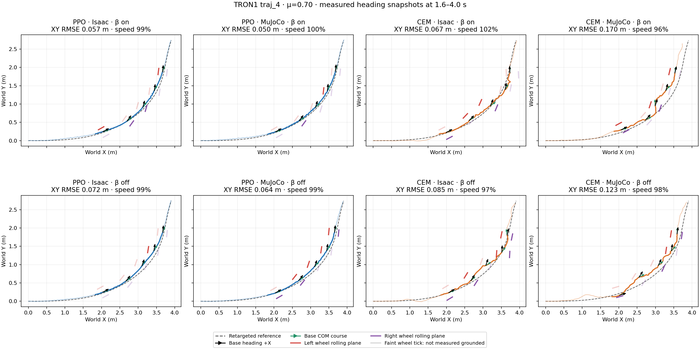

# Primary turn: PPO versus MPC-CEM, sideslip reward, and wheel-XY tracking

This is a compact audit of the existing `drift_drl_traj4` experiments, not a new control rollout. The turn core is 1.44–4.00 s of the 6.98 s trajectory. The nominal validation ground has static and dynamic friction μ=0.70. Each condition is one seed-42 episode in each simulator; the figures and numbers below are descriptive, not success probabilities. The [audited summary](ppo_cem_heading_ablation_mu0p7_20261020_v1/summary.json) binds all eight physical traces and reports to their previously published SHA-256 identities.

## Trajectory and measured headings



Columns are PPO/Isaac, PPO/MuJoCo, MPC-CEM/Isaac and MPC-CEM/MuJoCo; the upper and lower rows respectively include and exclude the direct sideslip-angle (β) reward. The dashed path is the retargeted reference. Black arrows show the measured body +X heading, green arrows the measured base-COM velocity direction, and red/purple ticks the left/right wheel rolling-plane headings at 1.6, 2.2, 2.8, 3.4 and 4.0 s. Faint wheel ticks have no eligible measured ground contact at that instant; they do **not** declare a failure. Wheel headings come from forward kinematics of the recorded states without stepping either simulator. An axial wheel heading has a 180° ambiguity and is not a measured tire-patch slip angle. The reference supplies neither tire-patch contact state nor a sensor-measured wheel heading.

| β reward | Controller | Simulator | Core XY RMSE / peak (m) | Speed retained | Mean absolute β-reference error | Ground-contact wheel-center course ↔ wheel heading, L / R |
| --- | --- | --- | ---: | ---: | ---: | ---: |
| On | PPO | Isaac | 0.0565 / 0.1009 | 99.4% | 2.85° | 12.19° / 8.69° |
| On | PPO | MuJoCo | 0.0498 / 0.0779 | 99.7% | 2.38° | 16.23° / 10.88° |
| On | MPC-CEM | Isaac | 0.0674 / 0.1122 | 102.2% | 7.43° | 14.44° / 10.67° |
| On | MPC-CEM | MuJoCo | 0.1700 / 0.3064 | 95.7% | 12.48° | 8.26° / 7.57° |
| Off | PPO | Isaac | 0.0718 / 0.1170 | 98.7% | 4.85° | 12.38° / 7.96° |
| Off | PPO | MuJoCo | 0.0642 / 0.1026 | 98.9% | 3.94° | 17.19° / 11.79° |
| Off | MPC-CEM | Isaac | 0.0846 / 0.1766 | 97.0% | 10.52° | 13.85° / 8.46° |
| Off | MPC-CEM | MuJoCo | 0.1233 / 0.2002 | 97.9% | 12.07° | 13.74° / 9.19° |

Core XY error is the base-position error against the same reference, not wheel-center position error. Speed retention uses the base COM XY speed. β error is the absolute wrapped difference between the actual and held-reference body-frame velocity directions, averaged over the core where both speeds pass the existing reward eligibility gates. The last column uses each wheel **center's** course, wheel heading, and measured ground contact with upward force >5 N; it is a geometric offset, not tire slip. Different episodes have different eligible sample counts, listed in the summary. The analysis does not classify β, heading offset, brief flight, or height as an XY tracking failure.

With β reward on, PPO's nominal XY RMSE is 0.0565/0.0498 m (Isaac/MuJoCo) versus CEM's 0.0674/0.1700 m. The existing exploratory XY screen is crossed only by the CEM MuJoCo β-on episode (RMSE >0.15 m **or** peak >0.30 m). Removing β worsens PPO's nominal RMSE by 0.0153/0.0144 m and its mean β error by 2.00°/1.56°. For CEM, removing β worsens Isaac RMSE by 0.0172 m but *improves* MuJoCo RMSE by 0.0467 m; there is no simulator-independent β benefit. Both methods retain roughly reference speed at μ=0.70, but speed alone does not establish successful turning.

This is not a matched optimizer-only intervention: the β-off PPO was **retrained from scratch** with the same 12,288,000-transition recipe and training friction randomization, whereas CEM simply changed its objective weight from 2 to 0 and performed a new search. CEM uses H30/B10 residual-plan search with 64 candidates × 3 iterations and eight elites, without a PPO demonstration initializer. The β-off CEM nominal Isaac solve median was about 635 ms for a 20 ms control period, so this is an **offline** comparison rather than a realtime-control claim. One run per cell cannot establish statistical superiority.

## What the wheel-position-relaxation question still needs

There is **no completed wheel-XY-relaxed PPO or CEM rollout** in this dataset, so these traces cannot estimate the effect of removing wheel-position tracking. All eight conditions keep it. In the height-smooth PPO task, `motion_body_pos` averages planar position error across the nine tracked bodies, including both wheels. The matching CEM objective also averages planar body-position error across those bodies. The global base XY anchor is a separate term in both. The height-smooth PPO profile already removes the `anchor_pos` and `ee_body_pos` **termination** gates; there is no wheel-XY termination to loosen here. Recorded relative wheel XY RMSE, approximately 0.018–0.076 m across these baselines, only describes the error while tracking remained active; it is not an ablation result.

To isolate the requested effect, use a 2×2 matrix for **each** controller: β on/off × wheel-body-XY tracking on/off, first at μ=0.70 in both engines. For the wheel-off branch, zero only the two wheel-body XY error contributions while retaining the original nine-body normalization, base-anchor XY, all nonwheel position targets, body/wheel velocities, orientations, action and contact terms, and every evaluation metric. This prevents an accidental rescaling of the remaining body reward. The wheel-off PPO branches require two new policy trainings; CEM requires two new closed-loop searches, with its optimizer settings otherwise fixed. Compare core XY RMSE/peak, speed retention, β error, grounded wheel-heading offsets, and solve time. Only then does “relaxing wheel XY” have a measured effect. A later friction sweep should freeze these four variants first, so friction changes are validation perturbations rather than silent controller retuning.

For broader friction context, the existing **β-on** fixed-controller 17-point grid is below both exploratory XY limits at 13/17 Isaac and 11/17 MuJoCo points for PPO, and 10/17 in each engine for CEM. The existing **β-off PPO** data cover only six friction points (4/6 in both engines); β-off fixed CEM has a separate 17-point grid (7/17 Isaac, 6/17 MuJoCo). These grids are not a wheel-relaxation comparison, nor are the counts statistical success rates. See the [β-off six-point report](2026-10-16-no-sideslip-friction-pilot.md), [β-on controller grid](2026-10-16-primary-controller-friction-development.md), and [CEM β×friction grid](2026-10-17-nmpc-beta-friction-factorial-17.md).

Reproduce this read-only summary and heading view from the saved raw traces with:

```bash
python scripts/summarize_ppo_cem_heading_ablation.py \
  --output-dir outputs/REPLAY_ppo_cem_heading_ablation
```

The input traces live under gitignored `outputs/`; this repository publishes the derived figure, summary, code, and provenance hashes, not the raw checkpoints or model assets. Existing source reports and rollouts are not changed by the analyzer.
