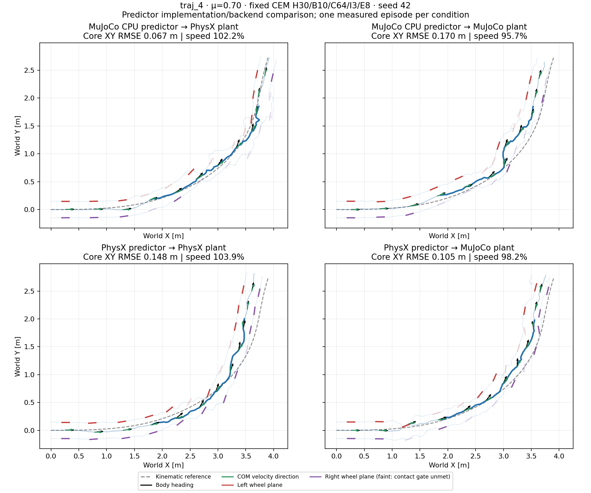

# CEM prediction physics × validation physics

Changing the prediction backend does not uniformly improve tracking. At nominal
μ=0.70, PhysX prediction improves the MuJoCo episode but worsens the PhysX
episode relative to the archived MuJoCo predictor. Same-engine prediction is
therefore not automatically the best controller under this fixed search.

## Measured results

The primary `traj_4` reference turns approximately 61° and averages 1.03 m/s in
the 1.44–4.00 s evaluation core. Every condition completes 349 control decisions
and 6.98 s of physics, with zero solver failures. There is one seed-42 episode
per condition, not a success-rate estimate.

| Prediction model | Validation plant | Core XY RMSE / peak | Speed retained | Median solve |
| --- | --- | ---: | ---: | ---: |
| MuJoCo CPU | PhysX | 0.0674 / 0.1122 m | 102.2% | 634 ms |
| MuJoCo CPU | MuJoCo | 0.1700 / 0.3064 m | 95.7% | 999 ms |
| PhysX | PhysX | 0.1480 / 0.2610 m | 103.9% | 2,508 ms |
| PhysX | MuJoCo | 0.1049 / 0.1740 m | 98.2% | 2,555 ms |

The paired PhysX–MuJoCo path-gap RMSE is 0.2093 m with MuJoCo prediction and
0.1154 m with PhysX prediction. This measures two independently replanned
closed-loop paths in the same world frame, not identical actions replayed
through different engines. Both new episodes fall below the exploratory
0.15 m RMSE / 0.30 m peak screen; the PhysX episode is close to the RMSE limit.
This single-coefficient result is not a frozen robustness benchmark.



[Watch the synchronized top-down video](mpc_prediction_transfer_mu0p7_20261021_v1/topdown.mp4).
Black arrows show body heading, green arrows COM velocity, and red/purple
segments the wheel planes. Faint wheels do not meet the measured ground-contact
gate. [Heading-offset traces](mpc_prediction_transfer_mu0p7_20261021_v1/heading_offsets.png)
condition wheel angles on contact count >0 and upward force >5 N. Heading
offset and height/flight are diagnostics, not mismatch or failure labels.

## What is controlled, and what is not

All four episodes use the same reference, 15-term height-smooth objective,
eight-action DC-motor contract, 200 Hz physics, 50 Hz action hold and residual
CEM H30/B10/C64/I3/E8. Prediction μ=0.70 is predeclared, not copied from the
plant. The two new PhysX-predictor episodes use an isolated 64-environment
worker; no policy initialization, action replay, root prescription after reset,
external root forces or controller retuning is used. The other two episodes
are reused archived recordings, not newly rerun MuJoCo-predictor cases.

This compares predictor implementations/backends, not an isolated solver
change: historical MuJoCo prediction cold-resets every 20 ms; PhysX integrates
continuously over the horizon. Both retain the same MuJoCo bias-force nominal
seed. Precision, asset/contact behavior and contact-force measurement operators
also differ. All solves exceed 20 ms, and simulated time waits for each answer;
these are offline results, not real-time control or intrinsic engine-speed tests.
The PhysX worker currently also steps padded candidate slots during rescoring.

The [execution inputs and calibration evidence](mpc_prediction_transfer_mu0p7_20261021_v1_inputs/README.md)
preserve all four raw reports/rollouts, the exact executed 20-file source
snapshot, commands and three actual 64-candidate/30-step probes. Stored arrays,
cost sums, source bindings and four episode metrics are rechecked by the
[analyzer](../scripts/analyze_mpc_prediction_transfer.py).
See the [JSON](mpc_prediction_transfer_mu0p7_20261021_v1/summary.json) and
[CSV](mpc_prediction_transfer_mu0p7_20261021_v1/metrics.csv) for contact, posture,
heading and timing diagnostics. The earlier
[PPO/CEM 17-friction comparison](2026-10-21-physx-mujoco-controller-transfer.md)
is a separate experiment; PPO was not retrained here.

## Asset-free replay

With NumPy and Matplotlib installed, reproduce metrics and figures from the
published recordings without Isaac, MuJoCo, robot assets or learned weights:

```bash
python scripts/analyze_mpc_prediction_transfer.py \
  --physx-pair-dir results/mpc_prediction_transfer_mu0p7_20261021_v1_physx_pair \
  --output-dir outputs/mpc_prediction_transfer_replay
python scripts/render_mpc_prediction_transfer_video.py \
  --source-dir outputs/mpc_prediction_transfer_replay \
  --output-file outputs/mpc_prediction_transfer_replay/topdown.mp4
```

Video additionally requires ffmpeg or `imageio_ffmpeg`. Re-running the physical
experiments requires the asset/task stack and paths recorded in the snapshot
and execution commands; these dependencies are not silently downloaded.
