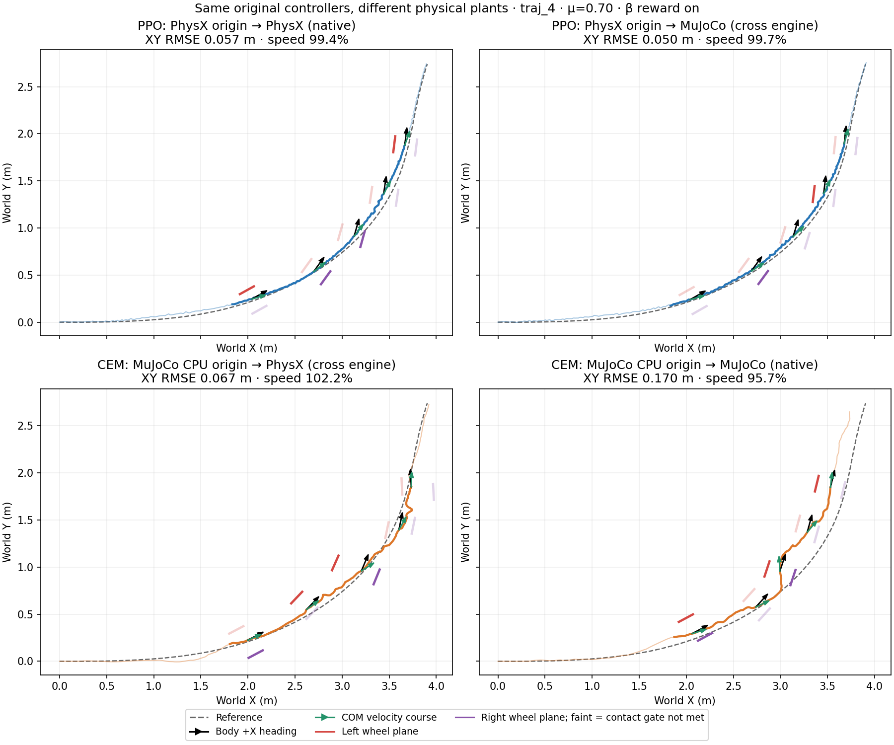
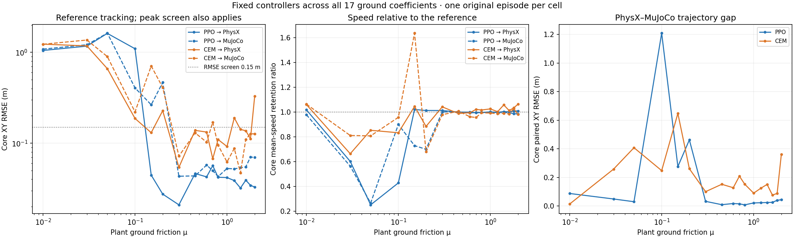

# PhysX and MuJoCo controller transfer

For the primary `traj_4` turn, the PhysX-trained PPO retains similar tracking
when evaluated in MuJoCo. CEM with a MuJoCo CPU prediction model changes more
between validation engines and tracks better in PhysX at nominal μ=0.70.
The comparison covers the existing 17 friction coefficients and 68 physical
episodes, one seed per controller and coefficient. The figures replay those
recordings; they introduce no new policy training or physical rollouts.

## Controller origin and validation

| Controller | Source physics | PhysX validation | MuJoCo validation |
| --- | --- | --- | --- |
| PPO | PhysX training, 12,288,000 transitions | Same frozen checkpoint | Same frozen checkpoint |
| MPC CEM | MuJoCo CPU prediction, μ=0.70 | Replan from measured PhysX state | Replan from measured MuJoCo state |

The same reference, 200 Hz physics, 50 Hz action hold, eight leg/wheel actions
and nominal DC-motor contract apply. Validation changes fixed ground μ with
random events disabled. CEM uses the same 15-term objective and
H30/B10/C64/I3/E8 residual search at every coefficient. Its prediction μ stays
at 0.70. PPO retains its original training domain randomization and frozen
normalization. Both use closed-loop feedback in the target engine.

## Nominal turning at μ 0.70

The core is 1.44–4.00 s of a 6.98 s physical episode. The reference COM speed
averages approximately 1.03 m/s in this robot-scale motion.

| Controller | Validation plant | XY RMSE / peak | Speed retained | PhysX–MuJoCo path gap RMSE |
| --- | --- | ---: | ---: | ---: |
| PPO trained in PhysX | PhysX | 0.0565 / 0.1009 m | 99.4% | 0.0157 m |
| PPO trained in PhysX | MuJoCo | 0.0498 / 0.0779 m | 99.7% | 0.0157 m |
| CEM with MuJoCo predictor | PhysX | 0.0674 / 0.1122 m | 102.2% | 0.2093 m |
| CEM with MuJoCo predictor | MuJoCo | 0.1700 / 0.3064 m | 95.7% | 0.2093 m |



[Watch the synchronized top-down video](physx_mujoco_controller_transfer_20261021_v1/nominal_topdown.mp4).
Black arrows show body +X, green arrows COM velocity, and red/purple ticks the
left/right wheel rolling planes. Faint ticks mean the measured ground-contact
gate was not met. Wheel heading is axial modulo 180°; its difference from
velocity direction is reported as geometry, separately from contact-point
lateral slip. Height and flight are not failure criteria.

## Friction sensitivity

| Controller | Below both XY limits in PhysX | In MuJoCo | Same μ passes in both |
| --- | ---: | ---: | ---: |
| PPO | 13/17 | 11/17 | 11/17 |
| CEM | 10/17 | 10/17 | 8/17 |

The exploratory XY limits are RMSE ≤0.15 m and peak ≤0.30 m. These counts
describe the recorded coefficients rather than success probabilities.
PhysX and MuJoCo disagree on this screen at μ=0.15 and 0.20 for PPO, and at
μ=0.15, 0.70, 1.20 and 2.00 for CEM. Thus identical CEM counts hide different
failure coefficients. The median paired path-gap RMSE over the sampled grid
is 0.0307 m for PPO and 0.1525 m for CEM.



The controller family and source physics vary together in this comparison.
The measurements establish sensitivity of these particular controllers to an
engine change; they do not isolate a causal backend effect or rank physics
accuracy. A same-family MPC comparison additionally needs a PhysX predictor
evaluated in both plants. Equal numerical μ does not calibrate equivalent
wheel-ground traction. CEM's approximately 638 ms nominal PhysX solve median
also places the current results in offline evaluation, with the plant waiting
for each solution rather than enforcing the 20 ms deadline.

## Reproduction

The asset-free [analysis program](../scripts/analyze_physx_mujoco_transfer.py)
checks the source bundle hashes, exactly replays all 68 episode metrics and
34 paired path gaps, and preserves original world coordinates and clocks.
The [JSON summary](physx_mujoco_controller_transfer_20261021_v1/summary.json)
and [68-row CSV](physx_mujoco_controller_transfer_20261021_v1/metrics.csv)
include source identities, contact-conditioned angles and slip diagnostics.

```bash
python scripts/analyze_physx_mujoco_transfer.py \
  --output-dir outputs/physx_mujoco_transfer_replay --video
```

Inputs are the published
[paired physical trace bundle](nmpc_primary_friction_pair_development_20261016_v1/summary.json).
NumPy and Matplotlib are sufficient for the figures; MP4 output additionally
uses ffmpeg or the `imageio_ffmpeg` encoder. SA29 remains a separate task.
