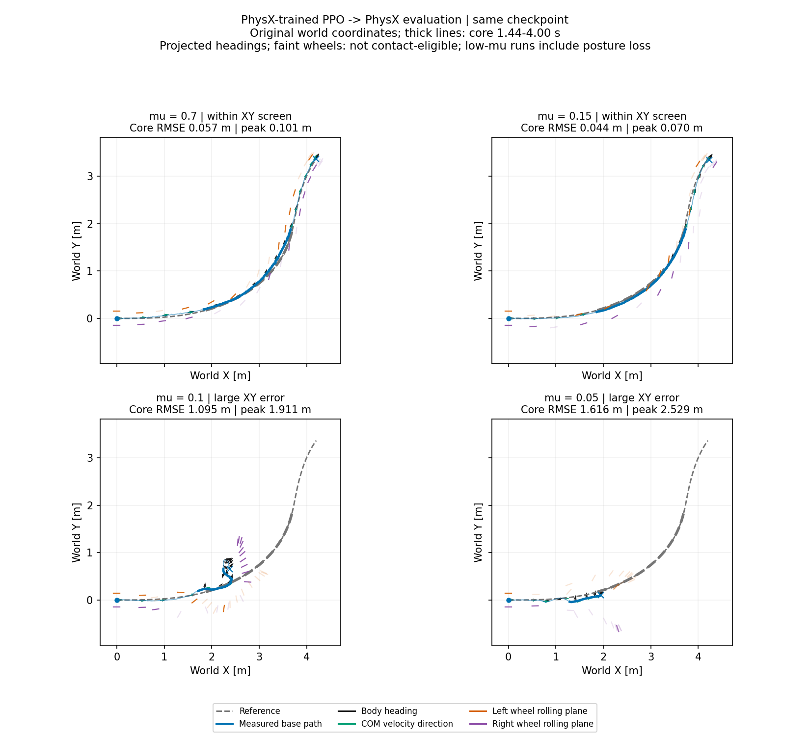
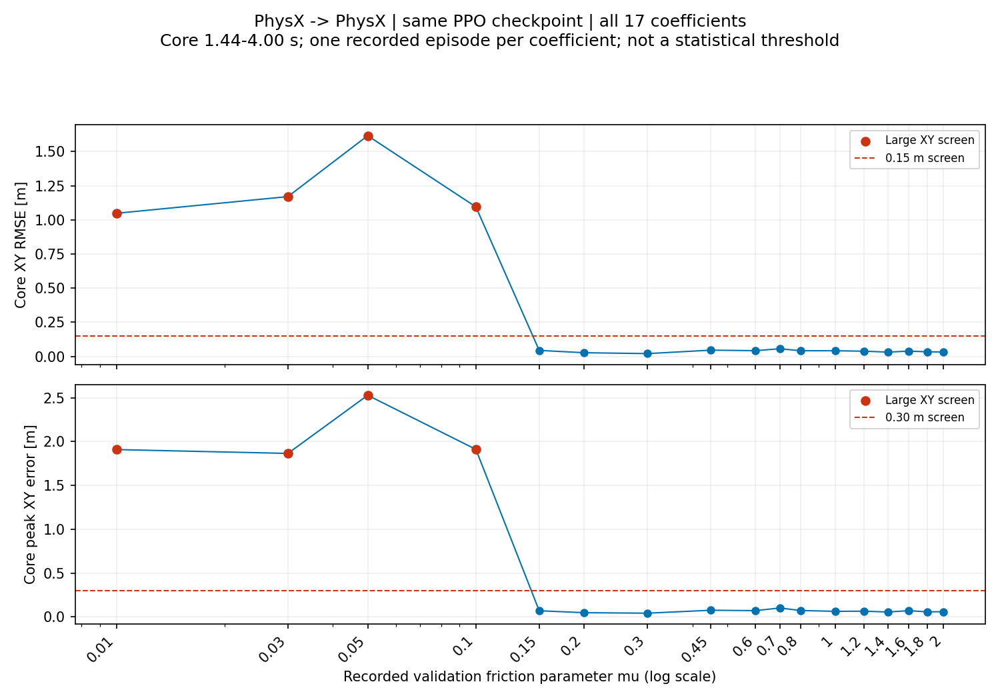

# PhysX trained PPO tracking under low friction

The same frozen PPO policy, trained and evaluated in **PhysX**, tracks the primary `traj_4` turn with 0.0565 m core XY RMSE at μ = 0.70, but reaches 1.0950 m at μ = 0.10 and 1.6159 m at μ = 0.05. Large low-friction tracking errors therefore occur within PhysX itself, without a change of simulation backend.

## Tracking comparison



[Synchronized top down animation](physx_ppo_low_friction_20261021_v1/topdown.mp4) compares μ = 0.70, 0.15, 0.10 and 0.05 on unchanged world axes and clocks. The dashed curve is the reference; black arrows show body heading, green arrows COM velocity direction, and red/purple marks the left/right wheel rolling planes. Faint wheel marks lack eligible measured ground contact. Low-friction episodes include severe posture loss: projected headings are not evidence of successful upright drifting.

| Validation μ | Core XY RMSE / peak m | Mean speed retained | XY screen |
| ---: | ---: | ---: | --- |
| 0.70 | 0.0565 / 0.1009 | 99.41% | Below limits |
| 0.15 | 0.0445 / 0.0695 | 102.11% | Below limits |
| 0.10 | 1.0950 / 1.9113 | 42.87% | Exceeded |
| 0.05 | 1.6159 / 2.5287 | 25.19% | Exceeded |
| 0.03 | 1.1701 / 1.8651 | 60.22% | Exceeded |
| 0.01 | 1.0479 / 1.9088 | 101.89% | Exceeded |

The core is 1.44–4.00 s. The existing screen is exceeded when XY RMSE >0.15 m **or** peak >0.30 m; height, flight and sideslip are not failure gates. Relative to μ = 0.70, RMSE rises about 19.4× at μ = 0.10 and 28.6× at μ = 0.05, the worst sampled RMSE. Speed alone is insufficient: μ = 0.01 retains approximately reference speed but misses the path and includes posture loss.



Only μ = 0.01, 0.03, 0.05 and 0.10 exceed the XY screen among the 17 sampled points. The successful μ = 0.15 contrast and nonmonotonic error prevent interpreting this single-seed grid as a universal friction threshold or success probability.

## Fixed policy and material convention

This is the earlier height-smooth PPO, not the newly launched mjlab-paired cohort. Its [training metadata](controller_primary_ppo_height_smooth_seed42_v1/training_metadata.json) records seed 42, 512 environments, 12,288,000 transitions and checkpoint SHA-256 `6ec411efeaea37fc61389285978b377aa7c5be80e326ce7f18581efc9acdf27b`. Every coefficient uses that checkpoint and the same task, with no adaptation or retraining.

Training randomized robot static friction over [0.3, 1.6] and dynamic friction over [0.3, 1.2], with ground friction fixed at 1.0. Validation disables random events and sets **both robot and ground static/dynamic coefficients to μ**; this is not a ground-only perturbation with fixed wheel material. Source configuration uses average combination, while the archived runtime audit verifies coefficient values but does not independently read back combination flags. The lowest validation coefficients extend beyond the training material range.

Each recording reaches 6.98 s, with 1,397 physical samples; the turn core contains 513 samples. Pose predicates were recorded without stopping the diagnostic episode. RMSE uses measured base XY against the original clock; speed uses recorded COM velocity. No alignment, time warping, new inference or simulator stepping is used.

## Reproduction

The [comparison script](../scripts/compare_physx_ppo_low_friction.py) derives PhysX-only metrics, plots and animation from the existing [public physical traces](policy_primary_friction_dynamics_20261016_v1/summary.json). The [new summary](physx_ppo_low_friction_20261021_v1/summary.json) and [CSV](physx_ppo_low_friction_20261021_v1/metrics.csv) retain all 17 points and input identities. No policy weights or robot assets are needed.

```bash
python scripts/compare_physx_ppo_low_friction.py \
  --output-dir outputs/physx_ppo_low_friction_replay
```

[Verification](physx_ppo_low_friction_20261021_v1/verification.json): 26 regression checks passed; the seven-second H.264 video decoded successfully as 350 frames at 50 fps.
