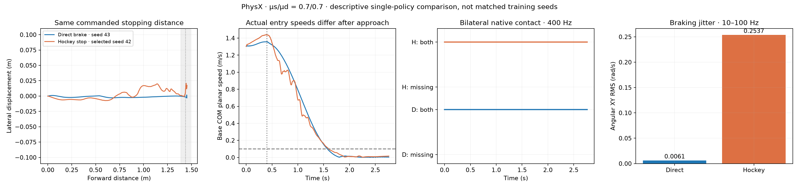

# Direct braking versus the archived hockey stop

At the current designed entry speed of about 1.31 m/s and PhysX friction
μs/μd = 0.7/0.7, direct braking completed **33/33** predeclared nominal and
perturbed trials. All 33 retained bilateral contact at every recorded physical
sample, stopped and held, and passed the fixed forward/lateral distance limits.
These are 33 evaluations of **one policy trained with seed 43**, not 33 training
seeds. The other material branch and seeds 44–47 remain in progress.

The completed direct policy has a 24,576,000-transition lineage: 12,288,000 from
scratch, 3,072,000 contact refinement, and 9,216,000 optimizer continuation.
Training retained friction and other DR. Positive β and lateral-sliding rewards
were removed, and the reference used the initial posture as a soft target while
retaining the hockey reference's XY translation and timing. Wheels remained
actively torque-controlled.

## Nominal comparison at the same commanded distance

The hockey column is the previously selected seed-42 v8 policy, evaluated at
0.7/0.7. Both recordings start from the same physical root/joint state to within
1.2e-7; linear/angular velocities and joint states match exactly. Physics is
400 Hz and policy control is 50 Hz. This is a descriptive comparison with the
archived baseline, not a matched-seed estimate of treatment effect.

| Metric | Direct braking, seed 43 | Hockey stop, selected seed 42 |
|---|---:|---:|
| Base COM speed at t=0 | 1.3033 m/s | 1.3033 m/s |
| Actual speed when braking starts at t=0.4 s | 1.3559 m/s | 1.4353 m/s |
| Bilateral native contact over the task | 100% | 100% |
| Native contact interruptions | 0 ms | 0 ms |
| Time after braking starts until sustained XYZ-speed stop | 1.1800 s | 1.2775 s |
| Forward distance from start at that stop | 1.4351 m | 1.4311 m |
| Maximum overshoot beyond the 1.4382 m target | 1.33 cm | 1.48 cm |
| Maximum lateral excursion over the full task | 0.30 cm | 2.08 cm |
| Braking angular XY RMS, 10–100 Hz | 0.00608 rad/s | 0.25366 rad/s |
| Maximum body tilt | 9.57° | 6.08° |

The direct policy has about **97.6% lower measured high-frequency angular RMS**
in this nominal comparison. Maximum tilt measures posture, while high-frequency
angular RMS measures oscillation; these are separate properties.
The current results do not show a hockey-stop advantage in stable stopping at
this speed and distance. They do not establish an advantage at higher speeds,
other surfaces, or different distance budgets.

The actual approach differs despite identical initial states: hockey enters
braking about 5.9% faster than direct braking. The stop-time difference therefore
does not isolate intrinsic braking efficiency. References and sliding/β reward
weights also change together; the difference cannot be attributed solely to β.



## Evaluation definitions and limits

- Contact uses native manifold separation ≤0.1 mm with valid normals, aligned
  to the pre-step geometry timestamp; unknown geometry cannot pass. Contact is
  checked at every native 2.5 ms sample, including the task endpoint. This is
  sampled continuity, not a mathematical continuous-time proof.
- A stopped interval requires base COM **XYZ** speed ≤0.1 m/s for at least
  0.5 s, bilateral contact and upright posture. The final 0.5 s must also remain
  stopped with tilt ≤30°. The earlier preview used planar speed; the JSON keeps
  both definitions. Planar stop times after braking are 1.1725 s and 1.2000 s.
- Forward distance is base-link displacement projected onto the fixed initial
  reference direction, measured from each episode's actual start. It is not
  arc length or COM distance. The fixed target is 1.438207 m, tolerance 5 cm;
  maximum forward overshoot is 5 cm and maximum lateral excursion is 10 cm.
  Fixed-world reference XY tracking is also reported independently.
- Direct trials additionally pass the retained entry-speed, approach-speed,
  tracking and body-heading checks. They have zero measured non-wheel contact
  force; wheel load distribution need not be equal. No absolute height, wheel
  spin imitation, minimum lateral slip, or hockey wheel-heading gate is used.
- Historical hockey lacks the newly added all-body contact-force telemetry.
  Its non-wheel support check is marked **unverified**, not assumed to pass.
  Historical qualification and these new direct task gates are not identical;
  no new common-gate hockey success percentage is claimed.
- Jitter uses the same detrend, Hann window, one-sided Parseval normalization,
  channel-mean power, 10<f<100 Hz band and t=0.4–1.8 s interval for both policies.

Across all 33 direct trials, median jitter RMS is 0.00631 rad/s, median maximum
tilt is 9.63°, and median lateral excursion is 0.86 cm. Every listed direct
task gate passed in every trial. No failed seed/trial was excluded or retuned.

Raw case reports and artifacts were hash-verified against the completed suite
report before analysis. [Full measurements](analysis_v1/report.json) include
all per-trial results, gates, identities, and nominal initial-state errors.
Raw arrays remain local under `evidence/evaluation/` and on the remote host;
weights and raw recordings are not included in this publication.

Recompute after downloading the completed validation suite:

```bash
/tmp/tron1-baseline-venv/bin/python scripts/analyze_direct_brake_comparison.py \
  --suite results/direct_brake_comparison_20261103_v1/evidence/evaluation \
  --output outputs/direct_brake_comparison_reproduced
```

## Queue recovery

The original dispatcher completed seed 43's equal-friction lineage, 33 cases
and the cross-material 0.9/0.7 nominal recording. It then stopped **before
launching** the 0.9/0.9 recording: `Path.with_suffix('.log')` truncated decimal
material names, causing both cross-material logs to have the same filename.

The fix appends `.log` to the complete directory name. Recovery verifies each
completed stage's protocol, model/report/artifact hashes and transition counts
before reusing it. Existing runtime protocols cannot be replaced. The original
snapshot, checkpoints, rewards, seeds, budgets and outputs remain intact; no
completed training is repeated. The pre-recovery status is archived remotely.
The recovered queue has passed the missing cross-material validation and is
running seed 43's split-friction contact training.

- Recovery source SHA-256: `f6b1eeef287984a3e6d316a6ec72834fb70730b9c48e999ddc869909ee2ec59d`
- Remote file: `/data/zengxiong/workspaces/tron1-direct-brake-20261102-v1/recovery_dispatcher_20261103_v1.py`
- Tmux session: `tron1-direct-brake-resume-20261103-v1`
- Queue status: `runs_v1/status.json` in the same workspace.
- Recovery regression tests: 8 passed in `tests/test_direct_brake_training.py`.

The queue still runs one job at a time and only launches on an RTX with no
compute/graphics processes, zero utilization and less than 256 MiB used.
