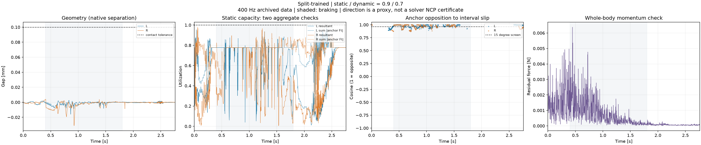

# Contact-model audit of the current hockey stop

The four completed native-cylinder PhysX cases retain their original task
success and show contact-supported, dissipative sliding. No aggregate static
capacity exceedance above the 5% diagnostic screen was found, including when
the magnitudes of all friction-anchor forces are summed before comparison.
This is stronger evidence than the previous resultant-only cone display, but
it does not certify each contact patch or the solver's maximum-dissipation law.

[Machine-readable report](report.json) · [derived signals](signals.npz) ·
[anchor samples](anchors.csv) · [analysis code](../../scripts/audit_hockey_contact_model_framework.py)

## Main comparison

All cases cover 0–2.76 s at 400 Hz; braking is 0.4–1.8 s. The first three
share the frozen v8 actor. The last uses the completed split-friction v9 actor.
Each row is one nominal rollout, not a training-seed or perturbation success rate.

| Policy | Static / dynamic mu | XY RMSE [cm] | Bilateral interruption [ms] | All-active-anchor sliding, L / R [s] | Friction within 15 degrees of opposite slip, L / R |
| --- | --- | ---: | ---: | --- | --- |
| Frozen v8 | 0.7 / 0.7 | 2.721 | 0 | 0.9675 / 0.5175 | 68.0% / 66.0% |
| Frozen v8 | 0.9 / 0.7 | 2.762 | 0 | 0.9600 / 0.5275 | 66.8% / 67.1% |
| Frozen v8 | 0.9 / 0.9 | 2.772 | 0 | 0.8325 / 0.4200 | 58.6% / 68.9% |
| Split-trained v9 | 0.9 / 0.7 | 2.308 | 0 | 0.8975 / 0.6325 | 72.5% / 73.9% |

The sliding-duration column counts intervals where **every force-active anchor
on that wheel** has speed above 0.05 m/s in all three velocity readouts and
their directions differ by at most 30 degrees. Both wheels must touch at both
recorded endpoints. These intervals need not be contiguous. In every selected
interval, `sum_anchor |Ft| / (mu_d sum_normal Fn)` is 1 to within 4e-7 across
all four cases. Selection does not use force opposition or capacity.

The final column has a different denominator: individual direction-stable
sliding anchor records, using material displacement over the interval as
velocity. It is a diagnostic 15-degree screen, not a task-success threshold.
All these records oppose slip in all three readouts; not all are exactly
antiparallel. The new durations differ intentionally from the frozen task's
qualified slide durations, which also include heading/tilt and other gates.



Other cases: [0.7/0.7](case0_framework_4x1.png),
[0.9/0.7 frozen](case1_framework_4x1.png), [0.9/0.9](case2_framework_4x1.png).

## What the framework supports

The audit separates geometry, force admissibility, friction direction, and
dynamics, following the distinctions in
[Contact Models in Robotics: a Comparative Analysis, v3](https://arxiv.org/html/2304.06372v3).
Agreement with a rigid Coulomb model is not validation of a real tire or ice blade.

| Check | Finding | Interpretation |
| --- | --- | --- |
| Contact geometry | All four cases retain both wheels at every sampled state even at 0.01 mm tolerance, versus the unchanged 0.1 mm task tolerance | Contact success is not dependent on the looser tolerance; substep events remain unobserved |
| Authored cylinder vs native gap | Maximum absolute discrepancy across cases is below 0.000277 mm | Independently confirms geometry, collider transforms and pose timing |
| Normal contact | No normal force below -0.001 N; latest minimum separation is -0.0313 mm | Small numerical penetration exists; ideal nonpenetration is not exact |
| Static cone | No interval above 1.05 for either `|sum Ft|/(mu_s Fn)` or `sum |Ft|/(mu_s Fn)` | Necessary wheel-level bounds pass; patch-specific loads remain unknown |
| Dynamic capacity | Every interval selected by all-active-anchor sliding saturates the aggregate dynamic budget | Supports friction-saturated sliding without inventing local normal loads |
| Dissipation direction | Latest braking has 610 L and 456 R qualifying anchor records, all opposing slip | Supports dissipative behavior; exact maximum dissipation is unproven |
| Linear momentum | Braking RMS force residual 0.00108–0.00115 N across cases | Net external-force accounting is consistent with COM motion |
| Timing negative control | Shifting forces one step raises braking RMS residual to 29.8–35.1 N | The force-interval alignment is consequential and independently checked |
| Numerical convergence | No matched timestep/solver-iteration sweep for these actors | Open; the historical 200/400 Hz comparisons changed other factors |

For v9, the native minimum-gap range is -0.0313 to +0.00403 mm. Some additional
manifold points carry force while their own separation exceeds 0.1 mm:
0.488% / 0.539% of normal impulse on L/R over the full recording; the largest
loaded-point separation is 0.526 mm. The wheel still has another touching
point. These are distinct from loss of wheel contact, and prevent claiming a
strict pointwise Signorini certificate. The recorded contact offset is 1 mm.

The latest direction-error medians are 9.89 / 6.89 degrees and the 95th
percentiles are 20.74 / 25.03 degrees. Using sliding-speed screens of 0.02 or
0.1 m/s instead of 0.05 preserves opposing friction for all direction-stable
braking samples in every case. These samples are not independent trials.

## Measurement and interpretation limits

- Raw geometry row k belongs to pose k; its force is impulse divided by dt
  over [k, k+1]. The unstepped zero-force slot is excluded. The analysis starts
  at t=0, including the moving-body/zero-wheel-spin startup transient.
- Each anchor's material point is transported with its wheel. Pre-step twist,
  post-step twist at the transported point, and interval displacement are kept
  separate. No changing contact centroid is differentiated.
- Force-active means greater than 0.001 N for direction numerics only. It
  does not redefine geometric contact or require equal wheel loading.
- Interval-average force times any sampled velocity is a power/work **proxy**.
  The latest braking interval proxy has 0.0192 J positive versus 122.345 J
  negative contributions across all force-active anchors, including slow and
  transition cases. Neither is an exact friction-energy measurement. Contact
  work also cannot be equated to loss of COM translation alone.
- A transported material point can leave the surface during pure rolling.
  Its positive normal velocity is not, by itself, a Signorini violation.
- Normal contacts and friction anchors have no complete archived patch/load
  mapping. Passing the stronger sum-of-norms check cannot prove patchwise
  admissibility. Wheel-to-wheel force cancellation can also be substantial
  (latest braking median 71.8%).
- Solver-stage velocities, contact stabilization biases, and stick/slip mode
  flags are absent. These outputs are not the paper's exact NCP residuals.
- There was no new physics rollout, policy training, gate change, or real-world
  calibration. The earlier 33-case task qualification remains a separate result.

The next discriminating experiment is the
[matched numerical-sensitivity specification](next_checks.json), followed by
patch-resolved force logging if the API permits it. That specification is
prepared only; no new GPU experiment was launched by this audit.

## Reproduce

Run from the repository root with NumPy, SciPy, PyTorch, Matplotlib and pytest.
The archived inputs are selected by `complete_selection.json`; raw files,
material values, reference, qualifications and source manifests are verified
by the existing strict loader. No policy weights are needed.

```bash
python scripts/audit_hockey_contact_model_framework.py \
  --cases-json results/hockey_static_dynamic_transition_20261029_v1/complete_selection.json \
  --reference results/hockey_speed_success_20261028_v1/source_snapshot_v1/references/s100 \
  --mass-report results/hockey_contact_reward_search_20261028_v1/momentum_force_audit_v1/report.json \
  --output <fresh-directory>
python -m pytest -q \
  tests/test_hockey_contact_model_framework.py \
  tests/test_hockey_contact_timing.py \
  tests/test_hockey_contact_cone_relation.py \
  tests/test_hockey_braking_effectiveness.py
```

All 16 tests pass. Counterexamples cover cancellation hiding excess anchor
force, an in-cone force assisting slip, undefined zero-speed directions,
rolling material-point migration, within-step slip reversal, and mixed
sticking/sliding anchors. The report records all analysis-source and data hashes.
