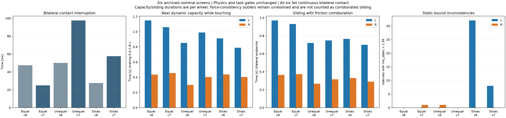
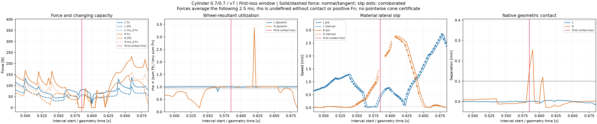

# Contact continuity and friction capacity

**The recordings contain sustained contact and friction-corroborated lateral sliding. The remaining failure is intermittent contact loss; saturation alone does not distinguish the failing intervals.** This retrospective audit compares all six completed v6/v7 nominal screens, with no new physics, reward changes or success-gate changes. They are single-seed screens, not independent robustness trials. All six still fail the continuous bilateral-contact gate.



## Findings

Across **17 wheel contact-loss events**, the last preceding positive-normal-force interval has dynamic utilization **0.993–1.000** and an opposing, dissipative friction-anchor signal. These intervals start 5–17.5 ms before the first missing geometric-contact sample and end 2.5–15 ms before it. In **all 17 events**, both normal and tangential force are already zero during the final 2.5 ms interval ending at loss. The ratio is undefined there; it is not a utilization of zero.

This establishes an observed sequence of near-capacity sliding, loss of normal impulse and subsequent geometric separation. It does **not** establish that friction saturation causes the wheel to lift. Near-capacity intervals also occur extensively while contact remains present. In the v7 equal cylinder, the left wheel stays geometrically touching throughout the task, spends **1.06 s** near dynamic capacity during braking, and contributes **0.930 s** of friction-corroborated lateral sliding.

| Geometry, static/dynamic friction | Bilateral interruption v6 → v7 | v7 corroborated slide, L / R | Static-bound exceedance intervals v6 → v7 |
| --- | ---: | ---: | ---: |
| Cylinder, 0.7 / 0.7 | 47.5 → 25.0 ms | 0.930 / 0.3725 s | 0 → 1 |
| Cylinder, 0.9 / 0.7 | 50.0 → 97.5 ms | 0.7475 / 0.3150 s | 1 → 0 |
| Nine rigid slices, 0.9 / 0.7 | 27.5 → 57.5 ms | 0.700 / 0.2900 s | 32 → 8 |

Interruption covers the 2.76 s task. Slide and force statistics cover braking, 0.4–1.8 s. Slide durations are per wheel and may overlap; do not add them into a task duration. The revised diagnostic requires both wheels touching at both interval endpoints, and therefore differs from the frozen task qualifier. It does not replace the original qualification or add a new success claim. v7 changes the aggregation of the contact-loss reward; each model is also trained with its own geometry/friction configuration, so cross-model differences are not isolated solver effects.

## A concrete loss event

The v7 equal-cylinder right wheel first loses geometric contact at **0.5850 s**:

| Interval start / geometry time | Interval-average Fn | Interval-average \|Ft\| | Native gap | Interpretation |
| --- | ---: | ---: | ---: | --- |
| 0.5775 s | 53.479 N | 37.170 N | −0.00497 mm | Dynamic capacity 37.435 N; rho = 0.9929; pre/interval lateral speed 0.881 / 0.954 m/s |
| 0.5800 s | 0 N | 0 N | −0.00459 mm | Geometrically touching, zero impulse; rho undefined |
| 0.5825 s | 0 N | 0 N | 0.07573 mm | Still within the unchanged 0.1 mm contact tolerance |
| 0.5850 s | 0 N | 0 N | 0.15529 mm | First contact failure |

Every force value averages the **following** 2.5 ms; it is not an instantaneous force at the displayed geometry timestamp. Native geometry has been aligned to the pre-step pose. The material displacement follows the same rigid-body point over the step, rather than differentiating a moving contact minimum.



The 0.620 s utilization spike in that plot is retained and flagged below. It is not counted as corroborated sliding.

## What the friction diagnostic can certify

For each wheel, using the flat ground's normal and the projected wheel longitudinal/lateral axes:

```text
capacity_s = mu_s * sum(Fn)
capacity_d = mu_d * sum(Fn)
rho_s = norm(sum(Ft_xy)) / capacity_s
rho_d = norm(sum(Ft_xy)) / capacity_d
```

Ratios are evaluated only with valid native geometric contact and positive normal force above a 1e-6 N division safeguard. This safeguard does not define contact. Zero-load geometric contact is retained in the contact audit. The normalized force-plane plots use `F_long/(mu_d Fn)` and `F_lat/(mu_d Fn)`, with separate static and dynamic analytical boundaries. For the 0.9/0.7 configuration, dynamic saturation corresponds to **rho_s ≈ 0.7778**, not rho_s ≈ 1.

Sliding corroboration additionally requires pre-step RMS and interval lateral material speed above 0.05 m/s, rho_d in [0.9, 1.05], an opposing lateral friction anchor, summed pre-velocity anchor power below −0.05 W, and both wheels touching at both interval endpoints. Anchor power is an impulse-average/pre-velocity proxy, not integrated work. These conditions establish sampled evidence, not continuous-time contact or an observed solver stick/slip flag.

PhysX describes friction at the contact-patch level, with normal impulses distributed to friction anchors. The archived channels expose normal contact points and friction anchors without their complete patch/normal-load assignment. Wheel-resultant diagnostics therefore cannot certify individual friction cones. Forces can also cancel between anchors, so a small resultant ratio need not mean every anchor has spare capacity. [PhysX friction documentation](https://nvidia-omniverse.github.io/PhysX/physx/5.4.1/docs/RigidBodyDynamics.html#friction-and-restitution), [tensor contact/friction API](https://docs.omniverse.nvidia.com/kit/docs/omni_physics/108.0/extensions/runtime/source/omni.physics.tensors/docs/api/python.html). These documents describe the model/API; this audit does not establish the installed solver's material flags or exact implementation version.

## Force-consistency limitations

**The nine-slice data cannot yet serve as a validated Coulomb-capacity benchmark.** During braking, its left wheel has 32/558 positive-normal contact intervals in v6, and 8/558 in v7, with **rho_s > 1.05**. Maximum rho_s is **2.518 / 1.745**. At the v6 maximum, Fn = 71.820 N and |Ft| = 162.776 N; the declared static capacity is only 64.638 N. This is not merely division by a nearly zero normal load.

The equal-cylinder v7 outlier is different: at 0.6200 s, Fn = 0.336 N and |Ft| = 0.793 N give rho = 3.377. The unequal-cylinder v6 outlier has Fn = 1.368 N and |Ft| = 2.263 N, with rho_s = 1.839. There are also five contact intervals across the six recordings with zero normal force but small nonzero tangential force, 0.059–1.149 N. Their ratios remain undefined and their exact samples are listed in `force_consistency_anomalies` in the report.

Raw-buffer reductions reproduce the archived force channels, so these are not removed by changing plotting precision. If all aligned impulses satisfied their individual Coulomb bounds with the same coefficient, the triangle inequality would bound the wheel resultant too. Missing anchor correspondence **alone does not explain** an aggregate static-bound exceedance. The source could involve reporting/aggregation or solver/contact treatment; this offline audit cannot distinguish those possibilities. Outliers are shown without clipping and excluded from near-capacity sliding corroboration. No stronger physical-friction claim is made.

[Equal cylinder force sections](model0_cone_sections_4x1.png) · [unequal cylinder](model1_cone_sections_4x1.png) · [nine slices](model2_cone_sections_4x1.png). All section plots use identical axes and display every outlier. Red crosses mark the last positive-normal interval before each loss, not the zero-force interval ending at loss.

## Implications for the existing reward

The frozen [sliding reward](../source_snapshot_v7/hockey_bilateral_task.py) already targets rho_d near 1 (Gaussian width 0.1, upper screen 1.05), together with slip, opposing dissipative friction, braking power, task tracking and posture. Its per-wheel contribution is scaled by `clip(Fn / (0.25 * mg), 0, 1)`, and the control window must retain both contacts. This is a reward weighting, not a contact or equal-load requirement. Its coefficient remains +0.5 in both recipes.

The evidence therefore supports focusing the next diagnosis on maintaining contact while normal impulse and available tangential capacity change. Simply maximizing rho would not preserve a nonzero capacity, and suppressing every near-boundary interval would suppress the sliding behavior already achieved. Before using slice-model capacity to shape a stronger objective, its force consistency needs independent validation. The active v8 equal-cylinder continuation remains unchanged by this audit.

## Reproduction and evidence

[Machine-readable report](report.json) · [all loss events](loss_events.csv) · [aligned signals](signals.npz) · [six-case selection](../cone_relation_inputs_v1.json) · [analysis code](../../../scripts/audit_hockey_contact_cone_relation.py) · [checks](../../../tests/test_hockey_contact_cone_relation.py).

```bash
python scripts/audit_hockey_contact_cone_relation.py \
  --cases-json results/hockey_contact_reward_search_20261028_v1/cone_relation_inputs_v1.json \
  --reference results/hockey_speed_success_20261028_v1/source_snapshot_v1/references/s100 \
  --output <fresh-output-directory>
python -m pytest -q tests/test_hockey_contact_cone_relation.py tests/test_hockey_contact_liftoff.py
```

Requires NumPy, SciPy, PyTorch and Matplotlib. Source/qualification, material values, original trajectory/contact hashes, and recorded float32 force reductions are checked before analysis. Seven focused checks pass, covering loss/endpoint timing, zero-force contact, falling force with rising utilization, force cancellation and existing control-step indexing. Analysis performs no simulator steps and changes no model, policy, training or frozen task threshold.
