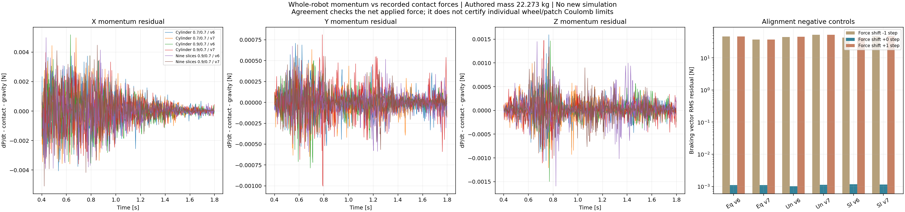

# Whole-robot momentum check of the contact forces

**The recorded total contact force agrees with independently recorded whole-robot linear momentum, including the intervals flagged by the friction-capacity audit.** Correctly aligned braking residuals have vector RMS **0.00102–0.00117 N**. Shifting the force channel by one physical step increases RMS to **37.2–52.6 N**. This supports the force sum and its timestamp; it does not resolve the distribution among wheels or patches.



| Model / recipe | Aligned braking RMS (N) | Force shifted −1 step (N) | Force shifted +1 step (N) | RMS within static-bound exceedances (N) |
| --- | ---: | ---: | ---: | ---: |
| Cylinder 0.7/0.7, v6 | 0.001093 | 46.047 | 46.075 | No such intervals |
| Cylinder 0.7/0.7, v7 | 0.001090 | 37.208 | 37.368 | 0.000453 |
| Cylinder 0.9/0.7, v6 | 0.001016 | 44.986 | 45.734 | 0.002333 |
| Cylinder 0.9/0.7, v7 | 0.001127 | 52.557 | 52.637 | No such intervals |
| Nine slices 0.9/0.7, v6 | 0.001167 | 42.631 | 43.156 | 0.001000 |
| Nine slices 0.9/0.7, v7 | 0.001143 | 47.959 | 47.992 | 0.001257 |

All statistics use the same 0.4–1.8 s braking intervals. “Static-bound exceedance” retains the preceding audit's `rho_static > 1.05` definition. Across the complete 2.76 s task, the largest vector residual in any case is **0.00617 N**.

The check is:

```text
P[k] = sum_body m_body * v_body_COM[k]
residual[k] = (P[k+1] - P[k]) / 0.0025
              - sum_wheel (F_t[k] + F_n[k] * e_z) - M * g
```

The hash-locked robot USD declares ten bodies totaling **22.273 kg**, with every body matched by name to the recording. The tracking source explicitly disables linear and angular damping. Gravity is taken as `(0, 0, -9.81)` m/s². Body COM velocities are separate recorded channels from the contact-force buffers. Internal joint forces and motor reactions cancel in this whole-system sum. Force indices refer to the physical interval between consecutive velocity samples, including the final task interval.

Masses here are **authored values**, not a new live mass/gravity readback. The small residual constrains the net contribution of any omitted external forces; it does not individually identify them. Equal-and-opposite wheel-force errors could cancel. No per-wheel joint-wrench reconstruction or angular-momentum check was performed. Consequently this result does **not** certify individual friction cones or make the nine-slice static-bound exceedances physically valid. It narrows the unresolved issue: a simple whole-system force-sum or one-step timestamp error does not explain the observed data.

The [preceding friction audit](../cone_relation_v3/README.md) and all original success gates remain unchanged. No simulator steps, policy updates, new training or reward edits were made for this audit. The v8 equal-cylinder PPO continuation runs independently.

[Report and provenance](report.json) · [momentum/force signals](signals.npz) · [analysis code](../../../scripts/audit_hockey_contact_momentum.py) · [tests](../../../tests/test_hockey_contact_momentum.py).

```bash
python scripts/audit_hockey_contact_momentum.py \
  --cases-json results/hockey_contact_reward_search_20261028_v1/cone_relation_inputs_v1.json \
  --cone-report results/hockey_contact_reward_search_20261028_v1/cone_relation_v3/report.json \
  --asset /path/to/hash-locked/WF_TRON1A.usda \
  --tracking-source /path/to/hash-locked/training/tron1_tracking.py \
  --output <fresh-output-directory>
python -m pytest -q tests/test_hockey_contact_momentum.py
```

Three focused tests pass: internal-impulse cancellation with the correct external impulse and clock, missing terminal-state rejection, and explicit positive/unique mass extraction. The mass reader targets the pinned USDA hierarchy; it is not a general USD composition parser. Archived input/qualification hashes and all force-audit artifact hashes are checked before calculation.
