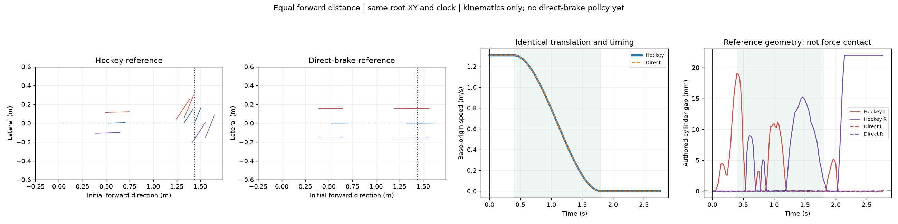

# Hockey stop versus direct braking at equal forward distance

**Question:** at the same entry speed and forward stopping distance, does the hockey maneuver stop more reliably with less body jitter? This delivery prepares and renders the paired references and rechecks two existing hockey PhysX episodes. **There is no trained direct-brake result yet, so superiority is not established.**

[Synchronized reference animation](reference_comparison_4x1.gif)



Blue marks the body heading, red the left wheel plane and purple the right wheel plane. Thin poses show 0.40/1.20/1.80 s; the animation's thick pose follows the current time. Wheel-plane marks use a fixed display length and are not measured contact footprints. Both top views keep identical fixed world limits and scale.

## Matched reference

Both arms use the same base-link XY position at every one of the 139 reference frames, not just the same endpoint. The direct arm holds the initial body orientation and joint posture while following that translation. The hockey arm preserves the original GMR-derived posture command. No new IK, retargeting, physics simulation or policy inference is performed.

| Reference quantity | Both arms |
|---|---:|
| Designed initial base-origin speed | 1.307 m/s |
| Approach, 0.00–0.40 s | 0.523 m |
| Braking, 0.40–1.80 s | 0.915 m |
| Total initial-forward displacement | 1.438 m |
| Reference endpoint hold | 1.80–2.76 s |

“Forward” is the projection onto the initial reference course. It is not curved path length or an arm-dependent heading projection. **1.438 m includes the approach; 0.915 m is the designed braking distance.** The shared speed schedule removes timing as a confound for this initial stability comparison; it is not an optimization of fastest possible stopping.

The human video supplies posture, not a measured metric stopping distance. The original hockey command already has this designed straight-line translation, so removing the turn does not create a new shorter path. Equality of reference distance and time is imposed, not an empirical result.

The direct reference is a nominal command, not a force-balanced braking solution. PPO must retain the ability to lean, move the legs and use wheel torque. Wheel joint angles remain placeholders excluded from spin imitation; this does **not** command a discontinuous wheel lock or zero measured wheel velocity. No absolute-height reward is added.

Initial reference poses are exactly equal. Reference velocities are not all equal because the hockey posture begins moving; their maximum initial per-body linear-velocity difference is 0.0159 m/s. A [common physical initial state](common_evaluation_initial_state.npz), taken from the hash-verified nominal v8 episode, is supplied for future paired deployment. Its measured initial base-COM speed is 1.303 m/s. The future runtime must reset both arms to that one state, rather than independently resetting from the two reference velocity arrays.

The reference geometric envelope is also shown: the hockey reference has up to 22 mm wheel clearance, while the rigid initial direct pose has both ideal cylinders on the plane. These are authored-geometry calculations, **not actual load-bearing contacts or evidence that direct braking will be stable**. The existing hockey policies learn substantial departures from the reference posture and do maintain contact in the two retained episodes.

## Existing hockey results, not a matched direct-brake experiment

The retained episodes are selected seed-42 nominal recordings. Their original source, actor, material, raw trajectory, contact buffers and qualification hashes are reverified. They have no paired direct-brake policy. The two rows use different policies and materials and must not be used to isolate a static-friction effect.

| Archived PhysX episode | Initial speed | Speed at 0.40 s | Stop time after brake onset | Forward position at stop / maximum reached | Bilateral native contact | Angular XY RMS, 10–100 Hz |
|---|---:|---:|---:|---:|---:|---:|
| v8, μs/μd = 0.7/0.7 | 1.303 m/s | 1.435 m/s | 1.200 s | 1.425 / 1.453 m | 100% | 0.254 rad/s |
| v9, μs/μd = 0.9/0.7 | 1.303 m/s | 1.399 m/s | 1.298 s | 1.419 / 1.438 m | 100% | 0.226 rad/s |
| Direct braking | No policy result | — | — | — | — | — |

The new descriptive stop event is planar base-COM speed ≤0.10 m/s, upright tilt <45°, and both native wheels touching throughout at least 0.50 s of recorded samples. The distance column uses the base-link origin from the shared initial position; a separate base-COM displacement is stored in [report.json](report.json). Contact eligibility is reconstructed from native geometry with the existing 0.1 mm hockey tolerance. It is not defined by load >5 N. This does not establish continuous-time contact between physical samples or an independent trial success rate.

Maximum forward excursion is included because a robot can overshoot and later roll back. A stable stop at a nearby endpoint is not automatically a strict equal-distance pass. Forward and lateral tolerances must be frozen before the prospective seed comparison. Existing archived gates are retained unchanged, and the records are not rescaled or time-warped to fit the reference.

## Prospective PhysX comparison

The primary outcome is **completed stable stopping within the distance allowance**. Contact interruptions, fall/non-wheel support, overshoot and lateral excursion are reported first. Among completed stops, compare body angular oscillation, roll/pitch, action variation and actuator saturation. Slip, friction capacity and dissipation explain how braking is achieved; they are not prerequisites that make the direct arm fail merely for not sliding.

The [prospective protocol](prospective_protocol.json) retains the previously selected PPO seeds 43–47, native PhysX at 400 Hz with 50 Hz control, materials 0.7/0.7 and 0.9/0.7, matched actuator limits, DR and training budgets. The direct arm removes deliberate sliding incentives and hockey-specific gates while keeping the common stopping/contact/smoothness terms. This compares behavior recipes; it is not an isolated causal test of the human prior.

The paired references are **not yet admitted for training**. The common-state reset adapter, exact direct-arm reward/gate specification, environment lock, and prospective distance/corridor tolerances remain to be frozen and smoke-tested. No remote job or new training was launched by this delivery, and existing hockey/turn configurations were not modified.

## Reproduce

```bash
/tmp/tron1-baseline-venv/bin/python -m pytest -q tests/test_hockey_equal_distance.py
/tmp/tron1-baseline-venv/bin/python scripts/prepare_hockey_equal_distance.py \
  --output /path/to/new/equal_distance_preview
```

The output directory must not exist. CPU Torch is needed only to reproduce the archived float32 contact readback; Matplotlib/Pillow produce the synchronized GIF. Inputs, outputs and script hashes are listed in [report.json](report.json) and [publication_manifest.json](publication_manifest.json). Three focused tests cover distance decomposition, rigid-reference invariants, and stop holds interrupted by rebound/contact loss.
