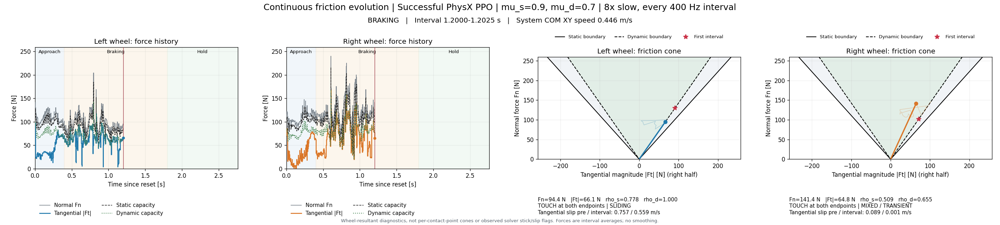

# Triangular friction cones and contact-point discontinuities

[Continuous force / triangular-cone animation](analysis/force_evolution_from_start_8x_4x1.mp4) ·
[GIF preview](preview/friction_triangle.gif) ·
[contact-point animation with corrected point-cloud background](contact_animation/case0_contact_friction_8x_4x1.mp4).

Both full videos retain all **1,104 intervals from 0 to 2.76 s**, at 8× slow
motion. They use the same successful v9 PhysX recording, with **mu_s=0.9 and
mu_d=0.7**. No policy, physics, material, contact threshold or force data changes.
The force/velocity/contact CSV is byte-identical to the previous display.

## Reading the triangle

The vertical axis is normal force **Fn [N]**. The moving point's horizontal
coordinate is the full tangential resultant magnitude
**|Ft| = sqrt(F_long² + F_lat²) [N]**, placed on the right half of the cone.
Its position does not encode left/right sliding direction.

- The solid outer edges are `Ft = ±0.9 Fn`, the static capacity.
- The dashed inner edges are `Ft = ±0.7 Fn`, the dynamic capacity.
- The moving vector ends at `(|Ft|, Fn)`. Distance from the edges shows how much
  capacity remains. A faint 40-sample trail shows its recent movement.
- The red star marks the first interval. The top of the plotted triangle is
  only the display range; it does not impose a maximum normal-force constraint.

This is a **radial section of the wheel-resultant cone**. Using only lateral
force would hide longitudinal consumption of the same friction capacity. The
radial magnitude retains the same capacity test as the earlier circular force
plane. It does not preserve the old plot's longitudinal/lateral direction
information. Contact and slip readouts remain visible, but reaching an edge
does not reveal an unrecorded solver static/dynamic mode flag.



## Where the contact-path jumps come from

Every 400 Hz geometric-contact sample in this nominal recording still contains
a touching point for each wheel, using the existing 0.1 mm separation tolerance.
The visible jumps therefore are not recorded contact-loss events.

The largest changes coincide with camber crossing zero and the qualifying
contact position switching between the two rims of the **50 mm-wide cylinder**:

| Wheel | Consecutive pose times [s] | Contact XY jump | Wheel-center XY movement | Local axial coordinate change | Camber before → after |
| --- | --- | ---: | ---: | ---: | ---: |
| Left | 1.3900 → 1.3925 | 48.01 mm | 1.43 mm | −50.00 mm | −0.125° → +0.174° |
| Right | 1.3975 → 1.4000 | 46.27 mm | 2.81 mm | +50.00 mm | +0.284° → −0.136° |

At these events there is one qualifying point before and after, so the
point-set centroid is also the individual recorded point. The exact 50 mm
change in wheel-local axial position identifies the rim switch independently
of the small simultaneous wheel-center displacement.

A flat-ended cylinder near upright can also have two qualifying points. Left
and right have two points in **158 and 155** intervals respectively; their
same-frame separation reaches **50.0001 mm**. The rim height difference has the
scale `width * sin(camber)`: 0.1 mm across 50 mm corresponds to about 0.115°.
Small inclination changes can therefore change which points pass the geometric
tolerance. Actual membership also depends on clearance and the native contact
manifold, not this angle alone.

There was also a visualization issue: the previous background used a line plot
over flattened contact-buffer rows, connecting different points **within one
instant** and between instants without persistent identities. The corrected
background uses an unconnected scatter plot. Actual per-frame points and their
rim switches remain visible; they are not interpolated or smoothed away.

Contact-point migration is not wheel-material sliding velocity. Slip continues
to use the rigid-body material velocity at a contact point and the same
material point's displacement over the interval, not differences between
changing contact centroids. Native friction anchors remain separate from
normal-contact points; no per-point load/cone correspondence is invented.
See `contact_path_diagnostics` in the [report](analysis/report.json).

## Reproduce

```bash
python scripts/plot_hockey_friction_from_start.py \
  --analysis results/hockey_static_dynamic_transition_20261029_v1/trained_contact_points_v1 \
  --nominal results/hockey_static_dynamic_transition_20261029_v1/continuation_evidence/run_v9/native_split_smooth_stop_xyz_huber_continuity/nominal \
  --cone-view triangle --output <fresh-analysis-directory>
python scripts/render_hockey_friction_contacts.py \
  --analysis results/hockey_static_dynamic_transition_20261029_v1/trained_contact_points_v1 \
  --start-time 0 --cone-view triangle --output <fresh-contact-animation-directory>
python -m pytest -q tests/test_hockey_triangle_section.py \
  tests/test_hockey_contact_cone_relation.py tests/test_hockey_contact_timing.py \
  tests/test_hockey_braking_contacts.py
```

Twelve checks pass, including a combined 60/80 N tangential-force example whose
100 N resultant exceeds a 90 N static capacity even though neither individual
component does. Both complete videos are decoded and verified at 50 fps.
The [GIF generation record](preview/provenance.json) selects source video
frames `0,4,8,...,1100` for a smaller preview; full videos retain every interval.
The `circle` option remains available for the earlier force-plane view.
