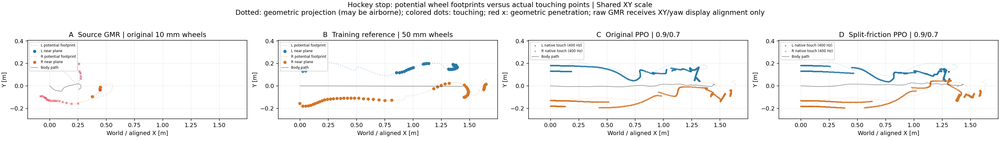

# GMR reference versus measured wheel-contact paths

**Continuous bilateral contact does not mean the learned policy reproduces the GMR-derived wheel footprints.** Both PPO policies keep both wheels touching, but their wheel paths differ substantially from the training reference. The split-friction policy improves body XY tracking while moving its wheel footprints farther from that reference.



[Four-panel animation, 4× slow](comparison_v2/contact_paths_4x1_4x.mp4) · [clearance versus time](comparison_v2/contact_clearance_4x1.png) · [time-aligned footprint distances](comparison_v2/contact_path_error_4x1.png) · [numerical report](comparison_v2/report.json).

The panels share the same XY scale:

1. **Archived source GMR output**, with the original 10 mm-wide wheels. This source already includes its earlier single-wheel height projection. Only a constant XY translation and yaw rotation are applied for display; height, scale and time are unchanged.
2. **Actual training reference**, using GMR posture, an initial posture blend, a separately designed stopping path, and a height projection for the authored 50 mm-wide wheels. The source GMR global XY was not used in this reference.
3. **Original v8 PPO**, evaluated at static/dynamic friction 0.9/0.7.
4. **Split-friction v9 PPO**, evaluated at the same 0.9/0.7 material.

Dotted curves show potential geometric wheel footprints, including airborne portions. Blue/orange dots show left/right near-plane geometry for the references, and actual native contact points for PhysX. Red crosses mark reference penetration. The animation adds body and wheel headings, current contact points, and measured native contact material velocities. Its background includes the complete trajectories; the moving markers identify the current time. Native footprint backgrounds use every 400 Hz sample; comparison metrics use the exact common 50 Hz timestamps without interpolating physics.

## Contact pattern and path differences

The training reference has only **4/139 frames** with both cylinders within ±0.1 mm of the floor. The left wheel is near the plane in **86 frames**, the right in **57 frames**. Maximum reference clearance is **19.07 mm left / 21.98 mm right**. Both policies touch with both wheels in all 139 common samples, and their existing full 400 Hz qualifications confirm **zero bilateral contact interruption**.

The following distances use only timestamps when the corresponding reference wheel is also near the floor: 86 left-wheel frames and 57 right-wheel frames. They are RMS XY distances from actual native contact points to the reference's near-lowest cylinder footprint; they are **not body-tracking errors or new task failure gates**.

| Policy, evaluated at 0.9/0.7 | Left footprint distance | Right footprint distance | Body XY RMSE from the prior qualification |
| --- | ---: | ---: | ---: |
| Original v8 | 12.52 cm | 5.55 cm | 2.76 cm |
| Split-friction v9 | 13.96 cm | 7.21 cm | 2.31 cm |

The wheel-center XY errors also increase, from **10.62/8.12 cm** to **12.58/9.94 cm** (L/R, all 139 frames). Thus the difference is not solely an arbitrary choice of point within the finite wheel width. These observations show different wheel placement despite good body tracking and continuous contact; they do not by themselves prove why the policy chose those placements. Existing task success remains unchanged. [Prior material/training comparison](../hockey_static_dynamic_transition_20261029_v1/README.md).

## Geometry and interpretation

A reference supplies geometry, not measured contact forces. A reference wheel counts as near-plane only when its signed cylinder clearance is within ±0.1 mm; deeper penetration is reported separately. With this strict criterion, the archived 30 Hz source GMR has zero bilateral near-plane frames, and penetration in 5 left/18 right frames, reaching 1.47/1.06 mm. This is an audit of the archived pose and original collider geometry, not a physical-contact measurement or a general claim about GMR quality. Reinterpreting those same unchanged poses with the wider authored cylinders increases penetration to 7.89/3.84 mm; that counterfactual is reported separately and does not alter the plots or training reference.

A perfectly upright cylinder has a **line of lowest points**, rather than a unique contact point. Selecting one rim can jump by the wheel width when camber changes sign. The distance calculation therefore uses the bottom generatrix within 0.1 mm of its minimum height and takes the nearest XY distance to that finite segment. Native points are equally weighted within a frame, and frames are equally weighted in the RMS. An additional all-frame distance includes airborne reference projections and is explicitly labeled as such in the report and plot.

The physical contact points come from the native normal-contact buffers, aligned to the **pre-step pose**, with no minimum-force threshold. Independently reconstructed authored support clearance agrees with native separation to within **0.262 micrometres**. The red velocity vectors use `v_COM + omega × (point − COM)` projected into the ground tangent plane; they are not derivatives of a migrating footprint or manifold centroid. The reference wheel-spin command is a placeholder, so no measured reference slip velocity, friction capacity or saturation is asserted.

## Reproduction

```bash
python scripts/compare_hockey_gmr_contact_paths.py \
  --reference results/hockey_speed_success_20261028_v1/source_snapshot_v1/references/s100 \
  --gmr results/hockey_stop_reference_audit_20261026_v1/gmr_support_projection_v1 \
  --model /path/to/WF_TRON1A/mujoco/robot.xml \
  --geometry-config config/hockey_bilateral_training_v1.json \
  --selection results/hockey_gmr_contact_paths_20261030_v1/selection.json \
  --output <fresh-output-directory> --render
python -m pytest -q tests/test_hockey_gmr_contact_paths.py
```

Requires NumPy, SciPy, MuJoCo, Matplotlib, OpenCV and imageio-ffmpeg. MuJoCo performs forward kinematics only. The locked source GMR file, training reference and robot model must be available locally; their hashes and the recording provenance are retained in the report. [Derived robot geometry and contact arrays](comparison_v2/signals.npz) are included. No human joint arrays, model assets, weights or source video are added.

Three analytic geometry tests pass: the upright-wheel line of minima, known 30-degree camber support, and the nearly upright camber sign change. All 556 animation frames decode correctly. No new retargeting, training or simulation was performed.
