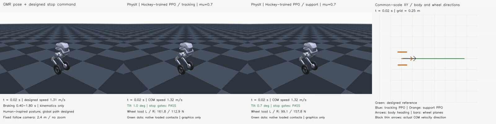
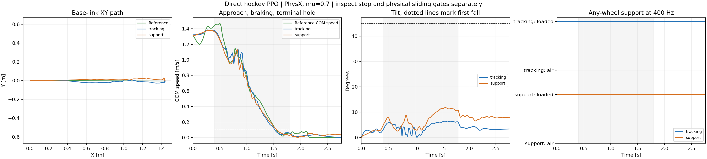
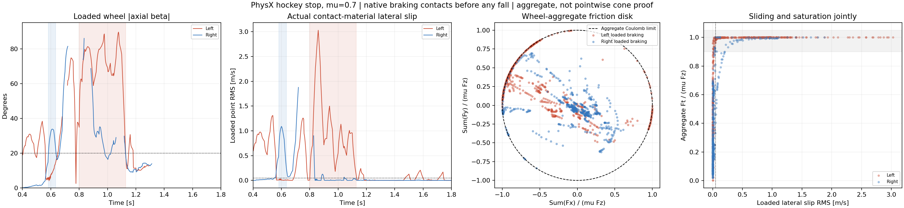

# Direct PPO learning of the hockey stop

**Both PPO arms completed 12,288,000 transitions and passed all frozen hockey-stop gates in PhysX at μ = 0.7.** Each has one full-start nominal validation. This establishes the designed stop-and-slide task, not multi-seed reliability, friction robustness, or exact human-pose reproduction.



[Full-rate 4×1 video](comparison_render/hockey_ppo_fullbody_xy_4x1.mp4) · [Numerical comparison](pair_summary/metrics.csv) · [Verified completion](completed_pair/verified_completion_status.json) · [Completion audit](completion_audit.json)

The panels show **GMR reference / tracking PPO / support PPO / common-scale XY**. The camera follows at a fixed relative offset and distance, with no zoom, pose correction, smoothing or time remapping. XY arrows show body headings and actual COM velocity; bars show wheel-plane headings. All motion comes from recorded native PhysX poses; MuJoCo is used only for graphics and forward-kinematics verification.

| Nominal metric | Tracking PPO | Additional support reward |
| --- | ---: | ---: |
| Full stop-and-slide task | **PASS** | **PASS** |
| XY RMSE / peak error | **1.79 / 3.98 cm** | **2.32 / 3.60 cm** |
| Entry COM speed | 1.382 m/s | 1.375 m/s |
| Approach speed / reference speed | 1.022 | 1.021 |
| Body / loaded-wheel heading RMSE during braking | 2.05° / 3.12° | 1.84° / 3.94° |
| At least one wheel supported / maximum gap | 100% / 0 s | 100% / 0 s |
| Both wheels loaded during braking | 86.6% | 92.5% |
| Maximum body tilt | **6.49°** | **11.84°** |
| Supported stop start / continuous duration | 1.520 / 1.240 s | 1.558 / 1.203 s |
| Longest high-β, loaded, saturated, dissipative slide, L / R | **0.1975 / 0.0300 s** | **0.3275 / 0.0525 s** |

The added support reward increased bilateral loading and the longest qualifying sliding event in this pair. It also increased XY RMSE and body tilt. Both policies already satisfy the requested **at-least-one-wheel continuous support** condition. This is a tradeoff, not evidence that the added term improves every aspect of control.



Contact is not perfectly smooth: braking right-wheel peak normal force is **1,134 N / 1,006 N** (tracking / support), despite continuous any-wheel support. The corresponding 99th-percentile forces are 348 / 303 N. Individual-wheel unloading and force spikes remain visible in the [tracking contact animation](render/pair/tracking/hockey_command_physx_xy_contact_4x1.mp4) and [support contact animation](render/pair/support/hockey_command_physx_xy_contact_4x1.mp4). Passing the task gates does not mean all contact transients have disappeared.

## β, material slip and friction saturation



[Tracking-arm friction plot](friction_section/tracking_diagnostic/beta_slip_friction_disk_4x1.png) · [Tracking event data](friction_section/tracking_diagnostic/report.json) · [Support event data](friction_section/support/report.json)

The evaluator requires the **same wheel** to remain loaded while its contact material moves laterally, friction approaches saturation, and force opposes that motion. It also checks nonzero speed and |axial β| ≥ 20°. β alone is not evidence of sliding. The ≥50 ms event gate is met by the tracking arm's left wheel and by each wheel separately in the support arm; simultaneous bilateral sliding is not required.

| Longest qualifying left-wheel event | Tracking | Support |
| --- | ---: | ---: |
| Interval | 0.9800–1.1775 s | 0.8000–1.1275 s |
| Median absolute axial β | 61.86° | 72.87° |
| Median contact lateral slip | 0.525 m/s | 0.892 m/s |
| Median normal load | 53.82 N | 75.41 N |
| Median aggregate friction utilization | 0.99986 | 0.99983 |
| Median anchor force–velocity power | −24.60 W | −44.18 W |

The friction disk is the wheel-level section `ρ = ||ΣFt|| / (μ ΣFn)`, with saturation screened at 0.90–1.05 on the stationary flat floor. Normal contacts and friction anchors are separate native PhysX outputs, so these are **aggregate saturation indicators, not pointwise friction-cone certificates**. All friction-anchor force in each selected event satisfies the same-anchor lateral-slip/opposing-force/dissipation check. Native API forces are already in newtons; there is no second division by the timestep. Force paired with post-step material velocity is a power proxy, not exact integrated work.

## What was reproduced

The source provides GMR human-inspired posture. The global 1.31 m/s stopping path was designed; its speed and distance are **not calibrated human measurements**. Both policies learn this locked command from scratch. Neither a car policy nor an MPPI candidate initializes training.

Posture tracking remains approximate:

| Braking posture error | Tracking | Support |
| --- | ---: | ---: |
| Six leg joints, RMSE | 0.0872 rad | 0.0880 rad |
| Body up-axis, RMSE | 11.03° | 11.84° |
| Loaded wheel camber, L / R RMSE | 7.04° / 9.55° | 11.95° / 11.99° |

The policies are more upright than the GMR reference. Holding the initial joint configuration would give 0.1237 rad error, but an offline best-fitting constant posture scores only 0.0483 rad. Neither constant is a physical controller; this shows why joint RMSE alone cannot establish dynamic imitation. [Tracking posture plots](posture_fidelity/tracking_diagnostic/posture_fidelity_4x1.png) and [support posture plots](posture_fidelity/support/posture_fidelity_4x1.png) expose the remaining differences. Native rigid-cylinder Coulomb contact is used; an ice-blade force law is not reproduced.

## Recorded v1 sampling and timing limitations

The inherited adaptive sampler counts `termination_manager.terminated` as failure. In this finite task, that flag also includes successful clip completion. The final training log assigns 99.03% of adaptive sampling probability to the last bin; the separate 20% full-clip-start mixture remains enabled. The dispatcher was stopped before launching the support arm while this was diagnosed. The current training child was left untouched and finished normally. Its original authorized full-horizon validation was then launched separately and passed. The support arm subsequently completed with **the same v1 snapshot**, so its comparison changes only the support weight. No additional formal-training budget was launched.

V1 also uses float32 time for the binary braking flag. At frame 20 the computed value is 0.39999998 s, so that flag starts at frame 21 (0.42 s). The continuous reference velocity and the independent 0.40 s braking evaluation interval are unchanged. The observation audit reproduces the archived numerical behavior rather than silently treating this flag as corrected.

The opt-in [`hockey_ppo_learning_v2.json`](../../config/hockey_ppo_learning_v2.json) and [`hockey_ppo_sampling.py`](../../scripts/hockey_ppo_sampling.py) prepare fall-only adaptive sampling and integer-frame phase boundaries. They are **not deployed or trained** in the results here. A future corrected-recipe study must be reported separately.

For each arm, all 139 recorded actions were independently replayed through its exported actor (maximum error 2.68e−7 / 2.38e−7). All 56 input fields and all 1,112 completed physical substeps were independently reconstructed from physical states, commands and native normal/friction buffers. The graphics renderer checked all 1,113 poses per arm against forward kinematics and performs no physics or pose correction. The [verified completion record](completed_pair/verified_completion_status.json) checks actual process identities and terminal artifact hashes; unknown operating-system exit codes remain null. The original dispatcher status is historical and stale after the documented manual continuations.

The actor now has 56 inputs: the existing 51 observations, followed by target planar velocity in the actual body's yaw frame, target world yaw rate, braking-phase indicator, and stop-hold indicator. The critic has 125 inputs. Both actors are trained from scratch; their observation normalizers are learned independently. Existing car checkpoints do not initialize either arm.

## First controlled comparison

| Setting | Tracking | Support |
| --- | --- | --- |
| Reference, reset distribution, network, seed | Identical | Identical |
| Physics / control rate | 400 / 50 Hz | 400 / 50 Hz |
| Action-rate weight | −0.5 | −0.5 |
| Continuous any-wheel load-deficit weight | 0 | +0.4 on a negative deficit |
| Training | 512 environments, 1,000 updates | Same |
| Transitions | 12,288,000 | 12,288,000 |
| Nominal evaluation | μ = 0.7, one environment, 139 controls | Same |

The only treatment difference is the continuous support-deficit weight. Both arms already condition the β reward on actual wheel loading and the terminal hold reward on any-wheel support. Thus this is an ablation of the **additional continuous load-margin penalty**, not an experiment with all contact information removed.

PPO uses RSL-RL 3.0.1, 24 steps per environment, fixed learning rate 3e−4, clip parameter 0.2, entropy coefficient 0.005, initial action standard deviation 0.5, 5 learning epochs, 4 mini-batches, γ = 0.99 and λ = 0.95. These are initial experiment settings, not optimized results. The historical 1e−4 / clip 0.1 recipe fine-tuned an existing car actor; it is not a matched from-scratch hockey baseline.

[Runtime provenance](evidence/runtime_dependencies.json) records Isaac Sim 5.1.0.0, Torch 2.7.0+cu128, Isaac Lab commit `3c6e67bb5c7ada942a6d1884ab69338f57596f77`, and the native framework/runner source hashes. All 26 TRON1 training files match the repository's pinned TRON1 submodule; the inherited motion-command implementation also matches the pinned BeyondMimic submodule. The remote copies themselves are source snapshots, so their missing `.git` directories are not treated as unknown source revisions.

The existing shared tracking DR remains active: wheel friction uniformly drawn from [0.3, 1.2] once per environment, shared by both wheels; unit-friction ground and multiply combination; equal static/dynamic friction; zero restitution; leg encoder bias, base COM offsets, and velocity pushes. Evaluation disables these random disturbances and fixes effective wheel/ground μ at 0.7. Native rigid-cylinder Coulomb contact is retained.

## Reward and episode semantics

Approach tracking uses the reference velocity vector. During braking that vector decreases to zero; there is no constant-speed requirement during braking. After 1.8 s, a separate reward favors a supported, upright stop. XY, heading, yaw rate, six leg angles, spin-invariant wheel axes, and valid loaded per-wheel β are tracked throughout their applicable phases.

The additional support cost reads all eight actual physical substeps. For substep s,

`d_s = clip(1 − max(Fz_left, Fz_right)/(0.5 m g), 0, 1)`

and the support arm adds `−0.4 × [max_s(d_s) + mean_s(d_s)]/2`. A single wheel may carry the load, and the supporting side may change. Extra impact force above the load target gives no extra credit. Isaac multiplies reward rates by the 0.02 s control interval.

No absolute root-height target or termination is used. Height regularization penalizes bounded vertical acceleration only. Wheel XY position and wheel spin are excluded from imitation. Training episodes terminate at 45° tilt or clip completion; the clip end is a true finite-task terminal. Validation runs the complete horizon without resetting after a fall, so pre-fall and post-fall effects remain distinguishable.

Training resets use the existing adaptive reference-state initialization, including 20% starts at frame zero. Reference wheel spin is a zero placeholder and initializes the wheels, but is never a tracking target. Validation initializes directly from the locked reference, rather than injecting the old car rollout's seed state. This initialization difference must be retained when displaying old MPPI failures as historical context.

Friction saturation is not rewarded directly. Independent evaluation still requires actual material-point lateral motion, sustained same-wheel load, an aggregate friction-force ratio near one, and dissipative force/velocity pairing. No pointwise friction-cone certificate is claimed.

## Qualification and reproduction

The existing hockey task gates are unchanged: entry speed, approach-speed retention, XY error, body/wheel headings, uninterrupted any-wheel support, no fall, supported terminal stop, and a ≥50 ms loaded high-β sliding event corroborated by friction and dissipation. Pose fidelity is reported separately. Smaller XY error alone is not task success.

The [snapshot manifest](source_snapshot_v1/manifest.json) records the exact nine uploaded files. The approved archive SHA-256 is `ee2d90d6e58b6f68e4b1bddbc40659d9c824382dda908149be70820c6e16ee7e`. Models, weights, credentials, SMPL assets and source video are excluded.

Entry points:

- [`prepare_hockey_ppo.py`](../../scripts/prepare_hockey_ppo.py): build a fresh source/reference bundle.
- [`dispatch_hockey_ppo.py`](../../scripts/dispatch_hockey_ppo.py): serial smoke, training and nominal validation, with a fresh fully-idle RTX check before every stage.
- [`train_hockey_ppo.py`](../../scripts/train_hockey_ppo.py): training or full-horizon native-force recording.
- [`analyze_hockey_ppo.py`](../../scripts/analyze_hockey_ppo.py): independently reconstruct all 56 observations, replay the exported actor, reconstruct native contacts and apply the unchanged physical qualification.
- [`collect_hockey_ppo.py`](../../scripts/collect_hockey_ppo.py): retrieve finished evidence and keep actor weights under ignored `outputs/`.
- [`render_hockey_physx_probe.py`](../../scripts/render_hockey_physx_probe.py): fixed-relative-camera GMR / physical motion / XY / contact display.

The source snapshot is immutable. Any later hyperparameter or reward change needs a new version and must retain this comparison's results. CPU validation passed 21 checks covering support sampling/reset isolation, missing-substep detection, single-wheel/alternating support, spin/height invariance, reference timing, zero-speed β masking, command coordinates, archived float32 phase boundaries, pre-fall event attribution and the undeployed fall-only sampler. The two PhysX smoke runs additionally verified actual 56/125 observation dimensions, native material readback, finite reward/forces, actor export and 1,536 transitions each. Their initial network state hashes and friction draw ranges match; the only reward-weight difference is support 0 versus 0.4. These checks establish executable plumbing, not learned task performance.

<details>
<summary>Reproduction commands and required inputs</summary>

Run from the repository root. Public artifacts include the exact source snapshot, derived robot reference, physical trajectories, native contact buffers, qualification data and compressed logs. Actors and checkpoints stay outside Git. The [collection manifest](completed_pair/collection_manifest.json) records original and stored SHA-256 hashes; `.log.gz` files decompress to the exact remote log bytes.

For training, initialize the pinned TRON1 and BeyondMimic submodules, use the Isaac/PPO environment in [runtime provenance](evidence/runtime_dependencies.json), and supply the original `WF_TRON1A.usda` with its mesh dependencies. The script verifies its hash. Robot assets are excluded from this repository; see the upstream asset preparation and license instructions. Set `HOCKEY_ISAAC_PYTHON`, `HOCKEY_USD`, and `HOCKEY_GPU` to that environment, model and a fully idle GPU ordinal. Leave `CUDA_VISIBLE_DEVICES` unset, as the runner explicitly selects the physical GPU for physics and rendering.

```bash
git submodule update --init upstream/tron1-learning-from-human upstream/whole_body_tracking
HOCKEY_SNAPSHOT="$PWD/results/hockey_ppo_learning_20261028_v1/source_snapshot_v1"
HOCKEY_RUN="$PWD/outputs/hockey_ppo_reproduction"
HOCKEY_ARM=tracking  # Repeat for support after the tracking arm finishes.

# Select a fully idle GPU again before each invocation; outputs must be fresh.
"$HOCKEY_ISAAC_PYTHON" "$HOCKEY_SNAPSHOT/train_hockey_ppo.py" \
  --protocol "$HOCKEY_SNAPSHOT/protocol.json" --motion "$HOCKEY_SNAPSHOT/motion.npz" \
  --asset "$HOCKEY_USD" --tracking-root "$PWD/upstream/tron1-learning-from-human" \
  --beyondmimic-root "$PWD/upstream/whole_body_tracking" --device "cuda:$HOCKEY_GPU" \
  --variant "$HOCKEY_ARM" --mode smoke --output-dir "$HOCKEY_RUN/${HOCKEY_ARM}_smoke"

"$HOCKEY_ISAAC_PYTHON" "$HOCKEY_SNAPSHOT/train_hockey_ppo.py" \
  --protocol "$HOCKEY_SNAPSHOT/protocol.json" --motion "$HOCKEY_SNAPSHOT/motion.npz" \
  --asset "$HOCKEY_USD" --tracking-root "$PWD/upstream/tron1-learning-from-human" \
  --beyondmimic-root "$PWD/upstream/whole_body_tracking" --device "cuda:$HOCKEY_GPU" \
  --variant "$HOCKEY_ARM" --mode formal --output-dir "$HOCKEY_RUN/${HOCKEY_ARM}_formal"

"$HOCKEY_ISAAC_PYTHON" "$HOCKEY_SNAPSHOT/train_hockey_ppo.py" \
  --protocol "$HOCKEY_SNAPSHOT/protocol.json" --motion "$HOCKEY_SNAPSHOT/motion.npz" \
  --asset "$HOCKEY_USD" --tracking-root "$PWD/upstream/tron1-learning-from-human" \
  --beyondmimic-root "$PWD/upstream/whole_body_tracking" --device "cuda:$HOCKEY_GPU" \
  --variant "$HOCKEY_ARM" --mode eval --output-dir "$HOCKEY_RUN/${HOCKEY_ARM}_eval" \
  --actor "$HOCKEY_RUN/${HOCKEY_ARM}_formal/actor_normalized.pt"
```

The code and random seed are pinned; bitwise-identical GPU training is not promised. To independently analyze each new rollout, use Python with Torch, NumPy, SciPy and Matplotlib:

```bash
HOCKEY_COMMAND=results/hockey_stop_evaluation_audit_20261026_v1/physx_command_v2
python scripts/analyze_hockey_ppo.py \
  --source "$HOCKEY_SNAPSHOT" --command-dir "$HOCKEY_COMMAND" \
  --run-dir "$HOCKEY_RUN/${HOCKEY_ARM}_eval" \
  --training-dir "$HOCKEY_RUN/${HOCKEY_ARM}_formal" \
  --actor "$HOCKEY_RUN/${HOCKEY_ARM}_formal/actor_normalized.pt" \
  --output "$HOCKEY_RUN/qualification/$HOCKEY_ARM"
```

To regenerate the published comparison from the committed evidence without training or actor weights, use Python with NumPy, SciPy, Matplotlib, OpenCV, MuJoCo and FFmpeg. Set `HOCKEY_MJCF` to the original robot XML and `HOCKEY_FFMPEG` to the executable. The renderer verifies the model hash and every recorded wheel origin by forward kinematics; it never calls a physics step.

```bash
HOCKEY_RESULT=results/hockey_ppo_learning_20261028_v1
HOCKEY_COMMAND=results/hockey_stop_evaluation_audit_20261026_v1/physx_command_v2
HOCKEY_DISPLAY=outputs/hockey_ppo_display_reproduction

python scripts/summarize_hockey_ppo_pair.py \
  --evidence "$HOCKEY_RESULT/completed_pair/comparison_v1" \
  --qualification "$HOCKEY_RESULT/qualification/pair" --command-dir "$HOCKEY_COMMAND" \
  --output "$HOCKEY_DISPLAY/summary"

for HOCKEY_ARM in tracking support; do
  python scripts/plot_hockey_friction_section.py \
    --qualification "$HOCKEY_RESULT/qualification/pair/$HOCKEY_ARM" \
    --output "$HOCKEY_DISPLAY/friction/$HOCKEY_ARM"
  MUJOCO_GL=osmesa python scripts/render_hockey_physx_probe.py \
    --result "$HOCKEY_RESULT" --run-dir "$HOCKEY_RESULT/completed_pair/comparison_v1/${HOCKEY_ARM}_eval" \
    --qualification "$HOCKEY_RESULT/qualification/pair/$HOCKEY_ARM" --command-dir "$HOCKEY_COMMAND" \
    --model "$HOCKEY_MJCF" --ffmpeg "$HOCKEY_FFMPEG" --output "$HOCKEY_DISPLAY/render/$HOCKEY_ARM" \
    --xy-center 0.7449164986610413 0.009227141737937927 --xy-extent 2.0
done

python scripts/render_hockey_ppo_comparison.py \
  --tracking-render "$HOCKEY_DISPLAY/render/tracking" --support-render "$HOCKEY_DISPLAY/render/support" \
  --tracking-run "$HOCKEY_RESULT/completed_pair/comparison_v1/tracking_eval" \
  --support-run "$HOCKEY_RESULT/completed_pair/comparison_v1/support_eval" \
  --command-dir "$HOCKEY_COMMAND" --ffmpeg "$HOCKEY_FFMPEG" --output "$HOCKEY_DISPLAY/comparison"
```

</details>
