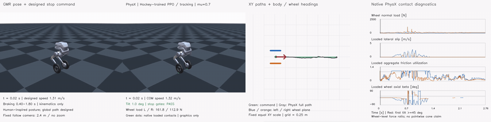
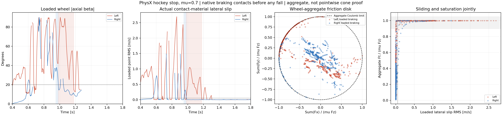

# Direct PPO learning of the hockey stop

Status: the tracking arm completed 12,288,000 transitions and **passed all frozen nominal hockey-stop gates** in a complete single-environment PhysX rollout at μ = 0.7. The support arm is training with the same immutable v1 recipe. This is one successful nominal rollout, not a multi-seed or friction-robustness result.

[Full-rate video](render/tracking_diagnostic/hockey_command_physx_xy_contact_4x1.mp4) · [Independent qualification](qualification/tracking_diagnostic/report.json) · [Contact events](qualification/tracking_diagnostic/event_details.json)

The dashed disk is the wheel-level normalized section `||sum(Ft)|| / (mu Fz) = 1` on the stationary flat floor. It is not a pointwise contact-cone reconstruction. Native API forces are already in newtons; no second impulse-to-force division is applied. In the longest left-wheel event, 0.9800–1.1775 s, median |β| is **61.86°**, lateral slip is **0.525 m/s**, normal load is **53.82 N**, and friction utilization is **0.99986**. All friction-anchor force in those samples satisfies the same-anchor lateral-slip/opposing-force/dissipation check. Force–velocity power uses completed-step force with post-step velocity and is a proxy, not an exact integral of work.

| Nominal tracking-arm metric | Result |
| --- | ---: |
| XY RMSE / peak error | 0.01788 / 0.03976 m |
| Entry COM speed | 1.3818 m/s |
| Approach speed / reference speed | 1.0218 |
| Braking body / loaded-wheel heading RMSE | 2.05° / 3.12° |
| Any-wheel support fraction / maximum gap | 100% / 0 s |
| Maximum body tilt | 6.49° |
| First supported stop / uninterrupted stop duration | 1.52 s / 1.24 s |
| Longest loaded high-β saturated dissipative sliding event, L / R | 0.1975 / 0.0300 s |

The left-wheel qualifying samples have median lateral material-point slip **0.787 m/s**, aggregate friction utilization **0.9999**, and anchor force–velocity power **−39.98 W**. The corresponding right-wheel medians are 0.506 m/s, 1.0000 and −61.04 W. These medians refer only to qualifying braking samples, not the whole task. The left wheel supplies a continuous event longer than 50 ms; the right wheel's qualifying samples are more fragmented. Both wheels may briefly unload individually, but they never lose support simultaneously after the protocol's initialization grace period.

Posture imitation remains approximate: braking leg-angle RMSE is **0.0872 rad**, body-up-axis RMSE is **11.03°**, and loaded wheel-camber RMSE is **7.04° / 9.55°**. The physical policy stays more upright than the GMR reference. Passing the stop/slide gates is not exact human-pose reconstruction or evidence of an ice-blade force law.

The previous experiments used a car-turn policy, with command substitutions or MPPI residuals, to attempt this motion. This experiment trains a new policy directly on the locked hockey reference. It uses the GMR posture and the designed global stopping path, whose speed and distance are **not measured human motion**. The failed MPPI trajectory is not a training target.

## Recorded v1 sampling and timing limitations

The inherited adaptive sampler counts `termination_manager.terminated` as failure. In this finite task, that flag also includes successful clip completion. The final training log assigns 99.03% of adaptive sampling probability to the last bin; the separate 20% full-clip-start mixture remains enabled. The dispatcher was stopped before launching the support arm while this was diagnosed. The current training child was left untouched and finished normally. Its original authorized full-horizon validation was then launched separately and passed. The support arm was subsequently started with **the same v1 snapshot**, so its comparison still changes only the support weight. No additional formal-training budget was launched.

V1 also uses float32 time for the binary braking flag. At frame 20 the computed value is 0.39999998 s, so that flag starts at frame 21 (0.42 s). The continuous reference velocity and the independent 0.40 s braking evaluation interval are unchanged. The observation audit reproduces the archived numerical behavior rather than silently treating this flag as corrected.

The opt-in [`hockey_ppo_learning_v2.json`](../../config/hockey_ppo_learning_v2.json) and [`hockey_ppo_sampling.py`](../../scripts/hockey_ppo_sampling.py) prepare fall-only adaptive sampling and integer-frame phase boundaries. They are **not deployed or trained** in the results here. A future corrected-recipe study must be reported separately.

The 139 recorded actions were independently replayed through the exported actor (maximum error 2.68e−7). All 56 input fields were reconstructed from physical states and the source command. All 1,112 completed physical substeps were independently reconstructed from native normal/friction buffers. The graphics renderer checked all 1,113 poses against the robot's forward kinematics and performs no physics or pose correction.

The actor now has 56 inputs: the existing 51 observations, followed by target planar velocity in the actual body's yaw frame, target world yaw rate, braking-phase indicator, and stop-hold indicator. The critic has 125 inputs. Both actors are trained from scratch; their observation normalizers are learned independently. Existing car checkpoints do not initialize either arm.

## First controlled comparison

| Setting | Tracking | Support |
| --- | --- | --- |
| Reference, reset distribution, network, seed | Identical | Identical |
| Physics / control rate | 400 / 50 Hz | 400 / 50 Hz |
| Action-rate weight | −0.5 | −0.5 |
| Continuous any-wheel load-deficit weight | 0 | +0.4 on a negative deficit |
| Training | 512 environments, 1,000 updates | Same |
| Transitions | 12,288,000 | 12,288,000 |
| Nominal evaluation | μ = 0.7, one environment, 139 controls | Same |

The only treatment difference is the continuous support-deficit weight. Both arms already condition the β reward on actual wheel loading and the terminal hold reward on any-wheel support. Thus this is an ablation of the **additional continuous load-margin penalty**, not an experiment with all contact information removed.

PPO uses RSL-RL 3.0.1, 24 steps per environment, fixed learning rate 3e−4, clip parameter 0.2, entropy coefficient 0.005, initial action standard deviation 0.5, 5 learning epochs, 4 mini-batches, γ = 0.99 and λ = 0.95. These are initial experiment settings, not optimized results. The historical 1e−4 / clip 0.1 recipe fine-tuned an existing car actor; it is not a matched from-scratch hockey baseline.

The existing shared tracking DR remains active: wheel friction uniformly drawn from [0.3, 1.2] once per environment, shared by both wheels; unit-friction ground and multiply combination; equal static/dynamic friction; zero restitution; leg encoder bias, base COM offsets, and velocity pushes. Evaluation disables these random disturbances and fixes effective wheel/ground μ at 0.7. Native rigid-cylinder Coulomb contact is retained.

## Reward and episode semantics

Approach tracking uses the reference velocity vector. During braking that vector decreases to zero; there is no constant-speed requirement during braking. After 1.8 s, a separate reward favors a supported, upright stop. XY, heading, yaw rate, six leg angles, spin-invariant wheel axes, and valid loaded per-wheel β are tracked throughout their applicable phases.

The additional support cost reads all eight actual physical substeps. For substep s,

`d_s = clip(1 − max(Fz_left, Fz_right)/(0.5 m g), 0, 1)`

and the support arm adds `−0.4 × [max_s(d_s) + mean_s(d_s)]/2`. A single wheel may carry the load, and the supporting side may change. Extra impact force above the load target gives no extra credit. Isaac multiplies reward rates by the 0.02 s control interval.

No absolute root-height target or termination is used. Height regularization penalizes bounded vertical acceleration only. Wheel XY position and wheel spin are excluded from imitation. Training episodes terminate at 45° tilt or clip completion; the clip end is a true finite-task terminal. Validation runs the complete horizon without resetting after a fall, so pre-fall and post-fall effects remain distinguishable.

Training resets use the existing adaptive reference-state initialization, including 20% starts at frame zero. Reference wheel spin is a zero placeholder and initializes the wheels, but is never a tracking target. Validation initializes directly from the locked reference, rather than injecting the old car rollout's seed state. This initialization difference must be retained when displaying old MPPI failures as historical context.

Friction saturation is not rewarded directly. Independent evaluation still requires actual material-point lateral motion, sustained same-wheel load, an aggregate friction-force ratio near one, and dissipative force/velocity pairing. No pointwise friction-cone certificate is claimed.

## Qualification and reproduction

The existing hockey task gates are unchanged: entry speed, approach-speed retention, XY error, body/wheel headings, uninterrupted any-wheel support, no fall, supported terminal stop, and a ≥50 ms loaded high-β sliding event corroborated by friction and dissipation. Pose fidelity is reported separately. Smaller XY error alone is not task success.

The [snapshot manifest](source_snapshot_v1/manifest.json) records the exact nine uploaded files. The approved archive SHA-256 is `ee2d90d6e58b6f68e4b1bddbc40659d9c824382dda908149be70820c6e16ee7e`. Models, weights, credentials, SMPL assets and source video are excluded.

Entry points:

- [`prepare_hockey_ppo.py`](../../scripts/prepare_hockey_ppo.py): build a fresh source/reference bundle.
- [`dispatch_hockey_ppo.py`](../../scripts/dispatch_hockey_ppo.py): serial smoke, training and nominal validation, with a fresh fully-idle RTX check before every stage.
- [`train_hockey_ppo.py`](../../scripts/train_hockey_ppo.py): training or full-horizon native-force recording.
- [`analyze_hockey_ppo.py`](../../scripts/analyze_hockey_ppo.py): independently reconstruct all 56 observations, replay the exported actor, reconstruct native contacts and apply the unchanged physical qualification.
- [`collect_hockey_ppo.py`](../../scripts/collect_hockey_ppo.py): retrieve finished evidence and keep actor weights under ignored `outputs/`.
- [`render_hockey_physx_probe.py`](../../scripts/render_hockey_physx_probe.py): fixed-relative-camera GMR / physical motion / XY / contact display.

The source snapshot is immutable. Any later hyperparameter or reward change needs a new version and must retain this comparison's results. CPU validation passed thirteen tests covering support sampling/reset isolation, missing-substep detection, single-wheel/alternating support, spin/height invariance, endpoint reference timing, zero-speed β masking, command coordinates and phase boundaries. The two PhysX smoke runs additionally verified actual 56/125 observation dimensions, native material readback, finite reward/forces, actor export and 1,536 transitions each. Their initial network state hashes and friction draw ranges match; the only reward-weight difference is support 0 versus 0.4. These checks establish executable plumbing, not learned task performance.
