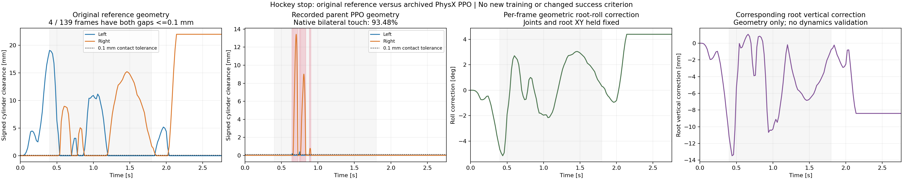

# Where the stable hockey policy loses bilateral contact

The archived original-speed hockey PPO still fails the required continuous bilateral-contact gate. Its left wheel loses contact for **20 ms** in total, reaching **0.388 mm** clearance; its right wheel loses contact for **160 ms**, reaching **13.430 mm**. There are no unknown-contact samples in these intervals. Native separation matches the independently reconstructed authored cylinder clearance at the preceding pose to within **0.245 micrometres**. These are geometric contact interruptions, not failures caused by a minimum-load threshold.

The reference itself was constructed using a **one-wheel ground projection**. Only **4 of 139 reference frames (2.88%)** place both authored wheel cylinders within 0.1 mm of the floor. Peak reference clearances are 19.07 mm left and 21.98 mm right. This is a 50 Hz kinematic-reference statistic, distinct from the policy's 400 Hz native-contact statistic of **93.48%**. The policy already departs substantially from the original reference's vertical/attitude geometry to maintain contact.



A per-frame geometric feasibility check keeps all joint angles, root XY and the root forward axis fixed, rotates the articulated pose about that forward axis, and allows a vertical translation until both cylinder support heights coincide with the floor. It finds a solution at every reference frame within a maximum absolute additional roll of **5.147 degrees**. The accompanying root vertical correction ranges from **-13.477 to +1.069 mm**. Both rotation and vertical translation are needed for this construction. The residual cylinder-ground gap is below 1 nanometre.

This calculation is a geometry diagnostic, **not an IK retarget, a new trajectory, a controller, or a dynamics result**. It does not check time-continuous dynamics, required torques, friction feasibility, whole-body collisions or stability. It does not prove that the reference caused the recorded interruptions. It shows that the original pose has a different contact pattern, while bilateral geometric contact is possible with the same joints if root attitude and vertical placement can adjust. It therefore supports retaining free root attitude/height and learning contact coordination; it does not establish that leg imitation must be removed or that changing friction alone will solve the task.

At the time of this diagnostic, the new reward/model screens were pending upload approval. They have since been authorized and executed; see the [current comparison](../hockey_contact_reward_search_20261028_v1/README.md). This diagnostic changes no policy, reference, training configuration, contact tolerance or success gate. The original process and upload observations are historical, not a current execution status.

Artifacts: [audited numerical report](report.json), [PNG](reference_contact_gap_4x1.png), [SVG](reference_contact_gap_4x1.svg), [diagnostic arrays](geometry_diagnostics.npz). The report pins source recording, reference, asset relationship and geometry-configuration hashes. [Reproduction script](../../scripts/audit_hockey_reference_contact_gap.py) and [five geometric checks](../../tests/test_hockey_reference_contact_gap.py) are included. All five checks pass, including a known analytic roll solution, heading invariance, rejection of an infeasible bounded search, finite cylinder width and preservation of the time/wheel array dimensions.

```bash
python scripts/audit_hockey_reference_contact_gap.py \
  --run outputs/hockey_support_failure_evidence_20261028_v1/runs_v1/hockey_s100_seed42/eval-suite/nominal \
  --reference results/hockey_speed_success_20261028_v1/source_snapshot_v1/references/s100 \
  --geometry-config config/hockey_bilateral_training_v1.json \
  --output results/hockey_reference_contact_gap_reproduced
```

The existing recorded rollout and reference arrays are required; this command creates only local diagnostics and never starts a simulator or training job.
