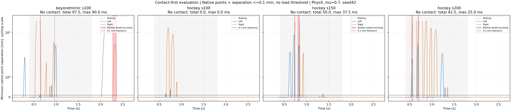
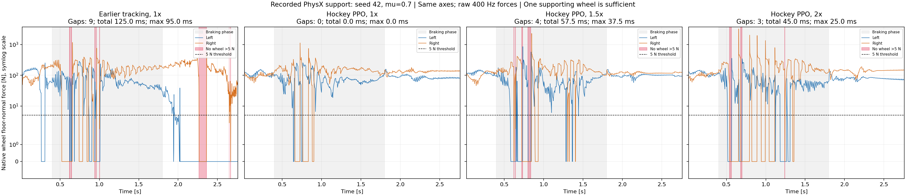
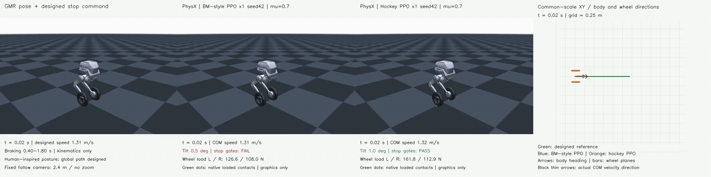

# Hockey-stop learning success and increased speed

The current requested evaluation is **contact-first**, replacing the 5 N load threshold as the condition for evaluating sliding. The new offline analysis below uses valid native wheel-ground contact points and their separation. The running training snapshots and their historical qualification reports remain unchanged; their old support-based success rates must not be relabeled as contact-based rates.

## Contact-first evaluation — current definition

A wheel is touching when it has at least one valid native wheel-ground point with separation **≤0.1 mm**. This declared numerical tolerance is independent of force; results at 0, 0.5 and 1 mm are also recorded. Either wheel can provide contact. Native contact count alone is insufficient: PhysX can generate points before surfaces meet. See the official [contact-data API](https://docs.omniverse.nvidia.com/kit/docs/omni_physics/107.3/extensions/runtime/source/omni.physics.tensors/docs/api/python.html#omni.physics.tensors.impl.api.RigidContactView.get_contact_data) and [contact/rest-offset description](https://nvidia-omniverse.github.io/PhysX/physx/5.1.2/docs/AdvancedCollisionDetection.html#tuning-shape-collision-behavior).

Sliding is evaluated independently for each touching wheel from contact material-point tangential velocity, including wheel rotation. Points are selected by valid geometry and separation, not by force or force weighting. Off-contact velocity is **not applicable**, not zero sliding. All-zero or zero-normal native entries cannot certify touching; without another valid touching point they yield an unknown state. At the main 0.1 mm tolerance these four nominal episodes have no unknown any-wheel intervals, although individual-wheel states can be unknown.

Normal force and `mu * Fn` remain friction-capacity diagnostics. A wheel may touch with zero force; its contact state remains valid, but friction utilization is undefined at zero load. The 1e-6 N division safeguard is numerical, not a support threshold. Friction-corroborated sliding additionally checks near-limit wheel-level utilization, dissipative friction-anchor evidence and material-point lateral motion. It is distinct from merely observing contact and slip.

| Nominal policy, seed 42, mu=0.7 | Any-wheel touching | Total / longest no-contact interval | Old force-gap time that still touches |
| --- | ---: | ---: | ---: |
| Earlier tracking, 1× | 96.44% | 97.5 / 90 ms | 35 ms |
| Hockey PPO, 1× | 100% | 0 / 0 ms | 0 ms |
| Hockey PPO, 1.5× | 98.18% | 50 / 37.5 ms | 12.5 ms |
| Hockey PPO, 2× | 98.45% | 42.5 / 25 ms | 7.5 ms |

At 1.5×, no-contact intervals are 0.7225–0.735 and 0.8025–0.840 s; at 2× they are 0.5425–0.5675 and 0.6825–0.700 s. These are not identical to force-gap intervals, including a one-substep shift in several boundaries. They describe the recorded native separation at each completed step, not continuous-time geometry between samples. The previous force-gap durations therefore cannot simply be renamed as no-contact durations. With a 1 mm diagnostic tolerance, total no-contact time remains 42.5 ms at 1.5× and 35 ms at 2×.



This update covers contact eligibility and contact-conditioned sliding for four nominal recordings. It does **not** claim new full-task success rates for the 32 perturbed trials or silently reuse the old force-gated stop, heading and sliding qualifications. Five physical counterexample tests pass, covering zero-force touch, rolling cancellation, positive-distance contact candidates, absent contacts and invalid geometry.

[Contact report](ground_contact_analysis_v2_validated/report.json) · [Per-wheel signals](ground_contact_analysis_v2_validated/contact_signals.npz) · [Evaluation specification](../../config/hockey_contact_evaluation_v2.json) · [Analysis code](../../scripts/analyze_hockey_ground_contact.py)

```bash
python scripts/analyze_hockey_ground_contact.py \
  --runs outputs/hockey_support_evidence/runs_v1 \
  --references results/hockey_speed_success_20261028_v1/source_snapshot_v1/references \
  --output outputs/hockey_ground_contact_analysis
```

## Historical load-based evaluation

Earlier deployment inspection, October 28, retained below: **5/18 cells independently qualified, covering 165 full episodes**. At that inspection the queue was running in tmux `hockey_speed_success_20261028_v1`, with hockey PPO at 2× speed / seed 42 training on GPU 3. Each completed policy used 12,288,000 training transitions from scratch. The remote snapshot matched all 41 approved file hashes. Later results are discussed in the support-interruption analysis below; this historical status is not a live progress indicator. [Deployment report and evidence](deployment_status_20261028_v1/report.json) · [Verified process status](deployment_status_20261028_v1/verified_process_status.json) · [Remote snapshot audit](deployment_status_20261028_v1/remote_snapshot_audit.json) · [Launch evidence](preflight/launch.json) · [Upload receipt](preflight/upload_receipt.json) · [CPU checks](preflight/local_tests.json).

| Recipe / speed, seed 42 | Nominal full success | Perturbed successes | Nominal XY RMSE | Longest qualifying slide, L / R | Longest support interruption |
| --- | --- | ---: | ---: | ---: | ---: |
| Earlier tracking, 1× | Fail | 0/32 | 0.259 m | 60 / 27.5 ms | 95 ms |
| Hockey PPO, 1× | Pass | 32/32 | 0.0179 m | 197.5 / 30 ms | 0 ms |
| Earlier tracking, 1.5× | Fail | 0/32 | 0.104 m | 152.5 / 20 ms | 37.5 ms |
| Hockey PPO, 1.5× | Fail | 0/32 | 0.0253 m | 315 / 27.5 ms | 37.5 ms |
| Earlier tracking, 2× | Fail | 0/32 | 0.0944 m | 37.5 / 30 ms | 67.5 ms |

Qualifying sliding combines loaded contact, lateral material-point velocity, near-limit aggregate friction, dissipative friction-anchor evidence, and the existing high-beta/braking/upright gates. Support interruption means neither wheel exceeds the 5 N load threshold; it is not a geometric proof of separation. The 1.5× hockey policy stops without reaching 45° tilt and passes all gates except continuous support, both nominally and in all 32 perturbed starts. The earlier recipe's 1.5× and 2× nominal episodes also remain below 45° tilt: failure is not synonymous with falling. Success rates include every frozen gate and remain conditional on each individual trained policy.

Deployment distinction: 400 Hz validation already records native normal forces, friction-anchor forces and positions, and wheel COM twists for reconstructing sliding velocity and friction utilization. The actor does **not** receive an explicit sliding-state label or friction-cone utilization. Hockey training uses substep load information to gate its beta and supported-stop rewards, without an explicit friction-saturation reward. The newer pre-fall and force-cone analysis scripts run locally on collected evidence and are absent from the immutable remote training snapshot. Evaluation still uses equal static/dynamic coefficients, 0.7; recorded sliding does not establish a coefficient drop or expose an internal solver stick/slip flag. No training settings or success gates changed during this inspection.

The requested baseline is the earlier **TRON1 BeyondMimic-style PPO tracking recipe**, rather than the previous hockey experiment's zero-support-weight arm. The second method is the directly trained hockey tracking PPO, without the additional continuous support penalty. The full recipes differ in observations, rewards, learning-rate schedule and episode-end semantics; this is not a single-reward causal ablation.

A separate [friction-boundary reward ablation](../hockey_friction_boundary_20261028_v1/README.md) is uploaded and queued for 1.5× speed, with identical instrumentation and reward weights 0 versus +0.5. The user approved its exact payload and execution scope; its dependency wrapper waits for this entire 18-cell study to complete. It has not changed this running study or produced new training results.

## Why continuous wheel support fails

The later seed-42 diagnosis reconstructs native PhysX contact buffers for four nominal recordings and checks the original qualification hashes. The 2× hockey policy has now completed validation. No policy, simulator setting, training job or success gate was changed for this analysis.



| Seed-42 nominal policy | Support fraction | Gap count | Total / longest gap | Both wheel forces effectively zero | Perturbed support failures |
| --- | ---: | ---: | ---: | ---: | ---: |
| Earlier tracking, 1× | 95.44% | 9 | 125 / 95 ms | 117.5 ms | 32/32 |
| Hockey PPO, 1× | 100% | 0 | 0 / 0 ms | 0 ms | 0/32 |
| Hockey PPO, 1.5× | 97.90% | 4 | 57.5 / 37.5 ms | 55 ms | 32/32 |
| Hockey PPO, 2× | 98.36% | 3 | 45 / 25 ms | 45 ms | 32/32 |

The frozen gate requires at least one wheel's summed floor-normal force to exceed 5 N in every completed 2.5 ms physical interval after the first 20 ms, through 2.76 s. Either wheel may lift. A single unsupported interval fails this gate. Forces at or below 1e-6 N count as effectively zero only for the descriptive sensitivity analysis.

For hockey 1.5×, all gaps occur during braking: 0.620–0.625, 0.640–0.6425, 0.720–0.7325 and 0.800–0.8375 s. The 12.5 ms gap separates right-wheel support from left-wheel support; the 37.5 ms gap occurs between two left-wheel support intervals. Both wheels report zero force throughout those two longer gaps. The first returning left-wheel loads are respectively 860.9 and 572.3 N, each representing a 2.5 ms step rather than an instantaneous peak. The 2.5 ms gap at 0.640 s has 1.923 N on the right wheel; all other unsupported samples have zero wheel force. Reducing the diagnostic threshold from 5 to 1 N therefore removes only 2.5 ms and does not restore continuous support.

For hockey 2×, gaps occur at 0.540–0.565, 0.680–0.6975 and 1.240–1.2425 s. Both longer gaps separate right-wheel support from left-wheel support. All three contain zero wheel force. The first returning left-wheel loads are 358.6 and 345.7 N. Thus the failure persists for every tested threshold from 1e-6 to 10 N. These patterns establish interrupted force transfer and recontact, without proving geometric separation or identifying a particular joint action as the cause.

Both faster hockey nominal runs remain upright and pass the sliding and terminal-stop gates; their only failed gate is continuous support. All 32 perturbed starts for each also fail only that gate. Their longest support gaps range over 30–37.5 ms at 1.5× and 17.5–35 ms at 2×. This is not a single nominal-reset artifact, although the results still condition on one training seed. At zero wheel load the wheel friction budget `0.7 * (Fn_left + Fn_right)` is zero, so these intervals cannot count as loaded sliding, and a friction-utilization ratio is undefined there.

The frozen hockey tracking arm has support-deficit weight zero. Its beta reward is multiplied by each wheel's loaded fraction over eight physical substeps; its stop reward uses the mean any-wheel supported fraction and activates during the hold phase. XY, velocity and posture rewards can remain positive during a short support gap. This provides a plausible objective-level explanation for good tracking with interrupted support, not a causal ablation result. The separately queued friction-boundary reward adds an all-eight-substeps support gate to its bonus; its effectiveness has not yet been measured.

[Audited report and per-trial support statistics](support_failure_analysis_v1/report.json) · [Every nominal gap](support_failure_analysis_v1/gap_events.csv) · [Plot signals](support_failure_analysis_v1/plot_signals.npz) · [Analysis code](../../scripts/analyze_hockey_support_failure.py)

Reproduce from a fresh read-only collection containing nominal traces:

```bash
python scripts/collect_hockey_speed_study.py --case nominal --output outputs/hockey_support_evidence
python scripts/analyze_hockey_support_failure.py \
  --runs outputs/hockey_support_evidence/runs_v1 \
  --references results/hockey_speed_success_20261028_v1/source_snapshot_v1/references \
  --output outputs/hockey_support_analysis
```

## Matched original-speed comparison — seed 42, μ = 0.7



[Nominal 4×1 MP4](paired_s100_seed42_nominal_comparison_v1/hockey_ppo_fullbody_xy_4x1.mp4) · [Identical perturbed start, trial 022](paired_s100_seed42_trial022_comparison_v1/hockey_ppo_fullbody_xy_4x1.mp4) · [Nominal physics chart](paired_s100_seed42_analysis_v1/nominal_physics_comparison_4x1.png) · [All paired trial metrics](paired_s100_seed42_analysis_v1/paired_trials.csv) · [Machine-readable comparison](paired_s100_seed42_analysis_v1/report.json) · [Study-wide partial summary](partial_pair_summary_v1/report.json)

| Metric | Earlier BeyondMimic-style PPO | Hockey PPO |
| --- | ---: | ---: |
| Nominal episode, all eleven gates | Fail | Pass |
| Perturbed-reset success | 0/32 | 32/32 |
| Conditional Wilson 95% interval | 0–10.72% | 89.28–100% |
| Nominal entry COM speed | 1.399 m/s | 1.382 m/s |
| Nominal XY RMSE / peak | 0.259 / 0.942 m | 0.0179 / 0.0398 m |
| Nominal at-least-one-wheel support | 95.44% | 100% |
| Nominal longest support interruption | 95 ms | 0 ms |
| Nominal supported final 0.5 s stop | Fail | Pass |
| Nominal pre-fall high-β saturated dissipative slide, longest left / right | 60 / 27.5 ms | 197.5 / 30 ms |
| Perturbed XY RMSE, median [min, max] | 0.284 [0.093, 0.490] m | 0.0196 [0.0117, 0.0304] m |

All 32 paired perturbations favor hockey PPO under the unchanged complete success definition. In the nominal recording, the earlier recipe brakes initially, then accelerates away during the stop/hold phase and exceeds 45° tilt at 2.6575 s. Hockey PPO maintains support and a supported stop while preserving the required loaded sliding. Across its 32 perturbed trials, its longest qualifying left-wheel slide is 192.5–337.5 ms; all trials retain continuous at-least-one-wheel support.

| Failed gate, nonexclusive counts over 32 perturbations | Earlier recipe | Hockey PPO |
| --- | ---: | ---: |
| Continuous at-least-one-wheel support | 32 | 0 |
| Supported terminal stop | 30 | 0 |
| Peak XY error ≤0.30 m | 28 | 0 |
| XY RMSE ≤0.15 m | 26 | 0 |
| Whole-task tilt <45° | 22 | 0 |
| Corroborated loaded high-β sliding ≥50 ms | 5 | 0 |

Entry speed, approach-speed retention and both braking-heading gates pass in all 32 perturbed trials of both methods. Thus this pair primarily differs in tracking and stop/support stability, rather than simply entering more slowly. Near-limit friction remains a wheel-aggregate diagnostic, not a pointwise friction-cone certificate. These results establish conditional robustness for this trained hockey policy; one training seed cannot establish repeatable learning success, and the full-recipe difference cannot isolate a β-reward effect.

Both animations keep the camera 2.4 m from the robot with identical orientation, fixed relative target and identical XY bounds. The four panels show the GMR-based reference, earlier PPO, hockey PPO and shared XY paths with body headings, wheel-plane directions and COM velocity directions. `trial_022` is selected because it has the earlier recipe's largest perturbed XY RMSE; the hockey panel uses exactly the same initial-state draw. All other trials remain in the reported denominator. Rendering adds no physics, retiming or pose correction.

[Pre-fall friction-capacity analysis](original_prefall_friction_v1/README.md): in the original policy's last 100 ms before first tilt ≥45°, the left wheel has zero capacity and right-wheel capacity medians are 72.1 N (nominal) and 43.6 N (`trial_022`). The right wheel is near its friction limit for 64.1% and 100% of loaded samples, respectively. The diagnostic separates force saturation, support loss and measured lateral/tangential sliding; it does not attribute the fall solely to friction.

[Friction-cone sections and 3D force-space comparison](friction_cone_analysis_v1/README.md): the original right-wheel resultant approaches the 34.992° ideal cone boundary, mainly laterally in the nominal episode and with larger longitudinal use in `trial_022`. No examined loaded sample exceeds the numerical ρ=1.0001 check. Normalized coordinates, directional headroom, loaded sliding and the limits of aggregate rather than pointwise certification are reported separately.

<details>
<summary>Archived first-cell analysis before its matched policy completed</summary>

Only `beyondmimic_s100_seed42` is included here. Every recorded observation, actor output and native contact sample passed independent reconstruction before qualification. The maximum CPU actor-replay discrepancy over the 33 episodes was 1.02e-6, below the frozen 5e-5 tolerance. [All 33 outcomes](first_cell_evidence_v1/runs_v1/beyondmimic_s100_seed42/analyze/report.json) · [Partial summary](partial_first_cell_v1/report.json) · [CSV](partial_first_cell_v1/summary.csv).

| Nominal episode, original speed / seed 42 / μ = 0.7 | Measured result |
| --- | ---: |
| Entry COM speed | 1.399 m/s |
| Approach-speed retention | 1.021× reference |
| XY RMSE / peak error | 0.259 / 0.942 m |
| At-least-one-wheel support fraction | 95.44% |
| Longest support interruption | 95 ms |
| First tilt ≥45° | 2.6575 s |
| Supported terminal stop | Not achieved |
| Longest pre-fall high-β, loaded, near-limit dissipative slide, left / right | 60 / 27.5 ms |

The nominal episode passes the sliding-evidence gate and both braking-heading gates, but fails XY accuracy, continuous support, terminal stopping and whole-task tilt. Sliding occurs before the fall; detecting sliding alone does not establish successful stopping. Near-limit friction is assessed at wheel aggregate level, not as a pointwise friction-cone certificate.

Across the 32 paired initial-state perturbations, full success is **0/32** (conditional Wilson 95% interval **0–10.72%**, conditional on this single policy). Failure counts are nonexclusive: support interruption 32/32, terminal stop 30/32, peak XY error 28/32, XY RMSE 26/32, tilt 22/32, and sliding evidence 5/32. All 32 pass entry-speed, approach-speed and braking-heading gates. XY RMSE ranges from 0.093 to 0.490 m, with a median of 0.284 m. The remaining training seeds and faster conditions are pending; this does not establish that the earlier recipe cannot learn the task.

The nominal episode and `trial_022` (the largest perturbed-trial XY RMSE) are retained without early truncation. Both renders use the same XY bounds and a fixed 2.4 m follow camera. MuJoCo is used only for mesh rendering and forward kinematics; these are recorded PhysX trajectories.

- [Nominal 4×1 video](first_cell_nominal_render_v1/hockey_command_physx_xy_contact_4x1.mp4): reference, full body, XY/headings, native contact diagnostics.
- [Worst-XY perturbed episode, 4×1 video](first_cell_failure_render_v1/hockey_command_physx_xy_contact_4x1.mp4).
- [Partial 4×1 success/failure chart](partial_first_cell_v1/learning_and_rollout_success_4x1.png). Missing conditions remain pending and are excluded from denominators.

</details>

## Shared reference and recipes

| Shared reference condition | Original speed | 1.5× speed | 2× speed |
| --- | ---: | ---: | ---: |
| Designed base-link entry speed | 1.307 m/s | 1.961 m/s | 2.615 m/s |
| Total designed XY displacement, including approach | 1.438 m | 2.157 m | 2.876 m |
| Translational kinetic energy at equal mass | 1× | 2.25× | 4× |
| Braking interval | 0.40–1.80 s | Same | Same |
| Pose clock / final reference time | Unchanged / 2.76 s | Same | Same |

Speed scaling changes world translation and its contribution to every body's COM velocity. It preserves GMR joint positions/velocities, body and wheel orientations, angular velocities, height and phase timing. A fixed braking duration means the target stopping distance grows with speed. These are designed robot commands, not measured human skating speeds. The original-speed motion bytes are unchanged.

Wheel spin remains the same zero placeholder at reset in every condition, excluded from imitation. The higher-speed evaluations therefore include the initial wheel spin-up transient. A failed training run means failure within the fixed budget and reset convention, not proof that a physical hockey stop is impossible at that speed.

| Recipe | Earlier BeyondMimic-style tracking | Direct hockey PPO |
| --- | --- | --- |
| Actor / critic inputs | 51 / 120 | 56 / 125 |
| Imitation objective | Six exponential global/relative body tracking terms | XY, velocity vector, heading, yaw rate, leg pose, wheel axes, loaded β |
| Explicit velocity / braking / holding input | No | Yes |
| Terminal supported-stop reward | No | Yes |
| Extra continuous support-deficit penalty | No | No |
| Learning rate / schedule | 0.001 / adaptive | 0.0003 / fixed |
| Reference-end termination | Historical timeout semantics | Finite-task terminal |
| Training orientation termination | Historical reference-orientation error, 0.6 rad | Absolute tilt, 45° |

Both use the same PhysX robot/actuators, 400 Hz physics, 50 Hz control, action-rate weight −0.5, network widths, PPO clip/epochs/minibatches, and training friction DR over [0.3, 1.2]. Encoder bias, COM offsets and velocity pushes are also shared. Absolute height tracking and height termination remain disabled, as previously requested. The original recipe therefore retains the existing TRON1 free-height and simulation-clock adaptations; it is not an unmodified official humanoid task. Its wheel-relative XY tracking remains active; wheel axial orientation/spin imitation remains excluded.

The hockey arm retains the documented v1 sampler and float32 phase-boundary limitations. The undeployed v2 correction is not introduced during this comparison. Those implementation differences remain part of the full-recipe comparison and cannot be attributed solely to β or the stopping reward.

## Success denominators

- **Learning success:** three independent training seeds (42, 43, 44) per method and speed, each starting from scratch with 12,288,000 transitions. Report nominal full-start passes out of three, including unsuccessful seeds. Three seeds provide only a preliminary reliability estimate.
- **Conditional rollout success:** each trained policy runs the same 32 IID initial-state perturbations at μ = 0.7, in addition to one exact nominal episode. Report successes/32 and a 95% Wilson interval for each policy. Report the mean and min/max across training seeds separately; do not pool 96 correlated trials into an IID binomial confidence claim.
- **Paired failures:** retain original-only, hockey-only, both-success and neither-success outcomes for matching perturbation IDs. Report nonexclusive failure counts for XY, speed retention, heading, support, tilt, terminal stop and corroborated sliding.

The perturbations are uniform initial XY ±0.02 m, yaw ±2°, forward COM speed ±5%, lateral COM velocity ±0.05 m/s, and world yaw rate ±0.1 rad/s. They are drawn once with seed 20261028 and paired across methods and training seeds. Height, joint pose, reference commands, friction and subsequent disturbances are unchanged. The evaluator observes all 139 controls and 1,112 physical substeps, without resets after failure. The nominal case is excluded from the random-trial denominator.

All **eleven existing physical stop-and-slide gates** remain fixed, including approach-speed retention, XY RMSE ≤0.15 m and peak ≤0.30 m, continuous at-least-one-wheel support, supported terminal stop, heading/tilt limits, and ≥50 ms of same-wheel loaded high-β material sliding corroborated by near-limit aggregate friction and dissipative force. No height gate is added. Friction evidence remains wheel-aggregate, not a pointwise cone certificate.

## Frozen execution scope

[Plan and case draws](source_snapshot_v1/plan.json) · [Payload manifest](source_snapshot_v1/manifest.json) · [Runtime preflight](preflight/remote_runtime.json) · [Upstream source parity](preflight/upstream_remote_parity.json)

The payload contains 41 files, 736,575 bytes, plus its manifest. Archive SHA-256: `f8a3d60a547094df98f0290a8a81da3a8f8820d15ed86ce485eb39f765b8b1ac`. It includes code/configuration and derived robot references; no robot models, weights, credentials, video or SMPL assets.

The prepared scope is 18 formal trainings, 18 short smoke checks, and 594 single-environment episodes. Each smoke uses 32 environments × 2 iterations; each formal run uses 512 × 1,000 iterations × 24 steps = 12,288,000 transitions. Total formal budget is 221,184,000 transitions. At the previous 1,341 s per training, training alone would take approximately 6.7 hours; evaluation and resource waiting are additional.

The dispatcher uses one freshly audited, completely idle RTX at a time. It runs seed 42 across all speeds first, then seeds 43 and 44. It stops on infrastructure/audit failure, retains unsuccessful policies, does not retry or tune automatically, and never stops other processes. Idle polling has a six-hour cumulative limit. The approved runtime and assets are reused without installing packages.

## Reproduction

Run from the repository root. Build a **new** payload from current source with:

```bash
python scripts/prepare_hockey_speed_study.py \
  --output outputs/hockey_speed_study_reproduction/source \
  --archive outputs/hockey_speed_study_reproduction/source.tar.gz
```

To reproduce this exact study, use the committed immutable snapshot instead. On the authorized compute host, after verifying the manifest and supplying the existing runtime paths:

```bash
"$HOCKEY_ISAAC_PYTHON" "$HOCKEY_BUNDLE/dispatch_hockey_speed_study.py" \
  --bundle "$HOCKEY_BUNDLE" --prior-launch "$HOCKEY_PRIOR_LAUNCH" \
  --audit-helper "$HOCKEY_GPU_AUDIT_HELPER" --output "$HOCKEY_NEW_RUN_DIRECTORY"
```

The dispatcher launches training, the full episode suite, and a separate CPU analysis that reconstructs every observation/action and native contact before qualification. Its status file records process identity, GPU audit, arguments, return codes and report hashes. Once collected, summarize only complete audited cells:

```bash
python scripts/summarize_hockey_speed_study.py \
  --plan results/hockey_speed_success_20261028_v1/source_snapshot_v1/plan.json \
  --runs "$HOCKEY_COLLECTED_RUNS" --output outputs/hockey_speed_success_summary
```

Missing cells remain explicitly pending; they are never counted as successes or silent failures. Rendered examples must be selected after reporting every trial, with representative failure cases retained alongside successful nominal runs.

Read-only live progress and evidence retrieval:

```bash
python scripts/collect_hockey_speed_study.py --status-only
python scripts/collect_hockey_speed_study.py --representative-traces \
  --output outputs/hockey_speed_success_collection
```

For a matched failure example, add `--case trial_022` to retrieve that same audited episode from each completed policy. To reproduce the original-speed pair's metrics and physics chart from this committed evidence:

```bash
python scripts/compare_hockey_speed_pair.py \
  --runs results/hockey_speed_success_20261028_v1/paired_s100_seed42_evidence_v1/runs_v1 \
  --command-dir results/hockey_speed_success_20261028_v1/source_snapshot_v1/references/s100 \
  --seed 42 --speed-scale 1 \
  --output outputs/hockey_original_speed_pair_reproduction
```

The collector downloads completed reports and optionally nominal / worst failed-XY traces. Actor weights and checkpoints remain on the authorized host; no remote process is started, stopped or modified by collection.
