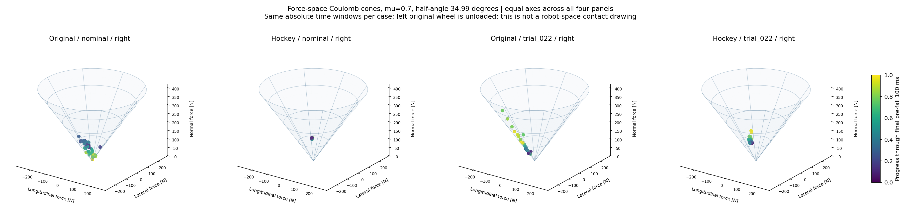
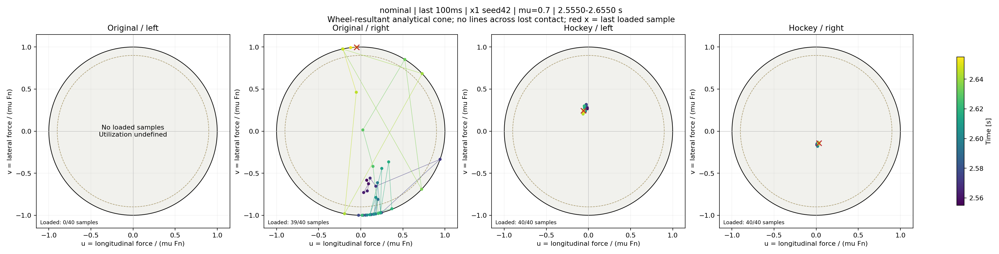
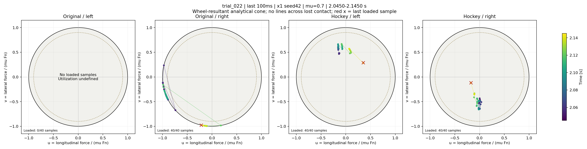

# Friction-cone analysis of the original PPO failures

The original policy approaches the **boundary of the wheel-resultant friction cone**, rather than showing a clear force-limit violation. Before the first 45° body tilt, its remaining right-wheel force is primarily lateral in the nominal case and has a larger longitudinal component in `trial_022`. The successful hockey policy operates farther inside the cone during those same stopping intervals. It also approaches the boundary earlier during intentional braking, so cone proximity alone is not a failure criterion.

This analysis uses the same recorded PhysX original-speed / seed-42 / μ=0.7 pair as the [capacity analysis](../original_prefall_friction_v1/README.md). There is no new simulation, training, change of success gates, or inference of missing per-anchor normal forces.

## Cone geometry

For a flat floor and an ideal isotropic Coulomb contact, using wheel-ground longitudinal and lateral axes,

\[
F_n\ge0,\qquad F_{\parallel}^{2}+F_{\perp}^{2}\le(\mu F_n)^2.
\]

Its half-angle relative to the ground normal is \(\phi=\tan^{-1}\mu=34.992^\circ\). With \(u=F_{\parallel}/(\mu F_n)\), \(v=F_{\perp}/(\mu F_n)\), the normalized section is \(u^2+v^2\le1\), and \(\rho=\sqrt{u^2+v^2}\). The angle of the measured resultant to the ground normal is \(\theta=\tan^{-1}(\mu\rho)\).

Here μ remains fixed and static/dynamic coefficients are equal. Loss of load reduces the section radius μFn; it does **not** change the cone half-angle. The floor normal defines the cone axis. Tilting or steering the wheel can change loads, contact locations and velocities; it does not rotate a flat floor's normal with the wheel. At Fn=0, the force section reduces to the apex; normalized coordinates are undefined. Samples with Fn≤5 N are therefore omitted from normalized plots instead of appearing at their centers.



These are cones in **force space**, not cones drawn at robot-world positions. All four panels use the same force axes and view. Each policy is evaluated over the original policy's last 100 ms before the tilt threshold. The original left wheel is unloaded over these windows; the 3D panels show the remaining right wheel.

## Directional use during the last 100 ms

| Case / policy, right wheel | Median absolute u | Median absolute v | Median ρ | Median θ |
| --- | ---: | ---: | ---: | ---: |
| Nominal / original | 0.178 | 0.969 | 0.99994 | 34.990° |
| Nominal / hockey | 0.023 | 0.152 | 0.15452 | 6.173° |
| Trial 022 / original | 0.914 | 0.405 | ≈1.00000 | 34.992° |
| Trial 022 / hockey | 0.020 | 0.486 | 0.48591 | 18.785° |

Each column is an independently computed median over loaded samples, not the components of one representative force vector. The time series can change direction sharply; inspect the colored samples rather than interpreting their medians as a single pose or adding component percentages.





Black circles mark ρ=1; dashed circles mark ρ=0.9. Colors indicate time and red crosses mark the last loaded samples. Lines connect consecutive loaded samples only, without claiming a physically simulated interpolation between them. The original left panel is empty because the wheel is unloaded, not because it has unused friction capacity.

No examined loaded pre-fall sample exceeds **ρ=1.0001**. Maximum ratios are approximately 1+3e-7 for the original policy and 1+4e-7 for the matched hockey policy, consistent with the scale of numerical rounding rather than a resolved cone violation. This new numerical check is separate from the existing 0.90–1.05 near-limit screen and does not relax or alter the task's success gates.

## Available force directions and sliding

At fixed normal load and longitudinal force, let

\[
B=\sqrt{(\mu F_n)^2-F_{\parallel}^2},\qquad
\Delta F_{\perp}\in[-B-F_{\perp},\ B-F_{\perp}].
\]

The headroom for increasing the current lateral-force magnitude is \(B-|F_{\perp}|\). Its right-wheel median is about **0.0064 N** for the original nominal episode and approximately **0 N** for original `trial_022`, versus **81.4 N / 44.8 N** for the matched hockey policy. Tiny negative residuals, down to a few 1e-5 N, are retained as numerical results.

This is an algebraic slice at fixed Fn and longitudinal force. Zero same-sign headroom does **not** mean that every direction of force change is unavailable: reducing or reversing a component may remain inside the cone. These bounds also do not establish actuator feasibility, the available balancing moment, or the corrective wrench needed to avoid falling.

Cone proximity must be combined with loaded contact-point velocity and dissipative force evidence. In the original policies' final 100 ms, corroborated lateral sliding totals **5 ms / 27.5 ms**, while any tangential sliding totals **5 ms / 95 ms**. These distinctions prevent treating rolling-direction slip or near-limit low-speed contact as sustained lateral drift. Conversely, the successful hockey policy is near the cone boundary for **51.5% / 55.7% of its loaded left-wheel samples during braking**, yet completes these episodes. The phase and subsequent support/stop behavior matter.

## What the recorded contact data can establish

For parallel contact normals with a common μ, pointwise Coulomb constraints imply the aggregate inequality by the triangle inequality. The converse does not hold: opposing tangential forces may cancel, so an aggregate vector inside the cone does not certify every contact. The analysis also retains the sum-of-anchor-force-magnitudes ratio to expose cancellation.

The recorded buffers contain normal-point counts and friction-anchor counts, with observed combinations 1/1 and 2/2. Equal counts do not establish force correspondence. The Tensor API returns separate normal and friction records, and the PhysX documentation describes patch-based friction anchors and patch normal-load allocation. Neither the retained raw arrays nor the run reports provide patch IDs or normal-load allocation per anchor. Consequently no nearest-point or index-based reassignment is made. See the [official Tensor API](https://docs.omniverse.nvidia.com/kit/docs/omni_physics/107.3/extensions/runtime/source/omni.physics.tensors/docs/api/python.html#omni.physics.tensors.impl.api.RigidContactView.get_friction_data) and [PhysX friction model documentation](https://nvidia-omniverse.github.io/PhysX/physx/5.4.1/docs/RigidBodyDynamics.html#friction-and-restitution).

Those sources explain representation and APIs; they do not establish this installation's exact solver/friction flags, which were not captured in the frozen reports. The drawn circular cone is an analytical diagnostic, not a claim that every internal PhysX constraint is this exact cone. Contact-force moments and the required balance wrench remain outside this analysis.

[Nominal braking sections](nominal.braking_cone_sections_4x1.png) · [Trial 022 braking sections](trial_022.braking_cone_sections_4x1.png) · [Nominal last 500 ms](nominal.last_500ms_cone_sections_4x1.png) · [Trial 022 last 500 ms](trial_022.last_500ms_cone_sections_4x1.png) · [All metrics and input hashes](report.json) · [Nominal samples](nominal.cone_samples.csv) · [Trial 022 samples](trial_022.cone_samples.csv)

## Reproduction

```bash
python scripts/analyze_hockey_friction_cone.py \
  --original-cell results/hockey_speed_success_20261028_v1/paired_s100_seed42_evidence_v1/runs_v1/beyondmimic_s100_seed42 \
  --comparison-cell results/hockey_speed_success_20261028_v1/paired_s100_seed42_evidence_v1/runs_v1/hockey_s100_seed42 \
  --output outputs/hockey_friction_cone_reproduction
python -m pytest -q tests/test_hockey_friction_cone.py
```
