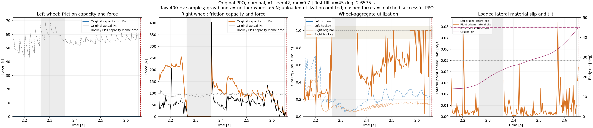
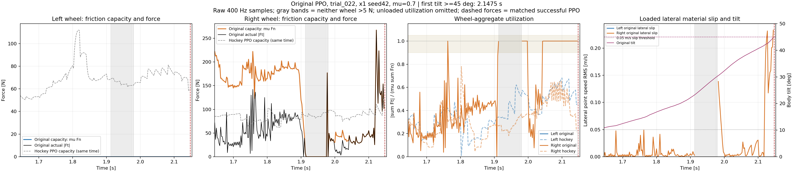

# Original PPO: friction capacity before loss of balance

The original BeyondMimic-style policy approaches its available friction limit before crossing 45° tilt, but the more informative pattern is **loss of left-wheel load, intermittent loss of both contacts, and later saturation of the remaining right-wheel force**. Saturation alone is not a causal explanation of the fall or evidence of lateral sliding.

These are recorded **PhysX evaluations at μ = 0.7** of the original-speed, seed-42 policy, not contact statistics from the randomized training environments. The nominal episode and `trial_022`, previously selected for the largest perturbed XY RMSE, are analyzed. The matched successful hockey policy is shown at the same absolute times and with the same initial-state draw. No simulation, policy training or success-gate change is performed here.

## Definitions and time window

For each wheel, the recorded force-based capacity proxy and utilization are

\[
C_i=\mu\sum_j F_{n,z,ij},\qquad
T_i=\left\|\sum_k\mathbf F_{t,ik,XY}\right\|,\qquad
\rho_i=T_i/C_i.
\]

The stationary floor is flat. Native normal and friction buffers are already in newtons; no second division by the physics timestep is applied. The material audit verifies equal static/dynamic wheel friction 0.7, a unit-friction floor and multiply combination. Capacity is computed even for unloaded samples, while utilization is defined only when wheel normal load exceeds 5 N. An unloaded wheel's utilization is missing, not zero. Near-limit utilization retains the existing diagnostic range 0.90–1.05.

“Before the fall” means before the **first recorded body tilt ≥45°**, a diagnostic threshold rather than a measured instant of body-ground impact. The last-100-ms window contains exactly forty complete 2.5-ms force intervals, ending at the preceding physical sample. Threshold-crossing and subsequent samples are excluded. Forces and contact-point velocities remain unsmoothed.

## Last 100 ms before the threshold

| Metric | Nominal | Perturbed `trial_022` |
| --- | ---: | ---: |
| First tilt ≥45° | 2.6575 s | 2.1475 s |
| Analyzed force-interval window | 2.555–2.655 s | 2.045–2.145 s |
| Left capacity, median over all samples | 0 N | 0 N |
| Right capacity, median over all samples | 72.1 N | 43.6 N |
| Right wheel loaded samples | 39/40 | 40/40 |
| Right utilization, median when loaded | 0.99994 | ≈1.00000 |
| Right near-limit fraction of loaded samples | 64.1% | 100% |
| Near-limit, dissipative **lateral** slip duration | 5 ms | 27.5 ms |
| Near-limit, dissipative **any tangential** slip duration | 5 ms | 95 ms |
| Hockey PPO combined capacity at the same times, median | 152.6 N | 165.0 N |
| Hockey PPO left / right utilization, loaded medians | 0.255 / 0.155 | 0.583 / 0.486 |

The original policy's combined capacity medians are 47.2% and 26.4% of the matched hockey policy's values at these times. These are ratios of measured capacity medians, not estimates of the corrective force needed to prevent a fall. Individual-wheel medians need not sum to the median combined capacity.

The nominal right-wheel force is predominantly lateral near the end, but lateral material speed remains below the 0.05 m/s threshold for most loaded samples. `trial_022` has much more sustained tangential sliding than lateral sliding, and its force has a substantial longitudinal component. Thus **ρ ≈ 1 does not imply 100 ms of lateral drift**. The “any tangential” diagnostic includes rolling-direction slip and must not be labeled pure side slip.

Sliding requires a loaded wheel, measured contact-point speed above 0.05 m/s, near-limit aggregate friction, negative aggregate anchor power below −0.05 W and a dissipative slipping friction anchor. Lateral slip additionally requires opposing lateral force at that anchor. These pre-fall physical diagnostics do not apply the task's β≥20° or braking-phase gate and do not replace its frozen success definition.

## Sequence before the threshold

- **Nominal:** the last left-wheel loaded interval ends at 2.0225 s. Neither wheel exceeds 5 N over 2.265–2.360 s, followed by a short recontact force peak. During the final 100 ms the right-wheel capacity median is 72.1 N; its radial difference `C−T` has median 0.0063 N when loaded. The tilt threshold is reached at 2.6575 s.
- **Trial 022:** the last left-wheel loaded interval ends at 1.6275 s. Both wheels lose >5 N support over 1.9125–1.975 s, with another 2.5-ms gap shortly afterward. The remaining right wheel is near its friction limit throughout the final 100 ms, with capacity median 43.6 N, before the tilt threshold at 2.1475 s.
- During braking, 0.4–1.8 s, the original policy already spends about 75.6% / 73.7% of its **left-wheel loaded samples** near the friction limit in the nominal / perturbed episodes. This early saturation is compatible with the intended sliding maneuver; it is distinct from the later loss of support and stopping stability.





Four horizontal panels show left-wheel capacity/force, right-wheel capacity/force, utilization and loaded lateral slip with body tilt. Gray bands mark loss of >5 N support on both original-policy wheels. Dashed capacity and utilization traces show the matched successful hockey policy. The red vertical line marks first tilt ≥45°. The changing capacity follows the normal force; μ remains fixed.

[Nominal full pre-fall plot](nominal.full_prefall_4x1.png) · [Trial 022 full pre-fall plot](trial_022.full_prefall_4x1.png) · [Nominal samples](nominal.prefall.csv) · [Trial 022 samples](trial_022.prefall.csv) · [Metrics and native reconstruction audit](report.json)

## Interpretation limits and reproduction

This is a wheel-aggregate force proxy. The native friction anchors do not expose their corresponding pointwise normal loads, so these results do not certify individual contact cones. Net anchor forces can cancel; the report also retains the sum-of-anchor-magnitudes utilization. No pre-fall window here exceeds 1.05, and the largest anchor-sum ratio is approximately 1.00000034. Tiny negative `C−T` values are retained as floating-point residuals rather than presented as physical excess force.

`C−T` is a radial force difference, not guaranteed available lateral correction or a balancing moment. Contact location, force direction, whole-body dynamics and the required corrective wrench also matter. These observations support a coupled support-loss / force-saturation failure description; they do not establish which event caused the fall. Normal-point speeds use the rigid-body COM twist and wheel axes projected onto each reported contact normal. Anchor power pairs completed-step force with post-step velocity and remains a diagnostic proxy.

All four raw recordings (two original and two matched hockey) are independently reconstructed again. Force, slip and other archived signals agree within 1e-10 tolerance; only archived β angles require a 1e-5-degree allowance for measured remote/local numerical differences, whose maximum is below 8e-6 degrees. No archived evidence is modified. The executable records input and source hashes.

From the repository root:

```bash
python scripts/analyze_hockey_prefall_friction.py \
  --original-cell results/hockey_speed_success_20261028_v1/paired_s100_seed42_evidence_v1/runs_v1/beyondmimic_s100_seed42 \
  --comparison-cell results/hockey_speed_success_20261028_v1/paired_s100_seed42_evidence_v1/runs_v1/hockey_s100_seed42 \
  --output outputs/hockey_prefall_friction_reproduction
```
