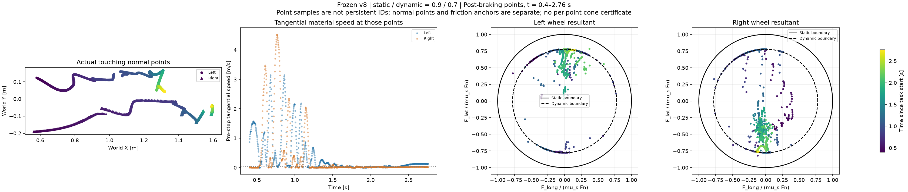
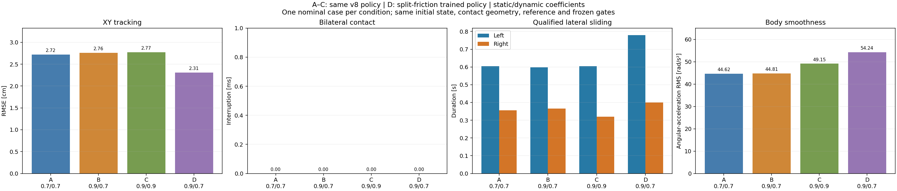

# Hockey stop: contact points and static/dynamic friction

**Both the original policy and the matched split-friction policy pass the nominal stop with static/dynamic friction 0.9/0.7 and uninterrupted bilateral contact.** Retraining improves XY tracking and increases qualified sliding, but also increases body angular acceleration. The data show a change in friction capacity and local sliding; they do not establish an instantaneous 22.2% force drop when sliding begins.

## Same policy, different materials

| Static / dynamic friction | XY RMSE | Bilateral interruption | Qualified slide L / R | Angular-acceleration RMS |
| --- | ---: | ---: | ---: | ---: |
| 0.7 / 0.7 | 2.721 cm | 0 ms | 0.6050 / 0.3550 s | 44.62 rad/s² |
| 0.9 / 0.7 | 2.762 cm | 0 ms | 0.5975 / 0.3650 s | 44.81 rad/s² |
| 0.9 / 0.9 | 2.772 cm | 0 ms | 0.6050 / 0.3200 s | 49.15 rad/s² |

Each row is **one nominal rollout**, not a new 33-case success estimate. All eleven frozen gates pass, including the 0.5 s terminal planar stop. The actor, reference, actual initial state, geometry, 400 Hz physics and 50 Hz control are identical. Materials remain constant throughout each rollout; there is no terrain-friction step. These are closed-loop policy responses, not identical-action open-loop tests. The repeated 0.7/0.7 control reproduces the earlier successful state/action arrays exactly.

[Results](fixed_policy_effects_v1/report.json) · [four-panel comparison](fixed_policy_effects_v1/material_comparison_4x1.png) · [initial-state audit](probe_evidence/run_v10/initial_state_audit.json) · [baseline replay](probe_evidence/run_v10/baseline_reproduction.json) · [raw recordings](probe_evidence/manifest.json).

## What happens at the touching points

The analysis covers **0.4–2.76 s**, from braking onset through the final hold. In the 0.9/0.7 probe it contains **945 left and 955 right normal-contact point samples**. These are samples across physical intervals, not 1,900 distinct persistent points. Normal points qualify geometrically within the unchanged 0.1 mm tolerance; no minimum normal force defines contact. Velocities follow the same wheel material point over each interval, not a finite difference of a changing contact minimum.



The left wheel is already sliding at braking onset. The right wheel's first sustained low-slip-to-slip event occurs at **0.5275 s** under the stated diagnostic thresholds. The first corresponding left-wheel event after braking occurs at **1.2025 s**. Low slip requires both pre-step and interval tangential RMS below 0.02 m/s for 20 ms; sustained slip requires both above 0.05 m/s for 20 ms. Contact must persist through the transition. These are analysis thresholds, not a PhysX friction-switch speed. [Threshold sensitivity](onset_threshold_sensitivity.json) places the first right-wheel event at 0.5250–0.5425 s for the three tested threshold pairs.

For each wheel, the capacity sections use:

```text
rho_s = norm(sum(Ft_xy)) / (mu_s * sum(Fn))
rho_d = norm(sum(Ft_xy)) / (mu_d * sum(Fn))
```

Ratios require contact and positive normal force; zero force leaves them undefined. At fixed normal force, the 0.9/0.7 dynamic boundary is **77.8%** of the static boundary, a **22.2% analytical capacity reduction**. During sustained sliding the resultant frequently follows this inner boundary. The actual force also depends on normal load and requested motion.

For example, immediately before the left-wheel event, at 1.1975 s, Fn is **67.61 N** and |Ft| is **35.18 N**. At 1.2000 s, Fn rises to **88.64 N** and |Ft| to **62.05 N**, while the interval material speed grows to 0.0886 m/s. The force increases while reaching the dynamic limit; this is not an observed 22.2% downward force jump. Force values average the following 2.5 ms.

[Aligned onset comparison](fixed_policy_effects_v1/slip_onset_4x1.png) · [per-point samples and all phases](probe_contact_points_v3/report.json) · [recorded numerical arrays](probe_contact_points_v3/signals.npz).

There are **five braking intervals above 105% of the dynamic bound**, all below the static bound. In all five the interval tangential RMS is below 0.02 m/s, even though pre-step speed can be higher. This is consistent with stronger friction arresting local slip, but the solver's actual stick/slip flag was not recorded. These intervals are not classified as static-bound violations or friction-corroborated sustained sliding. [Exact intervals](fixed_policy_effects_v1/above_dynamic_below_static.csv).

The completed split-policy perturbation suite gives a stronger example. A post hoc scan of all 33 trials selects the largest braking-phase static utilization: the right wheel of `trial_016` at **0.995 s**, with rho_s **0.9975**, Fn **94.20 N** and |Ft| **84.57 N**. Its material-point tangential speed falls from **0.0642 to 0.0031 m/s** over that interval. In the following interval, |Ft| falls to **29.13 N**, but slip remains near zero and Fn rises to **101.87 N**. This is local slip arrest followed by a lower measured force, not evidence that the force drop starts sliding. The selection is diagnostic, not a frequency or success-rate estimate. [Four-panel event](static_boundary_event_v2/static_boundary_event_4x1.png) · [selection rule and all 66 wheel/trial peaks](static_boundary_event_v2/report.json).

## Sliding capacity versus braking effect

Local friction saturation does not directly measure net braking. In the 0.9/0.7 braking phase, the median sum of the two wheel-force magnitudes is **116.23 N**, while median resultant magnitude is **28.20 N**. The median per-interval cancellation fraction is **77.6%**. The force directions can oppose each other and contribute a yaw couple; capacity, direction and torque must therefore be considered together.

The measured whole-system COM loses **27.094 J** of planar translational kinetic energy during braking. Integrating the contact resultant against interval-average COM velocity agrees to **0.0000364 J**. This checks the COM work balance; it is not a measurement of motor work or total contact-slip dissipation. The separate anchor-power integral is explicitly a pre-velocity/interval-force proxy.

[Force cancellation, braking contributions and yaw torque](braking_effectiveness_v2/case1_effectiveness_4x1.png) · [energy/impulse report](braking_effectiveness_v2/report.json).

Holding static friction at 0.9 and lowering dynamic friction from 0.9 to 0.7 increases the diagnostic near-capacity lateral-slip duration from **0.785/0.400 s** to **0.9475/0.5125 s** (L/R), while all task gates remain passed. This diagnostic omits the qualifier's beta/tilt conditions, so its durations differ from the qualified-slide table. Braking COM path length changes only from 0.8872 to 0.8899 m in these closed-loop nominal rollouts; a larger failure effect is not demonstrated.

## Animations

The [fixed-follow full-body comparison](fullbody_comparison_v2/static_dynamic_fullbody_4x1.mp4) shows four horizontal panels: original policy at 0.7/0.7, 0.9/0.7 and 0.9/0.9, followed by the split-trained policy at 0.9/0.7. The camera stays 2.4 m from the recorded root with a fixed relative offset. Green markers show actual touching normal points. MuJoCo provides graphics and forward kinematics only; the motion is recorded PhysX, with no pose correction or simulation replay. [Slow contact excerpt](fullbody_comparison_v2/static_dynamic_contact_excerpt_8x_4x1.mp4).

The contact animations below have four horizontal panels with shared plot limits: touching normal points and native friction-anchor vectors, left/right aggregate capacity sections, and material-point slip history. Every 400 Hz interval is displayed at 50 fps for **8× slow motion**. Geometry and forces are not interpolated. The normal-point dots and friction-anchor vectors are separate records, not a claimed point-to-anchor force assignment.

- [0.7 / 0.7](contact_animation_v2/case0_contact_friction_8x_4x1.mp4)
- [0.9 / 0.7](contact_animation_v2/case1_contact_friction_8x_4x1.mp4)
- [0.9 / 0.9](contact_animation_v2/case2_contact_friction_8x_4x1.mp4)
- [Split-trained policy at 0.9 / 0.7](trained_contact_animation_v1/case0_contact_friction_8x_4x1.mp4)
- [Provenance and complete decoding checks](contact_animation_v2/provenance.json): 944 frames per video, 2560×576 pixels.

## Matched training comparison

The split-friction arm completed **9,216,000 additional transitions** from its v7 checkpoint, reaching **12,288,000 same-recipe transitions**, matching the successful v8 equal-friction arm. Both share the earlier 12,288,000-transition parent. PPO settings, rewards, reference, geometry, physics, success gates and dynamic-friction DR range 0.3–1.2 are unchanged. Static friction is scaled by 0.9/0.7 in the split arm. Actor/critic, normalizers, Adam and exploration are restored from each arm's own v7 checkpoint; simulator/RNG/phase histories restart as they did for v8.

The [recipe audit](matched_recipe_audit.json) lists the only differences: friction ratio and associated model label, checkpoint identities and continuation provenance. The [runtime preflight](continuation_runtime_preflight.json) passes 1,536 smoke transitions and reproduces the v7 parent trajectory and qualification exactly. The final nominal rollout passes all eleven unchanged gates. The subsequent suite also passes **33/33 cases: one nominal plus 32 prescribed initial-state perturbations**, each at 0.9/0.7. No automatic retuning was performed. [Execution completion](pipeline_completion.json).

| Policy, both evaluated at 0.9 / 0.7 | XY RMSE | Peak XY error | Bilateral interruption | Qualified slide L / R | Angular-acceleration RMS |
| --- | ---: | ---: | ---: | ---: | ---: |
| Original v8, equal-friction DR | 2.762 cm | 6.139 cm | 0 ms | 0.5975 / 0.3650 s | 44.81 rad/s² |
| v9, split-friction DR | 2.308 cm | 3.844 cm | 0 ms | 0.7800 / 0.4000 s | 54.24 rad/s² |

The split-trained policy reduces nominal XY RMSE by **16.5%** and peak error by **37.4%**, but angular-acceleration RMS increases by **21.0%**. Entry speed is 1.401 m/s versus 1.433 m/s, and both retain the required 0.5 s terminal planar stop. This is a tradeoff, not an across-the-board improvement. Both training arms use one seed; it does not establish a multi-seed training effect. The original split-friction v7 screen had 97.5 ms bilateral interruption; the completed v9 continuation has zero interruption in its nominal test.



[All four results and actual-state equality](policy_comparison_v1/report.json) · [split-policy contact analysis](trained_contact_points_v1/report.json) · [split-policy braking effects](trained_braking_effectiveness_v1/report.json) · [unchanged numerical replay of the old 33-case baseline](audit_regression.json).

The 33-case result concerns the split-trained actor only. The original actor's 0.9/0.7 material probe remains a single nominal case, so these data do not establish that split-friction training improves perturbation success over the original actor at the same material.

All 33 qualifications were replayed locally from the archived 400 Hz recordings and matched the remote results. XY RMSE ranges from **2.213 to 3.033 cm**; bilateral interruption is **0 ms in every case**; angular-acceleration RMS ranges from **51.26 to 55.94 rad/s²**. [Full numerical audit](robustness_audit_v1/report.json) · [case table](robustness_audit_v1/cases.csv) · [robustness plots](robustness_audit_v1/robustness_4x1.png). Actor replay was verified remotely against the private weights; the public local audit does not require those weights.

[Study plan](study_plan.json) · [v9 continuation snapshot](../hockey_contact_reward_search_20261028_v1/source_snapshot_v9/manifest.json) · [v10 probe/pipeline snapshot](../hockey_contact_reward_search_20261028_v1/source_snapshot_v10/manifest.json) · [upload verification](upload_receipt.json) · [launch receipt](launch_receipt.json).

## Interpretation limits and reproduction

PhysX computes friction using contact patches and friction anchors. The tensor API exposes normal-contact records and friction-anchor forces/locations, but the archived data do not provide their complete patch/normal-load correspondence. The force sections are therefore **wheel-resultant diagnostics, not per-point cone certificates**. [PhysX friction model](https://nvidia-omniverse.github.io/PhysX/physx/5.4.1/docs/RigidBodyDynamics.html#friction-and-restitution), [friction-anchor API](https://docs.omniverse.nvidia.com/kit/docs/omni_physics/108.0/extensions/runtime/source/omni.physics.tensors/docs/api/python.html). These references explain the model/API; they do not establish the installed solver's unrecorded mode flags.

The measured effect comes from native Coulomb contact with different material coefficients. No elastic tire, brush law, terrain step or imposed velocity-dependent friction law was added. These probes use one selected policy and one reference. The earlier nine-slice force-allocation anomalies remain outside this comparison.

```bash
python scripts/analyze_hockey_braking_contacts.py --cases-json results/hockey_static_dynamic_transition_20261029_v1/probe_selection.json --reference results/hockey_speed_success_20261028_v1/source_snapshot_v1/references/s100 --mass-report results/hockey_contact_reward_search_20261028_v1/momentum_force_audit_v1/report.json --output <fresh-contact-analysis>
python scripts/plot_hockey_static_dynamic_effects.py --analysis <contact-analysis> --selection results/hockey_static_dynamic_transition_20261029_v1/probe_selection.json --output <fresh-comparison>
python scripts/analyze_hockey_braking_effectiveness.py --analysis <contact-analysis> --selection results/hockey_static_dynamic_transition_20261029_v1/probe_selection.json --output <fresh-effectiveness-analysis>
python scripts/render_hockey_friction_contacts.py --analysis <contact-analysis> --output <fresh-animation-directory>
python scripts/summarize_hockey_material_policies.py --selection results/hockey_static_dynamic_transition_20261029_v1/complete_selection.json --output <fresh-policy-comparison>
python scripts/audit_hockey_material_robustness.py --bundle results/hockey_contact_reward_search_20261028_v1/source_snapshot_v9 --evidence results/hockey_static_dynamic_transition_20261029_v1/robustness_evidence/robustness_v9_v1 --nominal-evidence results/hockey_static_dynamic_transition_20261029_v1/continuation_evidence --reference results/hockey_speed_success_20261028_v1/source_snapshot_v1/references/s100 --run-name run_v9 --output <fresh-robustness-audit>
python scripts/analyze_hockey_static_boundary_events.py --audit <robustness-audit> --evidence results/hockey_static_dynamic_transition_20261029_v1/robustness_evidence/robustness_v9_v1 --output <fresh-boundary-event>
MUJOCO_GL=osmesa python scripts/render_hockey_contact_screens.py --reference results/hockey_speed_success_20261028_v1/source_snapshot_v1/references/s100 --model <locked-robot.xml> --cases-json results/hockey_static_dynamic_transition_20261029_v1/fullbody_selection.json --output <fresh-body-render> --slow-window 0.4 1.8 --snapshot-times 0.5275 1.2025 2.76 --prefix static_dynamic
python -m pytest -q tests/test_hockey_braking_contacts.py tests/test_hockey_braking_effectiveness.py
```

Requires NumPy, SciPy, Torch, Matplotlib and OpenCV; video rendering additionally uses imageio-ffmpeg, and full-body graphics use MuJoCo. The locked reference and robot assets are obtained separately. The eight focused checks cover contact loss during a proposed transition, short slip spikes, reusing a low-slip interval, force cancellation, COM work balance and rotation invariance. The raw recordings, source manifests and actor identity are hash checked. No weights, robot assets, credentials or source video are published.
