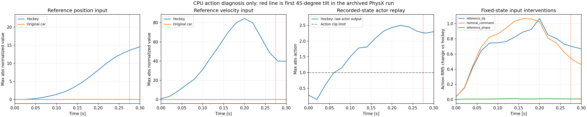
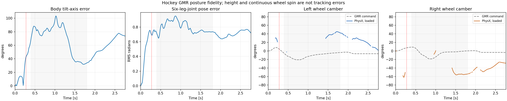

# Hockey-stop failure: the car stabilizer receives unfamiliar reference inputs

**Completed:** both approved physical interventions have now finished. The
[reviewed results and four-panel animation](../hockey_stop_conditioning_physx_20261027_v1/README.md)
show delayed instability, but neither case completes the hockey stop. Queue and
preflight statements below describe the historical preparation snapshots.

The archived hockey rollout and the original car baseline start from **bit-identical
physical states**. Their first 51D actor observations differ only in the six
reference leg-velocity fields (columns 6–11). Replacing only those fields with the
original car reference restores the car's first clipped action to **1.49e-8** on
the same CPU implementation. This isolates the first-action difference; it does
not yet prove the cause of the subsequent closed-loop fall.



The frozen actor reproduces all archived hockey and car actions to a maximum
absolute error of **1.06e-6**. No simulation, retraining or model-weight change was
performed in this audit. The [previous physical result](../hockey_stop_physx_probe_20261026_v2/README.md)
remains the authoritative hockey outcome: first tilt >=45 degrees at 0.275 s,
before intended braking at 0.4 s, and no completed stable stop.

| Time | Largest normalized reference position | Largest normalized reference velocity | Largest raw action |
|---|---:|---:|---:|
| 0.00 s | 0.021 | 0.88 | 0.28 |
| 0.04 s | 0.147 | 8.62 | 0.60 |
| 0.10 s | 1.40 | **31.35** | **1.50** |
| 0.20 s | 8.15 | **84.27** | **2.43** |

The normalization is `(x - mean)/(std + 0.01)`, applied exactly once by the saved
actor. These numbers are **normalized magnitudes, not standard-deviation counts**.
Training-distribution quantiles were not available. The small normalization scales
and contrast with the original reference indicate a substantial conditioning
change; the table alone is not a statistical out-of-distribution certificate.
The controller clips actions to [-1,1]. Changing the motion from 349 to 139 frames
also speeds up its phase input by **2.522x**. A separate phase-only intervention
has much smaller fixed-state action changes in this early window.

The initial blend uses sampled finite-difference velocities. Its first reference
velocity is nonzero despite the continuous quintic blend having zero derivative
at its endpoint. Correcting only that first sample would not remove the large
velocity inputs in the following samples. The useful next comparison therefore
tests the conditioning interface, rather than assuming a single endpoint edit
will reproduce the whole stop.

## Prepared physical interventions

Two 139-control-step, single-environment PhysX cases are prepared at the same
400/50 Hz and mu=0.7, with exactly the same hockey geometry/trajectory, initial
state, actor, normalization, action clipping, PD gains and wheel torque mapping:

| Case | PPO input change | What it tests |
|---|---|---|
| `reference_dq` | Replace columns 6–11 with the original car reference velocities at the same elapsed control time | Whether unfamiliar reference velocities contribute to early support loss |
| `nominal_command` | Replace columns 0–13 with the original car q/dq and original 349-frame phase clock | Whether the old PPO can supply useful stabilization while insulated from the new joint-conditioning sequence |

All actual state fields, relative anchor-pose inputs and previous actions remain
unaltered. The adapter changes only the specified reference fields before the
actor call. The engine then archives the **actual adapted actor input**, not the
unadapted vector. Weights and the normalization statistics are unchanged. There
are no external tire forces, in-trajectory pose writes, training or MPPI residuals.

These interventions change the controller and must be labeled. The nominal-command
case is **not by itself a reproduction of the GMR pose**. Both cases must still be
evaluated against the unchanged hockey target, including support, XY/speed,
body/wheel headings, beta, loaded contact-material velocity, friction utilization
and dissipation. Improved posture stability alone is not task success. If this
establishes a useful stabilizer, subsequent residual optimization must recover
the hockey motion and its stop rather than substituting an ordinary car turn.

The adapter passed three focused contract tests and was replayed on all 139
archived observations in each mode. State/previous-action columns stayed
bit-identical, and action differences from the independent intervention calculation
were at most **1.08e-6**. These are CPU checks; closed-loop improvement is unverified.

## Execution status and reproduction

The user **approved this exact new bundle and both interventions**. The archive
was uploaded and hash-verified at the destination below. All eight RTX GPUs had
other processes, so a CPU-only waiter is queued for up to one hour; no new physics
had started at the archived [status snapshot](queue_evidence.json). The waiter PID
and start-tick identity were verified live. It checks every 30 seconds and invokes
the approved dispatcher once an idle GPU exists; the dispatcher independently
checks again before each job. A failed physics job is not retried. Other users'
processes remain untouched. Preparation-status fields inside the immutable payload
manifest describe its packaging time, not the current authorization state.

The [payload manifest](probe_payload_manifest.json) lists eight code/configuration/
derived-data files, 116,248 bytes, plus the manifest. There are no models, weights,
credentials or original RGB. Archive SHA-256:
`94555eff1ae646cb3edd1166a8ef378f1ef573d6570f0962f61e98fa1f8a487c`.

The wrapper writes its provenance into the engine report **before** Kit shutdown,
so it does not depend on post-shutdown code returning. The unmodified engine and
contact instrumentation remain pinned to their earlier hashes. Neither legacy
inline cost nor its `short_smoke_only` label is used to qualify a hockey stop.

```bash
# Requires the already authorized frozen actor locally; it stays outside Git.
CUDA_VISIBLE_DEVICES='' python scripts/audit_hockey_policy_conditioning.py \
  --actor /path/to/actor_normalized.pt --output /tmp/hockey-conditioning-audit

# Run in the Torch environment.
CUDA_VISIBLE_DEVICES='' python tests/test_hockey_conditioning_adapter.py

# Package only. Does not upload or start physics.
python scripts/package_hockey_conditioning_probe.py \
  --output /tmp/hockey-conditioning-bundle
```

[report.json](report.json) records source/actor/trace hashes and intervention
metrics. [interventions.npz](interventions.npz) contains normalized inputs and
counterfactual action outputs; these are not new dynamic trajectories.
[adapter_preflight.json](adapter_preflight.json) records real-actor CPU checks.
[pending_launch.json](pending_launch.json) records the exact proposed remote
arguments and destinations. The complete public-source motion and previous jump
demonstrations remain unchanged.

The independent evaluator additionally reconstructs **all 51 actual actor-input
fields** from pre-action physical states, the unchanged hockey target and, when
applicable, `--conditioning-table`. This checks that the adapter does not filter
or substitute velocities, poses or previous actions. The existing hockey trace
matches within 1.26e-6; a deliberately changed state field is rejected. Twenty-two
evaluator tests passed at the input-audit stage. The physical hockey success criteria remain unchanged.

## Posture fidelity in the original failed run

The subsequent [pose audit](baseline_posture_fidelity/report.json) compares all
six leg joints, the body up axis and both signed wheel cambers with the unchanged
GMR command. It uses linear joint interpolation and quaternion Slerp on the native
clock. Root height and continuous wheel spin are not penalized. The independent
evaluator now reports these diagnostics for future input-intervention runs too;
the existing stop thresholds have not been changed or replaced by a pose score.



| Window in original run | Leg-joint RMS error | Body up-axis RMS error | Loaded camber RMS, left / right |
|---|---:|---:|---:|
| Before first 45-degree tilt | 0.536 rad | 16.60 degrees | 20.20 / 55.17 degrees |
| Declared braking, 0.4–1.8 s | 0.802 rad | 72.82 degrees | 44.35 / 49.41 degrees |

There are **zero braking samples before the first tilt diagnostic**. The second
row therefore describes an already destabilized trajectory. These numbers do not
prove that reference conditioning is the sole cause; they show that the existing
failed motion also lacks posture fidelity. Merely retaining a familiar car stance
in the new nominal-command intervention must not be called hockey imitation.
No new GPU rollout was used for this analysis.

Twenty-four evaluator tests now pass, including invariance to root-height offsets
and wheel spin, and separation of pre-instability versus later braking samples.
Reproduce the pose audit with:

```bash
python scripts/analyze_hockey_posture_fidelity.py \
  --run-dir results/hockey_stop_physx_probe_20261026_v2/evidence/probes_v2/baseline \
  --qualification results/hockey_stop_physx_probe_20261026_v2/qualification \
  --command-dir results/hockey_stop_evaluation_audit_20261026_v1/physx_command_v2 \
  --output /tmp/hockey-baseline-posture
```

## Automatic retrieval and comparison

The local [collector](../../scripts/collect_hockey_conditioning_results.py) now
watches the identity-verified remote queue. It launches **no physics**. After both
approved cases complete, it verifies and retrieves the original reports/buffers,
runs independent stop/contact/input/posture analysis, and renders the historical
baseline plus both interventions with a common XY extent and fixed follow cameras.
Failed or partial jobs cannot produce a complete comparison; no physics retry is
performed. Queue expiry is recorded as such, not as a simulated failure.

[Collection readiness tests and render preflight](collection_pipeline_preflight.json)
cover incomplete-job rejection and the generic renderer on 139 existing baseline
frames. The preflight contains **no new intervention trajectory**. The running
collector's local output is `outputs/hockey_conditioning_results_20261027_v1/`;
`comparison.json` appears only after all analysis/rendering succeeds and still
requires interpretation before any task-success or goal-completion claim.
