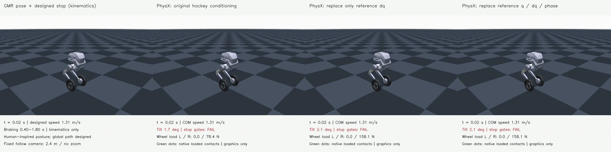
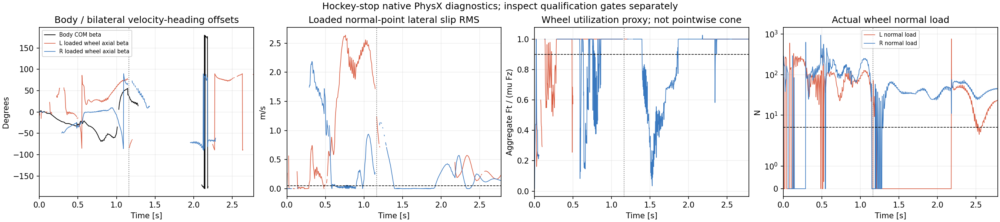

# Hockey stop: conditioning interventions improve support but do not complete the task

Both approved PhysX probes completed. Replacing only the reference leg velocities
delayed the first 45-degree body tilt from **0.275 s to 1.1625 s**, reduced XY RMSE
from **0.722 m to 0.371 m**, and produced a **0.5275 s loaded lateral-sliding event
before that tilt**. Neither intervention completed a stable hockey stop. Replacing
all joint-reference and phase inputs delayed tilt further but worsened XY tracking.

[Full-resolution four-panel animation](comparison_render/hockey_conditioning_fullbody_4x1.mp4)



Left to right: GMR posture with a designed stop path; original hockey inputs;
car-reference dq only; car-reference q/dq/phase. All panels retain the same clock,
fixed 2.4 m follow distance, azimuth/elevation and root-relative camera offset.
No zoom, pose correction or physics replay is used to compose this display.
MuJoCo supplies mesh graphics only; the three dynamic trajectories are PhysX.

| Controller input | First tilt >=45 degrees | XY RMSE | At least one wheel loaded | Longest support gap | Stable terminal stop |
|---|---:|---:|---:|---:|---:|
| Original hockey reference | 0.2750 s | 0.722 m | 49.9% | 492.5 ms | 0 s |
| Replace reference dq only | 1.1625 s | 0.371 m | 95.5% | 20.0 ms | 0 s |
| Replace reference q/dq/phase | 1.5000 s | 0.895 m | 81.8% | 315.0 ms | 0 s |

Load means wheel normal force >5 N, measured at every 2.5 ms physics step. Support
statistics cover the original command after the initial 20 ms. The 95.5% result
still fails the continuous-support criterion. Tilt is an instability diagnostic,
not a height constraint or a timestamp of first body-ground collision. Every
trajectory also fails the fixed XY, heading and upright terminal-stop gates.
These are one rollout per condition, not statistical performance estimates.

## What changed

The same frozen car-trained PPO, hockey target, initial state, native collision
geometry, actuator mapping and mu=0.7 are used at 400 Hz physics / 50 Hz control.
There is no new training, residual search, external tire force or trajectory-state
overwrite. The historical baseline is reused; only the two approved probes ran.

`reference_dq` replaces observation columns 6–11 with the original car-reference
joint velocities at the same elapsed time. `nominal_command` replaces columns
0–13 with car-reference joint positions/velocities and its original phase clock.
All measured-state, relative-anchor and previous-action inputs remain unchanged.
The evaluator reconstructed all 51 actual input fields for all 139 control steps;
maximum errors were 1.26e-6, 2.27e-6 and 8.71e-7 respectively, below 5e-5.

Both interventions are still scored against the original hockey target. The
reference uses human-inspired GMR posture and a designed global stop path; it is
not a metrically calibrated reconstruction of the human's stopping distance.
The changed inputs help isolate the conditioning problem, but this does not prove
that conditioning is the sole cause of failure or that the old car stance imitates
the hockey posture. Braking-window leg-joint error for `reference_dq` remains
0.771 rad, versus 0.802 rad for the already unstable baseline.

## Sliding before instability

In `reference_dq`, the left wheel satisfies the combined sliding screen from
**0.6175–1.145 s** (211 completed physics steps, 0.5275 s), before the first
45-degree tilt at 1.1625 s. The first recorded endpoint is 0.6200 s; event start
includes that endpoint's preceding 2.5 ms interval.

| Left-wheel quantity over this event | Minimum | Median | Maximum |
|---|---:|---:|---:|
| Normal force | 21.85 N | 75.03 N | 129.71 N |
| Loaded contact-material lateral speed, RMS | 0.801 m/s | 2.217 m/s | 2.638 m/s |
| Aggregate friction utilization | 0.9999999 | 1.0000001 | 1.0000003 |
| Wheel axial beta | 20.12 degrees | 30.78 degrees | 78.19 degrees |
| Aggregate anchor force-velocity power proxy | -607.75 W | -291.50 W | -41.90 W |

Each sample also has a friction anchor with lateral slip and opposing lateral
force at that same anchor. Thus the evidence includes support, actual material
sliding, force saturation and dissipative force direction, rather than beta alone.
The right wheel's longest qualifying pre-instability event is 0.140 s.

The utilization is a **wheel-aggregate** tangential-force/normal-force ratio.
Normal force cannot be assigned to each friction anchor with the available API,
so this is not a pointwise friction-cone certificate. Power pairs completed-step
forces with post-step velocities and is a dissipation proxy, not exact work.
The baseline's later qualifying intervals occur after its first instability and
must not be presented as controlled pre-fall hockey sliding.

Detailed synchronized posture / XY / contact animations:

- [Original hockey conditioning](render/baseline/hockey_command_physx_xy_contact_4x1.mp4)
- [Reference dq replacement](render/reference_dq/hockey_command_physx_xy_contact_4x1.mp4)
- [Reference q/dq/phase replacement](render/nominal_command/hockey_command_physx_xy_contact_4x1.mp4)



All three detailed animations use the same XY bounds and diagnostic axis limits.
The full diagnostic curves may include post-instability data; the red line marks
the first 45-degree tilt. The combined evidence does not yet establish a usable
physical reference for successful hockey imitation.

## Evidence and reproduction

The approved jobs ran sequentially on freshly idle GPUs 0 and 4, one environment
and 139 control steps each, returning code 0. No other processes were stopped.
The [raw manifest](evidence/evidence_manifest.json) verifies all 26 returned files.
The return-archive SHA-256 is
`6d5eb7633de7bb1a0413c68459f680a5a3f0a5d8cb3bd6891a54a3c04b86d76d`.
Original reports, source snapshots, native buffers and traces are unchanged.
Models, weights, credentials and source RGB are absent.

[comparison.json](comparison.json) contains the complete metrics.
[review.json](review.json) records artifact hashes and verification.
The collector's archived `requires_review` status is its completion-time status;
this report supplies the subsequent review. The generated `reference_candidate.npz`
files are unqualified engine outputs, not accepted training references.

```bash
# Repository root; requires NumPy, SciPy and Matplotlib. No new simulation.
python scripts/evaluate_hockey_physx.py \
  --run-dir results/hockey_stop_conditioning_physx_20261027_v1/evidence/conditioning_probes_v1/reference_dq \
  --command-dir results/hockey_stop_evaluation_audit_20261026_v1/physx_command_v2 \
  --conditioning-table results/hockey_stop_conditioning_physx_20261027_v1/evidence/source_snapshot_v1/nominal_conditioning.npz \
  --output /tmp/hockey-dq-evaluation

# Compose the three archived videos; requires OpenCV, NumPy and FFmpeg.
python scripts/render_hockey_conditioning_comparison.py \
  --result results/hockey_stop_conditioning_physx_20261027_v1 \
  --output /tmp/hockey-condition-comparison --ffmpeg /path/to/ffmpeg
```

See the [conditioning audit](../hockey_stop_conditioning_audit_20261027_v1/README.md)
for the pinned adapter, reference table, approved payload and CPU first-action
diagnosis. The next modeling/control decision remains open; no additional physics
or training was launched while reviewing these results.
