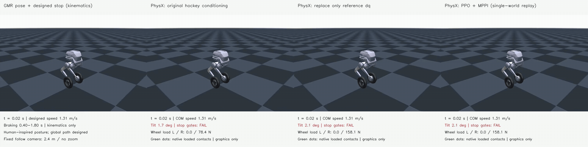
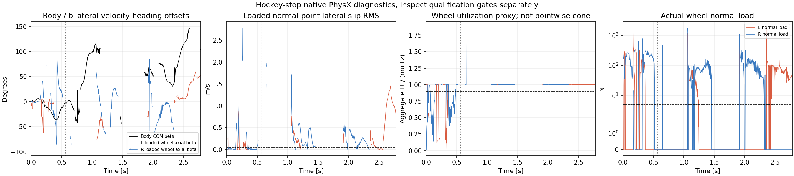

# Hockey MPPI: lower XY error, earlier loss of stability

The approved smoke check, six-update native PhysX MPPI search, and independent
single-environment validation all completed. **The hockey stop still fails.**
Compared with the previous dq-conditioned PPO, MPPI reduces XY RMSE from 0.371 m
to **0.214 m**, but advances the first 45-degree body tilt from 1.163 s to
**0.565 s** and reduces wheel-support coverage from 95.5% to **60.3%**.
The exported candidate is not admitted as a successful imitation reference.

[Full-resolution four-panel animation](comparison_render/hockey_mppi_fullbody_4x1.mp4)



Left to right: GMR posture with the designed stop path, original hockey-conditioned
PPO, dq-conditioned PPO, and PPO plus MPPI in the separate single-world validation.
All panels retain the same time, camera distance and relative offset. These are
PhysX dynamics; MuJoCo supplies mesh graphics only. The reference is human-inspired
posture with a designed global path, not a calibrated human stopping distance.

| Result at mu=0.7 | Original PPO | dq-conditioned PPO | PPO + MPPI validation |
|---|---:|---:|---:|
| XY RMSE | 0.722 m | 0.371 m | **0.214 m** |
| Peak XY error | 1.171 m | 0.513 m | 0.372 m |
| First body tilt >=45 degrees | 0.275 s | **1.163 s** | 0.565 s |
| At least one wheel loaded | 49.9% | **95.5%** | 60.3% |
| Longest support gap | 492.5 ms | **20.0 ms** | 455.0 ms |
| Entry speed | 0.715 m/s | 1.797 m/s | 1.295 m/s |
| Approach speed ratio | 1.006 | 1.175 | **0.984** |
| Braking body-heading RMSE | 78.69 degrees | 129.36 degrees | 73.78 degrees |
| Loaded braking wheel-heading RMSE | 58.12 degrees | 46.06 degrees | 43.27 degrees |
| Braking leg-joint RMSE | 0.802 rad | 0.771 rad | **0.487 rad** |
| Braking body up-axis RMSE | 72.82 degrees | **38.25 degrees** | 65.38 degrees |
| Upright supported terminal stop | 0 s | 0 s | 0 s |

Load means normal force >5 N. The tilt timestamp is an instability diagnostic,
not first body-floor collision. Improved leg-joint tracking does not establish
whole-body imitation: body orientation and support deteriorated. The new run
passes the entry-speed and approach-speed checks, but fails XY, heading,
continuous support, sustained sliding, terminal stop and whole-task tilt checks.
No absolute height limit or two-wheel support requirement was introduced.

## Beta and friction evidence before instability

During declared braking and before the first tilt, the left wheel has no loaded
samples. The right wheel has a **22.5 ms** continuous event at **0.4950–0.5175 s**
with normal load, lateral material slip, aggregate friction utilization near 1,
negative force-velocity power, and opposing lateral force at the same friction
anchor. There is also a separate 2.5 ms event at 0.5200–0.5225 s.

Adding the moving-wheel **abs(axial beta) >=20 degrees** condition leaves only
**2.5 ms**, at 0.4950–0.4975 s. This is below the unchanged 50 ms hockey criterion.
Thus there is short physical saturated sliding before instability, but no
sustained high-beta loaded skid. The previous dq-only case had a 527.5 ms
qualifying left-wheel event before its own first tilt.

[Cumulative contact-condition analysis](failure_analysis.json) separates load,
material slip, saturation, dissipation, same-anchor opposition and beta.
The force ratio is wheel-aggregate; per-anchor normal forces are unavailable,
so this is **not a pointwise friction-cone certificate**. Power pairs completed-step
forces with post-step velocities and is a dissipation proxy rather than exact work.

[Synchronized full-body, XY and contact animation](render/mppi_validation/hockey_command_physx_xy_contact_4x1.mp4)



## Search behavior and limits

This is PPO-assisted physical trajectory generation with the frozen car actor,
not a new hockey-trained policy or an independent pure-model controller. The
[prepared method](../hockey_stop_mppi_preflight_20261027_v1/README.md) changes
residual clipping, terminal control authority, initialization and planning cost
together. This experiment does not isolate the contribution of each change.
The native rigid-cylinder Coulomb law, mu=0.7, 400/50 Hz clocks, motor interface,
hockey target and independent qualification thresholds remain unchanged.

The final mean costs **59.19** in search world 0 and **74.13** in the separate
single-world validation. Across 64 final-mean clones, costs span **54.34–100.74**
(median 65.09). Even the zero-residual baseline clones differ by up to **0.171 m
in a root-position component**. These results reveal sensitivity across native
rollouts; they do not identify whether origin precision, contact/reset state or
closed-loop amplification is responsible. The single-world validation governs
the outcome, not the most favorable clone or sampled candidate.

The importance-weight effective sample size ranges from 1.00 to 1.98 for 63
samples, so updates are strongly concentrated. A lower weighted cost can still
trade support and posture against tracking. This run therefore does not justify
claiming that larger sample counts alone will solve the stop. Contact stability
and rollout consistency remain unresolved. Each condition is a single trial.

## Verification and reproduction

All three jobs ran serially on GPU 3, independently verified idle before each
launch. Reported runner times were about 5.5 s, 91.0 s and 14.3 s respectively;
these include environment setup but exclude Kit application startup. No retry, training or additional
physics job was launched. All [46 returned files](evidence/evidence_manifest.json)
were hash-verified. Return-archive SHA-256:
`d3e3ff3d019333e64f9097da42c1e4d1839b84fa868294ba9b5d9915d77d3eac`.

The independent evaluator reconstructs all **1,112 physics substeps** from raw
native contact buffers. The [control replay](control_replay/report.json) verifies
all 139 applied actions against the frozen actor and saved MPPI plan with maximum
error **9.72e-7**. All 51 actor inputs are reconstructed from actual pre-action
states. The [qualification](qualification/mppi_validation/report.json),
[posture report](posture/mppi_validation/report.json), [comparison](comparison.json)
and [artifact review](review.json) retain the failed gates and provenance.
No models, weights, credentials or original source video are published.

Use the CPU replay and evaluation commands in the
[preflight documentation](../hockey_stop_mppi_preflight_20261027_v1/README.md),
pointing `--run-dir` at this result's `evidence/search_v1/validation` and
`--search-source` at `evidence/source_snapshot_v1`. Recompose the archived videos:

```bash
python scripts/render_hockey_conditioning_comparison.py \
  --result results/hockey_stop_physx_mppi_20261027_v1 \
  --cases baseline reference_dq mppi_validation \
  --basename hockey_mppi_fullbody_4x1 \
  --output /tmp/hockey-mppi-comparison --ffmpeg /path/to/ffmpeg
```
