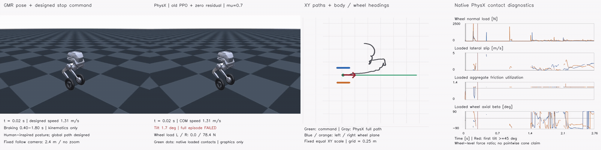

# Hockey-stop PhysX probe: sliding observed, controlled stop failed

The corrected v2 command was executed in native PhysX at **400 Hz physics / 50 Hz
control, mu = 0.7**. Both approved jobs completed: 16 control steps for the smoke
test, then 139 steps for the full command. Each used one environment on GPU 3,
which had no reported compute or graphics processes immediately before launch.
This is the **existing car PPO stabilizer with zero residual**, with no training,
MPPI search, external tire forces or in-trajectory state resets.

The robot lost stability before planned braking. This run does **not** demonstrate
a successful hockey stop or establish that the task is physically impossible.



[Full-resolution 4x1 video](render/hockey_command_physx_xy_contact_4x1.mp4) ·
[Early contact detail](pre_braking_contact_4x1.png) ·
[Full contact/beta plot](qualification/contact_beta_4x1.png) ·
[Machine-readable qualification](qualification/report.json)

The two mesh views use the same fixed 2.4 m camera distance, azimuth and elevation.
They follow the respective root with a fixed offset and never zoom. The XY panel
uses equal, fixed axis scales and displays body and both wheel-plane headings.
Green dots show native normal points carrying more than 5 N. MuJoCo supplies
graphics/FK only; no physics is rerun or pose corrected. All 1,113 native poses
were checked against recorded wheel origins: maximum error **0.69 micrometers**.
The public video contains no original source RGB or licensed body-model assets.

## Outcome

| Measure | Full-command result |
|---|---:|
| Designed approach speed | 1.307 m/s |
| Planned braking interval | 0.40–1.80 s |
| First body tilt >= 45 degrees | **0.275 s**, before braking |
| Mean speed in final 0.1 s before braking | 0.715 m/s |
| XY RMSE / peak error | **0.722 / 1.171 m** |
| At least one wheel carrying > 5 N | **49.9%** of evaluated physical intervals |
| Longest gap in wheel support | **0.493 s** |
| Braking body / loaded wheel-heading RMSE | 78.69 / 58.12 degrees |
| Final speed at reference end, 2.76 s | 0.351 m/s |
| Final upright, wheel-supported stop hold | **0 s** |

The mean approach-speed ratio is 1.006 and passes its aggregate screen, but it
conceals the subsequent instability: the robot initially accelerates, then loses
speed before braking. The separate entry-speed and stability gates fail. There is
no absolute height failure criterion. One wheel may lift; both losing support
violates the requested continuous-support condition. These wheel-load recordings
do not rule out contact by other robot bodies after falling.

## Sliding and friction evidence

Before the first 45-degree tilt, the longest continuous **same-wheel** episodes
combining load, lateral contact-material velocity, near-saturation force and
opposing dissipative anchor force were:

| Pre-instability episode | Left | Right |
|---|---:|---:|
| Time interval | 0.215–0.2325 s | 0.180–0.2125 s |
| Duration | **17.5 ms** | **32.5 ms** |
| Lateral material-speed RMS | 0.102–1.178 m/s | 0.434–1.779 m/s |
| Aggregate friction utilization | 0.996–1.042 | approximately 1.000 |
| Wheel normal force | 22.8–157.0 N | **242.6–2,468.6 N** |

Adding the axial wheel-beta condition, |beta| >= 20 degrees at wheel COM speed
>= 0.25 m/s, reduces the longest pre-instability left event to **2.5 ms**; the right
event remains **32.5 ms**. Neither reaches the prospective 50 ms criterion and
both precede the declared braking phase. These are short, impact-associated
sliding episodes, not evidence of smooth controlled stopping.

Later, after initial instability, the robot briefly returns below 45 degrees and
produces 72.5 / 75.0 ms left/right events within the braking interval. The frozen
evaluator's instantaneous sliding subgate therefore passes, while its whole-task
tilt and other gates fail. These later events are explicitly separated in
[phase_summary.json](phase_summary.json); they must not be advertised as
pre-fall hockey-stop success.

The analysis reconstructs all **1,112 physical-step** native buffers. Maximum
differences from recorded readback are 1.91e-6 N for normal load, 3.01e-6 m/s for
lateral RMS and 4.17e-4 W for anchor power. The smoke/full-run initial root
positions are bit-identical across their common 129 states.

The reported ratio is `norm(sum F_anchor_XY) / (mu * sum normal_Fz)`, screened
within [0.9, 1.05]. It is **wheel-level friction evidence**, not a pointwise cone
certificate: native friction anchors have no individually assigned normal load.
Anchor power pairs force and material velocity at the same spatial anchor, but
uses completed-step force and post-step velocity; it is a power proxy rather than
exact step work. Large beta alone does not prove loaded sliding, and large impact
power is not a total-energy or tire-model validation.

## Interpretation and next experimental change

This baseline first loses wheel support at the interval beginning 0.020 s and
crosses the tilt diagnostic at 0.275 s, during the 0.3 s initial posture blend.
It fails before the intended stop. The old car actor is operating on an unfamiliar
pose sequence and has no explicit desired braking-velocity command. This limits
what can be inferred from this probe; it does not isolate friction as the cause.

The next useful experiment is to establish a supported moving approach before
introducing the hockey pose blend, then test stopping residuals on that stable
approach. That is a proposed follow-up, **not an additional run performed here**.
The approved two-job scope is exhausted. The command's global path and metric
speed are designed; the public video supplied posture guidance, not calibrated
human stopping distance or blade-force measurements.

## Reproduce the analysis and rendering

All received reports, traces, logs and the six-file source payload are retained
unchanged under [evidence](evidence). The frozen engine and helper sources are
already versioned in the earlier
[PhysX reference experiment](../physx_policy_mppi_reference_20261025_v1/evidence/source_snapshot_v2/).
The command and wheel-geometry audit are in the
[preceding preparation](../hockey_stop_evaluation_audit_20261026_v1/README.md).

```bash
python scripts/evaluate_hockey_physx.py \
  --run-dir results/hockey_stop_physx_probe_20261026_v2/evidence/probes_v2/baseline \
  --command-dir results/hockey_stop_evaluation_audit_20261026_v1/physx_command_v2 \
  --execution-evidence results/hockey_stop_physx_probe_20261026_v2/evidence \
  --output /tmp/hockey-qualification-new

python scripts/summarize_hockey_physx_probe.py \
  --result results/hockey_stop_physx_probe_20261026_v2

MUJOCO_GL=osmesa python scripts/render_hockey_physx_probe.py \
  --result results/hockey_stop_physx_probe_20261026_v2 \
  --command-dir results/hockey_stop_evaluation_audit_20261026_v1/physx_command_v2 \
  --model /path/to/WF_TRON1A/mujoco/robot.xml \
  --output /tmp/hockey-render-new --ffmpeg /path/to/ffmpeg

python -m pytest -q tests/test_evaluate_hockey_physx.py
```

The evaluator's 21 tests pass, including launch/report tamper rejection. The local
render requires the hash-matched TRON1 mesh assets; they are not copied here.

The frozen engine writes its report before Kit shutdown. The wrapper's post-run
annotations did not execute, so the raw reports omit `hockey_wrapper_sha256`.
Also, the old engine labels all runs under 201 steps `short_smoke_only`, including
this complete 139-step command. Neither is treated as physical success/failure.
The local evaluator instead verifies the unchanged report against the dispatcher
record, archived exact wrapper/payload and all artifact hashes. It then applies
the previously specified hockey criteria. No missing field was fabricated in the
original reports and no additional physics run was needed.

Approved upload SHA-256:
`fc87c10983c54ca74900fab66e86d498eb0e66def04e7b6a4cfffa5b12d3642c`.
Returned evidence archive SHA-256:
`8a1279b41333afe163c4760610cabfbc387db1e8e7becda49676313da845499c`.
The local experiment date is 2026-10-26; remote UTC logs begin on 2026-10-27.
