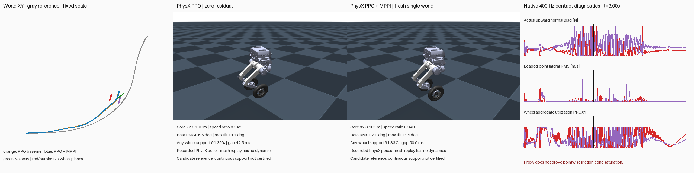

# PhysX reference generation with PPO feedback and MPPI residuals

The reference generator now runs full TRON1 dynamics in **PhysX**. A fixed PPO
policy provides feedback; MPPI searches smooth, independent residual commands
for all six leg joints and both wheels. This is **PPO-assisted reference
generation**, not an independent pure-model controller comparison.

This pilot generated a complete 6.98 s dynamic candidate at μ=0.7. It did **not**
produce an accepted stable-contact reference. The small core tracking change
does not establish an MPPI improvement: contact gaps and angular jitter remain,
and identical baseline controls diverged between parallel worlds.

[Four horizontal panels, fixed relative cameras](render_v1/physx_reference_4x1.mp4)



## Results

Both rows below are fresh, separate **single-world** PhysX evaluations with the
same initial state. The baseline is the existing **S** PPO policy with zero
residual, not the original earlier PPO. These are exploratory N=1 results.
The authoritative statistics are [analysis_v3.json](analysis_v3.json).

| Measurement | PPO, zero residual | PPO + MPPI final mean |
|---|---:|---:|
| Core XY RMSE | 0.1835 m | 0.1810 m |
| Whole-reference XY RMSE | 0.1551 m | 0.1728 m |
| Core mean speed / reference speed | 94.21% | 94.80% |
| Core β RMSE against intended nonzero β | 6.48° | 7.16° |
| Any-wheel support, 0.02–6.96 s | 91.39% | 91.83% |
| Longest no-support gap | 42.5 ms | 50.0 ms |
| Core angular XY RMS, 10 < f < 100 Hz | 0.672 rad/s | 0.766 rad/s |
| Longest left-wheel aggregate sliding corroboration | 35 ms | 65 ms |

The MPPI candidate's angular high-frequency RMS is **14.0% higher**. Neither
trajectory passes the existing 0.15 m XY, ≥95% speed retention, and continuous
any-wheel support screens together. Height is free; neither wheel must remain
individually loaded. No additional policy training or friction sweep occurred.

The left-wheel 65 ms event is **3.185–3.250 s**. At every sampled step, that same
wheel has upward normal load >5 N, actual-contact lateral RMS speed >0.05 m/s,
wheel aggregate friction utilization ≥0.9, and negative sampled anchor power;
COM speed is ≥0.25 m/s. No contact gaps or different wheels are joined. This is
**wheel-level corroboration**, not a certified pointwise friction-cone event.

## What was simulated and optimized

- Original TRON1 USD, floating base, native rigid-cylinder Coulomb contact.
  Normal loads are PhysX outputs, not prescribed `mg/2` or optimization inputs.
- Actual physics at 400 Hz; PPO/action commands at 50 Hz, held for eight steps.
- μ_static = μ_dynamic = 0.7 on robot shapes; floor coefficients 1; multiply
  combination; restitution 0. Native material readbacks are archived.
- Original leg PD 500/10, 80 Nm / 15 rad/s DC motor envelope; wheels 12 Nm /
  100 rad/s envelope. No motor change or additional external tire force.
- Existing S policy, frozen observation normalization included once, 51 inputs,
  eight outputs. Reference conditioning remains the existing independent-camber
  motion. No new GMR/IK fit is involved in this dynamic generation step.
- Four MPPI iterations, 16 Gaussian proposals plus a mean-plan diagnostic world,
  12 residual knots × eight channels, fixed covariance and temperature 0.5.
  Smoothstep interpolation and a sine-squared endpoint envelope are applied to
  residual commands. Left/right commands are independent.

The command is `a = clip(PPO(obs) + residual(t), -1, 1)`. The original action
interface then produces leg targets `q0 + a_leg` and wheel torque requests
`12*a_wheel`, subject to the unchanged DC motor limits. MPPI optimizes complete
continuous trajectories, with one initialization per rollout and **no state
writes during the trajectory**. It never resets a predictor every 20 ms.

All finite Gaussian samples contribute using the existing MPPI importance
ratio and final weighted-mean update; the diagnostic mean world is excluded
from the Gaussian population. The final mean is freshly simulated and exported,
not replaced by a best sample. Planning costs explicitly cover XY, COM speed,
nonzero β, upright posture, every-substep any-wheel support and action changes.
They are **new planning costs**, not the PPO reward or a matched-reward study.
There is no absolute-height target or wheel-XY tracking cost.

The nominal search took approximately 139 s after AppLauncher setup on one
initially idle RTX GPU. Search, final single-world evaluation and single-world
baseline evaluation were run serially. Other users' processes were untouched.

## Contact evidence and remaining modeling limits

Actual loaded normal points supply lateral slip using
`v_point = v_COM + omega × (point - COM)` and the wheel's projected local +Y
axle. Friction forces and their reported anchors come separately from native
`RigidContactView.get_friction_data(dt)`.

The wheel-level proxy is `norm(sum F_anchor_XY)/(mu*sum F_normal_Z)`. No normal
load is invented for an individual friction anchor. Normal points and friction
anchors lack a verified correspondence in the recorded API, so slip at one
point and saturation elsewhere on a wheel must not be presented as a same-point
friction-cone proof. See NVIDIA's [contact tensor API](https://docs.omniverse.nvidia.com/kit/docs/omni_physics/107.0/extensions/runtime/source/omni.physics.tensors/docs/api/python.html).

Anchor power pairs force and material velocity at the **same reported anchor**,
but uses a dt-averaged force and post-step velocity. Its rectangular time
integral is a proxy, not exact discrete contact work or a passivity certificate.
The candidate right wheel's core integral is slightly positive (~0.121 J);
force timing, impulse work and friction-anchor history need diagnosis before
claiming model-level dissipation. Native cylinder contact is not a calibrated
automotive tire model, and this run introduces no unqualified camber-thrust law.

All **2,792 physical samples × both wheels**, for both single-world episodes,
were independently reduced again in NumPy from archived native buffers. Maximum
candidate discrepancies were 3.06e-5 N in normal force, 1.20e-7 m/s in lateral
RMS, and 1.23e-4 W in sampled anchor power. This verifies the recorded arithmetic,
not the missing point-to-anchor correspondence or physical tire calibration.

Identical zero-residual controls across 17 batch worlds developed up to **1.782 m**
root-position spread. Therefore the Gaussian search costs contain world/reset
variability. The final mean differs from its fresh single-world rollout by up to
0.0234 m. MPPI effective sample sizes also fell from 8.36 to 1.10 over the four
updates. Before treating this as a reliable optimizer, isolate clone/reset and
world-origin sensitivity, compare repeated same-world costs, and establish a
repeatable candidate evaluation protocol. These are computational validation
issues, not grounds to relax task or sliding criteria.

## Artifacts and reproduction

- [Dynamic reference candidate](evidence/validation_v1/reference_candidate.npz):
  349 frames, 50 Hz; named joint positions/velocities, all native body link
  positions/quaternions and COM linear/angular velocities. It is a **candidate**,
  not admitted policy-training data. The terminal 6.98 s state is retained in
  the 400 Hz rollout rather than appended to the 349-frame motion.
- [Final actual rollout](evidence/validation_v1/final_rollout.npz) and
  [raw native contact buffers](evidence/validation_v1/native_contact_buffers.npz).
- [Frozen runtime source](evidence/source_snapshot_v2/source_manifest.json),
  [search history](evidence/search_v1/search_history.json), native reports, exact
  launch arguments, GPU-idle audits and serial validation driver are included.
- The initial preflight correctly rejected an actor archive hash difference.
  The cached export was then checked on all 349 recorded observations: maximum
  raw-action error 4.10e-7. Its distinct archive identity is preserved; equivalence
  is only asserted on those observations, not for arbitrary states.
  [Actor verification record](actor_equivalence_audit_v1.json).

Original execution root:
`/data/zengxiong/workspaces/tron1-physx-reference-generation-20261025-v1/`.
Reuse that host's existing Isaac/PPO/assets; no models, weights or credentials
were uploaded in this experiment. Physics used frozen `source_snapshot_v2`;
later independent analysis corrects held-reference report approximations by
interpolating the locked car reference onto native times, with whole window
0–6.96 s. No simulated states are resampled or corrected.

For physics reproduction, use the recorded `*.launch.json` argument arrays
with **fresh output paths**, the pinned source snapshot and input hashes, and
a freshly audited idle physical CUDA ordinal. Run the smoke test first, then
the search, then the final-mean and zero-mean single-world validations serially.
`evidence/validate_serial.py` records the exact original validation procedure.
Do not overwrite completed evidence. The frozen runtime remains reproducible
even where current analysis/helper code has subsequently improved validation.

From the repository root, reproduce the independent analysis and graphics:

```bash
python scripts/analyze_physx_policy_mppi_reference.py \
  --search results/physx_policy_mppi_reference_20261025_v1/evidence/search_v1 \
  --validation results/physx_policy_mppi_reference_20261025_v1/evidence/validation_v1 \
  --baseline-validation results/physx_policy_mppi_reference_20261025_v1/evidence/baseline_validation_v1 \
  --reference results/contact_wheel_axis_20261025_v1/reference.npz \
  --output /tmp/physx_reference_recomputed.json

python scripts/render_physx_policy_mppi_reference.py \
  --search results/physx_policy_mppi_reference_20261025_v1/evidence/search_v1 \
  --validation results/physx_policy_mppi_reference_20261025_v1/evidence/validation_v1 \
  --baseline-validation results/physx_policy_mppi_reference_20261025_v1/evidence/baseline_validation_v1 \
  --reference results/contact_wheel_axis_20261025_v1/reference.npz \
  --model outputs/car_failure_sideslip_20261015/raw/mujoco_model.xml \
  --output-dir /tmp/physx_reference_render
```

Rendering uses MuJoCo **only for mesh/FK graphics**, with zero dynamics steps.
Both panels show recorded PhysX states. Cameras have fixed 1.9 m distance,
orientation and root-relative target offset, with no zoom. Wheel FK was checked
against recorded PhysX origins to <20 μm. The 50 Hz video cannot resolve all
400 Hz contact events; native traces are authoritative for contact continuity.

Validation: 71 CPU tests passed across the contact/search math tests and existing
MPPI tests; the PhysX smoke, complete search, two fresh single-world validations,
independent raw-buffer reduction and full 349-frame rendering completed.
