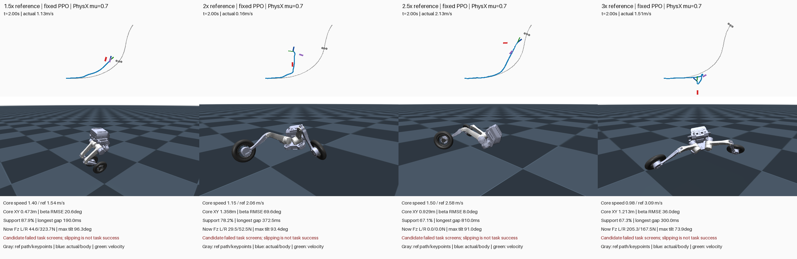

# Faster references expose the fixed PPO controller's limits

Four physically retimed references were tested in **PhysX at μ=0.7**, followed
by one bounded MPPI residual rescue at 1.5x. **None produced an accepted fast-turn
reference.** Raising the commanded speed did not reliably raise actual speed:
the existing PPO slowed down, departed from the path and lost stable support.
These results do not establish a physical speed limit for TRON1 or PhysX.

[Four speeds, real-time 4x1 video](render_v1/speed_ladder_4x1.mp4) ·
[1.5x PPO versus PPO+MPPI 4x1 video](rescue_render_v1/physx_reference_4x1.mp4)

| Requested speed scale | Core target / actual mean speed | Core XY RMSE | Any-wheel support | Longest support gap |
|---|---:|---:|---:|---:|
| 1.5x | 1.54 /1.40 m/s | 0.473 m | 87.9% | 190 ms |
| 2x | 2.06 /1.15 m/s | 1.358 m | 78.2% | 372.5 ms |
| 2.5x | 2.58 /1.50 m/s | 0.929 m | 67.1% | 810 ms |
| 3x | 3.09 /0.98 m/s | 1.213 m | 67.3% | 300 ms |
| 1.5x + serial MPPI | 1.54 /1.35 m/s | 0.492 m | 87.8% | 185 ms |

The 1.5x/2x/2.5x episodes reached >90° root tilt; the 3x episode reached 73.9°
and lost the path. Tilt is descriptive, not a new absolute-height failure gate.
All candidates already fail tracking, speed-retention or continuous-support
screens. The task still permits either wheel to lift; bilateral support is not
required. Native contact traces, not 50 Hz video, determine support continuity.

## What changed

- Fixed spatial path, existing independent-camber pose sequence, nonzero β and
  μ=0.7. Actual reference time is compressed at unchanged50Hz control/400Hz
  physics; all reference linear/angular/joint velocities scale consistently.
- Initial pose is unchanged. Initial COM and joint velocities are multiplied by
  the same factor: **preaccelerated entry**, with kinetic energy proportional
  to scale². Acceleration from rest is not tested.
- Effective scales are1.5,2,2.503597 and3, preserving both reference endpoints
  on the50Hz grid. Maximum XY resampling error is0.31–0.63 mm.
- Fixed S PPO checkpoint/normalizer, original500/10 leg PD and DC motor limits,
  native rigid-cylinder Coulomb contact. No policy training, external tire
  force, friction change or absolute-height target.

Core comparisons use the same **source-motion phase**, `[1.44/s,4/s]` seconds,
not the original unscaled time window. Support is measured from0.02s through
the retimed reference endpoint. Moving/loaded β metrics additionally require
actual COM speed≥0.25m/s and reference speed≥0.3m/s; low-speed heading is not
treated as evidence of drift.

## What the MPPI rescue established

The 1.5x rescue uses one world, 4 knots × 8 independent residual channels,
16 Gaussian proposals × 2 iterations. Candidates run sequentially in the same
PhysX environment. The full baseline and its lightweight-planning repeat had
**exactly equal cost 16.797760**. Direct normal-force-matrix reads were checked
against actual normal-point sums; proposals omit expensive telemetry, while
the same planning cost is evaluated at every400Hz step.

The deployed **final importance-weighted mean** cost was 18.990831, 13.1% worse;
it was not replaced by a lower-cost sample. Importance effective sample sizes
were only1.78 and1.63 out of16. The bounded small-sample search did not rescue
the task. Its final rollout and a fresh single-world validation matched exactly
in root/joint states, wheel forces and sampled anchor power. The independently
run PPO probe also exactly matched the search baseline. This resolves the
cross-world confound for this particular comparison, not general robustness.

The frozen 51D actor observes current base velocity, reference leg q/dq, phase
and anchor errors, but has **no explicit target root-speed input**. Retiming
changes some conditioning without training it across these speeds. The observed
braking/instability therefore motivates a speed-conditioned stabilizer or a
model-based balance layer before larger residual searches. This is a modeling
and training hypothesis; this experiment does not isolate a single cause.

## Sliding evidence and its limits

There are longer intervals with loaded-point slip and near-limit **wheel-level**
friction utilization, but that alone does not establish successful drift. For
example, the2x right-wheel270ms interval starts at1.5525s, **after** root inversion
at1.5100s. Such motion must remain a failure example.

Normal points and friction anchors are recorded separately; their pointwise
association is not verified. Aggregate utilization and sampled anchor power
are corroborating diagnostics, not a per-point friction-cone or exact energy
certificate. Raw contact buffers for all four probes and the rescue were
independently reduced again in NumPy.

At2.5x/3x, source-resolution ideal peak lateral demand scales to approximately
1.02/1.46 times μg. Differentiating the resampled50Hz velocities gives lower
peaks,0.53/0.78, because sharp curvature features are undersampled. Both are
reported; neither proves full-body friction feasibility. **Actual** retained
speed and sustained support remain necessary evidence.

Authoritative records: [speed ladder analysis](analysis_v3.json),
[rescue/repeatability analysis](rescue_analysis_v1.json), frozen source snapshots,
actual dynamic candidate NPZ files and native buffers under [evidence](evidence/).
All candidate references remain **unaccepted** for subsequent imitation training.
See [reproduction instructions](REPRODUCE.md). 78 CPU tests, two PhysX smoke tests,
four full probes, the complete serial search and fresh validation passed their
execution/data-integrity checks; task-success screens did not pass.
